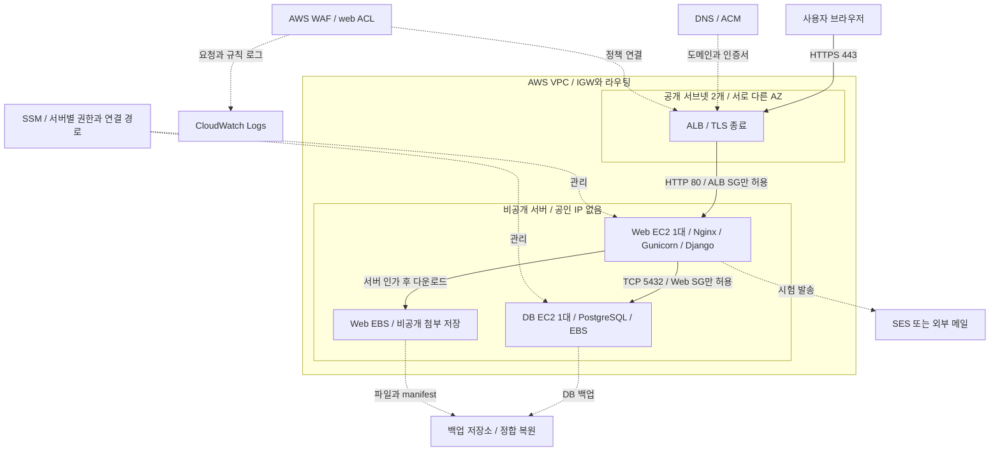

# Haven

**팀 ORCHESTRAION | 클라우드 보안 프로젝트**

**이번 주 일정·진행 상황·일일 리뷰** — [팀 진행 및 리뷰](docs/팀_진행_및_리뷰.md)

**착수·역할 분담·작업 순서:** [팀 공용 작업 목록 TASK_TODO.md](TASK_TODO.md)에서 담당, AI 지시문, 선행 조건과 검증 결과를 관리합니다.

Haven은 **AWS 기반 기록 공유 서비스와 운영자용 보안 점검 도구**를 함께 만드는 프로젝트입니다. 사용자는 자신의 기록을 특정 회원에게 읽기 전용으로 공유하고 파일을 첨부합니다. 운영자는 클라우드 설정과 요청 처리 결과를 점검해 보안 정책을 개선합니다.

> **현재 상태: 팀 검토용 계획 단계.** 아래 기능과 구성은 구현할 목표이며 구축 완료를 의미하지 않습니다. 기술 선택, 출구 방식, 예산, 담당과 일정은 팀 검토 후 확정합니다.

## 무엇을 만드는가

| 결과물 | 사용할 사람 | 제공할 기능 |
|---|---|---|
| 기록 공유 웹 서비스 | 일반 회원 | 본인 CRUD, 특정 회원 읽기 공유/해제, 비공개 첨부 업로드/다운로드 |
| 제한된 계정 관리 화면 | 앱 운영 관리자 | 계정 활성/비활성 처리와 변경 이력 확인 |
| 읽기 전용 설정 점검 CLI | AWS 점검 운영자 | SG 수집, 기대 접근 정책과 비교, JSON/CSV 결과 |
| 요청 재현 CLI | 허가된 시험 운영자 | 정해진 정상/시험 요청 실행, WAF/앱 로그와 대조 |
| 검증 자료 | 팀과 검토자 | 구성, 접근 거부, 복원, 정책 변경 전후와 잔여 한계 |

조회와 첨부 다운로드는 현재 사용자와 소유자가 활성인 경우 소유자 또는 유효한 공유 대상에게 허용합니다. 수정/삭제, 공유/해제, 첨부 추가/삭제는 소유자만 할 수 있습니다. 공유받은 회원은 읽기 전용이며 해제 후 다음 요청부터 접근을 거부합니다. 이미 내려받은 사본을 회수하는 기능은 아닙니다. 운영 관리자에게도 타인 기록 본문이나 비밀번호, 권한을 편집하는 기능은 제공하지 않습니다. 이 제한은 앱 권한에 대한 것으로 OS/DB 최고관리자의 열람 불가능성을 보장하지 않습니다.

가상 계정과 가상 데이터만 사용합니다. 공개 글, 익명 공유 링크, 공동 편집/재공유, 보안 점검 웹 대시보드, 별도 실시간 탐지 시스템과 자체 도구의 자동 정책 변경은 기본 범위에 넣지 않습니다. 설정한 AWS WAF Block 규칙에 따른 요청 자동 차단은 기본 범위에 포함합니다.

## 사용자 화면과 운영 흐름

Django Templates와 최소 정적 파일로 UI를 구성합니다. 별도 SPA나 프론트엔드 서버를 두지 않습니다.

| 화면 | 주요 동작 |
|---|---|
| 회원가입 / 로그인 | 입력 검증, 세션 생성, 일반화된 실패 안내와 남용 제한 |
| 내 기록 / 공유받은 기록 | 목록과 상세, 소유자 또는 유효 공유 확인 |
| 작성 / 수정 | 제목과 본문 입력, POST+CSRF, 크기 검증과 오류 안내 |
| 삭제 확인 | GET으로 확인, 소유자만 POST+CSRF 삭제 |
| 공유 관리 | 소유자만 특정 활성 회원에게 읽기 권한 부여/해제 |
| 첨부 관리 / 다운로드 | 소유자 업로드/삭제, 글 조회 권한을 확인한 다운로드 |
| 계정 관리 / 이력 | 승인된 관리자의 계정 상태 변경과 변경 기록 확인 |

**사용자:** 가입/로그인 → 기록 작성/첨부 → 대상 회원에게 공유 → 수신자 조회/다운로드 → 공유 해제.

**보안 운영자:** 대상 확인 → 설정 점검/요청 재현 → 로그 대조 → 변경 검토 → 수동 정책 수정 → 같은 조건 재시험.

서버는 조회에 소유자/활성 공유를, 변경에는 소유자 권한을 검사합니다. 인증된 사용자의 미공유/해제/소유자 비활성/없는 글·첨부는 동일 404로 처리합니다. 현재 계정의 비활성은 기존 세션도 인증 단계에서 거부하고 공유 대상의 수정/삭제/업로드/재공유도 거부합니다.

## 기본 시스템 구성

구축 예정 구성입니다. 실선은 서비스 요청, 점선은 정책/관리/보조 연결입니다.

- 외부 입구는 ALB로 제한하고 Web은 ALB SG, DB는 Web SG의 지정 포트만 허용합니다. 정상 접속과 직접 접근 거부를 함께 시험합니다.
- ALB에서 TLS를 종료하고 ALB→Web은 HTTP를 사용합니다. 기본 구성을 전 구간 암호화로 설명하지 않습니다.
- Web/DB는 각 1대입니다. ALB용 공개 서브넷 두 개가 전체 서비스의 고가용성이나 무중단 운영을 보장하지 않습니다.
- 비공개 서버 출구는 **미결정**입니다. SSM, 패키지 설치, 메일, 로그 목적지별로 NAT/Endpoint 등을 비교하며 Endpoint를 일반 인터넷 출구로 가정하지 않습니다.

## 공유와 파일 업로드 보안

- **공유:** 소유자가 정확한 회원 아이디를 지정해 읽기 권한을 부여/해제합니다. 공유 대상은 글과 첨부를 읽을 수 있지만 변경하거나 재공유할 수 없습니다.
- **업로드:** 제안 기본값은 TXT/PDF, 파일당 2MiB, 기록당 3개, 계정당 10MiB입니다. 확장자/MIME만 신뢰하지 않고 실제 형식, 크기와 경로를 검증합니다.
- **저장/다운로드:** Web EBS의 비공개 폴더를 사용하고 UUID 저장 키를 생성합니다. 공개 media URL 없이 인가 후 다운로드 전용 응답으로 제공합니다.
- **실패/복원:** 임시/고아 파일과 용량 예약을 정리하고 DB/파일/manifest를 함께 복원합니다. 공유 해제, 삭제, 비인가 접근 거부도 다시 시험합니다.

일반 글의 8,192바이트 제한과 별도 multipart 업로드를 구분합니다. 파일 요청 상한은 2MiB + 64KiB이며 파일 자체는 2MiB 이하입니다. WAF는 전체 파일 검사나 악성 파일 부재를 보장하지 않습니다. 업로드 경로의 필요한 특정 body 규칙만 검토하고 다른 통제와 앱 검증은 유지합니다.

## 기술과 구현 방향

| 영역 | 권고 기술 | 구현하고 확인할 내용 |
|---|---|---|
| 서비스와 UI | Django / Templates | CRUD, 읽기 공유/해제, 첨부, 소유권/CSRF/입력 검증 |
| Web 운영 | Nginx / Gunicorn / systemd | 요청 전달, 정적 파일, 비root 실행, 재시작 후 실제 기능 |
| 데이터 | 별도 EC2 PostgreSQL / EBS | runtime/migration 분리, DB/첨부/manifest 정합 복원 |
| 네트워크 | VPC / ALB / SG | 공개 입구와 비공개 서버, 포트/출발지별 허용과 거부 |
| AWS 권한/관리 | IAM / MFA / SSM | 사용자/그룹 실습, 운영 Role 분리, Web/DB 관리 접속 |
| 외부 연결 | DNS / ACM / SES 또는 외부 메일 | 도메인 `orchestration-haven.cloud`(11/11 구매), HTTPS 세션, 시험 메일 발송과 수신 |
| 웹 보안 | WAF / CloudWatch Logs | 보안 정책 설정, Block 규칙에 일치하는 요청 자동 차단, Count 관찰과 로그 기반 재시험 |
| 점검 | 자체 CLI / Prowler / ZAP Baseline | SG 설정 비교, 제한된 요청 재현, 경고와 실제 문제의 구분 |

AWS IAM, 앱 회원 권한, DB 계정 권한은 각각 검증합니다. IAM 사용자/그룹은 과제 실습으로 유지하고 운영은 임시 Role 기반 인증을 우선 비교합니다. Web/DB 모두 SSM용 권한과 연결 경로를 준비합니다. DB EC2는 권고안이며 RDS 채택 여부는 별도 결정합니다.

## 구현과 검증 순서

| 단계 | 주요 작업 | 완료 기준 |
|---|---|---|
| M0 설계 | 화면/권한/네트워크, 출구, 인증, 비용 결정 | 와이어프레임, 접근표, 착수 결정과 종료 계획 |
| M1 로컬 서비스 | UI/CRUD, 읽기 공유/해제, 첨부, 최소 관리자, CI | 조회/변경 권한, SH/UP 실패와 파일 정리 시험 |
| M2 AWS 통합 | IAM/SSM, DB/비공개 파일, HTTPS, 메일 | 정상/거부, 재시작, DB/첨부 정합 복원 |
| M3 점검 도구 | SG CLI, fixture/실제 대조, 요청 재현, WAF Count | 수집 오류 분리, 요청과 로그 대응 |
| M4 정책 개선 | 최소권한/WAF 검토와 수동 변경 | 같은 조건 전후 비교, 확인용 요청, 정상 기능 유지 |
| M5 제출 준비 | 증거, 시연, 운영/종료 문서 | 과업별 결과 연결과 공개용 가림본 |

설정 점검 CLI는 AWS를 변경하지 않고 `PASS / FAIL / UNKNOWN / ERROR`로 결과를 구분합니다. 요청 재현은 허가된 대상과 횟수/속도/시간 제한 안에서 수행합니다. 두 도구의 옵션, 결과 필드와 종료 코드는 [기본 구현 명세](docs/구현명세/기본프로젝트_구현명세.md)에 둡니다.

AWS WAF는 설정한 Block 규칙에 일치하는 비정상/공격 요청을 자동 차단합니다. 적용 과정에서는 검증 대상 규칙을 Count로 설정해 매칭 결과를 기록하고, 로그와 오탐 검토 후 Block으로 전환합니다. 같은 조건의 요청과 별도 확인용 요청 집합으로 정상 통과/오탐/차단 결과를 다시 시험합니다. HTTP 403만으로 차단을 확정하지 않으며 오탐/차단/미확정과 판정 가능한 분모를 함께 기록합니다. CI와 fixture 통과는 실제 AWS 접근 통제나 배포 시험을 대신하지 않습니다.

## GitHub 협업 계획

**Issue로 작업 정리 → 작업별 브랜치에서 구현 → PR로 변경과 시험 공유 → 팀원 검토와 준비된 자동 검사 → main 통합 → 실제 AWS 시험과 증거 공유** 순서로 진행할 계획입니다.

각 작업의 완료 조건과 담당은 팀에서 정합니다. PR에는 변경 이유와 영향, 관련 Issue, 시험 결과를 남깁니다. 자동 검사는 구현된 앱과 설정 점검용 시험 데이터부터 확장하며 CI 통과를 실제 AWS 동작 확인으로 대신하지 않습니다. main 통합과 AWS 반영도 구분합니다. 비밀값과 민감한 원본 로그는 올리지 않고 공개 가능한 가림 자료만 공유합니다.

구체적인 절차는 [기본 계획서의 협업 계획](기본프로젝트_계획.md#91-협업과-최소-pr-검사)에 정리했습니다. Issue나 Actions가 이미 구성됐다는 뜻은 아닙니다.

## 기본 필수/선택 대응

아래는 계획서 내부 추적 번호입니다. 모두 예정 작업이며 공식 과제 원문과 인정 조건은 별도 확인이 필요합니다.

| 항목 | 구현 목표 | 검증과 예정 산출물 |
|---|---|---|
| B1 클라우드 서비스 | Web/DB, CRUD/공유/첨부 UI | 공유·파일 권한/재시작/정합 복원, 구축 결과와 구성도 |
| B2 IAM 관리 | 사용자/그룹/정책과 역할 분리 | 허용/거부, 정책과 권한 관리 결과서 |
| B3 네트워크 통제 | VPC/서브넷/SG/라우팅/관리 | 정상 경로와 우회 접근 거부, 구성도와 접속 결과 |
| B4 보안 정책 | WAF 연결과 요청/로그 검증 | 규칙/액션 대조, 보안 장비와 정책 구성 결과서 |
| C1 외부 서비스 | DNS/HTTPS/메일 | 인증서, 접속, 실제 수신 결과 |
| C2 최소권한 점검 | 권한 검토와 개선 | 변경 근거, 정책 전후 허용/거부 |
| C3 자체 설정 점검 | 읽기 전용 SG CLI | 소스, fixture/실제 대조, JSON/CSV |
| C4 정책 개선/재현 | 요청 재현과 WAF 조정 | 동일 조건 전후, 오탐/차단/UNKNOWN과 회귀 결과 |

## 기본과 심화 문서

| 문서 | 내용 |
|---|---|
| [기본 프로젝트 계획서](기본프로젝트_계획.md) | 목적, 화면, 구성, 기술별 구현, 검증과 추진 계획 |
| [기본 구현 명세](docs/구현명세/기본프로젝트_구현명세.md) | 경로/권한/설정, CLI 입출력과 상세 시험 |
| [심화 프로젝트 계획서](심화프로젝트_계획.md) | 기본 서비스에 추가할 가상 보호 필드 암호화, 키 관리, PKI와 내부 TLS |
| [심화 구현 명세](docs/구현명세/심화프로젝트_구현명세.md) | 암호문/키/인증서 계약, 교체 실패와 복원 시험 |

심화는 기본 서비스가 준비된 뒤 진행하는 별도 계획입니다. 기본의 구성 설명을 반복하지 않고 같은 서비스의 데이터 보호와 내부 보안 통신을 확장합니다.

[현재 발표 PPT](docs/발표/Haven_프로젝트_계획서.pptx): 개요, 전체 시스템과 Public/Private 배치, 구현/복원, 사용자/운영 권한, 점검과 GitHub 협업을 정리한 14장입니다. 기술과 구성은 팀 검토용 계획이며 구현 완료를 뜻하지 않습니다.

[14장 발표 대본](docs/발표/발표대본.md)도 함께 제공합니다.

[발표 자료 안내](docs/발표/README.md)에서 현재 자료를 확인할 수 있습니다. 완성된 PPT와 발표 대본, 최종 미리보기를 유지합니다.

- [개편 전 통합 계획서 보관본](archive/통합프로젝트_계획.md)
- [기존 선택 근거 부록](통합프로젝트_선택근거_부록.md)
- [팀원별 원본 의견](의견/)

## 저장소 구조와 팀

| 현재 경로 | 용도 |
|---|---|
| [TASK_TODO.md](TASK_TODO.md) | 팀 공용 역할·단계별 할 일·AI 작업 지시·진행/검증 기록 |
| `docs/` | 계획서, 구현 명세, 구성도, 운영/시험 문서 |
| `archive/` | 개편 전 통합 계획 등 과거 문서 |
| `의견/` | 팀원별 원본 제안 |

빈 임시 구현 폴더는 제거했습니다. 앱·인프라·점검 도구·시험·가림 증거 폴더는 공통 기준을 정하고 실제 파일을 추가할 때 만듭니다. 명세에 정의한 CLI 예정 경로는 유지합니다.

비밀값, 세션/쿠키, 실제 개인정보와 민감한 원본 로그는 공개하지 않습니다. 원본과 공개용 가림본을 분리합니다.

| 팀원 | 역할 |
|---|---|
| 안민수 | 레포 admin 지원 (팀장·배포·백업 복원은 11/11 이민성에게 인수인계) |
| 김보람 | AWS 계정·IAM·비용·자원 관리, SES 설정 |
| 이민성 | 팀장(조장), 서버 배포·백업 복원, AWS 기반·네트워크·ALB/HTTPS·SG 점검 CLI |
| 권혁민 | 레드팀·요청 재현 CLI·WAF 검증·실제 SG 수집 대조 |
| 신요찬 | Django 서비스·모델·서버 인가, 앱 PR 통합 시험, 시험 메일 발송 코드 |
| 노푸른 | 화면·템플릿·사용자 흐름 시험 |

역할은 착수 배치안이며 첫 작업 결과와 팀 합의에 따라 조정합니다. 세부 순서와 완료 조건은 [팀 공용 작업 목록](TASK_TODO.md)을 따르고, 날짜와 예산은 착수 결정 단계에서 확정합니다.
