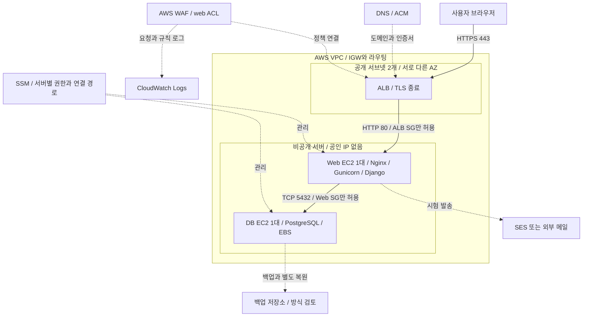

# Haven

**팀 ORCHESTRAION | 클라우드 보안 프로젝트**

Haven은 **AWS 기반 개인 기록 서비스와 운영자용 보안 점검 도구**를 함께 만드는 프로젝트입니다. 사용자는 웹 화면에서 자신의 기록을 관리하고, 운영자는 클라우드 설정과 요청 처리 결과를 점검해 보안 정책을 개선합니다.

> **현재 상태: 팀 검토용 계획 단계.** 아래 기능과 구성은 구현할 목표이며 구축 완료를 의미하지 않습니다. 기술 선택, 출구 방식, 예산, 담당과 일정은 팀 검토 후 확정합니다.

## 무엇을 만드는가

| 결과물 | 사용할 사람 | 제공할 기능 |
|---|---|---|
| 개인 기록 웹 서비스 | 일반 회원 | 회원가입, 로그인, 본인 기록 작성/조회/수정/삭제 |
| 제한된 계정 관리 화면 | 앱 운영 관리자 | 계정 활성/비활성 처리와 변경 이력 확인 |
| 읽기 전용 설정 점검 CLI | AWS 점검 운영자 | SG 수집, 기대 접근 정책과 비교, JSON/CSV 결과 |
| 요청 재현 CLI | 허가된 시험 운영자 | 정해진 정상/시험 요청 실행, WAF/앱 로그와 대조 |
| 검증 자료 | 팀과 검토자 | 구성, 접근 거부, 복원, 정책 변경 전후와 잔여 한계 |

기록은 작성자만 열람하고 수정/삭제합니다. 운영 관리자에게도 타인 기록 본문이나 비밀번호, 권한을 편집하는 기능은 제공하지 않습니다. 이 제한은 앱 권한에 대한 것으로 OS/DB 최고관리자의 열람 불가능성을 보장하지 않습니다.

가상 계정과 가상 데이터만 사용합니다. 공개 글, 회원 간 공유, 파일 업로드, 보안 점검 웹 대시보드, 실시간 탐지와 자동 정책 변경은 기본 범위에 넣지 않습니다.

## 사용자 화면과 운영 흐름

Django Templates와 최소 정적 파일로 UI를 구성합니다. 별도 SPA나 프론트엔드 서버를 두지 않습니다.

| 화면 | 주요 동작 |
|---|---|
| 회원가입 / 로그인 | 입력 검증, 세션 생성, 일반화된 실패 안내와 남용 제한 |
| 내 기록 목록 / 상세 | 본인 글 목록과 페이지 이동, 소유권을 확인한 상세 조회 |
| 작성 / 수정 | 제목과 본문 입력, POST+CSRF, 크기 검증과 오류 안내 |
| 삭제 확인 | GET으로 대상 확인, POST에서 소유권과 CSRF 재검사 후 삭제 |
| 계정 관리 / 이력 | 승인된 관리자의 계정 상태 변경과 변경 기록 확인 |

**사용자:** 가입 → 로그인 → 내 기록 → 작성/조회/수정/삭제 → 로그아웃.

**보안 운영자:** 대상 확인 → 설정 점검/요청 재현 → 로그 대조 → 변경 검토 → 수동 정책 수정 → 같은 조건 재시험.

화면에서 버튼을 숨기는 것과 별개로 서버가 모든 요청의 인증과 소유권을 검사합니다. 타인 글 ID와 없는 글 ID는 동일한 404로 처리합니다.

## 기본 시스템 구성

구축 예정 구성입니다. 실선은 서비스 요청, 점선은 정책/관리/보조 연결입니다.

- 외부 입구는 ALB로 제한하고 Web은 ALB SG, DB는 Web SG의 지정 포트만 허용합니다. 정상 접속과 직접 접근 거부를 함께 시험합니다.
- ALB에서 TLS를 종료하고 ALB→Web은 HTTP를 사용합니다. 기본 구성을 전 구간 암호화로 설명하지 않습니다.
- Web/DB는 각 1대입니다. ALB용 공개 서브넷 두 개가 전체 서비스의 고가용성이나 무중단 운영을 보장하지 않습니다.
- 비공개 서버 출구는 **미결정**입니다. SSM, 패키지 설치, 메일, 로그 목적지별로 NAT/Endpoint 등을 비교하며 Endpoint를 일반 인터넷 출구로 가정하지 않습니다.

## 기술과 구현 방향

| 영역 | 권고 기술 | 구현하고 확인할 내용 |
|---|---|---|
| 서비스와 UI | Django / Templates | 인증/세션, 개인 CRUD, 소유권/CSRF/입력 검증, 화면 사용 흐름 |
| Web 운영 | Nginx / Gunicorn / systemd | 요청 전달, 정적 파일, 비root 실행, 재시작 후 실제 기능 |
| 데이터 | 별도 EC2 PostgreSQL / EBS | runtime/migration 권한 분리, 데이터 유지, 별도 DB 복원 |
| 네트워크 | VPC / ALB / SG | 공개 입구와 비공개 서버, 포트/출발지별 허용과 거부 |
| AWS 권한/관리 | IAM / MFA / SSM | 사용자/그룹 실습, 운영 Role 분리, Web/DB 관리 접속 |
| 외부 연결 | DNS / ACM / SES 또는 외부 메일 | 도메인, HTTPS 세션, 시험 메일 발송과 수신 |
| 웹 보안 | WAF / CloudWatch Logs | Count 관찰, 요청/규칙 대조, 선별 Block과 정상 기능 재시험 |
| 점검 | 자체 CLI / Prowler / ZAP Baseline | SG 설정 비교, 제한된 요청 재현, 경고와 실제 문제의 구분 |

AWS IAM, 앱 회원 권한, DB 계정 권한은 각각 검증합니다. IAM 사용자/그룹은 과제 실습으로 유지하고 운영은 임시 Role 기반 인증을 우선 비교합니다. Web/DB 모두 SSM용 권한과 연결 경로를 준비합니다. DB EC2는 권고안이며 RDS 채택 여부는 별도 결정합니다.

## 구현과 검증 순서

| 단계 | 주요 작업 | 완료 기준 |
|---|---|---|
| M0 설계 | 화면/권한/네트워크, 출구, 인증, 비용 결정 | 와이어프레임, 접근표, 착수 결정과 종료 계획 |
| M1 로컬 서비스 | UI, 인증, 개인 CRUD, 최소 관리자, 초기 CI | 실제 사용 흐름, 타인 접근/CSRF/입력 실패 시험 |
| M2 AWS 통합 | IAM, SSM, DB, 배포, HTTPS, 메일 | 정상/거부, 재시작, 데이터 유지, 백업 복원 |
| M3 점검 도구 | SG CLI, fixture/실제 대조, 요청 재현, WAF Count | 수집 오류 분리, 요청과 로그 대응 |
| M4 정책 개선 | 최소권한/WAF 검토와 수동 변경 | 같은 조건 전후 비교, 확인용 요청, 정상 기능 유지 |
| M5 제출 준비 | 증거, 시연, 운영/종료 문서 | 과업별 결과 연결과 공개용 가림본 |

설정 점검 CLI는 AWS를 변경하지 않고 `PASS / FAIL / UNKNOWN / ERROR`로 결과를 구분합니다. 요청 재현은 허가된 대상과 횟수/속도/시간 제한 안에서 수행합니다. 두 도구의 옵션, 결과 필드와 종료 코드는 [기본 구현 명세](docs/구현명세/기본프로젝트_구현명세.md)에 둡니다.

WAF는 Count → 로그 대조 → 필요한 규칙만 Block → 동일 조건 재시험 → 조정에 쓰지 않은 요청으로 확인하는 순서로 검증합니다. HTTP 403만으로 차단을 확정하지 않으며 오탐/차단/미확정과 판정 가능한 분모를 함께 기록합니다. CI와 fixture 통과는 실제 AWS 접근 통제나 배포 시험을 대신하지 않습니다.

## 기본 필수/선택 대응

아래는 계획서 내부 추적 번호입니다. 모두 예정 작업이며 공식 과제 원문과 인정 조건은 별도 확인이 필요합니다.

| 항목 | 구현 목표 | 검증과 예정 산출물 |
|---|---|---|
| B1 클라우드 서비스 | Web/DB와 개인 기록 UI | CRUD/재시작/복원, 구축 결과서와 구성도 |
| B2 IAM 관리 | 사용자/그룹/정책과 역할 분리 | 허용/거부, 정책과 권한 관리 결과서 |
| B3 네트워크 통제 | VPC/서브넷/SG/라우팅/관리 | 정상 경로와 우회 접근 거부, 구성도와 접속 결과 |
| B4 보안 정책 | WAF 연결과 요청/로그 검증 | 규칙/액션 대조, 보안 장비와 정책 구성 결과서 |
| C1 외부 서비스 | DNS/HTTPS/메일 | 인증서, 접속, 실제 수신 결과 |
| C2 최소권한 점검 | 권한 검토와 개선 | 변경 근거, 정책 전후 허용/거부 |
| C3 자체 설정 점검 | 읽기 전용 SG CLI | 소스, fixture/실제 대조, JSON/CSV |
| C4 정책 개선/재현 | 요청 재현과 WAF 조정 | 동일 조건 전후, 오탐/차단/UNKNOWN과 회귀 결과 |

## 기본과 심화 문서

| 문서 | 내용 |
|---|---|
| [기본 프로젝트 계획서](기본프로젝트_계획.md) | 목적, 화면, 구성, 기술별 구현, 검증과 추진 계획 |
| [기본 구현 명세](docs/구현명세/기본프로젝트_구현명세.md) | 경로/권한/설정, CLI 입출력과 상세 시험 |
| [심화 프로젝트 계획서](심화프로젝트_계획.md) | 기본 서비스에 추가할 가상 보호 필드 암호화, 키 관리, PKI와 내부 TLS |
| [심화 구현 명세](docs/구현명세/심화프로젝트_구현명세.md) | 암호문/키/인증서 계약, 교체 실패와 복원 시험 |

심화는 기본 서비스가 준비된 뒤 진행하는 별도 계획입니다. 기본의 구성 설명을 반복하지 않고 같은 서비스의 데이터 보호와 내부 보안 통신을 확장합니다.

새 기본 계획서 PPT는 **README 검토 후 작성 예정**입니다. 아직 생성하지 않은 PPT 링크는 게시하지 않습니다.

- [개편 전 통합 계획서 보관본](archive/통합프로젝트_계획.md)
- [기존 선택 근거 부록](통합프로젝트_선택근거_부록.md)
- [팀원별 원본 의견](의견/)

## 저장소 구조와 팀

| 폴더 | 용도 |
|---|---|
| `app/` | 웹 애플리케이션 |
| `infra/` | 인프라와 정책 설정 |
| `scripts/` | 설정 점검과 요청 재현 |
| `tests/` | 테스트와 fixture |
| `docs/` | 계획서, 구현 명세, 구성도, 운영/시험 문서 |
| `archive/` | 개편 전 통합 계획 등 과거 문서 |
| `evidence/` | 공개 가능한 가림 처리 증거 |

비밀값, 세션/쿠키, 실제 개인정보와 민감한 원본 로그는 공개하지 않습니다. 원본과 공개용 가림본을 분리합니다.

| 팀원 | 역할 |
|---|---|
| 안민수 | 조장 |
| 김보람 | 팀원 |
| 이민성 | 팀원 |
| 권혁민 | 팀원 |
| 신요찬 | 팀원 |
| 노푸른 | 팀원 |

세부 작업 분담과 일정은 팀에서 정합니다.
