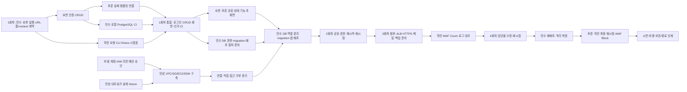

# Haven 공용 TODO

개인 브랜치에서 **2일 작업 → 검증된 결과를 main에 순서대로 merge → 최신 main을 개인 브랜치에 반영 → 다음 2일 작업**을 반복한다. 아래는 4회차 목표이며 실제 시작일부터 계산한다. 2일이 지나도 완료 기준을 충족하지 못하면 해당 작업을 다음 회차로 넘기고 의존 작업도 조정한다.

## 담당과 개인 브랜치

| 번호 | 담당 | 브랜치 | 개인 TODO | 맡을 일 |
|---|---|---|---|---|
| 1 | 안민수 | `Minsoo` | [안민수/TODO.md](안민수/TODO.md) | 팀장·공통 환경·CI·DB·배포·메일·백업 복원 |
| 2 | 노푸른 | `Pureun` | [노푸른/TODO.md](노푸른/TODO.md) | 화면·Django Templates·CSS·사용자 흐름 시험 |
| 3 | 권혁민 | `Hyeokmin` | [권혁민/TODO.md](권혁민/TODO.md) | 레드팀 시험·요청 재현 CLI·WAF·로그 검증 |
| 4 | 김보람 | `Boram` | [김보람/TODO.md](김보람/TODO.md) | 계정 소유·IAM·개인별 접근·비용/자원 관리 |
| 5 | 신요찬 | `Yochan` | [신요찬/TODO.md](신요찬/TODO.md) | Django 인증·모델·CRUD·공유·첨부·서버 인가 |
| 6 | 이민성 | `Minsung` | [이민성/TODO.md](이민성/TODO.md) | AWS 네트워크·EC2·SSM·ALB/HTTPS·SG CLI |

## 바로 다음 공동 작업 · 2026-11-06

현재 역할과 4회차 계획을 유지하면서 다음 인계부터 맞춘다. 아래는 작업 제안과 확인 요청이며, 수신·합의·일정 확정이나 AWS 변경 승인을 뜻하지 않는다. 각자 개인 브랜치 TODO의 `민수's comment`에 실제 진행 상태와 가능한 인계 시점을 덧붙인다.

| 담당·개인 브랜치 TODO | 지금 할 일 | 먼저 받을 입력·확인할 사람 | 넘길 결과·다음 담당자 |
|---|---|---|---|
| [안민수 · Minsoo](https://github.com/MinsooAhn02/Haven/blob/Minsoo/안민수/TODO.md) | 확인된 공통 실행 기준을 공유하고, 앱/DB CI 연결에 필요한 입력을 취합 | 요찬: 앱/설정/실행/시험 계약; 보람: 운영 접근; 민성: OS·서버 연결 | 공통 실행 안내와 검증 commit → 전원; 앱 인계 후 새 개발 DB·앱 CI 결과 → 푸른·혁민 |
| [신요찬 · Yochan](https://github.com/MinsooAhn02/Haven/blob/Yochan/신요찬/TODO.md) | 전체 기능 완성 전에 실행·화면 계약을 먼저 전달하고 인증·소유자 CRUD를 최소 단위로 인계 | 민수: 실행 환경 조율; 푸른: 기존 화면의 필드·오류 표시 요구 | 앱 루트·의존성·settings/WSGI·migration/실행/시험 명령과 URL/폼/context 계약 → 민수·푸른·혁민 |
| [노푸른 · Pureun](https://github.com/MinsooAhn02/Haven/blob/Pureun/노푸른/TODO.md) | 기존 시안 7개와 실제 URL·폼·context의 대응표 준비, 계약 수신 후 Django 연결 | 요찬: 서버 계약; 민수: 실행·시험 환경 | 화면 원본 위치·필요 필드/오류 목록 → 요찬·민수; 실제 사용자 흐름 결과 → 민수·혁민 |
| [김보람 · Boram](https://github.com/MinsooAhn02/Haven/blob/Boram/김보람/TODO.md) | 현재 수행 기록을 PR로 공유하고 리전·예산·접근/Role·출구 결정의 담당/상태 정리 | 민수·민성: 운영 자원·기간·출구 요구; 비용·권한 승인 확인 | 승인된 접근·자원 범위·미결정 항목 → 민성·민수; 설계·기록 PR은 구축 완료를 기다리지 않고 검토 |
| [이민성 · Minsung](https://github.com/MinsooAhn02/Haven/blob/Minsung/이민성/TODO.md) | 설계/fixture 완료와 구축 대기를 구분; OS/AMI 제안과 출구 승인 항목을 민수·보람과 조율 | 보람·민수: 리전·예산·출구 승인; 민수: 메일 방식 회신 | 승인 후 EC2/SSM·디스크·Web→DB·필요 출구·직접 접근 거부 결과 → 민수; 승인 전 추가 fixture·설계 진행 |
| [권혁민 · Hyeokmin](https://github.com/MinsooAhn02/Haven/blob/Hyeokmin/권혁민/TODO.md) | 준비된 요청 CLI·mock·fixture·시험 기록을 PR로 제출 | 요찬: URL·폼·인증/CSRF·로그 계약; 민수: 시험 origin·배포 commit | 로컬 시험 명령·기대/실제 결과·앱 연동 요구 → 민수·요찬; 실제 앱 시험은 대상 준비 후 진행 |

**병렬 순서:** 요찬의 계약 인계와 보람·민수·민성의 AWS 결정 정리를 동시에 진행한다. 푸른은 화면 대응표, 혁민은 기존 작업 PR을 준비한다. 민수는 전달받은 앱을 실행·DB·CI에 연결한다. AWS 배포는 접근/자원 승인·서버 연결·앱 인계가 모두 준비된 뒤 진행한다.

**다음 작업 완료 기준:** 요청/제안만 작성한 상태와 인계 수신을 구분한다. 인계에는 `담당·현재 상태·수신자·파일/commit·실행 명령 또는 결정 근거·가능한 인계 시점`을 남긴다. 독립 PR은 검토 후 먼저 병합할 수 있으며, 상대 개인 브랜치를 서로 직접 합치거나 미완성 작업을 일괄 main에 넣지 않는다.

## 공통 규칙

- 각자 본인 이름 폴더의 산출물과 TODO만 수정한다. 공용 TODO·공통 실행/의존성·CI·최종 경로 통합은 1번 안민수가 담당한다. 앱 Python 코드는 5번, 화면 원본은 2번만 수정한다.
- 코드가 연결될 때 필요한 URL·폼/context·환경변수 이름·실행 명령은 먼저 담당자에게 전달한다. 원본을 복사해 이중 관리하지 않는다. 명세의 최종 CLI 경로는 통합 때 맞추고 이후 수정 담당/경로를 확정한다.
- AWS 변경은 계정/IAM/비용=4번, VPC/SG/EC2/ALB/DNS=6번, 서버 내부 앱/DB/메일/복원=1번, WAF/전용 로그=3번으로 나눈다. 브랜치가 달라도 같은 AWS 자원을 동시에 수정하지 않는다.
- 보람님 계정에서 개인별 접근/MFA를 사용한다. 리전·예산·비공개 서버 출구·권한 확정 후 자원을 생성한다. 파괴적 변경·공유 DB 변경은 별도 확인한다.
- 각 회차 끝에 개인 브랜치에서 main으로 PR을 보낸다. 아래 번호는 **main으로 합칠 기본 순서**이며 개인 브랜치끼리 서로 합치라는 뜻이 아니다. 검토가 끝난 독립 문서·시안·fixture는 먼저 병합할 수 있고, 의존 코드 PR은 선행 변경 반영 후 검증한다. PR은 하나씩 처리한다.
- 본인/검토자가 환경·명령·실제 시험 결과를 확인한 작업만 merge한다. 다른 사람의 진행 중 작업을 대신 바꾸지 않는다. 충돌은 해당 담당자와 해결한다.
- main 통합 후 전원이 최신 main을 자기 브랜치에 merge한다. 개인 브랜치를 계속 사용하므로 main 통합은 merge commit 방식으로 이력을 유지하며 force push하지 않는다.
- **main에 직접 커밋·푸시하지 않는다.** GitHub 웹에서 파일을 편집할 때도 커밋 대상을 본인 브랜치로 고르고 PR로 보낸다. 무료 비공개 저장소라 브랜치 보호를 켤 수 없어 규칙으로 운영하며, 1번이 `git log --first-parent`로 PR 없이 들어온 커밋을 점검한다. (2026-11-08 추가: 11/08 웹 편집 6건이 main에 직접 들어감)
- 진행·증거는 개인 TODO에 기록하고 1번이 공용 체크를 갱신한다. 비밀값·세션·원본 민감 로그는 Git에 올리지 않는다.

## 1회차 · 1~2일차 — 계정·공통 기반·로컬 시작

| 번호 | 2일 동안 할 일 |
|---|---|
| 1 | 공통 환경/실행·CI·DB/배포 계약 준비, 5번과 모델/실행 기준 확인 |
| 2 | 공통 화면·로그인·기록 화면, 5번 계약에 맞춘 템플릿 준비 |
| 3 | 정상/거부 시험표·요청 CLI fixture |
| 4 | 루트 MFA·개인 접근·IAM 초안·예산/리전/비용·종료 결정 |
| 5 | 모델·URL·폼/context 계약 전달, 인증·소유자 CRUD·권한 시험 |
| 6 | 네트워크/SG/SSM·출구 설계, SG CLI fixture |

**main merge 순서: 1 → 5 → 2 → 4 → 6 → 3.** 5번의 화면 계약은 merge 전이라도 2번에게 먼저 전달한다.

- [ ] 공통 기준과 개인 접근·비용/출구 결정이 기록됨
- [ ] 로컬 인증·CRUD·비인가 거부와 화면 연결 확인
- [ ] 요청/SG CLI fixture 실행 결과 확인

## 2회차 · 3~4일차 — 공유·계정 관리·AWS 첫 배포

| 번호 | 2일 동안 할 일 |
|---|---|
| 1 | 승인된 PostgreSQL·migration·앱 배포, 재시작/되돌리기 확인 |
| 2 | 공유·읽기 전용·계정 관리/이력 화면과 사용성 시험 |
| 3 | 요청 CLI 제한/인증 시험, 준비된 앱의 권한 문제 재현 |
| 4 | 역할/정책 적용·허용/거부 시험, 서버 Role 전달·자원/비용 기록 |
| 5 | 읽기 공유/해제·비활성 처리·제한된 계정 관리와 서버 시험 |
| 6 | 승인 범위 VPC/SG/EC2/SSM·출구 구축, 연결/직접 접근 거부 인계 |

**main merge 순서: 4 → 6 → 5 → 2 → 1 → 3.** 1번 실제 배포는 6번 연결 시험과 5번 앱/migration이 준비된 뒤 진행한다.

- [ ] 공유 대상 읽기만 허용, 미공유/해제/비활성·변경 요청 거부
- [ ] SSM·필요 출구·Web→DB와 직접 접근 거부 확인
- [ ] AWS에서 앱 실행과 재시작 확인

## 3회차 · 5~6일차 — 첨부·HTTPS·메일·실제 보안 점검

| 번호 | 2일 동안 할 일 |
|---|---|
| 1 | 첨부 포함 재배포·메일 실제 수신/실패 확인·정합 백업 준비 |
| 2 | 첨부 화면, 실제 HTTPS 사용자 흐름과 오류 시험 |
| 3 | WAF Count 관찰·요청/WAF/앱 로그 대조·오탐 확인 |
| 4 | WAF/로그/메일 필요 권한 검토, IAM 문제 개선·비용 기록 |
| 5 | 비공개 첨부·다운로드 인가·형식/한도/동시 요청·실패 정리 |
| 6 | ALB·DNS/ACM·HTTPS, 실제 읽기 전용 SG 수집/수동 대조 |

**main merge 순서: 4 → 5 → 1 → 6 → 2 → 3.** 2·3번 실제 HTTPS 시험은 1·6번 배포/연결 확인 후 진행한다.

- [ ] A 작성/첨부→B 공유/조회/다운로드→C 거부→B 변경 거부→해제 후 B 거부
- [ ] HTTPS 세션·CSRF·메일, 실제 SG/로그 대조 확인
- [ ] WAF Count 결과 확보. HTTP 403만으로 WAF 차단 판정하지 않음

## 4회차 · 7~8일차 — 수정·Block 검증·복원·마무리

| 번호 | 2일 동안 할 일 |
|---|---|
| 1 | 수정 배포·격리 복원·전체 회귀·산출물/시연 통합 |
| 2 | 화면 수정·최종 사용자 흐름 재시험·가림 증거 |
| 3 | 결함 재현/수정 재검증, 검토한 WAF Block과 동일 조건 전후 비교 |
| 4 | IAM 수정/재시험, 권한·비용·보존/종료 목록 확인 |
| 5 | 서버 결함 수정·공유/첨부/권한 회귀 시험 |
| 6 | 네트워크/SG 수정·재시험, 최종 구성/실제 점검 결과 |

**main merge 순서: 5 → 2 → 6 → 4 → 1 → 3.** 3번은 발견사항을 회차 초반부터 전달하고 최종 배포 후 Block 비교/정상 회귀를 마무리한다. 수정이 추가되면 관련 담당 PR→1번 재배포→3번 재시험을 반복한다.

- [ ] 정상 기능 유지와 확인한 문제의 수정 후 재시험 완료
- [ ] DB+첨부+manifest 격리 복원 후 데이터/공유/다운로드 권한 확인
- [ ] WAF 전후 결과·UNKNOWN/ERROR·한계, 명세 누락과 가림 증거 정리
- [ ] 보존·종료 책임/잔여 비용 확인. 실제 삭제는 별도 확인 후 담당자가 수행

## 작업 의존 흐름과 인계

아래 화살표는 다음 결과가 있어야 완료할 수 있는 관계다. 설계·fixture·화면 초안 등 독립 작업은 앞서 진행할 수 있다. IAM 승인은 AWS 자원 **구축**의 선행조건이며 네트워크 설계의 선행조건은 아니다.

| 보낸 사람·결과 | 받는 사람·다음 일 | 기다리는 동안 병행 가능 |
|---|---|---|
| 민수+요찬: URL·폼·context·실행 계약 | 요찬: 인증/CRUD, 푸른: 계약 기반 템플릿 | 혁민 시험표/fixture, 민성 네트워크 설계, 보람 IAM/비용 검토 |
| 요찬: 앱·migration·시험 명령, 푸른: 원본 템플릿 | 민수: 로컬 PostgreSQL·CI·통합, 혁민: 준비된 기능 권한 시험 | 화면 정리, CLI fixture 및 IAM 검토 |
| 보람: 계정·IAM·리전·예산 승인, 민성: 승인 범위 네트워크·SSM 및 연결 증거 | 민수: DB 역할 분리·migration·앱 배포 | 앱/화면/fixture 검토; 승인 전 네트워크 설계 |
| 민수: 배포 commit·origin·로그 시각, 민성: ALB/HTTPS 연결 | 푸른: 사용자 흐름, 혁민: Count와 요청/WAF/앱 로그 대조 | 보람 권한·비용 검토, 요찬 앱 결함 수정 준비 |
| 푸른·혁민: 재현 조건·기대/실제·결함, 요찬/민성/보람: 수정 결과 | 민수: 통합 재배포·격리 복원 | 각 담당자는 자기 범위 수정, 혁민은 전후 시험 계획 |
| 민수: 최종 배포·복원 버전·로그 위치/시각 | 혁민: 최종 재시험·WAF Block; 전원: 시연/운영 인계 | 보람 비용·보존/종료 확인, 푸른 최종 화면 재검 |

각 회차의 여섯 담당자 작업표와 완료 조건은 해당 회차 표/체크 항목에 둔다. PR은 기본적으로 그 회차에 적힌 순서로 main에 합치되며, 검토·시험이 끝난 독립 문서/mockup/fixture PR은 먼저 합칠 수 있다. 의존 코드 PR은 최신 main 기준으로 재검증하고 merge commit을 유지한다. main merge는 AWS 작업 승인이 아니다.

## 현재 진행 스냅샷 (2026-11-08 확인)

아래는 해당 확인 시점의 기록이며 이후 바뀌었을 수 있다. PR 상태는 다시 확인한 뒤 갱신한다. 미확인은 완료로 간주하지 않는다. (변경됨 2026-11-08: 11/06 스냅샷을 #7·#8·#11·#13 병합 반영으로 교체. 이전 값은 git 이력에 있음)

| 담당 | 상태 | 대기/다음 인계 | 근거 |
|---|---|---|---|
| 안민수 | 공통 문서·SG CI·주간 운영 문서 병합. main 직접 푸시 금지 규칙 [#13](https://github.com/MinsooAhn02/Haven/pull/13) 추가; Django 앱·requirements는 아직 없음 | 요찬 앱 계약 인계 후 앱 실행·DB·앱 CI 연결; 월 오후 AWS 결정 | main `8893e56` CI 성공 |
| 신요찬 | 원격 `Yochan`에 앱 코드·PR 없음, 로컬 작업 미확인 | 월 오전 앱 루트·settings/WSGI·의존성·migration/시험 명령·URL/폼/context 전달 | 브랜치/PR 확인 |
| 노푸른 | [PR #3](https://github.com/MinsooAhn02/Haven/pull/3) 정적 시안 병합 이후 변경 없음 | 시안 7개 → URL·폼·context 대응표, 계약 수신 후 Django 연결 | merge `36db226` |
| 권혁민 | [PR #7](https://github.com/MinsooAhn02/Haven/pull/7) 요청 CLI·fixture 병합 | 앱 계약 수신 후 실제 앱용 path·입력 정리 | merge `3855664`, 전체 pytest 51 passed, main CI 성공 |
| 김보람 | [PR #8](https://github.com/MinsooAhn02/Haven/pull/8)·[#11](https://github.com/MinsooAhn02/Haven/pull/11) 점검 문서 병합, 루트 MFA·연락 수단 기록 | 리전·예산·출구·IAM 승인 결과를 민성/민수에게 전달 | merge `9f17c50`, `7a3c0c2`; 대체 연락처·복구 시험 미검증 |
| 이민성 | [PR #2](https://github.com/MinsooAhn02/Haven/pull/2) 설계·SG fixture 병합, 문서 보완 `864a847`은 PR 전 | `864a847` PR; 승인 후 구축 | merge `6d61d6c`, SG 시험 5개 통과 |

PR #3은 화면 시안, PR #2는 설계·fixture 단계로 merge commit 병합했다. 두 PR의 GitGuardian 검사도 통과했다. Django 연결·live AWS 수집·실제 AWS 구축/연결은 후속 작업이며, 위 병합으로 회차 전체를 완료 처리하지 않는다.

기능·오류·시험의 상세 기준은 [기본 계획](기본프로젝트_계획.md)과 [기본 구현 명세](docs/구현명세/기본프로젝트_구현명세.md)를 따른다. 실제 AWS 작업의 완료를 이 문서가 의미하지는 않는다.
