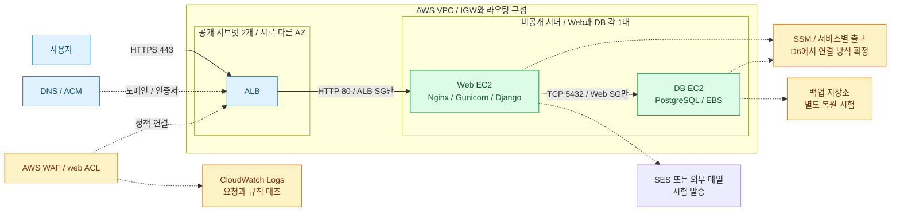
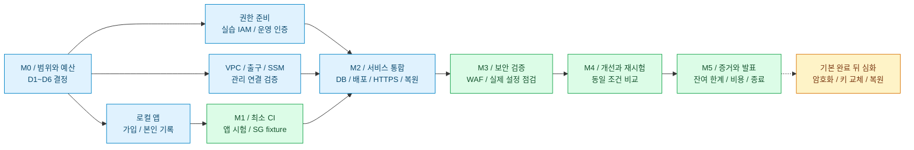
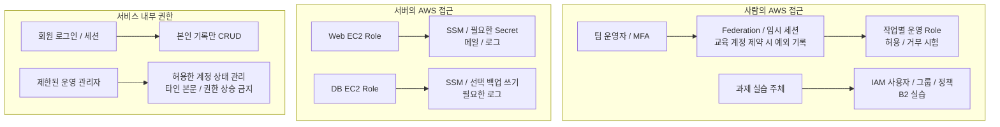
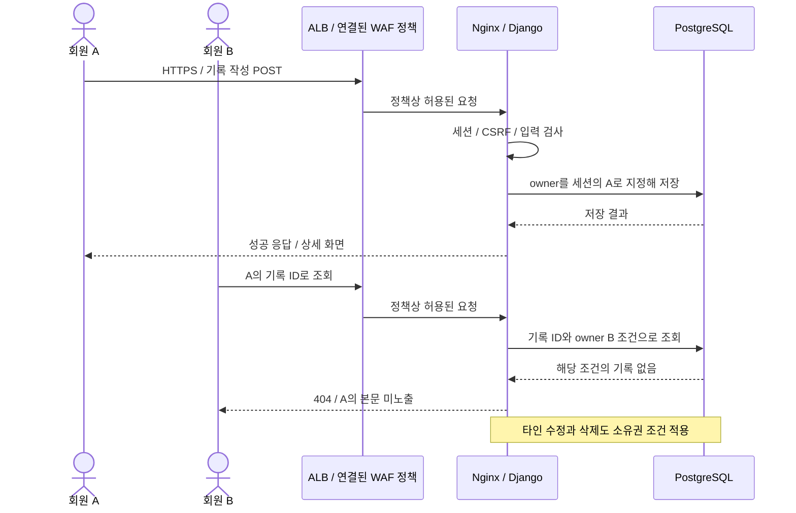
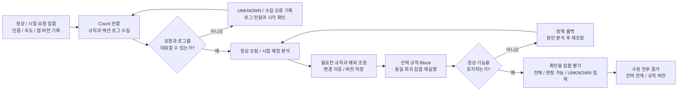
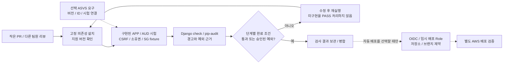
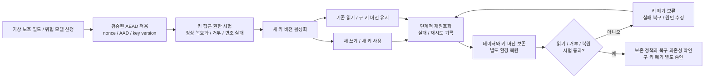

# Haven 상세 통합 실행 계획 및 의사결정 보고서

작성일: 2026-11-04 | 검토 기준: `295578baf390f6b7d7c820762dd2a063834504b9`

상태: **팀 검토용 통합 초안**. 아래 기술 선택과 우선순위는 통합 권고안이며 팀 합의나 구축 완료를 뜻하지 않는다. 역할과 일정은 배정하지 않았다. 개인별 원본과 README는 유지한다.

이 계획은 **제1부(1~13절)**의 통합 범위/원본 반영 현황과 **제2부(14~26절)**의 상세 작업 명세로 구성한다. 팀원별 대안과 선택 이유는 별도 [선택 근거 부록 A~F](../통합프로젝트_선택근거_부록.md)에 둔다. 상세 값과 시험 ID 중 원문에 없던 것은 이 통합본의 신규 설계 제안이며 이미 구현된 동작이 아니다. 이력서 활용 판단도 실제 성과가 생긴 뒤 적용한다.

## 발표와 이해를 위한 도식 안내

모든 그림은 구축 완료 화면이 아닌 계획도다. 전체 구성→진행 순서→권한 분리→회원 요청→WAF 개선→PR 검사→심화 키 교체 순서로 설명하면 된다. 부록에는 제안 채택/보류의 판단 흐름도도 둔다.

| 설명할 질문 | 도식 위치 |
|---|---|
| 서비스가 어디로 연결되는가? | 4절 / 전체 구성도 |
| 무엇을 먼저 하고 언제 합치는가? | 6절 / 진행 의존성 |
| AWS 권한과 회원 권한은 어떻게 다른가? | 16절 / 세 권한 영역 |
| 타인의 기록 접근은 어디에서 거부하는가? | 17절 / 요청 시퀀스 |
| 보안 정책 효과를 어떻게 검증하는가? | 20절 / WAF 관찰과 개선 |
| 협업 중 기존 동작을 어떻게 지키는가? | 25.1절 / PR 검사 |
| 키를 바꾸면서 복구 가능성을 어떻게 유지하는가? | 25.3절 / 키 교체와 복원 |

## 제1부. 통합 방향과 원본 분석

## 1. 통합 방향과 판단 기준

AWS에 작은 회원제 기록 게시판을 만들고, 서버 구축부터 권한 관리, 네트워크 통제, 웹 요청 차단, 점검과 개선까지 한 흐름으로 검증한다. 기본 프로젝트를 먼저 끝내고 암호화와 PKI를 같은 서비스에 확장한다. 파일 공유와 추가 탐지 장비는 별도 완료 조건을 두고 선택한다.

통합 기준은 다음 순서로 적용한다. 문서 길이, 업로드 순서, 작성자 수로 우선순위를 정하지 않는다.

| 순서 | 판단 기준 | 채택 조건 |
|---|---|---|
| 1 | 과제 충족 | 기본 필수 4개와 산출물에 직접 대응하는가 |
| 2 | 서비스 일관성 | 하나의 앱, DB, 통신 경로로 설명하고 실행할 수 있는가 |
| 3 | 검증 가능성 | 정상과 거부 결과, 설정과 실제 동작, 수정 전후를 대조할 수 있는가 |
| 4 | 구현과 운영 부담 | 설치, 업데이트, 권한, 비용, 백업과 종료까지 감당할 수 있는가 |
| 5 | 확장과 이력서 가치 | 개인의 판단과 변경, 문제 해결, 재현 가능한 결과가 남는가 |

이 문서의 B1~B4와 C1~C4는 저장소 README 및 팀 제안에 맞춘 내부 추적 번호다. **공식 과제 가이드 원문은 이번 저장소 검토 범위에 없으므로**, 선택 과업의 정확한 인정 조건과 별도 IPS 요구 여부는 원문 또는 강사 확인을 거쳐 확정한다. 루트의 6쪽 PDF를 공식 평가표로 취급하지 않는다.

## 2. 원본 검토 범위

| ID | 원본 | 검토와 성격 |
|---|---|---|
| S0 | [README](../README.md) | 전체 읽음. 기본 필수 4단계와 심화 3단계, 필수 산출물의 공통 기준 |
| S1 | [안민수 기본프로젝트 계획](../의견/안민수/기본프로젝트_계획.md) | 전체 읽음. Django/PostgreSQL, 단계별 통과 기준, B/C 체크표, 자체 점검과 재현 |
| S2 | [권혁민 상세 계획서](../의견/권혁민/프로젝트_계획서.md) | 전체 읽음. 게시판, 파일/S3, 상세 보안 및 시험, 운영과 후속 암호화 |
| S3 | [권혁민 프로젝트계획](../의견/권혁민/프로젝트계획.md) | 전체 읽음. MySQL/RDS 대안, 기본과 심화, 일정과 보안 확장. S2와 별도 제안으로 보존 |
| S4 | [신요찬 plan](../의견/신요찬/plan.md) | 전체 읽음. 사전 결정표, 비공개 서버, NAT/Suricata, 예산과 운영 |
| S5 | [신요찬 팀 가이드](../의견/신요찬/AWS%20보안%20프로젝트%20팀%20가이드.md) | 전체 읽음. FastAPI, 주차별 구성, 심화 암호/인증, 명령과 코드 예제 |
| S6 | [이민성 계획](../의견/이민성/README.md) | 전체 읽음. IAM 정책, MySQL, SG/NACL, 자동 점검 예제, 기본과 심화 |
| S7 | [노푸른 개요](../의견/노푸른/README.md) | 전체 읽음. 기본 필수와 결과물의 요약 |
| S8 | [김보람 PDF](../의견/김보람/AWS%20클라우드%20보안%20프로젝트.pdf) | 6쪽 텍스트 전체 및 렌더 확인. 1~4쪽 이미지 표 별도 확인. 6쪽은 빈 페이지 |
| S8-동일본 이력 | [김보람 PDF 정본](../의견/김보람/AWS%20클라우드%20보안%20프로젝트.pdf) | 기존 루트 업로드86a7e18과 개인폴더 업로드295578b 모두 Git 작성자 김보람. SHA256 동일하여 현재 개인폴더 정본1개로 정리 |
| S9 | [김보람 README](../의견/김보람/README.md) | 실질 본문 없음. 제안 내용은 S8로 평가 |

PDF SHA256: `0CBA0BA3943395112993FFDE86A1BD0851CBB5461C4A20FF552B40E6F535580C`.

MarkItDown 실행을 먼저 시도했으나 모듈이 없어 pypdf 추출과 Poppler 렌더로 보완했다. S8 이미지 표의 EBS, Access Analyzer, IGW, CloudWatch까지 반영했다. 로컬의 미추적 구성도들은 이전 개인 초안의 참고자료이며 새 팀 합의의 근거로 쓰지 않았다.

**본문을 확인하지 못한 외부 참조:** 사용자 승인 후 S6의 GitHub 첨부 이미지 4개(본문 12, 139, 364, 559행)의 원본 URL에 직접 접근했으나 모두 HTTP 404를 반환했다. S5의 외부 상세 가이드(140행)는 로그인 필요 화면만 확인되어 본문은 읽지 못했다. 삭제/비공개/인증 중 원인은 확정하지 않는다. 따라서 접근 시도 완료와 본문 검토 완료를 구분하고, 해당 내용은 추가 반영하지 않았다.

## 3. 선택이 충돌하는 부분과 통합 권고안

| 결정 | 원본의 차이 | 이번 초안의 권고 | 확정 전에 확인할 것 |
|---|---|---|---|
| D1 서비스 | 기록 게시판 / 문서 공유 / 단순 등록 조회 | 회원가입, 로그인, 본인 글 CRUD, 관리자 최소 기능 | 파일 공유를 핵심 시연에 넣을지 |
| D2 앱과 DB | Django/PostgreSQL / FastAPI / PHP+MariaDB / MySQL | Django + Nginx + Gunicorn, 별도 EC2 PostgreSQL | 팀 숙련도, DB 직접 구축 과제 조건. 프레임워크 변경 시 시험도 변경 |
| D3 DB 운영 | DB EC2 / RDS | DB EC2 우선 권고, RDS를 관리 부담 절감 대안으로 보존 | 패치와 백업 담당 가능 여부, RDS 비용과 과제 인정 |
| D4 공개 경로 | ALB / CloudFront / Web 직접 공개 후 전환 | 최종 외부 입구는 ALB, Web/DB는 비공개 | ALB 서브넷 구성, 도메인과 인증서, egress 비용 |
| D5 관리 접속 | SSM / 관리자 IP SSH | SSM 우선. SSH 예외는 필요성과 만료 조건을 기록 | Agent, IAM, DNS, 설치/업데이트 및 outbound 연결 |
| D6 비공개 서버 출구 | NAT Gateway / NAT 인스턴스 / VPC Endpoint | 아직 미결정. 도달할 목적지별로 비교 후 한 구성 선택 | SSM만 가능한 구성과 패키지/메일/API까지 가능한 구성의 차이 |
| D7 WAF 로그 | CloudWatch Logs / S3 | 우선 CloudWatch Logs로 시험 대조, S3는 보관 대안 | 로그 전달 권한, 보존 기간, 필드 마스킹, 비용 |
| D8 추가 탐지 | Suricata / Network Firewall / GuardDuty / fail2ban | WAF 기본 검증 완료 후 목적별 선택 | IPS 인정 범위, 검사할 패킷 경로, 복호화 지점, 운영 부담 |
| D9 범위와 기간 | 기본만 / 기본+심화 30일 / 주차별 구축 | 완료 기준이 있는 단계로 관리, 날짜와 역할은 별도 협의 | 실제 남은 기간과 예산. 원문 일정을 확정 일정으로 복사하지 않음 |

공통분모가 많은 D2를 권고했지만 다수결로 확정한 것은 아니다. S8의 **Ubuntu EC2 + Apache/PHP + RDS MariaDB + CloudFront/WAF**도 완결된 대안이다. 채택하면 DB 포트, 배포, 의존성 점검, 증거표를 그 스택으로 한꺼번에 바꾼다. 두 대안의 구성요소를 무작정 혼합하지 않는다.

## 4. 통합 권고 구성



실선은 서비스 요청, 점선은 관리/정책/보조 관계다. IGW와 라우팅을 구성하고, 비공개 서버의 출구는 D6에서 확정한다. 그림의 출구 상자는 모든 Endpoint가 인터넷 통신을 제공한다는 뜻이 아니다. 전체 구성도는 서비스와 보조 연결을 중심으로 단순화했다. IAM/CloudTrail과 점검 도구의 역할은 16절과 21절에서 별도로 설명한다.

ALB에서 TLS를 종료하고 기본안의 ALB→Web은 제한된 HTTP 경로로 둔다. **이를 전 구간 암호화라고 설명하지 않는다.** 내부 TLS와 mTLS는 심화에서 따로 구현한다. Web과 DB 각 1대이므로 전체 서비스 고가용성이나 무중단 서비스를 주장하지 않는다.

### 접근 통제 표

| 대상 | 인바운드 허용 | 확인할 거부 결과 |
|---|---|---|
| ALB SG | 외부 HTTPS 443. HTTP 80은 필요하면 HTTPS 리다이렉트용 | 불필요한 리스너와 관리 포트 없음 |
| Web SG | TCP 80, 출발지 ALB SG | 외부 직접 접속과 ALB 이외 출발지 차단 |
| DB SG | TCP 5432, 출발지 Web SG | 외부와 허가되지 않은 서버의 DB 접속 차단 |
| 관리 | SSM용 IAM 및 outbound 경로 | 일반 계정의 관리 접속 거부. SSH 예외가 없으면 22 닫힘 |
| NACL 선택 실습 | 필요한 왕복 통신을 표로 정의 | 임시 포트와 방향을 고려해 허용/거부 검증 |

원본 MySQL/MariaDB의 3306 규칙은 권고안에서는 PostgreSQL 5432로 바꾼다. SG, 점검 코드, 보고서와 시연에서 포트를 일치시킨다. outbound도 설치, DNS, SSM, 메일, 로그 등의 실제 필요에 맞춰 기록한다.

## 5. 범위와 우선순위

| 우선순위 | 내용 | 넘어가는 조건 |
|---|---|---|
| P0 기본 필수 | B1 Web/DB, B2 IAM, B3 네트워크, B4 WAF와 정책 검증 | 각 항목의 정상/거부 결과와 필수 산출물 확보 |
| P1 기본 선택 | C1 도메인/DNS/메일, C2 최소권한 점검, C3 자체 설정 점검, C4 정책 개선과 재현 | P0 우선으로 관리하되 연결상 필요한 P1 기능은 병행. 4개 선택 과업도 증거로 마무리 |
| P2 심화 | 필드 암호화/키 관리, 실습 CA/인증서/TLS, 인증 및 데이터 보호 통합 | 기본 범위와 제출 일정 확보 후 착수 |
| P3 추가 확장 | 파일/S3, IPS, 추가 탐지/자동 대응, IaC/자동 배포 확장, 고급 인증 | 최소 PR CI는 M1 기본. 추가 기능은 해결할 문제/비용/시험/복구 기준이 있을 때 선택 |

P1을 공식 평가의 필수 항목으로 바꾸지 않는다. AWS WAF가 과제의 보안 장비 인정 범위를 충족하는지 먼저 확인하고, 별도 IPS가 요구되면 D8을 P0로 재계획한다. 파일 기능이 개인 원문에서 P0여도 팀 공통 필수로 자동 승격하지 않는다.

P0/P1은 과제 분류와 완료 우선순위이며 엄격한 착수 순서가 아니다. HTTPS/DNS 등 외부 검증에 필요한 P1 구성은 P0 구축 중 함께 진행한다.

### 요구사항과 완료 증거

| ID | 목표 | 완료 판정 | 남길 증거 |
|---|---|---|---|
| B1 | EC2 Web과 DB 서비스 | 로그인과 본인 기록 저장/조회/수정/삭제, DB 영속 저장 확인 | 구축 결과서, 앱/DB 시험, 인프라 구성도 |
| B2 | IAM 사용자/그룹/정책 | 허용된 계정의 작업 성공과 권한 없는 계정의 거부, MFA 확인 | 정책 JSON, 계정/그룹/역할표, 허용/거부 결과 |
| B3 | VPC/서브넷/SG 접근 통제 | 외부→ALB→Web→DB만 의도한 통신 허용, DB 직접 접속 거부 | 라우팅/SG표, 실제 접속 시험, 구성도 |
| B4 | WAF와 보안 정책 | 정상/차단 대상 요청 및 WAF 로그를 대조, 정책 수정 후 재시험 | web ACL/규칙, 요청 결과, 로그, 정책 적용 보고서 |
| C1 | 도메인/DNS/외부 메일 | 도메인 HTTPS 접속과 시험 메일 수신 | DNS 레코드, 인증서, 발송/수신 확인. SES 선택 시 필요한 인증/DNS 설정 |
| C2 | 최소권한과 과도한 권한 점검 | Prowler/정책 검토에서 지적한 항목을 분류하고 개선/보류 근거 확인 | 점검 원본, IAM diff, 변경 전후 허용/거부 시험 |
| C3 | 자체 클라우드 설정 점검 | 의도한 정상/위반 fixture에서 기대 결과, 실제 설정과 수동 대조 | 소스, 단위 시험, JSON/CSV 결과, 정책 개선 기록 |
| C4 | WAF 정책 개선 효과 검증 | 동일 요청 집합으로 전후 비교, 정상 요청 오탐과 미차단 분리 | 재현 스크립트, 고정 요청 목록, HTTP/로그 대응표, 비교 보고서 |

보안 장비, 앱 인증, AWS IAM의 보호 대상은 다르다. WAF가 응답을 막았다는 결과로 앱의 SQLi 수정이나 객체별 인가 검증이 끝났다고 판정하지 않는다.

### 최소 앱과 DB의 구체 범위

| 영역 | 기본에 반영 | 후속 또는 대안으로 남길 내용 |
|---|---|---|
| 화면/인증 | 가입/로그인/로그아웃, 목록/상세/작성, 본인 글 수정/삭제, 최소 관리자. 가상 계정 2개와 관리자/비로그인 상태로 교차 시험 | 내 정보, 정지 회원 정책과 상세 RBAC는 서비스 시나리오에 맞춰 채택. 전화번호/주소 등 실제 개인정보 수집은 암호화 검증 전 비활성화 |
| 권한/입력 | 서버 세션 기준 객체 소유권, POST+CSRF 변경, ORM과 자동 이스케이프, HTML 실행 금지, 페이지네이션 | 로그인 남용 방어와 계정 열거 완화는 기본 공개 조건으로 반영. 이메일 인증은 선택. 전화번호는 원문의 향후 보호 필드로 남기고 기본 수집 비활성화 |
| 비밀번호/세션 | 프레임워크의 검증된 해시, 세션 만료, Secure/HttpOnly/SameSite, 신뢰 프록시 설정 시험 | 원문의 Argon2 후보는 버전/설치/설정 검증 후 선택. 별도 자체 인증 프레임워크는 도입하지 않음 |
| DB 모델 | Django auth 재사용, 작성자/제목/본문/생성시각의 posts, 필요한 인덱스/unique. User 모델은 첫 migration 전 결정 | profiles/attachments/roles/user_roles/audit_logs/security_findings/protected_records는 실제 기능이 생길 때 추가. sessions도 프레임워크와 중복 생성하지 않음 |
| DB 통제 | 앱 런타임과 migration 계정 권한 분리, 슈퍼유저 사용 금지, listener/pg_hba/인증/SG 일치, 가상 데이터 백업/복원 | S3 백업은 prefix와 쓰기/복원 권한 분리. 스냅샷은 DB 일관성을 별도 검증. 심화에서 암호문/키버전 필드 확정 |
| 앱 감사 | 로그인 성공/실패, 인가 거부, 글/관리자 변경을 UTC/실행ID/행위자/대상/결과로 기록 | 파일 기능을 채택하면 파일 변경도 추가. 보안 요약 화면과 상세 로그 집계는 후속 |
| 운영 배포 | 고정 의존성/venv, 비root 프로세스, systemd, Gunicorn loopback, static/migration, 최소 health 응답 | health 성공만으로 DB 기능 정상 판정하지 않음. 실제 저장/조회 smoke 시험 병행 |

원문에 있는 화면/API/업무 엔터티 수는 기능 규모를 논의하는 참고치다. 모든 후보 테이블과 화면을 한꺼번에 만들지 않는다. 채팅, 추천/피드, 고급 검색, 결제, 모바일 앱, 스트리밍, 소셜 로그인, 마이크로서비스, Kubernetes, React SPA와 전체 SOC 구축은 이번 통합 기본 범위에서 제외한다.

## 6. 차근차근 진행할 실행 단계

### 한눈에 보는 진행 의존성

로컬 앱, 권한, 네트워크를 병렬로 준비한 뒤 통합한다. M1의 최소 CI는 구현된 시험부터 시작하고 M2~M3에서 확장한다. 화살표는 완료 의존성이며 실제 일정/담당 확정을 뜻하지 않는다.




| 단계 | 선행조건 | 할 일 | 통과 기준과 산출물 |
|---|---|---|---|
| 0. 범위 결정 | 원본 비교 | D1~D9, 공식 과제 조건, 리전, 예산, 계정/접근 범위 결정. 데이터는 가상 데이터만 사용 | 결정 기록, 목표표, 예상 자원 목록, 비용/종료 계획 |
| 1. 계정과 권한 | 단계0 | 팀원별 계정/그룹과 작업별 역할, MFA, Web 실행/점검/배포 권한 분리 | B2 허용/거부 증거, root 상시 사용과 공유 키 없는 작업 경로 |
| 2. 네트워크와 관리 | 단계1 | VPC, ALB용 서브넷2개, Web/DB 비공개 영역, 라우팅/IGW/출구, SG와 SSM | SSM 실제 접속, 패키지 다운로드, 불필요한 관리포트 차단 |
| 3. DB와 복원 | 단계2 | PostgreSQL 설치, 앱 전용 계정/권한, EBS/데이터 저장 위치, 백업과 별도 복원 시험 | Web만 접속, 재시작 뒤 데이터 유지, 백업본 복원 결과 |
| 4. 최소 앱 | 단계3 | Django 인증/세션, 본인 글 CRUD, 소유권 검사, 관리자 최소 화면 | 비로그인/타인/관리자별 접근 시험. 비밀번호는 검증된 프레임워크 방식 사용 |
| 5. 운영 배포 | 단계4 | Nginx/Gunicorn, 서비스 재기동, DEBUG/ALLOWED_HOSTS/CSRF/쿠키/비밀값 검토 | 재시작 후 앱 정상, 운영 설정 점검 결과, 비밀값 Git 미포함 |
| 6. 외부 서비스 | 단계5 | ALB 상태 확인, DNS/ACM/HTTPS, 메일 발송. 로그/지표 확인 | HTTP/HTTPS 정책, 인증서/메일 수신, Web 우회 차단. C1 증거 |
| 7. WAF와 로그 | 단계6 | 관리 규칙, 필요 IP/빈도 규칙, Count 관찰 후 선택 Block 전환 | 정상/차단 요청과 규칙/액션 로그 대응. 정상 기능 회귀 없음 |
| 8. 점검 자동화 | 단계7 | Prowler, ZAP Baseline, 자체 AWS 설정 점검과 요청 재현. 필요 시 Lynis/pip-audit | 도구 버전/범위/권한/오류 기록, fixture 및 실제 설정 대조 |
| 9. 개선과 재검증 | 단계8 | 위험/오탐/비용을 보고 우선순위 정해 설정/정책 수정 | 같은 요청/설정 조건으로 전후 비교, 잔여 문제와 보류 사유 |
| 10. 증거와 종료 | 단계9 | B/C 산출물, 시연, 운영 절차, 비용내역, 개인 변경/시험 정리 | 증거 경로로 재현 가능. 백업/보존 승인 후 자원 종료 절차 준비 |
| 11. 심화 확장 | 기본 완료 | 9절의 암호화/PKI/통합 시험을 별도 변경으로 추가 | 잘못된 키/인증서/권한의 실패까지 설명 가능한 시험 |

출구 연결이 막혀 단계2가 실패하면 우회해서 서버를 계속 공개하는 대신 D6을 다시 결정한다. 취약한 설정 전후 비교가 필요하면 제한된 실습 조건과 설정 fixture로 재현하고 공개 서비스 전체를 취약하게 만들지 않는다.

표는 통합 시 의존성을 보여준다. 로컬 앱, IAM 정책 초안, 시험 케이스는 인프라와 병렬로 준비하고, 실제 DB 통합과 AWS 배포는 해당 선행 단계가 준비된 뒤 진행한다.

## 7. 점검 도구와 직접 구현할 부분

| 항목 | 사용할 범위 | 팀이 직접 해야 하는 일 |
|---|---|---|
| Prowler CLI | AWS 설정 점검 | 점검 역할의 범위 정의, Findings 검토, 오탐/미적용 분류, 개선 후 재실행 |
| ZAP Baseline | 허가된 웹 대상의 기본 점검 | 인증 여부와 도달한 페이지 기록, 보고서 해석. 기본 스캔으로 모든 취약점 검증을 주장하지 않음 |
| 자체 설정 점검 | SG/IAM 등 선택한 규칙 | SDK pagination, IPv4/IPv6, 프로토콜/포트 범위, SG참조, 권한/API 실패 처리, 구조화 결과 |
| 요청 재현 스크립트 | 정상 요청과 정해진 시험 요청 | 대상 허용목록, timeout, 요청 수/빈도 상한, TLS 검증, 실행 ID, 결과/로그 대응 |
| Django check --deploy | 운영 설정 | 경고별 조치/예외 근거와 운영 설정 시험 |
| Lynis / pip-audit | 필요 시 호스트 / Python 의존성 | 보고서 수집, 실제 영향과 수정 범위 판단. 즉시 자동 수정하지 않음 |
| Access Analyzer | IAM/자원 공개 접근의 보조 검토 | 권한 범위와 지원 조건 확인, 결과를 실제 허용/거부 시험과 함께 해석 |
| Checkov / Trivy | IaC / 컨테이너가 생길 때 | 해당 산출물이 없는 단계에서는 도입 보류 |

설정 점검은 우선 읽기 전용 CLI로 만든다. API 접근 실패, 결과 없음, 수집 누락을 PASS로 출력하지 않고 ERROR 또는 UNKNOWN으로 분리한다. 의도적인 위반 fixture와 정상 fixture, 접근 거부, 여러 페이지 결과, TCP/전체 프로토콜/IPv6 사례를 작은 시험으로 남긴다.

Lambda/SNS 예약 점검은 CLI가 검증된 뒤 포장할 후속 후보로 둔다. 첫 버전부터 CLI와 Lambda를 별도로 구현하지 않는다. 앱 요청, IAM 작업, SG 연결 시험은 서로 다른 결과 파일로 구분하되 실행 ID로 묶는다.

요청 집합에는 정상 한국어/기호/코드 입력, 비로그인/로그인+CSRF, 본인/타인 객체, SQLi/XSS 패턴, 빈도 규칙, ALB 우회 시험을 포함한다. 파일 기능 채택 시 거부 파일과 권한 실패를 추가한다. 외부 호스트로의 리다이렉트를 허용하지 않고 전체 실행 시간/중단 조건도 정한다. 응답 판정은 정상/WAF/앱/네트워크/실행 오류/미확정으로 구분한다. 빈도 규칙은 설정한 평가창과 지연을 기록하고 정확히 N번째에 즉시 차단된다고 가정하지 않는다.

WAF 관리 규칙은 원문의 IP reputation, Common, SQLi, Known bad inputs를 후보로 검토한다. 모두 자동 채택하지 않고 비용/WCU, priority/버전/예외를 기록한다. 로그 그룹 명명/전달 권한, 본문 검사 크기와 oversize 처리 등 서비스별 제약은 실제 배포 시 공식 문서로 확인한다. 원문의 ALB 8KiB 수치를 모든 연결 서비스에 공통 적용하지 않는다.

SG 설정의 위험과 실제 인터넷 도달 가능성은 별도 판정한다. 실제 도달성은 공인 IP/라우팅/SG/NACL/listener까지 확인한다. NACL 자동 분석은 S4의 추가 제안으로 보존하되, 첫 SG 판정이 검증된 뒤 왕복/임시 포트를 다루는 별도 규칙으로 확장한다. `Resource:*`가 필요한 조회 작업도 있으므로 문자 하나로 과권한을 판정하지 않고 Action/Resource/Condition과 실제 작업을 함께 검토한다.

### 검증과 측정 규칙

요청마다 ID, 사용자/권한 유형, 정상/시험 분류, 대상 경로, 예상 결과, 실제 HTTP 상태와 응답, WAF 로그의 액션/규칙, 앱 처리 여부를 기록한다. WAF 차단은 HTTP 403 한 가지로 판정하지 않는다. 관리 규칙/커스텀 응답과 앱 오류 등 실제 설정을 대조한다.

| 평가 | 기록 방법 | 해석 제한 |
|---|---|---|
| 정상 요청 오탐 | WAF 판정 가능한 정상 요청 중 WAF 차단 수 / WAF 판정 가능한 정상 요청 수 | 전체/판정 가능/UNKNOWN을 함께 보고. 앱 인증 성공 여부는 별도 필드 |
| 시험 요청 차단 | WAF 판정 가능한 시험 요청 중 WAF 차단 수 / WAF 판정 가능한 시험 요청 수 | 이 요청 집합의 결과이며 전체 공격 방어율이 아님. 분모0이면 N/A |
| 설정 점검 품질 | 알려진 fixture의 기대/실제 결과, 실제 설정의 수동 대조 | 스캐너 총 경고 수를 실제 취약점 수로 쓰지 않음 |
| 전후 개선 | 변경 대상으로 정한 정책/액션 이외의 대상, 앱, 요청, 인증, 속도, 환경을 유지하고 변경한 규칙/버전을 전후 기록 | 분모와 조건이 바뀌면 직접 개선율로 계산하지 않음 |
| 성능 | 심화에서 동일 부하/표본/환경의 응답시간과 처리량 비교 | 단일 실행이나 다른 서버 조건으로 성능 향상 주장 금지 |

세션, 쿠키, 비밀번호, 실제 개인정보, 전체 공격 본문은 공개 로그에 남기지 않는다. WAF 로그 필드 마스킹과 sampled requests의 노출 범위는 따로 확인한다. 원본 보고서와 공개용 가림본을 분리한다.

전체 요청 수, WAF 판정 가능 수, 실행 오류/로그 미확정 등 UNKNOWN 수와 앱 인증 상태를 각각 보고한다. 인증 오류만으로 WAF 판정을 UNKNOWN 처리하지 않는다. WAF 관련 비율은 판정 가능한 요청의 분모를 명시하고 제외 수/사유도 공개한다. UNKNOWN을 차단 성공이나 정상 통과로 계산하지 않는다. 개선 전후의 제외 기준과 표본이 달라졌으면 그 차이부터 설명한다.

## 8. 원문 예제에서 수정해서 가져올 부분

아래는 계획을 통합하면서 발견한 검토 사항이다. 실제 운영 코드에서 문제가 발생했다는 뜻은 아니며, 예제 그대로의 실행을 권하지 않는다.

| 출처 | 원문 검토 사항 | 통합본의 처리와 검증 |
|---|---|---|
| S5 crypto.py 예제 | 문자열을 bytes로 바꾸는 encrypt_field는 암호화가 아님 | 예제 채택 제외. P2에서 검증된 AEAD 라이브러리와 키 관리 구현 |
| S5 DB mTLS 설명 | 설정 줄 추가만으로 서버/클라이언트 인증 완료를 보장할 수 없음 | 인증서 발급, 서버/클라이언트 검증, 접속 정책, 실패 시험까지 포함 |
| S5 양자내성 HTTPS 설명 | ALB 설정만으로 종단의 실제 협상/효과를 입증하지 못함 | P3 실험으로 보류. 지원 버전/클라이언트/협상 결과의 확인이 선행 |
| S5 DB/배포 명령 | pg_hba의 Web CIDR이 S4와 다르고, DB_PASSWORD/템플릿/실제 인증 코드가 생략됨 | 선택한 주소/환경변수/앱 구조로 수정 후 시험. 시작 예제를 완성 앱으로 취급하지 않음 |
| S5 프록시/TLS | 내부 HTTP의 X-Forwarded-Proto 재설정과 sslmode=require가 최종 신뢰 목표와 어긋날 수 있음 | ALB TLS 종료 뒤 앱의 HTTPS 인식/CSRF/쿠키, DB 체인/호스트명 검증을 실제 시험 |
| S6 S3 PutObject 정책 | Get/Delete를 막아도 같은 key에 쓰는 덮어쓰기 가능성을 놓침 | 목적을 업로드 전용으로 좁히고 key 생성/소유권/덮어쓰기 통제를 별도 설계 |
| S6 Lambda 점검 예제 | 포트 숫자만으로 SG 위험을 판단하면 프로토콜 등 조건 누락 가능 | C3에서 프로토콜, 전체 포트, IPv6, 페이지 수집과 오류를 시험 |
| S6 보안 장비 설명 | fail2ban, Suricata, Network Firewall의 목적/배치가 혼재 | 장비별 보호 대상과 실제 관측/차단 경로를 분리해서 검토 |
| S6 ALB 뒤 IP 차단 | 서버에서 보이는 연결 출발지와 실제 클라이언트 주소가 다를 수 있음 | 프록시 신뢰 범위와 로그의 IP 의미를 확인. 잘못된 ALB IP 차단 방지 |
| S6 CloudTrail/SSM | AWS API 감사와 세션 명령 본문 기록은 다름 | CloudTrail, SSM 세션 로깅 설정, 호스트/앱 로그를 별도 검증 |
| S6 CloudTrail 범위 | 모든 API 호출이 같은 설정으로 자동 기록되는 것은 아님 | 관리/데이터 이벤트, 리전, trail과 실제 수집 범위를 명시 |
| S6 IMDSv2 | 메타데이터 접근 방어를 SSRF 전체 해결로 해석할 위험 | 보완책으로 반영하고 URL/네트워크/앱 검증도 따로 시험 |
| S6 WAF 시연 | 예제 SQLi/XSS 요청이 언제나 403이라는 보장 없음 | 고정 기대값은 실제 규칙에 맞춰 정하고 WAF 로그로 확인 |
| S2/S4 NAT+Suricata | NAT 경유와 HTTPS 트래픽만으로 웹 본문 검사가 보장되지 않음 | IDS/IPS 모드, 라우팅, TLS 종료 위치, fail-open/closed를 확인한 뒤 채택 |
| S4/S2 GuardDuty 자동 대응 | 모든 이벤트의 IP를 웹 공격 출발지로 보고 차단할 위험 | 이벤트 종류/방향/주소/웹 경로 연관 확인, 만료/해제/오탐/IPv6/차단 실패를 시험 |
| S4 위험 설정 시험 | 실제 관리자권한 확대/공개 SG 생성은 불필요한 노출을 만들 수 있음 | fixture/정책 시뮬레이션 우선, 필요 시 운영 ENI 미연결 전용 자원으로 제한 |
| S2/S4 IAM 역할표 | DBOps의 백업 쓰기/읽기/복원 경계와 태그 기반 WebOps 권한이 문서마다 다름 | 허용 작업표를 먼저 확정. 태그 변경 권한을 포함해 DB 제어 우회 가능성을 시험 |
| S1/S2 등 WAF와 파일 | WAF 요청 본문 검사만으로 업로드 파일 전체의 안전을 보장하지 못함 | 파일 기능 채택 시 별도 형식/크기/권한 검증과 필요 시 격리 검사 |

## 9. 앞으로 할 만한 심화와 확장

우선순위는 학습성과와 증거를 기준으로 잡았다. 아래는 권장 순서이며 구축 약속이나 팀의 확정 범위가 아니다.

| 순서 | 항목과 출처 | 할 일과 완료 조건 | 이유와 부담 |
|---|---|---|---|
| 1 / P2 | 필드 암호화와 키 관리 (S0~S6) | 보호 필드 선정, 검증된 AES-GCM 등 AEAD, nonce/키ID/암호문 저장 형식, 키를 DB/코드와 분리. 정상 복호화와 변조/잘못된 키 실패 | 기본 서비스에 직접 연결. 키 접근 권한과 백업 설계 필요 |
| 2 / P2 | 키 교체/재암호화 (S2/S3/S5) | 새 쓰기는 새 키, 기존 데이터 읽기 정책, 단계적 재암호화와 실패 복구. 기존 키 폐기 전 복원 시험 | 암호화 함수 구현보다 운영 설명에 도움이 됨 |
| 3 / P2 | 실습 CA와 TLS/mTLS (S0/S2~S6) | OpenSSL Root CA와 선택 Intermediate CA, 발급/체인/호스트명/TLS 버전/암호군/교체 검증, 필요 시 클라이언트 인증. 만료/미신뢰/잘못된 호스트/인증서 없음 실패 | ACM 외부 HTTPS와 사설 CA 내부 실습을 구분. 실습 CA는 공용 브라우저 기본 신뢰와 다름 |
| 4 / P2 | 인증/인가/데이터 보호 통합 (S0~S6) | IAM, 앱 사용자, DB계정을 구분. DB 덤프/앱 응답/전송 구간별 보호와 권한 실패를 묶어 시연 | 각 도구를 조립한 이유와 한계를 설명 가능 |
| 5 / P3 | 파일/S3 문서 공유 (S2) | 객체별 소유권, 비공개 버킷, 크기/확장자/내용/파일명 검증, 임의 key 접근 거부, 수명 짧은 URL과 권한 재검사 | 기능 범위 크게 증가. 취소/만료/삭제/실패 정리도 설계 |
| 6 / P3 | 파일 격리와 검사 (S2) | 격리→검사→허용 흐름, 검사 실패/대기 파일 다운로드 금지, 악성/정상 시험 | S3 업로드만으로 완료되지 않음. 검사 엔진과 운영비 추가 |
| 7 / P3 | IPS/네트워크 검사 (S2/S4/S6/S8) | Suricata 또는 Network Firewall 하나를 목적에 맞게 배치. 실제 경유 트래픽과 탐지/차단/정상통신 검증 | NAT에 함께 설치했다는 사실만으로 효과를 주장하지 않음 |
| 8 / P3 | GuardDuty와 대응 (S4/S6/S8) | 탐지 샘플/이벤트 전달/알림부터, 자동 격리는 승인/오탐/해제 시험 후 | 현재 지원/가격/평가판 미검증. 자동 차단은 별도 확인 |
| 9 / P3 | 운영 점검과 요약 화면 (S2/S4/S6) | CloudWatch 지표/알람, Lambda/SNS, 인증서 만료 알림, 최근 점검/정책 변경 요약 | 검증된 CLI와 로그 재사용. 새 관제 시스템 전체 구축은 보류 |
| 10 / P3 | 백업/복원 고도화 (S2/S4/S6) | DB/파일/암호키 버전의 복원 시점 일치, 별도 환경 복원과 소요시간 기록 | 기본 백업은 단계3, 심화 암호화 뒤 복원까지 추가 검증 |
| 11 / P3 | IaC/자동 배포 확장 (S2/S3/S4/S6) | 자원 재현, 정책 diff, 배포 자동화. Checkov/Trivy는 해당 산출물 도입 때 | 최소 PR CI는 P3에서 분리해 M1 기본으로 앞당김. 25절 참조 |
| 12 / P3 | 패스키와 DB RLS (S5) | 기존 인증과 분리한 등록/분실/복구, DB 사용자 컨텍스트와 정책 우회 시험 | 앱 소유권 검사 완료 후 검토. RLS로 앱 인가 전체를 대체하지 않음 |
| 13 / P3 | 양자내성 HTTPS (S5) | 실제 지원 환경과 클라이언트, 협상 증거, 비교 조건을 먼저 확인 | 최신 지원 정보 검증이 필요한 실험. 기본 완료를 지연시키지 않음 |
| 14 / P3 | 암호화 성능 비교 (직접 근거 S2/S3) | 동일 환경의 암호화 전후 지연/처리량/오류율, 키 조회 영향 분리 | 보안성과 성능의 선택 이유를 설명. 결과를 미리 약속하지 않음 |

파일 확장의 후속 후보에는 S3 versioning/수명주기, presigned POST/PUT 직접 업로드, 저장 총량 제한, DB/S3 불일치 시 보상 처리를 포함한다. 필요하면 ClamAV 등 파일 검사 엔진을 비교한다. 서버 경유 기본 업로드가 검증된 뒤 직접 업로드 경로를 열고, 그 경로가 기존 권한/검사 절차를 우회하지 않는지 확인한다.

심화 암호화에는 nonce 재사용 방지, 사용자/필드별 AAD와 키버전, 키 접근 권한과 로그 평문 노출 시험을 포함한다. 로컬 키/Secrets Manager/KMS, KMS 직접 호출/envelope encryption은 대안으로 비교하고 선택한다. 서버 관리자가 키와 실행 환경에도 접근하는데 “관리자도 절대 읽을 수 없다”고 주장하지 않는다. 데이터 암호문만 볼 수 있는 관리자와 복호화 권한이 있는 실행 주체의 위협 모델을 명시한다. “무중단 키 교체”도 구버전 읽기/새버전 쓰기, 동시 요청과 실패 복구 시험 전에는 완료로 쓰지 않는다.

기본 hardening 후보인 IMDSv2, EBS 암호화, Secrets Manager의 제한된 역할, S3 public access block/SSE/versioning은 해당 자원을 도입할 때 설정과 효과를 검증한다. EBS/S3 저장 암호화와 앱 필드 암호화는 대체 관계로 설명하지 않는다. VPC Flow Logs의 ACCEPT/REJECT와 CloudWatch 알람은 네트워크/운영 문제 분석의 보조 증거로 검토한다. Inspector/Security Hub는 유료 서비스/수집 범위와 운영 부담을 확인한 뒤 후보로 남기고, 보안 점수를 실제 위험 감소율로 쓰지 않는다.

WAF의 별도 대안인 ModSecurity + OWASP CRS(S3)는 AWS WAF 인정 범위/비용/자가 운영을 비교해야 할 때 검토한다. 기본안에 두 WAF를 동시에 요구하지 않는다. IAM Identity Center(S2)는 실제 팀 운영 인증의 우선 비교안으로 앞당긴다. 과제의 IAM 사용자/그룹 실습은 유지하되 일상 운영 인증과 분리한다(16절).

CloudFront, RDS, NAT Gateway/인스턴스, S3 WAF 로그는 무조건 추가할 기능이 아니라 D3/D4/D6/D7의 대안이다. 비교 필요가 생기면 하나의 변수를 바꿔 실험하고 구성도와 비용을 함께 갱신한다.

## 10. 비용, 운영과 산출물

현재 서비스 가격/무료 사용량/평가판은 외부 검증하지 않았다. Django 지원 기간과 일부 서비스 동작은 26절 공식 근거로 확인했으며 실제 설치 버전/계정 조건은 미확정이다. 문서에 있던 30일/주차별 일정과 금액을 그대로 확정하지 않는다.

| 항목 | 결정/기록할 내용 |
|---|---|
| 예상 비용 | 리전, EC2/EBS, ALB, WAF 규칙/요청, NAT 또는 Endpoint, IPv4, DNS/도메인, 로그, 백업, 메일, 선택 탐지 서비스와 세금/전송량 |
| 예산 통제 | 예산 알림 기준, 생성 전 견적 검토, 실습 시간, 서비스별 보존 기간. 알림 자체가 자동 지출 차단은 아님 |
| 운영 | 재시작, 배포/정책 롤백, 권한 변경, Agent 장애, DB 연결 실패, WAF 오탐, 로그 전달 실패 시 대응 |
| 종료 | 원본/증거/백업 보존 범위 확인 후 EC2 외 ALB, NAT, Endpoint, 디스크, 스냅샷, 로그 등 잔여 과금 자원 점검. 실제 삭제는 별도 확인 |
| 데이터/비밀값 | 가상 데이터만 사용, 환경변수/Secret 저장 위치와 권한, 키 유출 시 교체 절차. 원본 로그와 공개용 가림본 분리 |
| 변경 기록 | 작성자, 이유, 관련 요구사항, 설정 diff/PR, 검증 결과와 남은 문제. 역할은 실제 협의 뒤 기록 |

원문의 `myshop`, `cloud-sec`, `haven` 예시 이름/태그, CIDR, ARN, 리전과 계정 ID는 실제 Haven 값으로 통일한다. 태그별 야간 EC2 자동 중지(S4)는 태그 오선택/재시작/시연 영향과 KST 시간대, 제외 대상을 시험한 뒤 도입한다. EC2 자동 중지가 ALB/NAT 등 모든 과금을 종료하지는 않는다. SES sandbox/리전/발신자/수신자 제한과 SPF/DKIM/DMARC 결과는 실제 선택 구성에 맞춰 확인한다.

협업은 작은 변경 단위 PR과 다른 팀원 1인의 검토를 권고한다. 이슈에 요구사항/담당/완료 조건/시험/산출물을 연결하고, 회의 빈도나 develop 브랜치 통합 간격은 원문들의 상충 일정 대신 팀 협의로 정한다. 발표 전 기능 동결과 최종 smoke 시험 시점을 정하되 날짜는 아직 지정하지 않는다. 저장소 구조 app/infra/scripts/docs/tests, 빈 환경변수 예시는 구현을 시작할 때 기존 구조에 필요한 만큼만 추가한다.

최종 산출물은 ① 구축 결과서/구성도 ② IAM 구성/정책/시험 ③ 네트워크 정책표/접속 검증 ④ WAF 정책/로그/전후 비교 ⑤ 자동 점검 및 재현 코드/실행 방법 ⑥ 운영/백업/복원/비용 기록 ⑦ 발표/시연과 종합보고서로 묶는다. 심화 착수 시 암호화 대상/키 관리/PKI/통합 시험 보고서를 추가한다.

증거는 향후 `evidence/<실행ID>/` 아래 버전/환경, 가림 처리한 설정, 요청 결과, 관련 로그, 수정 전후 비교를 묶는 형식을 권고한다. 이 경로와 스크립트는 아직 생성/구현하지 않았다. 문서의 체크 완료와 AWS 기능 구현 완료를 같은 상태로 표시하지 않는다.

## 11. 이력서에 쓸 만한가

**구현과 검증까지 이어지면 활용할 만하다.** 특히 클라우드 보안, 보안 솔루션 기술지원, 보안 운영 직무에서 구성 이해, 로그 분석, 재현과 원인 파악을 설명할 소재가 된다. 현재 문서는 계획이므로 구축이나 개선 성과로 기재할 단계는 아니다. 특정 채용공고나 채용시장 적합성을 조사한 평가는 아니다.

| 남길 경험 | 실제로 보여줄 증거 | 완료 뒤 활용할 설명 |
|---|---|---|
| 네트워크 분리 | SG/라우팅 diff와 허용/거부 접속 결과 | 왜 ALB만 공개했는지, 관리/업데이트 경로를 어떻게 해결했는지 |
| 최소권한 | 정책 변경과 의도한 작업 성공/실패 | 점검 도구 권한과 앱 권한을 왜 분리했는지 |
| WAF 정책 조정 | 동일 요청 집합, 로그, 정상 기능 전후 결과 | 오탐과 미차단 원인을 어떤 규칙/요청에서 찾았는지 |
| 자체 점검 | fixture, 수집 오류 처리, 수동 대조 | 도구 결과를 맹신하지 않고 검증한 방법 |
| 운영 장애 해결 | 재현 조건, 원인, 수정, 재시험 | SSM/DB/로그 전달 등 구체 장애를 어떻게 좁혔는지 |
| 암호화/키 관리 | 데이터 형식, 키 권한, 변조/교체/복원 시험 | EBS 암호화와 앱 필드 암호화, TLS가 보호하는 범위의 차이 |
| 팀 통합 | 실제 결정 기록, 문서/코드 리뷰와 담당 변경 | 대안과 충돌을 어떤 근거로 조정했는지. 팀 전체 성과와 개인 작업 구분 |

완료 후 사실로 확인된 부분만 골라 다음처럼 쓴다. 아래 문장은 **미래 사용 예시**이며 현재 성과가 아니다.

> AWS 웹 실습 환경에서 Web/DB 접근 경로와 IAM 권한을 구성하고, 허용 및 거부 시나리오로 설정을 검증했다.
>
> 정상 요청과 시험 요청을 재현하는 스크립트를 작성하고, WAF 로그를 대조해 정책 수정 전후 결과를 비교했다.

수치를 넣을 때는 `정상 요청 [N]건 중 오탐 [A]건→[B]건, 변경한 정책 외 앱/요청/인증/속도/환경 유지, 규칙/버전 전후 기록`처럼 실제 분모와 조건을 함께 적는다. 아직 측정하지 않은 차단율, 비용 절감률, 무중단 운영, 실무 관제, 전체 보안 설계 경험을 만들어 적지 않는다. 개인 변경/리뷰/시험으로 확인되는 담당 범위를 적고 다른 팀원의 구현을 본인 성과로 쓰지 않는다.

포트폴리오는 도구 로고보다 한 장의 최종 구성도, 중요한 결정 2~3개, 허용/거부 시험표, 한 건의 문제 해결과 재검증, 개인 기여 링크를 중심으로 만든다. AI가 작성한 코드/문서가 있다면 본인이 검증한 함수/설정/시험과 설명 가능한 범위를 남긴다.

## 12. 원본 제안별 반영 추적표

`반영`은 통합 계획에 포함했다는 뜻이며 구현 완료가 아니다. `대안`과 `후속`도 삭제하지 않고 선택 이유를 보존한다.

| 출처 | 제안 | 처리 | 연결 |
|---|---|---|---|
| S0/S7 | 기본 4단계, 구성도/정책/검증 산출물 | 반영 | B1~B4, 단계1~10 |
| S0 | 심화 암호화/PKI/통합검증 | 기본 뒤로 분리 | P2, 9절 |
| S1/S2 | Django/Nginx/Gunicorn + EC2 PostgreSQL | 권고 | D2/D3, 구성도 |
| S3/S6 | MySQL, RDS 또는 DB EC2 | 대안 | D2/D3, 포트 일괄 변경 |
| S5 | FastAPI, PostgreSQL 및 초기 공개 Web | 대안 | D2/D4, 최종 구조와 구축 중 상태 구분 |
| S8 p1 | Ubuntu/Apache/PHP + RDS MariaDB/EBS | 대안 | D2/D3, 별도 완결 구성으로 비교 |
| S1~S6/S8 | 게시판/등록조회 | 최소 기능 반영 | D1, B1 |
| S2 | 회원제 문서/파일 공유, S3, 관리자/감사 | 게시판/최소 관리자 반영, 파일 후속 | P3 파일과 검사 |
| S1/S2/S4 | ALB/WAF, 비공개 Web/DB, SSM | 권고 | D4/D5, B3/B4 |
| S6/S8 | 관리자IP SSH, 공개 Web→보안 개선 | 대안/관리 목적 반영 | D4/D5, 접속 검증 |
| S8 p4~5 | CloudFront+WAF | 대안 | D4, 원본 경로 보존 |
| S4/S6/S8 | VPC/서브넷/IGW/SG/NACL | 기본 반영, NACL 선택 비교 | 구성도/SG표/B3 |
| S1/S2/S4/S6 | NAT Gateway/인스턴스/Endpoint | 선택 미결정 | D6, 단계2 |
| S1/S4/S8 | 도메인/Route53/DNS/SES 또는 외부 메일 | 선택 과업 반영 | C1, 단계6 |
| S6/S8 | 팀원 계정, 그룹, 최소권한, MFA, 정책 JSON | 반영 | B2/C2, 역할은 미배정 |
| S8 p2 표 | IAM Access Analyzer | 보조 후보 | 7절 |
| S1/S2 | Prowler/ZAP, Lynis/pip-audit, Django 점검 | 용도 구분해 반영 | 단계8, 7절 |
| S1/S2/S6 | 자체 SG/IAM 점검, 결과/알림 | CLI 우선, Lambda/SNS 후속 | C3, 7절/9절 |
| S1/S2/S4/S6/S8 | IP/빈도/관리규칙, Count→Block, 정상/차단 비교 | 반영 | B4/C4 |
| S1/S2 | 요청 재현, 보고서, 로그 마스킹/본문 검사 한계 | 반영 | 7절/8절 |
| S4 | WAF 로그 S3 | 보관 대안 | D7 |
| S1/S8 표 | CloudWatch, CloudTrail | 보호/감사 목적 구분해 반영 | 구성도, 운영/증거 |
| S4/S6/S8 | Suricata/Network Firewall/GuardDuty, 자동 대응 | 조건부 후속, IPS 요구 시 재계획 | D8/P3 |
| S3 | ModSecurity+CRS | AWS WAF의 대안 | 9절 |
| S4/S6 | Flow Logs, Inspector/Security Hub, IMDSv2/EBS/Secrets/S3 보호 | 기본 hardening과 유료 확장 분리 | 9절 |
| S4 | NACL 자동점검, 태그/시간 기반 중지 | SG 판정 뒤 확장, 중지는 별도 시험 | 7절/10절 |
| S6 | S3 Gateway Endpoint, 백업 버킷 정책/업로드 Role, 태그 EC2 정책, 자격증명/last access 검토 | 출구 대안과 권한 점검에 반영 | D6/C2, 8절/10절 |
| S6 | EventBridge 예약→Lambda→SNS | CLI 판정 검증 뒤 후속 | 7절/9절, 시간대/구독/권한 시험 |
| S2 | Identity Center, 태그별 운영, 상세 DB/백업 권한 | 대안/권한 경계 검증 | 8절/9절 |
| S2/S3/S4/S5 | 회원 상태/RBAC/스키마/화면/API/감사/메일 인증/전화번호 필드 | 최소 모델 반영, 기능별 후속 분리 | 5절/10절 |
| S2/S3/S4/S5 | 6영역 주/보조/UI분담, PR1리뷰, 이슈 기한/시험/증거/롤백, 주2회 공유/매일 기록, develop 통합/기능동결 | 협업 후보 보존, 실제 역할/빈도/날짜는 미확정 | 10절 |
| S6 | fail2ban, IMDSv2, SSM/CloudTrail 설명 | 목적/한계 교정 | 8절 |
| S2/S3/S5/S6 | 암호화, 키 교체, 재암호화, 성능 | 심화/후속 | 9절 |
| S2/S5/S6 | CA, TLS/mTLS, 만료 알림 | 심화/운영 후속 | 9절 |
| S5 | 패스키/DB RLS/양자내성 HTTPS | 지원과 검증 전제의 후속 | 9절 |
| S2/S3/S4/S6 | IaC/자동 배포, 컨테이너, Checkov/Trivy | 해당 자원 도입 때 후속. 최소 CI는 M1 기본 | 7절/9절 |
| S2/S4/S6/S8 | 백업/복원, 예산/종료, 운영기록 | 기본 운영 반영, 고도화 후속 | 단계3/10, 10절 |
| S2 | 보안 요약 화면, 상세 시험 매트릭스 | 시험표 반영, 화면 후속 | 7절/9절 |
| S3/S5 | 30일/주차별 일정 | 날짜 그대로 채택하지 않음 | 단계 의존성으로 통합 |
| S6 이미지4개/S5 외부 가이드 | 저장소 밖 상세 내용 | 승인 후 접근 시도. 이미지4개 HTTP404, 가이드 로그인 필요로 본문 미확인 | 접근 가능한 원본 확보 후 재대조 |
| S9 | 빈 README | 내용 없음 확인 | S8로 대응 |

## 13. 팀 검토 체크리스트

- [ ] 공식 과제 원문과 B/C 대응, WAF 및 별도 IPS 인정 범위를 확인한다.
- [ ] D1~D9를 결정하고 대표 문서가 다른 폴더의 버전 관계를 확인한다.
- [x] 승인된 외부 이미지 4개와 외부 상세 가이드의 접근 가능 여부를 확인한다(이미지 HTTP404, 가이드 로그인 필요).
- [ ] 접근 가능한 원본을 확보하면 외부 이미지/가이드 본문을 통합본과 대조한다.
- [ ] 서비스/스택/네트워크/로그/포트를 결정표, 구성도, 점검 코드에서 일치시킨다.
- [ ] 실제 리전/계정 조건으로 비용을 검토하고 출구 경로를 확정한다.
- [ ] 단계별 담당과 일정을 협의하고 B1~C4의 증거 경로를 연결한다.
- [ ] 기본 기능과 증거를 완료한 뒤 P2/P3에서 다음 범위를 선택한다.
- [ ] 개인별 실제 변경과 시험 결과를 모아 이력서 문구를 확정한다.
- [ ] 공개 전 APP-10/11과 WAF-09, 실제 CSRF/프록시를 검증한다.
- [ ] 기본 구현부터 CI-01~03과 ASVS 초기 선택 매핑/패치 갱신 기준을 확인한다.
- [ ] 운영 인증 제약, 목적지별 Endpoint 설계와 DB EC2 SSM 프로파일을 확정한다.

현재 완료된 것은 원격 동기화, 저장소 원문 검토와 이 통합 초안 작성이다. 서비스 구축, AWS 설정, 취약점 수정, 측정 결과 및 팀 합의는 완료 처리하지 않았다.

## 제2부. 상세 실행 명세

다음 명세는 권고 기본안 한 개를 끝까지 연결한다. 기본값은 **가상 데이터 기반 회원제 개인 기록 게시판 / Django / PostgreSQL EC2 / ALB+WAF / SSM**이다. 대안을 채택하면 관련 항목을 함께 변경하고 부록의 결정 기록에 이유를 남긴다.

## 14. 착수 기준과 설계 동결

### 14.1 착수 전에 채울 결정 기록

| 항목 | 권고 초깃값 | 착수 전 확인과 기록 |
|---|---|---|
| 시나리오 | 개인 기록 게시판. 파일 공유는 기본 제외 | 기록 공개 범위, 관리자 열람 범위, 회원가입 방식 |
| 리전 | 팀 제안의 서울 리전 후보 | 실제 사용 계정/리전/제약 확인, 다른 리전의 잔여 자원 여부 |
| OS/DB 버전 | 원문 후보 Ubuntu 24.04 / PostgreSQL 16 | 해당 조합의 설치/보안 업데이트/팀 환경 확인. 최신 버전이라는 주장은 하지 않음 |
| 앱 버전 | 지원되는 Django 5.2 LTS 패치를 우선 비교 후보로 검토 | Python/driver 호환 확인, 선택일/지원 종료/패치 검토 담당 기록. 정확한 patch는 설치 시점 확인 |
| 공개 주소 | 팀 도메인의 서비스 호스트 하나 | 소유/구매 주체, DNS 관리 권한, 인증서 발급 경로 |
| 네트워크 | S1 예시 CIDR 재사용 | 기존 VPN/VPC/로컬과 겹침 여부, 선택 AZ에서 인스턴스 사용 가능 여부 |
| 출구 | 운영 단순성 우선 비교 후보는 NAT Gateway, 최종 선택은 예산 심사 후 | Gateway/인스턴스/Endpoint의 실제 견적 및 목적지별 연결 검토. 확정 전 자원 생성 보류 |
| WAF | ALB에 연결하는 Regional web ACL | 공식 과제 인정 범위, 별도 IPS 필요 여부 |
| 비용 | 팀이 총액과 알림 기준 입력 | 정확한 금액을 이 초안에서 임의 확정하지 않음. 견적 작성일과 조건 보관 |
| 접근 | 운영은 federation/임시 Role 우선 비교, IAM 사용자는 과제 실습으로 분리. 서버 Role/SSM | 계정 제약, MFA, 세션/회수와 승인 범위 기록 |
| 데이터 | 가상 계정과 가상 기록 | 실제 전화/주소/비밀정보 수집 금지, 로그 공개 범위 |

착수 결과물은 `결정ID / 선택 / 비교 대안 / 이유 / 제약 / 확인자 / 날짜 / 되돌릴 조건`으로 남긴다. D1~D5는 앱/인프라 통합 전에, D6은 비공개 서버 배포 전에 확정한다. D8은 기본 WAF 인정 여부 확인 직후 처리한다. 상세 작업을 작성했다는 사실이 인프라 변경 승인을 대신하지 않는다.

### 14.2 상태와 작업 종료 규칙

작업 상태는 미착수, 진행, 검증 대기, 완료, 보류로 관리한다. 완료에는 산출물 위치, 시험 ID, 실행 환경/버전, 실제 결과가 필요하다. 보류에는 이유와 재개 조건을 적는다. 설정 화면 캡처만 있고 실제 시험이 없으면 검증 대기다. 다른 작업이 막히면 원인/대안/영향을 기록하고 해당 결정을 다시 검토한다.

### 14.3 보호 대상과 위협 가정

| 보호 대상 | 확인할 위협 | 담당 통제/시험 | 이 초안의 한계 |
|---|---|---|---|
| 기록 본문/계정 | 비로그인/타인 ID 접근 | 앱 인증/객체 인가, APP-03~05/09 | 기본에는 실제 개인정보 없음 |
| AWS 관리 권한 | 무관 자원 변경/권한 확대 | MFA/IAM/태그/Role 분리, IAM-02~08 | 최고관리자 전체 탈취 방어 보장 없음 |
| Web/DB 연결 | WAF 우회/DB 직접 접근 | 비공개 배치/SG/route, NET-02~04 | ALB-Web HTTP는 내부 구간 암호화 아님 |
| 서비스 가용성 | 오탐/잘못된 자동 차단/구성 장애 | Count/롤백/실패 시험 | 단일 Web/DB로 전체 HA 보장 없음 |
| 비밀값/증거 | Git/로그/화면 노출 | Secret 분리/가림/보존, APP-08/DEP-05 | 키/실행 환경 관리자 제한은 별도 모델 |
| 데이터 복구 | 삭제/백업 손상/키 불일치 | DB-04와 심화 복원 시험 | 백업/키 보존 없이는 복구 보장 없음 |

## 15. 네트워크와 관리 경로 명세

### 15.1 주소와 자원 배치

| 자원 | 이름 후보 | 주소/배치 | 목적 |
|---|---|---|---|
| VPC | haven-vpc | 10.20.0.0/16 | 실습 자원 격리 |
| 공개 서브넷 A | haven-public-a | 10.20.0.0/24, AZ-A | ALB 노드, 선택한 NAT 자원 |
| 공개 서브넷 B | haven-public-b | 10.20.1.0/24, AZ-B | ALB 노드 |
| Web 서브넷 | haven-web | 10.20.10.0/24 | 공인 IP 없는 Web EC2 1대 |
| DB 서브넷 | haven-db | 10.20.20.0/24 | 공인 IP 없는 DB EC2 1대 |
| SG | haven-alb/web/db-sg | SG 참조를 사용 | IP 고정보다 서비스 관계 표현 |

주소는 S1의 예시를 사용한다. AZ-A/B는 실제 AZ 이름으로 바꾸며 전체 서비스를 2AZ에 복제하는 계획은 아니다. SG 이름과 실제 ID의 대응표도 남긴다.

### 15.2 라우팅과 출구

| 라우팅 테이블 | 목적지 | 다음 경로 | 확인 |
|---|---|---|---|
| 공개 | VPC CIDR | local | VPC 내부 연결 |
| 공개 | 0.0.0.0/0 | IGW | ALB 인터넷 연결. NAT 인스턴스 사용 시 해당 자원의 인터넷 경로 |
| Web/DB 비공개 | VPC CIDR | local | SG/NACL/listener/auth 조건과 함께 실제 통신 확인 |
| Web/DB 비공개 | 일반 인터넷 목적지 | 선택한 NAT 경로 | 패키지/외부 API별 연결 확인. Interface Endpoint를 route next hop으로 쓰지 않음 |
| 선택 S3 경로 | 서비스 prefix list | S3 Gateway Endpoint 후보 | 관련 route table 연결과 endpoint/버킷 정책 확인 |

Interface Endpoint는 route table의 다음 경로가 아니다. SSM/사용하는 로그/Secret API는 지원 여부를 확인해 private DNS→Endpoint ENI와 SG(필요한 서버 SG에서 TCP443)로 연결한다. S3 Gateway Endpoint는 관련 route table에 연결한다. D6 산출물은 `목적지 / NAT 필요 여부 / interface/gateway 종류 / DNS / endpoint SG / route / IAM/endpoint policy / 실제 연결 시험` 표로 고정한다.

출구 시험 목적지는 SSM 관리, OS 패키지, Python 패키지/의존성, 메일 발송, 필요한 AWS API다. NAT 방식별 장애 복구/업데이트/라우팅 비용을 비교한다. NAT 인스턴스를 고르면 IP forwarding, source/destination check, 라우팅, SG/NACL, 재시작 지속성을 모두 시험한다. 기본 출구에 Suricata까지 같이 붙이지 않고 정상 연결부터 증명한다.

### 15.3 SG와 관리 검증 순서

1. ALB SG에 HTTPS 443을 허용하고, 80은 HTTPS 리다이렉트가 필요할 때만 연다.
2. Web의 Nginx 포트 80은 ALB SG에서만 허용한다. Gunicorn은 loopback 소켓/주소로 제한한다.
3. DB 5432는 Web SG에서만 허용한다. 관리자 작업은 SSM과 제한된 DB 운영 경로를 사용한다.
4. 관리 포트 22/3389는 기본 개방하지 않는다. SSH가 필요하면 출발지/기간/목적/회수 시험을 가진 예외로 기록한다.
5. outbound는 실제 목적지를 확인해 정한다. 허용이 넓은 초기 설정을 남기면 최종 잔여 위험으로 기록한다.
6. NACL은 기본 통신 안정화 후 선택 실습에서 변경하고, 변경 전 규칙과 복원 방법을 저장한다.

`NET-01` 외부 HTTPS 성공, `NET-02` Web 직접 접근 우회 불가, `NET-03` Web→DB 성공, `NET-04` 허가되지 않은 내부 출발지→DB 거부, `NET-05` 일반 계정 SSM 거부, `NET-06` 서버 재시작 후 SSM/업데이트 경로 복구를 시험한다. 외부에서 private IP에 접속 실패한 화면만으로 NET-02/04를 완료하지 않는다. 공인 IP 없음, 라우팅/SG와 내부 거부 시험을 함께 남긴다.

## 16. IAM 작업별 권한과 비밀값

### 16.0 과제 실습과 일상 운영 인증

과제의 IAM 사용자/그룹/정책 생성은 B2 실습으로 유지한다. 실제 팀 운영은 IAM Identity Center 또는 이용 가능한 federation으로 임시 자격증명을 사용하는 경로를 먼저 검토한다. 계정/교육 환경 제약으로 사용할 수 없으면 개인 IAM+MFA의 예외 사유, 장기 키 최소화, 권한 회수 절차를 기록한다. EC2는 Role, 로컬 CLI는 승인된 세션/profile을 사용한다. IAM 실습 주체가 일상 운영의 광범위한 권한을 자동으로 갖지 않게 한다.

### 인증과 권한은 세 영역으로 분리

AWS 운영 권한, EC2 실행 권한, 서비스 회원 권한은 서로 다르다. 예를 들어 AWS 조회 권한이 있다고 타인의 기록을 읽을 수 있는 것은 아니다. 아래는 권한 관계를 나타내며 실제 네트워크 연결도는 아니다.



### 16.1 사람의 AWS 권한과 서버 권한

다음은 사람을 배정한 표가 아니라 권한 묶음의 설계다. 원문의 Admin/WebOps/DBOps/Auditor/SecurityOps 이름은 작업 분류로 사용한다.

| 권한 묶음 | 허용할 작업 | 기본 제한 | 시험 |
|---|---|---|---|
| 계정 관리 | 개인 사용자/그룹/정책 관리, MFA 준비 | 일상 앱 운영에 쓰지 않음. 예외 기록 | IAM-01 |
| Web 운영 | 승인된 태그의 Web 상태/배포/SSM | DB 변경/권한 확대 금지 | IAM-02/IAM-03 |
| DB 운영 | DB 상태/SSM/백업과 승인된 복원 | 다른 서비스/버킷 무관 권한 금지 | IAM-04 |
| 보안 점검 | 필요한 Describe/List/Get, WAF 검토 | 쓰기와 자동 차단은 별도 역할 | IAM-05 |
| 조회/감사 | 승인된 설정과 가림 로그 조회 | 비밀값 원문/데이터 본문 조회 제한 | IAM-06 |
| Web EC2 Role | SSM, 필요한 Secret/메일/로그 작업 | 정적 AWS 키, 다른 Secret과 버킷 접근 금지 | IAM-07 |
| DB EC2 실행 Role | SSM 관리 + 선택 백업 prefix 쓰기 + 필요한 로그 권한을 인스턴스 프로파일에 구성 | 사람의 복원 읽기/삭제/정책 변경은 별도 권한. 정적 키 금지 | IAM-08/NET-06 |

ARN과 `myshop` 등 예시 리소스명을 실제 계정/리전/자원으로 바꾼다. 정책의 Action/Resource/Condition별로 허용 목적을 설명한다. 태그 기반 제어는 태그 변경 권한을 함께 제한한다. Admins의 광범위한 관리형 정책을 적용했다는 사실을 최소권한 완료로 쓰지 않는다.

### 16.2 허용/거부 시험과 자격 관리

- IAM-01: MFA 설정과 정상 등록/운영 경로를 확인한다. MFA 미등록 사용자를 영구 잠그는 정책이 되지 않도록 초기 등록 절차를 검토한다.
- IAM-02/IAM-03: Web 운영자는 지정 Web 작업 성공, DB 제어와 태그 변경을 통한 우회는 거부되어야 한다.
- IAM-04: 백업 쓰기/복원 읽기/DB 운영 각각의 허용 범위를 정한 후 무관 버킷/자원 접근을 거부한다.
- IAM-05/06: 읽기 점검과 로그 조회는 성공하고, 임의 정책 변경이나 Secret 원문 조회는 거부한다.
- IAM-07/08: 서버에서 Role로 필요한 작업이 성공하고 정적 키 없이 재시작 뒤에도 동작한다. 같은 S3 key 덮어쓰기는 별도 통제로 시험한다.

자격증명 보고서/마지막 접근/미사용 키를 검토하되 기간과 실제 업무 필요를 함께 판단한다. 사람이 쓰는 계정, EC2 Role, 앱 계정, DB 계정을 분리해 목록화한다. Secret은 Git/스크린샷/공개 로그에 넣지 않고, 로컬 파일을 쓰면 소유자/권한/백업 제외를 정한다. Secrets Manager는 원문 후보이며 사용 시 읽기 주체와 ARN 범위를 제한한다.

## 17. 앱 기능, 화면과 DB 모델

### 17.1 최소 기능의 동작 계약

기본 기록은 작성자만 읽고 수정/삭제한다. 관리자는 계정 상태를 관리하되 **다른 사람의 본문 열람은 기본 허용하지 않는 권고**로 둔다. 관리자 열람이 필요한 서비스로 바꾸면 정책/감사/시험을 함께 수정한다. 공개 게시판/회원 공유 글은 후속 가시성 옵션으로 분리한다.

| 경로 후보 | 메서드 | 권한/동작 | 실패 처리 |
|---|---|---|---|
| /accounts/signup/ | GET/POST | 가상 계정 가입. 필요한 최소 필드 | 검증 오류, 중복 계정 처리와 과도한 정보 노출 방지 |
| /accounts/login/ | GET/POST | 프레임워크 인증/세션 | 잘못된 자격은 일반 오류, 실패 기록. APP-10의 기본 남용 방어 적용 |
| /accounts/logout/ | POST | 로그인 세션 종료, CSRF | GET으로 상태 변경하지 않음 |
| /posts/ | GET | 본인 기록만 목록, 페이지네이션 | 비로그인 로그인 화면 이동 |
| /posts/new/ | GET/POST | 본인 소유 기록 생성 | CSRF/필드 검증 실패, 저장 오류 시 성공으로 응답하지 않음 |
| /posts/{id}/ | GET | 서버에서 소유자 조건으로 조회 | 없거나 타인 객체는 동일 404 권고 |
| /posts/{id}/edit/ | GET/POST | 소유자 수정 | ID만 바꾼 타인 접근 거부, 입력 author_id 무시 |
| /posts/{id}/delete/ | POST | 소유자 삭제 | CSRF/소유권 확인, GET 삭제 없음 |
| /admin/ | GET/POST | 승인된 관리자만 계정 관리 | 일반 회원 거부, 관리자 변경 감사 |
| /healthz | GET | 최소 상태 응답, 비밀/버전 상세 미노출 | 이것만으로 DB 정상 완료를 판정하지 않음 |

정확한 경로와 302/401/403/404 선택은 앱 구현 때 고정한다. 위 표는 구현 계약의 권고다. 앱 인가 실패와 WAF 차단을 시험에서 구분한다. SPA/별도 API 서버를 기본에 추가하지 않고 Django Templates와 필요한 최소 정적 파일로 시작한다.

운영용 관리자는 `is_superuser=False`로 두고, 기본 UserAdmin의 광범위한 add/change 권한을 그대로 주지 않는다. 서버에서 허용한 계정 활성/비활성 작업만 수행하게 제한하고, 타 계정 비밀번호 재설정/그룹/권한/staff/superuser 변경을 허용하지 않는다. 운영 관리자 화면에 Post 본문을 등록하지 않는다. 최고권한 계정은 승인된 복구 예외로 분리해 기록한다. 이 제한은 앱 운영 관리자 대상이며 OS/DB 최고관리자의 열람 불가능성을 보장하지 않는다.

### 17.1.1 공개 전 로그인 남용 방어

M0에서 실패 횟수/관찰창/완화 방식/회복 기간을 수치로 확정하고 공개 전에 APP-10을 통과한다. 기준은 계정과 출발지의 역할을 구분하고, 공격자가 타인 계정을 영구 잠그는 정책을 피한다. 동일 계정/분산 출발지, 동일 출발지/여러 계정, 제한 후 정상 로그인/회복, 존재/비존재 계정 오류를 시험한다. WAF IP 빈도 제한만으로 계정별 방어 완료를 판정하지 않는다. 세션/CSRF와 실패 기록은 비밀값을 남기지 않는다. 새 인증 플랫폼은 추가하지 않고 프레임워크/검증된 확장/선택 WAF 통제 중 최소 조합을 정한다.

### 정상 저장과 타인 접근 거부 흐름

서비스 요청은 ALB에 연결된 WAF 정책을 거친다. WAF를 별도 프록시 서버로 표현한 것이 아니다. 본문 크기 제한과 WAF 규칙 차단은 이 흐름 전단의 별도 검사이며, APP 시험은 앱의 소유권 검사를 직접 검증한다.



### 17.2 데이터 모델

| 모델 | 최소 필드/제약 | 관리 원칙 |
|---|---|---|
| User | Django auth 기반 식별자/비밀번호 해시/is_active, 필요한 unique | 기본 User 또는 사용자 모델을 첫 migration 전에 결정. 이중 auth 테이블 금지 |
| Post | id, owner FK, title, body, created_at, updated_at | owner는 세션에서 지정. 길이 제한과 기본 정렬/페이지 크기 명세 |
| AuditEvent 또는 구조화 로그 | UTC 시각, request_id, actor, action, resource_id, result | 비밀번호/토큰/본문 미저장. 기본은 로그로 시작해 필요할 때 DB 모델 도입 |
| 후속 Attachment | post FK, owner, object key, 원본명, 크기/형식/상태 | 실제 파일 기능 채택 때만 생성, 임의 key 신뢰 금지 |
| 후속 암호화 필드 | ciphertext, nonce, key_version 및 필요한 메타데이터 | dummy/null 상태와 실제 암호화 완료 상태를 구분 |

phone/address/profile/roles/user_roles/security_findings 등 후보 테이블을 미리 모두 만들지 않는다. 회원/관리자 구분은 프레임워크 권한을 우선 사용한다. 미래 암호화에 대비한다는 이유로 평문 인코딩 함수를 보호 기능처럼 노출하지 않는다.

입력 기준의 통합 권고값은 제목 1~200자, 비어 있지 않은 본문, 목록 페이지 20건이다. 기본 글 작성/수정 POST는 CSRF/제목/본문/폼 인코딩을 포함한 실제 HTTP body 전체가 8,192바이트 이하일 때만 허용한다. 기존 10,000자 허용안은 철회한다. 문자 수와 직렬화 바이트 수는 다르므로 브라우저 안내와 서버 제한을 함께 구현하고, 한도 초과는 데이터 변경 없이 명시적으로 거부한다. 공백만 있는 입력은 거부하고 서버에서 길이/소유권을 검사한다. 회원 비밀번호 검증은 프레임워크 validator를 사용하고 자체 해시를 만들지 않는다. 사용자 삭제의 본문/감사 보존 정책은 M0에서 정하며 기본 관리자 작업은 삭제보다 비활성화로 제한한다. 이 숫자/정책은 원문 확정값이 아닌 신규 제품 명세 제안이다.

### 17.3 앱 시험

| 시험ID | 시나리오 | 예상 결과 |
|---|---|---|
| APP-01 | 가상 사용자 A 가입/로그인/로그아웃 | 세션 생성/종료가 기대대로 동작 |
| APP-02 | A가 기록 생성/조회/수정/삭제 | DB와 화면 결과 일치 |
| APP-03 | B가 A의 목록/ID로 조회/수정/삭제 | 본문 미노출, 변경 없음 |
| APP-04 | 비로그인과 정지 계정의 접근 | 정책에 맞는 거부, 우회 없음 |
| APP-05 | CSRF 없음/잘못된 토큰/허용하지 않은 Origin, GET 삭제 + 유효 세션/토큰 대조 | enforce_csrf_checks=True로 실패/성공 모두 확인. 거부 요청의 DB 변경 없음 |
| APP-06 | 정상 한국어/기호/코드 입력 | 저장/조회에서 데이터 유지, 스크립트로 실행되지 않음 |
| APP-07 | 일반 회원의 관리자 경로 접근 | 계정 관리 거부 |
| APP-08 | 요청 로그와 오류 로그 확인 | 본문/비밀번호/세션/Secret 미노출 |
| APP-09 | 운영 관리자의 타인 본문/권한 상승/타 계정 비밀번호 변경 | 모두 거부. 승인된 복구 최고권한과 구분 |
| APP-10 | 반복 로그인 실패/계정 열거/회복/정상 사용자 영향 | 정한 관찰창/제한/회복을 적용하고 비밀값 미기록 |
| APP-11 | 글 POST의 실제 직렬화 body 8191/8192/8193바이트와 정상 한국어 입력 | 한도 이내 정상 처리, 초과는 명시적 거부. 앱/WAF 계층 구분 |

Django Client를 쓰는 APP-05는 `Client(enforce_csrf_checks=True)`로 실행한다. 유효한 세션/토큰 성공도 함께 검사한다. 실제 ALB 경로의 Secure/SameSite 쿠키, HTTPS 인식, 신뢰 proxy는 DEP-03에서 따로 시험한다. 소유권/입력/CSRF는 앱 시험으로 검증한다. WAF 때문에 요청이 앱에 도달하지 못하면 앱 시험의 성공 증거가 아니므로 로컬 또는 허가된 별도 경로에서 앱 로직을 검증한다.

## 18. DB 설치, 배포와 복원

### 18.1 DB 작업 순서

1. 선택 버전의 PostgreSQL 설치와 서비스 자동 시작을 확인하고 서버/패키지 버전을 기록한다.
2. 앱 DB, migration 주체, 런타임 주체를 분리한다. runtime은 필요한 스키마/CRUD 권한만 가지며 슈퍼유저를 사용하지 않는다.
3. listener와 pg_hba를 실제 Web 주소 범위와 일치시킨다. 원문의 다른 CIDR/포트를 섞지 않는다.
4. Web에서 올바른 계정 접속, 잘못된 자격/출발지의 거부를 확인한다. SG만으로 DB 인증 검증을 대신하지 않는다.
5. migration과 가상 데이터를 적용하고 재시작 뒤 데이터가 유지되는지 확인한다.
6. 가상 데이터 백업을 만들어 별도 DB로 복원한다. 스키마, 주요 행 수와 샘플 내용, 앱 조회를 확인한다.

`DB-01` Web 연결/CRUD, `DB-02` 권한 없는 계정/출발지 거부, `DB-03` 재시작 영속성, `DB-04` 별도 DB 복원, `DB-05` runtime의 불필요한 관리 작업 거부를 남긴다. 백업 파일 생성만으로 복원 완료 처리하지 않는다. 암호화 도입 후에는 키 버전까지 포함해 복원 시험을 다시 한다.

### 18.2 Web 배포 순서

1. 코드 commit, 고정 의존성, 환경변수 이름과 Secret 공급 위치를 기록한다. 운영용 비밀값을 저장소에 넣지 않는다.
2. 비root 실행 계정/venv를 만들고 의존성 설치, migrate와 static 처리를 수행한다.
3. DEBUG, ALLOWED_HOSTS, CSRF origin, 세션/쿠키, 프록시 신뢰, 로그 마스킹을 검토한다.
4. Gunicorn을 loopback으로 실행하고 systemd로 관리한다. Nginx는 앱 전달과 정적 파일 처리를 담당한다.
5. check --deploy 결과를 기록하고 경고별 조치/예외 사유를 남긴다.
6. ALB target health와 실제 로그인/기록 CRUD를 확인한다. 서비스 재시작/서버 재시작도 시험한다.
7. ACM/DNS/HTTPS/리다이렉트와 세션/CSRF 동작을 확인한다. ALB가 보낸 원래 scheme을 신뢰할 경계를 제한한다.

`DEP-01` 서비스 재시작, `DEP-02` 서버 재시작 후 정상 기동, `DEP-03` HTTPS 세션/CSRF, `DEP-04` health와 실제 DB 기능 비교, `DEP-05` 비밀값/운영 설정 점검을 남긴다. 이전 앱 버전/설정과 migration 변경을 기록하고, DB 스키마와 호환되지 않는 이전 코드로 무조건 되돌리지 않는다. 파괴적 migration은 별도 검토와 복원 계획을 먼저 가진다.

버전 선택일, 지원 종료일, 보안 패치 검토 담당/주기와 적용 기한을 M0에 기록한다. Django 5.2 LTS는 2026-11-04 공식 지원표 기준 2028년 4월까지 보안 지원 후보이며, 최신 patch 숫자를 장기 고정하지 않는다. Python/DB driver와 호환을 확인하고 업데이트 후 APP/DEP/CI 회귀 검사를 수행한다. 의존성 고정은 업데이트를 하지 않는다는 뜻이 아니다.

### 18.3 도메인과 메일

DNS 관리 주체/레코드와 인증서 대상 호스트를 맞춘다. 메일은 계정 알림 등 최소 시험 한 가지로 시작하고 계정 복구 전체 기능까지 자동 확장하지 않는다. SES를 고르면 sandbox/리전/인증된 발신/수신 조건과 SPF/DKIM/DMARC 결과를 실제 구성에 맞춰 확인한다. `EXT-01` 도메인 HTTPS, `EXT-02` 인증서 호스트/체인, `EXT-03` 가상 수신자 메일 도착, `EXT-04` 실패 시 사용자에게 성공으로 표시하지 않는 처리를 시험한다.

## 19. 자체 설정 점검 프로그램 상세 명세

### 19.1 최소 첫 버전

원문 `network_audit.py` 아이디어를 읽기 전용 CLI 하나로 구현한다. 기본 대상은 선택 리전/VPC의 SG다. IAM/NACL 해석과 EventBridge/Lambda 실행은 같은 판정이 검증된 뒤 추가한다. CLI 이름은 구현 때 확정하며, 이 문서의 이름은 생성된 파일이 아니다.

| 입력 | 계약 |
|---|---|
| 범위 | 명시한 리전/VPC 또는 SG ID 목록. 실행 전 대상 출력 |
| 자격 | 승인된 읽기 Role/profile. 코드에 키 삽입 금지 |
| 기준 | Web/DB/ALB/관리 자산 역할과 허용 프로토콜/포트/출발지 |
| 시험 모드 | 저장된 정상/위반/오류 fixture로 AWS 변경 없이 판정 시험 |
| 출력 | JSON 원본 + CSV 요약, 실행 ID/시각/버전/수집 범위 |

필수 finding 필드는 `check_id, region, vpc_id, sg_id, asset_role, protocol, from_port, to_port, source_type, source_value, expected, actual, verdict, reason, evidence`로 제안한다. 식별자/ARN은 공개용 결과에서 가릴 수 있다.

판정은 PASS(명시 기준 통과), FAIL(명시 기준 위반), UNKNOWN(역할/근거 부족), ERROR(수집/실행 실패)로 나눈다. 수집 실패가 있는 실행은 안전 판정 완료로 취급하지 않는다. 종료 상태도 정상 수집/위반 발견/수집 오류를 구분하되 구체 exit code는 구현 인터페이스에서 고정한다.

### 19.2 판정 규칙과 경계

| 규칙ID | 검사 | 주의 |
|---|---|---|
| SG-01 | 0.0.0.0/0 또는 ::/0에 관리/DB 포트 공개 | IPv4/IPv6 모두, 범위에 포함된 포트도 검사 |
| SG-02 | 전체 프로토콜 허용 | 숫자 포트 필드가 없는 규칙도 처리 |
| SG-03 | Web 포트의 출발지가 ALB SG인지 | 모든 80/443 공개를 일괄 정상 판정하지 않음 |
| SG-04 | DB 5432의 출발지가 Web SG인지 | 다른 DB 선택 시 허용표부터 변경 |
| SG-05 | 자산 역할별 허용 protocol/port/source와 실제 규칙 차이 | UDP 80/443을 TCP 웹 허용으로 오판하지 않음 |
| SG-06 | 연결되지 않은 SG/역할 불명 자산 | 참고 또는 UNKNOWN. 실제 인터넷 도달성과 구분 |

대상 인스턴스/ENI에 연결된 SG 전체의 허용 합집합을 확인한다. 기대 SG 한 개가 정상이더라도 추가 SG가 우회 허용하면 위반으로 보고한다. SG별 finding과 유효 접근 규칙을 구분한다. API 페이지를 모두 읽고 권한/네트워크/리전 오류를 기록한다. ICMP/누락 필드/SG 참조/CIDR/port range를 구분한다. 임의로 위험 SG를 운영 ENI에 연결해 도구를 시험하지 않는다.

`AUD-01` 정상 fixture, `AUD-02` 공개 DB, `AUD-03` 범위포트, `AUD-04` IPv6, `AUD-05` 전체 프로토콜/누락 포트, `AUD-06` UDP/ICMP, `AUD-07` 여러 페이지 수집, `AUD-08` API 접근 거부/수집 실패, `AUD-09` SG 참조와 자산 역할 미확정, `AUD-10` 실제 설정 수동 대조, `AUD-11` 정상 SG+추가 공개 SG의 합집합 fixture를 최소 시험으로 둔다.

## 20. 요청 재현과 WAF 정책 조정 상세 명세

### 20.1 재현 도구 계약

원문 `request_verify.py` 아이디어로 고정된 회귀 요청 집합을 순차 실행한다. 정책 조정에 쓰지 않은 확인용 정상/시험 요청 묶음도 소규모로 남겨 최종 평가한다. 두 집합은 각각 집계하며 전체 공격 방어율로 일반화하지 않는다. 입력은 scheme+host+port 허용목록, 케이스 파일, 필요한 가상 계정과 세션, timeout/최대횟수/빈도/전체 실행 시간이다. 로그인/CSRF 준비 실패 시 그 실행을 WAF 정상 통과로 기록하지 않는다. redirect는 기본 추적하지 않는다. 필요 시 매 hop에서 scheme+host+port를 재검증하고 HTTPS downgrade나 다른 포트 우회를 거부한다. 케이스의 절대 URL로 대상 검증을 우회할 수 없게 한다. 인증/TLS 검증을 임의 해제하지 않는다.

케이스 필드는 `case_id, category, method, path, auth_role, input_reference, expected_app, expected_waf, max_requests, note`로 제안한다. 결과는 `run_id, case_id, timestamp_utc, elapsed, http_status, redirect_target, response_summary, app_observed, waf_action, rule_id, verdict, evidence_path`를 남긴다. payload 원문과 인증 정보는 공개 결과에 복사하지 않는다.

| 케이스 묶음 | 목적 | 기대 확인 |
|---|---|---|
| 정상 홈/로그인/CRUD | 서비스 유지 | 앱 정상 처리, 불필요한 WAF 차단 없음 |
| 정상 한국어/따옴표/코드 문장 | 오탐 관찰 | 허용할 업무 입력을 규칙이 잘못 막는지 |
| 인증/CSRF/타인 객체 | 앱 경계 | 앱이 거부한 것을 WAF 성공으로 세지 않음 |
| SQLi/XSS 패턴 | 선택 규칙 매칭 | 실제 적용 규칙/액션 로그와 요청 대응 |
| 빈도 제한 | 평가창 안 요청 변화 | 즉시 N번째 차단 단정 없이 요청 시각/상태/로그 기록 |
| Web 직접 경로 | WAF 우회 여부 | ALB를 거치지 않은 공개 접근이 불가능한지 |
| 파일 시험 후속 | 권한/크기/형식/격리 | 파일 기능 채택 시에만 모집단 추가 |

### 20.1.1 WAF 본문 크기와 앱 계약

ALB의 WAF body 검사 한도는 8,192바이트다. 기본 글 작성/수정은 이 범위 안의 전체 직렬화 요청만 받도록 Nginx/앱 제한과 사용자 안내를 맞춘다. WAF의 SizeRestrictions_BODY/oversize 동작을 선택한 규칙 버전과 대조하고, 정상 글을 허용하려고 크기 규칙 전체를 무조건 해제하지 않는다. APP-11과 WAF-09는 실제 전송 body 8191/8192/8193바이트, 한국어/기호, CSRF/encoding overhead를 포함해 검사한다. 앱/프록시의 거부와 WAF 거부를 구분한다. 더 큰 본문이나 업로드를 도입하면 경로별 oversize/앱 검증/검사 한계를 재설계하고 변경 근거를 남긴다.

### WAF 관찰부터 정책 개선까지

응답 코드 하나로 판정하지 않고 요청 ID, 규칙/액션 로그, 앱 결과를 대조한다. UNKNOWN은 성공/실패 비율에 흡수하지 않는다. 개선용 회귀 집합과 조정에 쓰지 않은 최종 확인 집합의 결과를 따로 남긴다.



### 20.2 정책 적용 절차

1. 앱/프록시/로그/시각을 확인하고 정상 케이스가 처음부터 통과하는 기준선을 확보한다.
2. web ACL 연결과 로그 전달을 확인한다. 관리 규칙 후보의 이름/버전/우선순위/설정/비용 조건을 기록한다.
3. Count 상태에서 정상/시험 요청을 실행하고 매칭 규칙을 분석한다. Count/Allow 로그도 필요한 증거다.
4. 정상 입력이 매칭되면 필요한 경로/필드에 한정해 예외/규칙 조건을 검토한다. 전체 규칙을 근거 없이 끄지 않는다.
5. 선택 규칙을 Block으로 전환하고 **동일 케이스/인증/속도/앱 commit**으로 재시험한다.
6. 정상 요청 오탐, 시험 요청 차단, 앱 처리/미처리, UNKNOWN을 각각 집계한다.
7. 오탐/서비스 장애 시 직전 web ACL 설정으로 되돌리고 정상 기능부터 확인한다. 수정 이유와 잔여 한계를 기록한다.

`WAF-01` ACL 연결/로그 도착, `WAF-02` Count 관찰, `WAF-03` 선택 Block, `WAF-04` 정상 업무 입력 회귀, `WAF-05` 빈도 규칙, `WAF-06` 우회 차단, `WAF-07` 가림/보존과 로그 미도착 처리, `WAF-08` 정책 롤백, `WAF-09` 본문 크기 경계와 oversize를 시험한다. WAF 로그와 앱 응답이 불일치하면 미확정으로 남기고 403만으로 원인을 정하지 않는다.

## 21. 점검 결과에서 개선까지의 작업 절차

| 단계 | 실제 작업 | 기록 |
|---|---|---|
| 수집 | Prowler/ZAP/자체 점검 실행, 필요 시 Lynis/pip-audit | 도구/버전/범위/인증 여부/원본 결과/오류 |
| 분류 | 적용 가능, 오탐, 수용/보류, 미검사로 구분 | 근거와 실제 영향, 노출 경로 |
| 우선순위 | 외부 노출/권한 확대/비밀 노출/서비스 장애를 먼저 검토 | 과제 영향, 조치 부담, 담당 협의 |
| 변경 | 작은 설정/코드 diff로 수정 | 요구사항/원인/검증 계획/롤백 |
| 재시험 | 같은 범위와 관련 정상 기능 시험 | 전후 결과와 실패/UNKNOWN 수 |
| 마무리 | 해결/잔여/예외/미검사 상태 갱신 | 결론과 다음 조건 |

스캐너 결과를 전부 실제 취약점으로 세지 않는다. ZAP이 로그인 뒤 화면에 도달했는지, Prowler가 어느 계정/리전을 읽었는지 확인한다. 위험 설정을 실서비스에 만들어 전후 비교하기보다 fixture나 격리 자원으로 재현한다. 실행 근거가 없으면 원문의 “개선 결과” 표도 완료 실적이 아닌 검증 가설로 유지한다.

장애 기록은 `현상 / 재현 조건 / 관찰 로그 / 원인 후보 / 확인 방법 / 실제 원인 / 변경 / 재시험 / 남은 한계`로 남긴다. 도구 설치 자체보다 이 기록 한 건이 면접에서 설명할 수 있는 문제 해결 근거가 된다.

## 22. 단계별 일정, 협업과 변경 통제

날짜를 임의 배정하지 않고 완료 묶음 M0~M5를 제안한다. 실제 소요시간과 담당은 팀이 채운다.

| 묶음 | 병렬로 준비할 일 | 합류/통과 조건 | 지연 시 조정 |
|---|---|---|---|
| M0 설계 | D1~D9, 과제/예산/접근, 시험 초안 | D1~D6와 기본 요구 확인 | 선택 장비/파일 기능을 늘리지 않음 |
| M1 기반 | 로컬 앱 / 실습과 운영 인증 분리 / VPC/출구/SSM / 순수 SG 판정과 최소 fixture / PR CI | APP-01~03 로컬, IAM/NET, CI 시험/의존성 검사와 초기 표준 매핑 | 막힌 출구/계정 원인 먼저 해결 |
| M2 통합 | DB / 앱 배포 / 도메인/메일 / 백업 | B1~B3, EXT/DB/DEP 시험 | 파일/S3 추가 대신 최소 서비스 완성 |
| M3 검증 | WAF / CLI 실제 AWS 수집/대조와 확장 fixture / 요청 케이스 / 최초 점검 | B4/C2~C4 기준선 | 유료 탐지/대시보드/자동 차단 보류 |
| M4 개선 | 우선 finding 조치 / 동일 조건 재시험 / 복원 | 기본 8개 증거와 잔여 한계 | 심화 착수보다 보고/시연 누락 보완 |
| M5 제출 | 증거/발표/개인 기여 / 보존/종료 계획 | 재현 가능한 최종 시연 | 새 기능 동결, 정상 기능 회귀만 수정 |

원문의 6개 영역 주/보조 담당, UI 분담은 역할 설계 후보로 유지한다. 한 사람이 단독으로 막히지 않도록 검토자를 정하되 실제 이름 배정은 하지 않는다. PR에는 문제/변경/관련 시험/증거/위험을 적고 다른 팀원 한 명의 리뷰를 권고한다. 매일 회의록과 주2회 공유 중 팀 일정에 맞는 빈도를 택한다. develop 사용 여부와 2~3일 통합 간격은 기존 브랜치 운영에 맞춰 정한다.

코드와 정책의 작은 변경은 재현 가능한 단위로 관리한다. infra/DB 변경, 실제 자원 종료, 자동 격리/차단은 영향과 복구 계획을 먼저 확인한다. 기능 동결일은 제출일이 정해진 뒤 역산하며, 원문의 26일/30일 등 상대 일자를 확정 일정으로 쓰지 않는다.

## 23. 증거 패키지와 최종 시연

### 23.1 권고 파일 구조

```text
infra/                 향후 인프라/정책 설정
docs/                  결정 기록, 구성도, 운영/시험/보고서
app/                   최소 Django 앱 (기존 구조가 있으면 그 구조 유지)
scripts/               설정 점검, 요청 재현
tests/                 앱/점검 fixture 및 필요한 시험
evidence/<run-id>/
  manifest.json        commit, 환경, 도구/규칙 버전, 범위, 실행 시각
  config-redacted/     정책/네트워크/앱 설정의 공개용 가림본
  results/             APP/IAM/NET/DB/DEP/EXT/AUD/WAF 시험 결과
  logs-redacted/       요청 ID와 대응되는 최소 로그
  comparison/          수정 전후와 제외/UNKNOWN 근거
```

최상위 app/infra/scripts/tests/docs/evidence는 .gitkeep만 둔 골격으로 생성했다. 위 하위 구조와 코드는 구현 시 필요한 만큼 추가한다. Secret, 개인정보, 원본 쿠키/토큰, 전체 비공개 로그는 공개 Git에 넣지 않는다. raw 결과는 접근이 제한된 위치와 보존 기간을 정하고 공개용 파일과 분리한다.

### 23.2 요구사항과 시험 연결

| 요구 | 대표 시험 | 필수 증거 묶음 |
|---|---|---|
| B1 | APP-01~11, DB-01~05, DEP-01~05 | 앱/DB 동작, 배포/재시작, 구축 결과 |
| B2 | IAM-01~08 | 작업별 정책/주체/허용/거부 |
| B3 | NET-01~06 | 주소/라우팅/SG, 연결 성공/실패 |
| B4 | WAF-01~09 | ACL/로그/정상과 시험 요청/롤백 |
| C1 | EXT-01~04 | 도메인/인증서/메일 |
| C2 | IAM-02~08 + 점검 결과 재실행 | 과권한 근거/변경/재시험 |
| C3 | AUD-01~11 | 소스/fixture/실행 결과/실제 설정 대조 |
| C4 | WAF-02~09 + APP-02/06/11 | 동일 요청 집합/오탐/차단/UNKNOWN 전후 |

시연은 ① 구성도와 보호 경로 ② A의 정상 CRUD ③ B의 타인 객체 접근 거부 ④ AWS 권한 허용/거부 ⑤ DB 직접 접근 거부 ⑥ WAF Count/Block 로그 대조 ⑦ 자체 점검의 정상/위반/수집 실패 ⑧ 개선 전후와 복원/운영 한계 순서로 한다. 실시간 AWS 시연이 실패할 경우의 녹화/가림 로그는 보조 증거로 준비하되, 과거 결과를 현재 성공처럼 표현하지 않는다.

심화 TLS 시험 경로도 구분한다. ALB→Web HTTPS는 구간 암호화 후보지만 ALB는 target 인증서를 검증하지 않으므로, CA 미신뢰/만료/호스트명 실패 시험의 근거로 사용하지 않는다. 체인/호스트/mTLS 실패는 실제 검증을 수행하는 DB 클라이언트 또는 별도 내부 시험 경로에 배치한다.

## 24. 개인 경험과 이력서로 연결하는 계획

이 프로젝트의 설명 축은 **설정→실제 동작→문제 발견→변경→재검증**이다. 팀 결과와 개인 작업을 분리하려면 이슈/commit/PR/시험 작성자/보고서 구간을 연결한다. 단순 조장/팀원 명칭으로 전체 기술 성과를 소유한 것으로 쓰지 않는다.

| 경험 축 | 지금부터 남길 것 | 완료 후 문장에 포함할 사실 | 아직 쓰면 안 되는 표현 |
|---|---|---|---|
| 접근 통제 | SG/IAM 변경 diff, 실패 시험, 예외 근거 | 본인이 설계/수정/시험한 경로와 권한 | AWS 전체 보안 설계, 모든 침입 차단 |
| 자동 점검 | 검사 규칙/경계/fixture/오류 처리 | 자동화한 구체 규칙과 수동 대조 결과 | AWS 전반 취약점 자동 탐지 |
| WAF 개선 | 정상 업무 입력, 매칭 로그, 수정 이유 | 어떤 조건의 오탐/미차단을 어떻게 바꿨는지 | 표본 없는 방어율/오탐률 개선 |
| 운영/지원 | SSM/DB/배포/로그 장애의 재현 기록 | 로그에서 원인을 좁히고 재시험한 과정 | 실제 고객 기술지원/상용 운영 경험 |
| 심화 보호 | 키/인증서 실패와 교체/복원 시험 | 보호 범위, 권한 경계, 본인 구현과 한계 | 자체 암호 알고리즘, 무조건 안전/무중단 |
| 통합/협업 | 선택 근거, 대안, 리뷰와 실제 조정 | 본인이 비교/결정 지원/검토한 범위 | 팀 전체 결과를 개인 단독 구축으로 표현 |

특정 공고에 맞춘 평가는 아니며 채용 효과를 보장하지 않는다. 다만 위 증거가 있으면 기술지원의 재현/로그 분석, 보안 운영의 정책/오탐 판단, 클라우드 보안의 권한/네트워크 검증을 구체적으로 설명할 수 있다. 기본 완료 뒤 첫 심화 권고는 필드 암호화→키 접근 권한→키 교체→백업 복원과 실패 시험이다. 운영 자동화/파일/S3/추가 탐지/패스키/PQ는 이 축의 완료 후 별도 필요와 여력이 있을 때 선택한다.

## 25. 기본 개발 검증: 최소 CI와 보안 표준 매핑

### 25.1 M1부터 적용할 최소 PR 검사

IaC/자동 배포와 분리해 첫 앱/점검 코드부터 작은 PR 검사를 둔다. `.github/workflows/`나 코드 파일은 이번 문서 반영에서 생성하지 않는다. 구현 시작 시 고정 의존성 설치→APP 소유권/CSRF/남용 방어→AUD fixture→Django check→pip-audit 결과/예외 기록을 하나의 최소 job으로 연결한다. 코드가 아직 없는 검사는 PASS로 표시하지 않고 미구현으로 기록한다. 실제 AWS 권한/Secret 없이도 로컬/fixture 검사는 실행 가능하게 한다.

| ID | 검사 | 통과 조건 |
|---|---|---|
| CI-01 | 고정 환경/의존성으로 단계별 시험 재실행 | 설치/수집 오류를 성공 처리하지 않고 구현 단계의 APP/AUD 정상/실패 대조 통과 |
| CI-02 | Django 설정/의존성 감사 | 경고/finding의 조치 또는 예외 근거와 재검토 기한 등록 |
| CI-03 | workflow 권한/Action 출처 | 필요한 GITHUB_TOKEN 권한만, 검증한 Action commit 고정과 갱신 절차 |
| CI-04 | 후속 AWS 배포 인증 | 도입할 때 OIDC/임시 Role, 실제 repo/branch/environment의 sub/aud 제약과 허용/거부 확인 |

M1은 APP-01~03과 순수 SG 판정의 최소 정상/위반 fixture로 CI를 시작한다. M2에서 APP-05/10/11과 배포 관련 시험을, M3에서 확장 AUD/실제 수집 대조를 연결하고 M4에서 구현 범위의 전체 요구 시험을 확인한다. 미구현 시험은 미구현으로 공개하고 각 단계 완료 조건을 통과한 것으로 대신하지 않는다. CI-01~03은 기본 구현의 완료 조건이다. CI-04는 AWS 자동 배포를 선택할 때 적용한다. untrusted PR에 운영 Secret/쓰기 권한을 주지 않는다. 실제 Action SHA와 OIDC sub 형식은 구현 시 해당 저장소/공식 문서에서 확인하며 오래된 예시를 복사하지 않는다. 검사 실패는 병합 전에 해결하거나 근거/승인/만료가 있는 예외로 관리한다. 모든 AWS 배포 자동화를 지금 도입하는 계획은 아니다.

### PR 검사와 AWS 자동 배포의 경계

기본 CI는 운영 AWS 자격 없이 수행한다. AWS 배포는 나중에 선택할 별도 경로다. ASVS는 시험의 요구 근거를 연결하는 데 사용하며, 전체 준수나 인증을 의미하지 않는다.



### 25.2 ASVS 선택 매핑과 시험 근거

ASVS 5.0.0의 인증/세션/접근통제/입력/로그 관련 요구 중 현재 서비스에 적용되는 소수 항목을 고른다. 임의 requirement ID를 만들지 않고 공식 원문에서 정확한 versioned ID를 확인해 `버전/ID/요구/적용/제외 이유/시험ID/증거/잔여한계`로 기록한다. M0~M1에서 초기 매핑을 확정하고 M4에서 증거를 연결한다. 선택 항목의 충족을 전체 ASVS 준수/인증으로 표현하지 않는다.

| 선택 영역 | 기존 시험 연결 | 확인할 범위 |
|---|---|---|
| 인증/인증 남용 | APP-01/04/10 | 정상 인증, 정지/오류/제한/회복 |
| 세션/CSRF | APP-05, DEP-03 | 실제 CSRF 적용과 배포 cookie/proxy |
| 객체 접근 통제 | APP-03/07/09 | 타인 객체, 일반/운영 관리자 권한 |
| 입력/크기/출력 | APP-06/11, WAF-09 | 실제 body bytes, encoding, 안전한 출력 |
| 로그/설정/비밀값 | APP-08, DEP-05, CI-02 | 토큰/본문 미노출, 운영 설정과 갱신 |

인증 오류가 있어도 WAF 액션을 확정할 수 있으면 WAF 지표에서 일괄 제외하지 않는다. `waf_verdict`와 `app_validity`를 별도 필드로 두고, WAF 판정 분모/앱 기능 분모를 각각 정의한다. UNKNOWN/ERROR와 전체 수를 보고하고, 분모0은 N/A다. 고정 회귀 집합과 조정에 사용하지 않은 확인용 집합의 결과도 분리한다.

### 25.3 기본 이후 첫 심화의 완료 조건

첫 권고 축은 가상 보호 필드 선정→검증된 AEAD/키 접근 권한→새 키 쓰기/구 키 읽기→교체/재암호화→백업과 키 버전을 맞춘 별도 복원이다. 잘못된 키/변조/권한 거부/교체 중 실패/복원 결과를 남긴다. 공식 심화 제출 조건에 필요한 실습 CA/TLS/통합 시험은 실제 검증 경로에서 함께 계획한다. 패스키/PQ/추가 탐지/파일/S3는 삭제하지 않되 이 축과 동시에 기본 후속 전체를 착수하지 않는다.

### 첫 심화: 암호화와 키 교체의 운영 흐름

기본 완료 뒤에 착수할 계획이다. 새 데이터 쓰기, 기존 데이터 읽기, 재암호화, 백업 복원을 함께 시험하며, 교체 실패나 복원 실패가 남아 있으면 이전 키를 폐기하지 않는다.



## 26. 비판 검토 반영과 공식 근거

2026-11-04 사용자 승인으로 공식 문서만 대조한 비판 검토를 반영했다. 새 기술을 많이 추가하기보다 기존 구성의 동작 계약과 개발 검증을 수정했다. 현재 요금/실제 계정 가능 여부/성능을 확인한 것은 아니다.

| 근거 | 반영 내용 |
|---|---|
| [AWS WAF body 검사 한도](https://docs.aws.amazon.com/waf/latest/developerguide/web-acl-setting-body-inspection-limit.html) / [관리형 baseline 규칙](https://docs.aws.amazon.com/waf/latest/developerguide/aws-managed-rule-groups-baseline.html) | 글 POST8KB, APP-11/WAF-09, oversize 처리 |
| [Django 테스트 도구](https://docs.djangoproject.com/en/5.2/topics/testing/tools/) | CSRF 강제 Client와 실제 배포 시험 분리 |
| [AWS IAM 모범 사례](https://docs.aws.amazon.com/IAM/latest/UserGuide/best-practices.html) | IAM 사용자 실습과 federation/임시 운영 자격 분리 |
| [SSM VPC Endpoint](https://docs.aws.amazon.com/systems-manager/latest/userguide/setup-create-vpc.html) | Interface/Gateway/DNS/SG/route와 DB SSM 프로파일 구체화 |
| [GitHub Actions 보안](https://docs.github.com/en/actions/reference/security/secure-use) / [AWS OIDC](https://docs.github.com/en/actions/how-tos/secure-your-work/security-harden-deployments/oidc-in-aws) | 최소 PR CI, Action 고정/권한 제한, 후속 임시 배포 인증 |
| [OWASP ASVS](https://asvs.owasp.org/) | 소수 versioned 요구와 APP/DEP/CI 증거 연결 |
| [Django 지원 버전](https://www.djangoproject.com/download/#supported-versions) | 지원 종료와 패치 검토/회귀 책임 |
| [ALB target group](https://docs.aws.amazon.com/elasticloadbalancing/latest/application/load-balancer-target-groups.html) | 내부 HTTPS 암호화와 인증서 신뢰 검증 시험 경로 구분 |

이 표는 계획의 근거이며 공식 문서와의 전체 준수나 실제 구축 완료를 뜻하지 않는다. 실행 체크리스트에는 로그인 방어/본문 크기, 운영 인증 제약, Endpoint 목적지표/DB 프로파일, CI-01~03, ASVS 초기 매핑을 추가하고 팀이 확인한다.
