# 1회차 공유 흐름 검증 보고서

Team2 · Haven 프로젝트 · 작성 구민철

| 항목 | 내용 |
|---------------------------|------------------------------------------------------------------------------|
| **프로젝트**              | Haven (team2-project)                                                        |
| **검증 일자**             | 2026년 11월 12일 15:50~16:29                                                 |
| **보고 일자**             | 2026년 11월 13일                                                             |
| **검증 계정**             | test1(작성자, A), test2(공유 대상, B), test3(비공유 사용자) — 모두 일반 회원 |
| **웹 시험 환경 (4~12번)** | AWS 운영 사이트 orchestration-haven.cloud (#82 기록 기준)                    |
| **운영 배포 커밋**        | 74ae5eb (15:33 배포) — 조장 확인 기준. 5bccce1은 16:45 배포로 시험 이후      |
| **CLI 시험 환경 (1~3번)** | 로컬 Windows PowerShell, Python 3.14                                         |
| **종합 결과**             | 시험한 12개 항목 통과 / 미확인 항목은 5장에 별도 기재                        |

# 1. 개요

Haven 기록 서비스의 공유 흐름(기록 작성, 공유, 공유 해제)과 접근 통제가 운영 사이트에서 의도대로 동작하는지 확인하였다. 로컬에서 CLI 시험(1~3번)을 먼저 실행한 뒤, 운영 사이트에서 일반 회원 계정 3개로 공유 전·공유 중·공유 해제 후 상태를 차례로 점검하였다(4~12번). 운영 관리자 계정이 필요한 화면 등 이번에 하지 않은 항목은 5장에 따로 적었다.

## 1.1 검증 범위

- CLI 시험(로컬): 혁민님 요청 CLI pytest, sg_audit 단위 테스트 — 웹 앱 시험이 아님

- 인증: 로그인 실패 처리(응답 코드, 오류 메시지)

- 기록·첨부: 기록 작성, TXT 첨부 업로드 및 업로드 제한 안내

- 공유: 공유 대상 추가, 공유받은 기록 목록(읽기 전용)

- 접근 통제: 공유받은 사용자의 수정·삭제·공유 설정 차단, 비공유·공유 해제 사용자의 상세 조회·첨부 다운로드 차단

# 2. 검증 결과 요약

| **No** | **구분**  | **검증 항목**                          | **기대 결과**              | **실제 결과**             |
|--------|-----------|----------------------------------------|----------------------------|---------------------------|
| 1      | CLI 시험  | requirements.txt 의존성 설치(로컬)     | 정상 설치                  | 설치 완료                 |
| 2      | CLI 시험  | 요청 CLI pytest(로컬, 앱 시험 아님)    | 전체 통과                  | 265 passed                |
| 3      | CLI 시험  | sg_audit 단위 테스트(로컬)             | 전체 통과                  | 5 tests OK                |
| 4      | 인증      | 잘못된 비밀번호로 로그인               | 로그인 거부 + 안내 메시지  | 400 + 오류 메시지         |
| 5      | 기록·첨부 | test1 기록 작성 및 TXT 첨부            | 작성·업로드 성공           | test1.txt(5바이트) 업로드 |
| 6      | 공유      | 공유 전 공유 대상 확인                 | 공유 대상 없음             | 공유 사용자 없음 표시     |
| 7      | 공유      | test1 기록을 test2(B)에게 공유         | 공유 대상에 test2 추가     | test2 추가(16:16)         |
| 8      | 공유      | B의 공유받은 기록 조회                 | test1 기록 노출(읽기 전용) | 목록에 test1 표시         |
| 9      | 접근 통제 | B가 수정·삭제·공유 설정 주소 직접 접근 | 접근 차단                  | 404 응답(3건)             |
| 10     | 접근 통제 | 비공유자 test3의 조회·상세·다운로드    | 목록 미노출, 접근 차단     | 빈 목록, 404              |
| 11     | 접근 통제 | 권한 없는 요청(관리자 주소 접근)       | 요청 거부                  | 403 응답                  |
| 12     | 공유 해제 | 해제 후 B의 조회·상세·다운로드         | 즉시 접근 차단             | 빈 목록, 404              |

**※ 시험한 12개 항목 모두 통과. 시험하지 않은 항목은 5장 참조**

# 3. 상세 검증 내역

## 3.1 CLI 시험 환경 구성 (로컬)

|          |                                                                                          |
|----------|------------------------------------------------------------------------------------------|
| **목적** | 요청 CLI 시험에 필요한 의존성 설치                                                       |
| **절차** | 로컬 PowerShell에서 python -m pip install -r requirements.txt 실행                       |
| **결과** | requests, pytest 등 11개 패키지 설치 완료. 첫 시도는 명령어 오타(pyhon)로 실패 후 재실행 |
| **판정** | **통과**                                                                                 |
| **비고** | Scripts 경로가 PATH에 없다는 경고 발생 — python -m 방식으로 실행하면 영향 없음           |

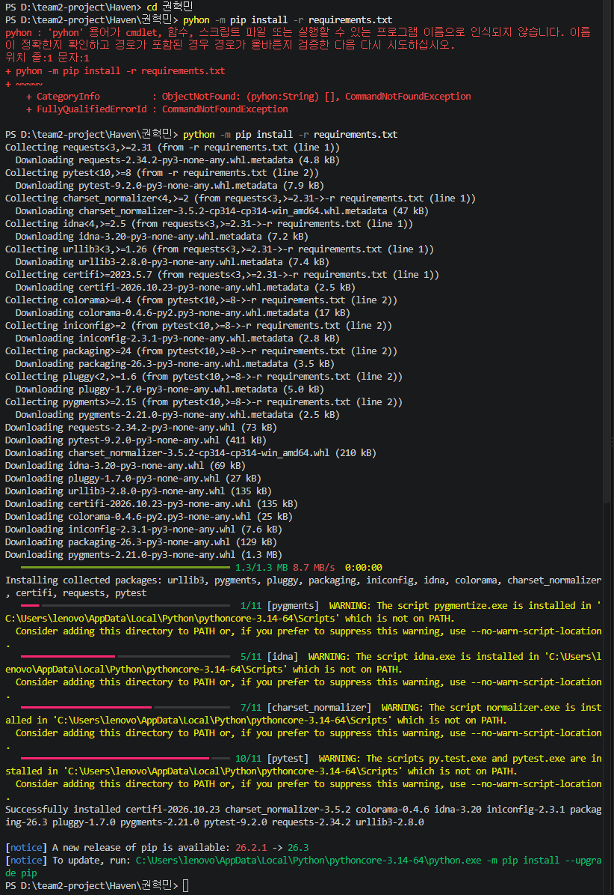

\[그림 1\] 의존성 설치 결과

## 3.2 요청 CLI pytest (로컬)

|          |                                              |
|----------|----------------------------------------------|
| **대상** | 혁민님 요청 CLI의 테스트 — 웹 앱 시험이 아님 |
| **절차** | 로컬에서 python -m pytest -q tests           |
| **결과** | 265 passed in 27.75s                         |
| **판정** | **통과**                                     |

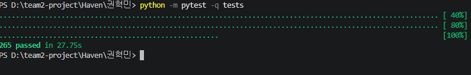

\[그림 2\] pytest 전체 테스트 결과

## 3.3 sg_audit 단위 테스트 (로컬)

|          |                                                                                      |
|----------|--------------------------------------------------------------------------------------|
| **대상** | sg_audit 네트워크 점검 스크립트 — 웹 앱 시험이 아님                                  |
| **절차** | python -B -m unittest discover -s 이민성/sg_audit -p test_network_audit.py -v        |
| **결과** | 스키마·JSON 오류 처리, 누락 자산 처리, 출력 경로 오류 처리, 출력 형식 등 5건 모두 ok |
| **판정** | **통과**                                                                             |

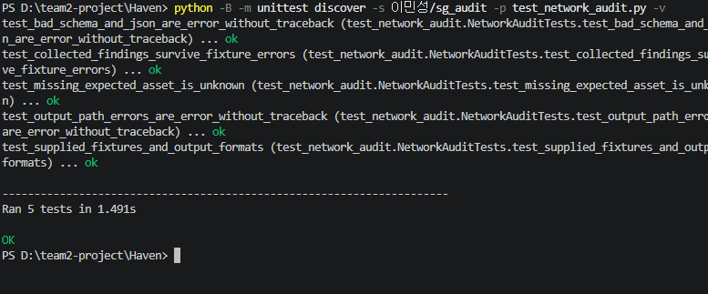

\[그림 3\] sg_audit 단위 테스트 결과

## 3.4 로그인 실패 처리(https://orchestration-haven.cloud/accounts/login/)

|               |                                                                                       |
|---------------|---------------------------------------------------------------------------------------|
| **절차**      | test1 아이디에 잘못된 비밀번호로 로그인 시도                                          |
| **기대 결과** | 로그인 거부, 아이디/비밀번호 중 무엇이 틀렸는지 노출하지 않는 안내                    |
| **결과**      | "로그인할 수 없습니다. 아이디와 비밀번호를 확인해 주세요." 표시, login/ 요청 400 응답 |
| **판정**      | **통과**                                                                              |

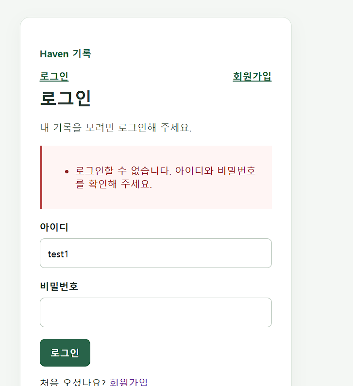

\[그림 4\] 로그인 실패 안내 메시지

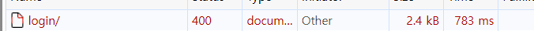

\[그림 5\] 로그인 실패 시 400 응답

## 3.5 기록 작성 및 첨부 업로드(https://orchestration-haven.cloud/posts/7/)

|          |                                                                                                                               |
|----------|-------------------------------------------------------------------------------------------------------------------------------|
| **절차** | test1 계정으로 기록 작성 후 test1.txt 첨부                                                                                    |
| **결과** | 기록 생성(2026-11-12 16:04), test1.txt(5바이트) 업로드. 업로드 제한(TXT/PDF, 파일당 2MiB, 기록당 3개, 계정당 10MiB) 안내 표시 |
| **판정** | **통과**                                                                                                                      |

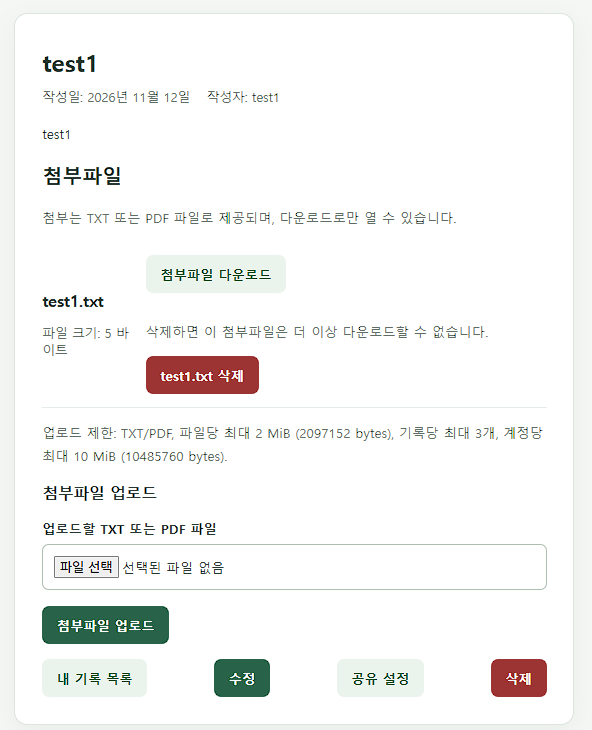

\[그림 6\] test1 기록 상세 및 첨부파일

## 3.6 공유 전 상태

|          |                                                |
|----------|------------------------------------------------|
| **절차** | test1 기록의 공유 설정 화면에서 공유 대상 확인 |
| **결과** | "아직 공유한 사용자가 없습니다" 표시           |
| **판정** | **통과**                                       |

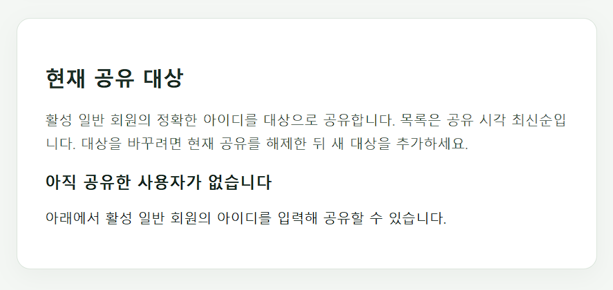

\[그림 7\] 공유 전 공유 대상 없음

## 3.7 공유 설정 (test1 → test2)(https://orchestration-haven.cloud/posts/7/shares/)

|          |                                                              |
|----------|--------------------------------------------------------------|
| **절차** | test1 기록 공유 설정에서 test2 아이디 입력 후 공유           |
| **결과** | 공유 대상에 test2 추가(공유 시각 16:16), 공유 해제 버튼 표시 |
| **판정** | **통과**                                                     |

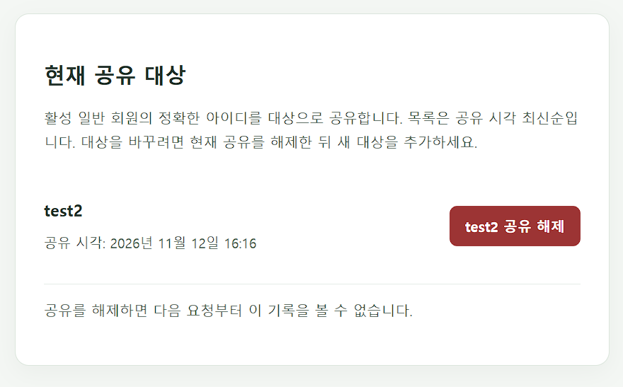

\[그림 8\] 공유 대상 test2 추가

## 3.8 공유받은 기록 조회 (B)(https://orchestration-haven.cloud/posts/shared/)

|          |                                                                |
|----------|----------------------------------------------------------------|
| **절차** | test2 로그인 후 공유받은 기록 메뉴 진입                        |
| **결과** | test1 기록이 작성자·작성/수정 시각과 함께 표시, 읽기 전용 안내 |
| **판정** | **통과**                                                       |

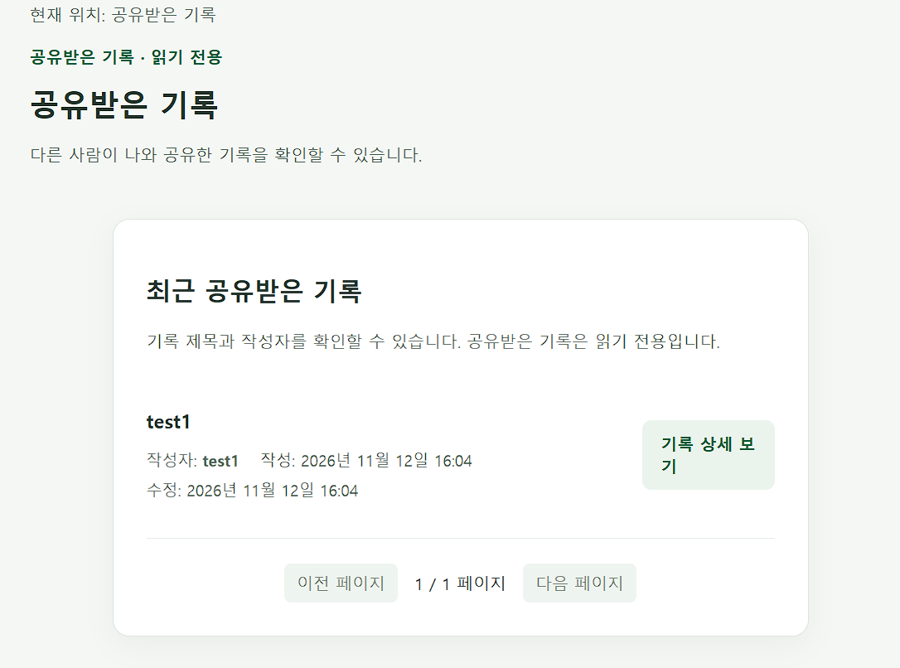

\[그림 9\] test2의 공유받은 기록 목록

## 3.9 공유받은 사용자의 수정·삭제·공유 설정 차단 (B)

|          |                                                                                     |
|----------|-------------------------------------------------------------------------------------|
| **절차** | 공유받은 상태의 test2가 test1 기록의 수정·삭제·공유 설정 주소로 직접 접근 (#82 6번) |
| **결과** | 세 주소 모두 404                                                                    |
| **판정** | **통과**                                                                            |
| **비고** | 공유받은 사용자는 읽기만 가능하고 작성자 기능은 막혀 있음                           |

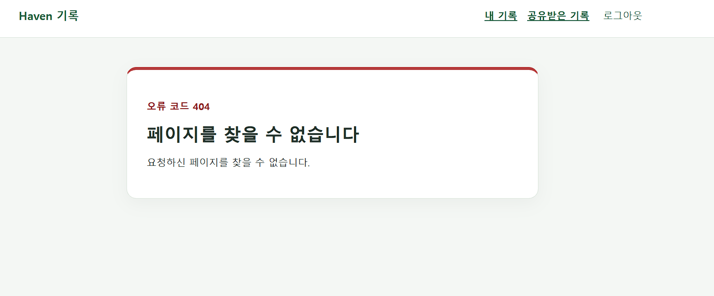

\[그림 10\] B의 test1 수정 주소 직접 접근(https://orchestration-haven.cloud/posts/7/edit/) → 404

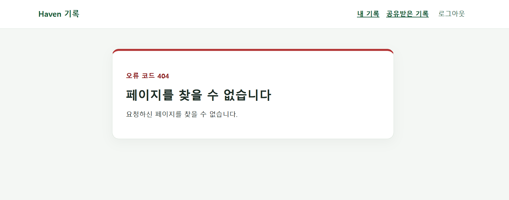

\[그림 11\] B의 test1 삭제 주소 직접 접근(https://orchestration-haven.cloud/posts/7/delete/) → 404 (1)

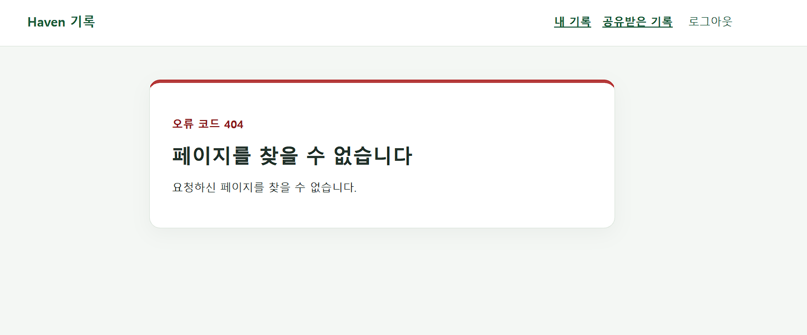

\[그림 12\] B의 test1 공유 설정 주소 직접 접근(https://orchestration-haven.cloud/posts/7/shares/) → 404 (2)

## 3.10 비공유 사용자 접근 차단 (test3)

|          |                                                                                             |
|----------|---------------------------------------------------------------------------------------------|
| **절차** | test3 로그인 후 공유받은 기록 조회, test1 기록 상세 URL 및 test1.txt 다운로드 URL 직접 접근 |
| **결과** | 공유받은 기록 없음 표시, 상세·다운로드 모두 404                                             |
| **판정** | **통과**                                                                                    |
| **비고** | 403이 아닌 404로 응답해 기록 존재 여부가 노출되지 않음                                      |

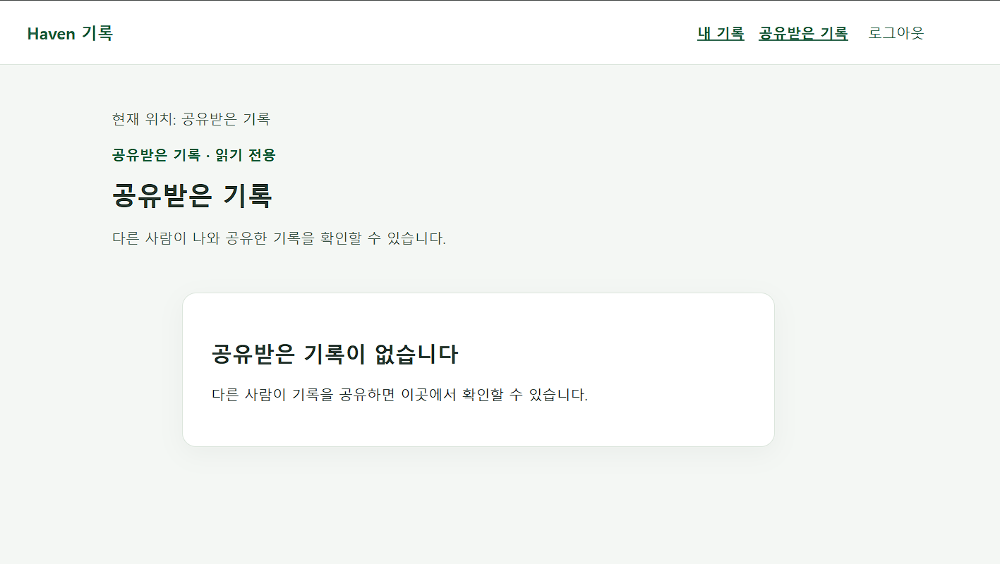

\[그림 13\] test3의 공유받은 기록(없음)(https://orchestration-haven.cloud/posts/shared/)

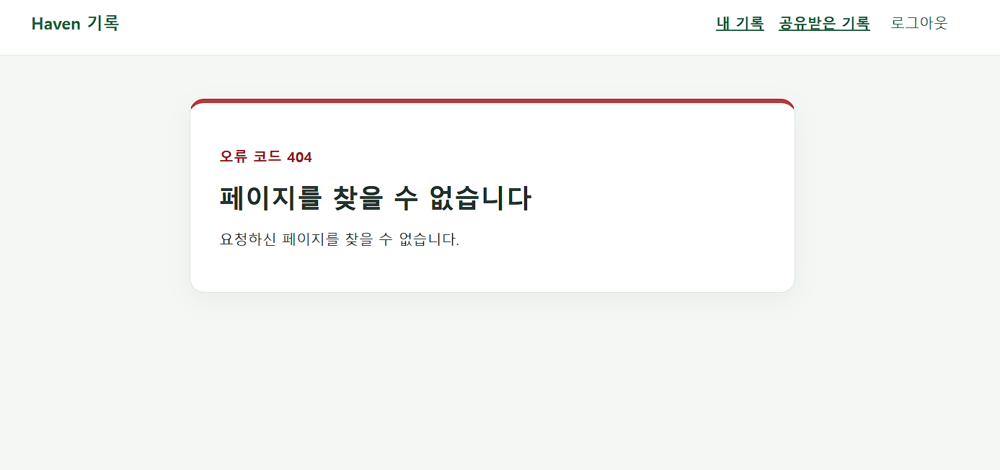

\[그림 14\] test3의 test1 기록 상세 접근(https://orchestration-haven.cloud/posts/7/) → 404

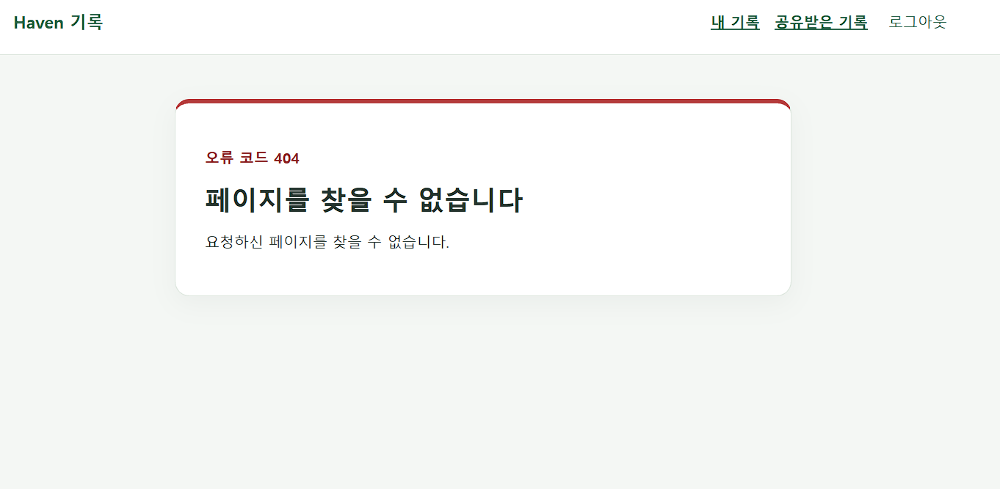

\[그림 15\] test3의 test1.txt 다운로드(https://orchestration-haven.cloud/posts/7/attachments/8/download/) → 404

## 3.11 권한 없는 요청 거부

|          |                                         |
|----------|-----------------------------------------|
| **절차** | test1 → 관리자 주소 접근                |
| **결과** | "요청이 거부되었습니다" 403 페이지 표시 |
| **판정** | **통과**                                |

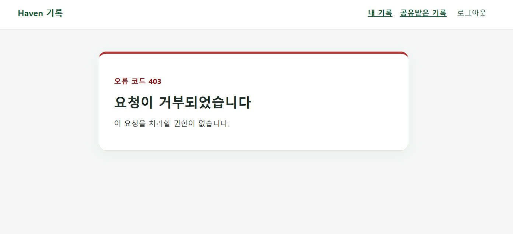

\[그림 16\] 권한 없는 요청(https://orchestration-haven.cloud/admin/accounts/) → 403

## 3.12 공유 해제 후 접근 차단 (B)

|          |                                                                                  |
|----------|----------------------------------------------------------------------------------|
| **절차** | test1이 test2 공유 해제 → test2로 공유받은 기록, 기록 상세, 첨부 다운로드 재접근 |
| **결과** | 공유받은 기록 없음 표시, 상세·다운로드 모두 404                                  |
| **판정** | **통과**                                                                         |

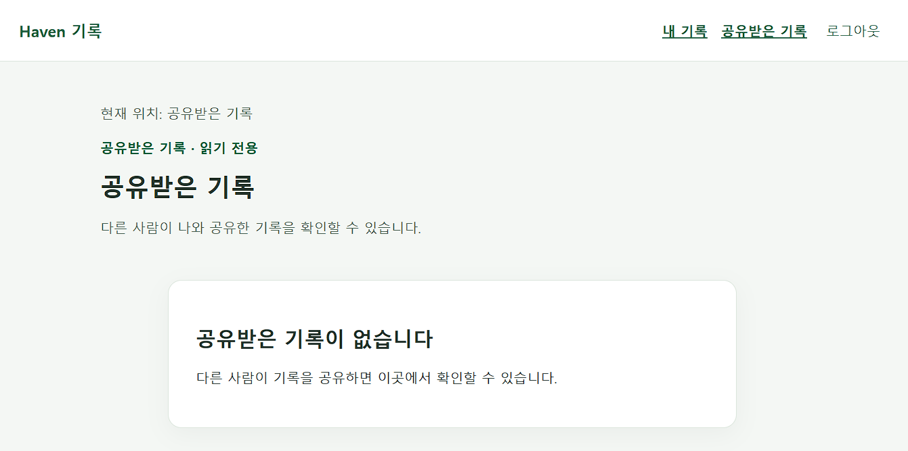

\[그림 17\] 공유 해제 후 test2의 공유받은 기록(없음)(https://orchestration-haven.cloud/posts/shared/)

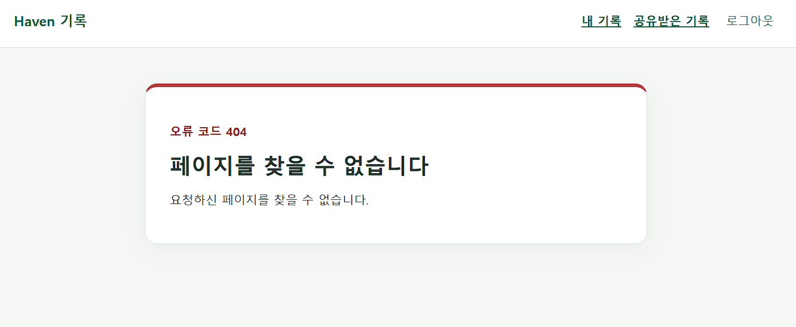

\[그림 18\] 공유 해제 후 test2의 test1 기록 상세(https://orchestration-haven.cloud/posts/7/) → 404

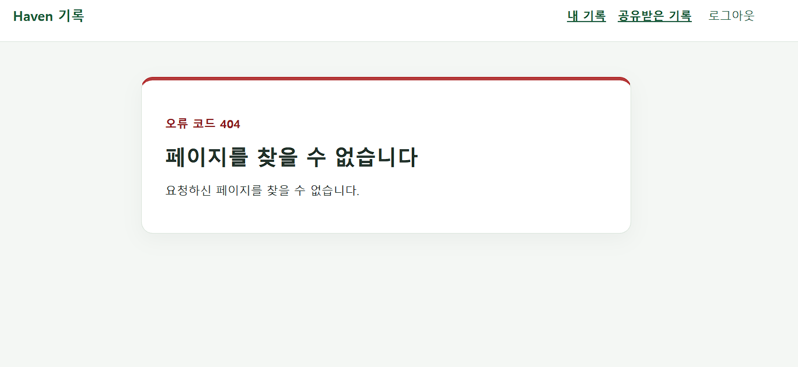

\[그림 19\] 공유 해제 후 test2의 test1.txt 다운로드(https://orchestration-haven.cloud/posts/7/attachments/8/download/) → 404

# 4. 오류 화면 확인 현황

일반 회원 계정으로 확인한 오류 화면과, 운영 관리자 계정이 있어야 볼 수 있는 화면을 구분해 정리하였다.

| **화면**                               | **어떻게 확인했나**                                         | **결과**               | **비고**                                          |
|----------------------------------------|-------------------------------------------------------------|------------------------|---------------------------------------------------|
| 404                                    | 일반 회원 계정으로 남의 글 주소 직접 접근 (3.9, 3.10, 3.12) | **확인(11/12)**        |                                                   |
| 403                                    | 관리자 주소 접근                                            | **확인(11/12)**        |                                                   |
| 로그인 실패 400                        | 잘못된 비밀번호로 로그인 (3.4)                              | **확인(11/12)**        |                                                   |
| 공통 400 (파일 2개 동시 업로드)        | —                                                           | **미확인, 2회차 예정** | 푸른님이 이미 확인함                              |
| 관리자 계정 목록, 상태 변경, 이력 화면 | —                                                           | **미확인, 4회차**      | 운영 관리자 계정이 있어야 함 (조장님이 만들 예정) |

# 5. 하지 않은 것 (미확인 항목)

이번 시험에서 하지 못한 항목을 그대로 적는다. 지금 할 수 없는 것은 할 수 없다고 기록한다.

- 업로드 거부 직접 요청 시험: 공유받은 사용자의 업로드 POST가 거부되는지 직접 요청으로 확인하지 않음. 화면에 업로드 버튼이 없는 것만 확인함

- 공통 400 (파일 2개 동시 업로드): 직접 확인하지 않음. 2회차에 확인 예정 (푸른님은 이미 확인)

- 운영 관리자 화면 (관리자 계정 목록, 상태 변경, 이력): 운영 관리자 계정이 아직 없어 확인 불가. 4회차 직전 조장님이 계정 생성 예정

- 메일 관련 기능: 확인하지 않음

# 6. 결론

운영 사이트(배포 커밋 74ae5eb)에서 일반 회원 계정으로 시험한 운영 사이트 일반 회원 시험 9개 항목과 로컬 CLI 시험 3개 항목이 모두 기대 결과와 일치하였다. 공유받은 사용자는 기록을 읽을 수만 있고 수정·삭제·공유 설정 주소는 404로 막혔다. 공유받지 않은 사용자와 공유가 해제된 사용자는 기록 상세와 첨부파일에 접근할 수 없었고, 공유 해제는 다음 요청부터 반영되었다. 비인가 접근에 404로 응답해 다른 사용자 기록의 존재 여부도 드러나지 않았다.

다만 업로드 거부 직접 요청, 공통 400, 운영 관리자 화면, 메일은 시험하지 않았으므로(5장) 이 보고서의 결과는 위 시험 범위에 한정된다.
