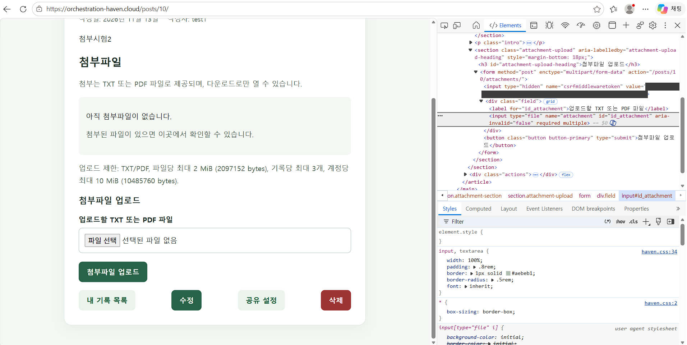
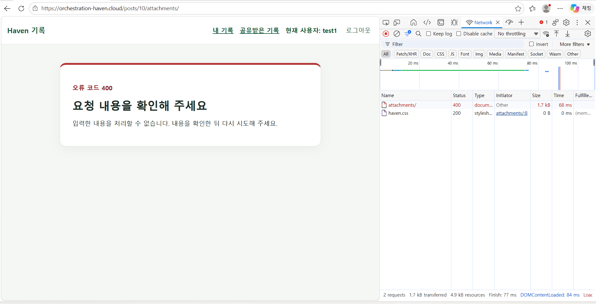
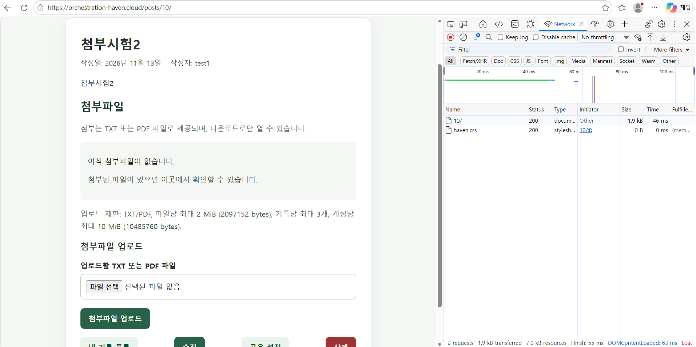

# 2회차 공통 400 화면 검증 보고서

Team2 · Haven 프로젝트 · 작성 구민철

| 항목 | 내용 |
|---|---|
| **프로젝트** | Haven (team2-project) |
| **검증 일자** | 2026년 11월 13일 16:15~16:20 |
| **보고 일자** | 2026년 11월 13일 |
| **검증 계정** | test1 — 본인이 가입한 일반 회원 |
| **웹 시험 환경** | AWS 운영 사이트 https://orchestration-haven.cloud (Edge) |
| **운영 배포 커밋** | `a7bfcd6` (11/13 11:49 운영 기록 기준, 이후 재배포 여부는 확인 필요) |
| **상태 코드 확인** | 브라우저 개발자 도구 Network 탭 |
| **대상 글** | `/posts/10/` (test1 본인 글, 첨부 없음) |
| **종합 결과** | 기대 결과와 일치 |

## 1. 검증 목적

TODO 4장(2회차)의 "공통 `400.html`을 본인 일반 회원 계정으로 직접 확인한다"를 수행한다.

- 개별 입력 오류(상세 화면 + 오류 문구)가 아니라, 처리할 수 없는 요청에 대해 사이트 공통 400 화면이 나오는지 확인한다.
- 공통 화면에 내부 정보(내부 경로, 코드 오류, 서버 정보)가 노출되지 않는지 확인한다.
- 거부된 요청의 첨부가 저장되지 않는지 확인한다.

## 2. 방법

신요찬 안내 방법(노푸른 TODO에도 같은 방법 기재)을 따랐다.

| 순서 | 내용 |
|---|---|
| 1 | Edge에서 test1로 로그인, 본인 글 `/posts/10/` 상세 화면 |
| 2 | 개발자 도구 Elements에서 업로드 칸 `<input type="file" name="attachment">`에 `multiple` 속성 추가 (내 브라우저 화면 사본만 변경) |
| 3 | 정상 파일 2개(`test2-1.txt` 19 B, `test2-6.pdf` 11.6 KB)를 한 번에 선택 |
| 4 | Network 탭을 연 상태로 "첨부파일 업로드"를 1회 클릭 |
| 5 | `/posts/10/`을 다시 열어 첨부 저장 여부 확인 |

- 정상 파일 2개를 써서 형식·크기 오류가 아닌 "한 요청에 파일 2개"만 원인이 되게 했다.
- 비정상 요청이라 본인 글에서 1회만 보냈고, 시험 후 새로고침해 화면 변경을 되돌렸다.

- 그림의 `<input type="file" name="attachment" id="id_attachment" … required multiple>` 줄이 속성을 추가한 결과다. 원래 화면에는 `multiple`이 없다.
- 같은 폼의 숨은 입력 `csrfmiddlewaretoken` 값은 공개 자료에 넣지 않으려고 가렸다.

## 3. 결과

| 확인 | 기대 | 실제 |
|---|---|---|
| Network `attachments/` 상태 코드 | 400 | **400** |
| 화면 | 공통 400 화면 | "오류 코드 400 / 요청 내용을 확인해 주세요 / 입력한 내용을 처리할 수 없습니다. 내용을 확인한 뒤 다시 시도해 주세요." |
| 응답 크기 | 상세 화면과 다른 페이지 | 약 1.7 kB (개별 첨부 오류로 상세 화면을 다시 보여 줄 때는 약 5.8 kB) |
| 노출 정보 | 내부 정보 없음 | 내부 경로, 코드 오류(stack trace), 서버 정보 없음 |
| 저장 여부 | 첨부 저장 안 됨 | `/posts/10/` 첨부 "아직 첨부파일이 없습니다" |

## 4. 결론

- 한 요청에 파일 2개를 보내면 개별 첨부 오류가 아니라 공통 400 화면으로 거부되고, 첨부는 저장되지 않았다.
- 공통 400 화면에는 사용자 안내 문구만 있고 내부 정보는 노출되지 않았다.
- TODO 4장 "공통 400.html 직접 확인" 항목을 완료로 본다. 계정 상태 변경·이력 화면(APP-07·09)은 4회차에 조장 확인 결과와 대조한다.
