# 2회차 첨부, 공유_파일_업로드_권한 검증 보고서

Team2 · Haven 프로젝트 · 작성 구민철

| 항목           | 내용                                                                        |
| ------------ | ------------------------------------------------------------------------- |
| **프로젝트**     | Haven (team2-project)                                                     |
| **검증 일자**    | 2026년 11월 13일 14:45~15:24, 추가 시험 2026년 11월 16일 12:3x~12:41 (7장)               |
| **보고 일자**    | 2026년 11월 13일 (7장 추가 2026년 11월 16일)                                         |
| **검증 계정**    | test1(작성자, A), test2(공유 대상, B) — 모두 본인이 가입한 일반 회원                         |
| **웹 시험 환경**  | AWS 운영 사이트 https://orchestration-haven.cloud (Edge: test1, Chrome: test2) |
| **운영 배포 커밋** | **`a7bfcd6`** (#86까지 반영, 오전 백업·격리 복원 연습 뒤 2회 배포, healthz 200)             |
| **상태 코드 확인** | 브라우저 개발자 도구 Network 탭, Console                                            |
| **대상 글**     | `/posts/9/` (첨부 흐름), `/posts/10/` (용량 한도·업로드 권한)                          |
| **종합 결과**    | 시험한 20개 항목 모두 기대 결과와 일치 (11/13 16개 + 11/16 추가 4개) / 미확인 항목은 8장에 별도 기재 |

## 1. 검증 목적

TODO 4장(2회차) 중 다음 두 항목을 확인한다.

- **첨부:** 허용 형식(TXT·PDF), 한도(파일 2 MiB, 기록당 3개, 계정 10 MiB) 안의 업로드·다운로드와 잘못된 업로드 거부(형식·개수·용량)
- **공유 중 업로드 거부:** 공유받은 사용자가 화면에 없는 업로드를 직접 요청으로 보내도 서버가 거부하는지 (조장 코멘트 2번)

## 2. 기준 (신요찬 `앱계약.md` 3·4장)

| 규칙 | 위반 시 응답 |
|---|---|
| 확장자 `.txt`·`.pdf` (대소문자 무관) | 400 |
| 실제 내용 검사: TXT는 UTF-8·제어문자 없음, PDF는 구조·암호화 아님 | 400 |
| 빈 파일, 경로 문자·`..`·255자 초과 이름 | 400 |
| 파일당 2 MiB (2,097,152바이트) 이하 | 413 |
| 기록당 3개 | 400 |
| 계정당 10 MiB (10,485,760바이트) | 400 |
| 소유자가 아닌 사용자의 업로드 요청 | 404 |
- 400·413이면 상세 화면을 오류 문구와 함께 다시 보여 주고 첨부는 저장하지 않는다.
- 업로드 성공은 302 후 상세 화면(200)으로 이동한다.

## 3. 시험 파일

PowerShell로 저장소 밖 폴더(`D:\haven-upload-test`)에 만들었다. 개인정보 없음.

| 파일 | 크기 | 내용 | 용도 |
|---|---|---|---|
| `test2-1.txt` | 19 B | ASCII 한 줄 | 정상 TXT |
| `test2-6.pdf` | 11.6 KB | Microsoft Print to PDF로 만든 실제 PDF | 정상 PDF |
| `fake.pdf` | 19 B | `test2-1.txt` 복사본 | 이름만 PDF |
| `wrong.jpg` | 19 B | `test2-1.txt` 복사본 | 허용 안 되는 확장자 |
| `test2-4.txt` | 2 B | `0xC3 0x28` | UTF-8 아님 |
| `test2-5.txt` | 3 B | `0x41 0x00 0x42` | 제어문자(NUL) 포함 |
| `empty.txt` | 0 B | 없음 | 빈 파일 |
| `test2-3.txt` | 2,097,153 B | `a` 반복 | 2 MiB + 1바이트 |
| `test2-2.txt` | 2,097,152 B | `a` 반복 | 정확히 2 MiB (경계값) |
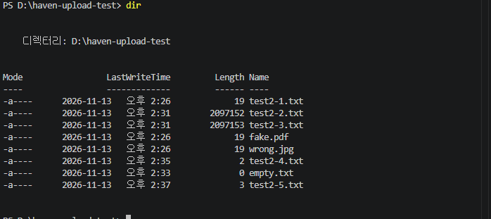

## 4. 첨부 결과 (test1, `/posts/9/`)

| # | 파일 | 기대 | 실제 상태 코드 | 화면 문구 | 첨부 목록 |
|---|---|---|---|---|---|
| U1 | `test2-1.txt` | 성공 | 성공, 다운로드 확인 | - | 1개 |
| U2 | `test2-6.pdf` | 성공 | 성공 | - | 2개 |
| U3 | `fake.pdf` | 400 | **400** | PDF 파일이 아닙니다. | 2개 그대로 |
| U4 | `wrong.jpg` | 400 | **400** | TXT 또는 PDF 파일만 올릴 수 있습니다. | 2개 그대로 |
| U5 | `test2-4.txt` | 400 | **400** | UTF-8 텍스트 파일만 올릴 수 있습니다. | 2개 그대로 |
| U6 | `test2-5.txt` | 400 | **400** | 텍스트 파일에 허용하지 않는 제어문자가 있습니다. | 2개 그대로 |
| U7 | `empty.txt` | 400 | **400** | 빈 파일은 올릴 수 없습니다. | 2개 그대로 |
| U8 | `test2-3.txt` | 413 | **413** | 파일은 2 MiB까지 올릴 수 있습니다. | 2개 그대로 |
| U9 | `test2-2.txt` | 성공 | **302 → 200** | - | 3개 (2.0 MB 표시) |
| U10 | 4번째 파일 | 400 | **400** | 글 하나에 첨부는 3개까지입니다. | 3개 그대로 |
| U11 | U1 삭제 후 다운로드 주소 | 404 | **404** | 페이지를 찾을 수 없습니다 | U1 사라짐 |

- 거부될 때마다 첨부 목록이 그대로였다. 거부된 파일이 저장되지 않았다.
- 위반 종류마다 오류 문구가 구분되어, 확장자 검사와 내용 검사(PDF 구조, UTF-8, 제어문자, 빈 파일)가 각각 동작함을 확인했다.
- 경계값: 2,097,152바이트는 허용, 2,097,153바이트는 413으로 정확히 갈렸다.
- U11 주소: `/posts/9/attachments/10/download/`

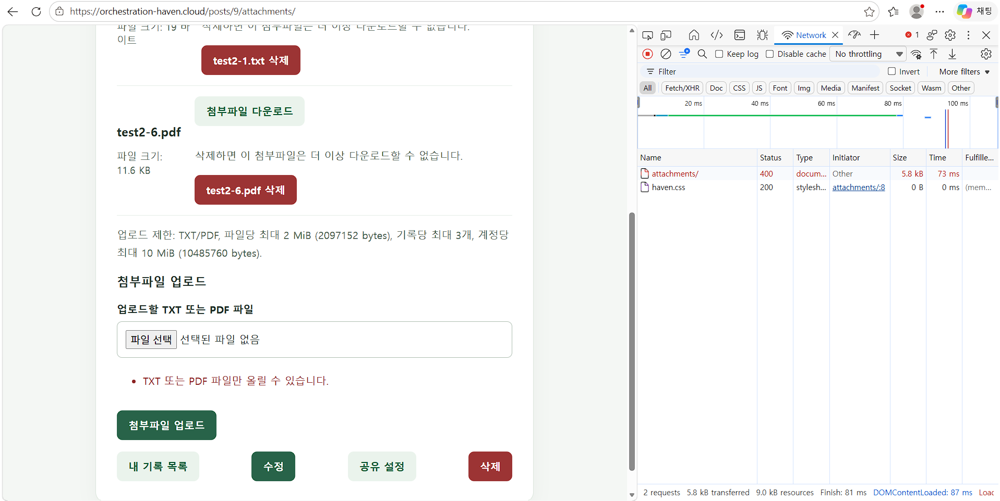
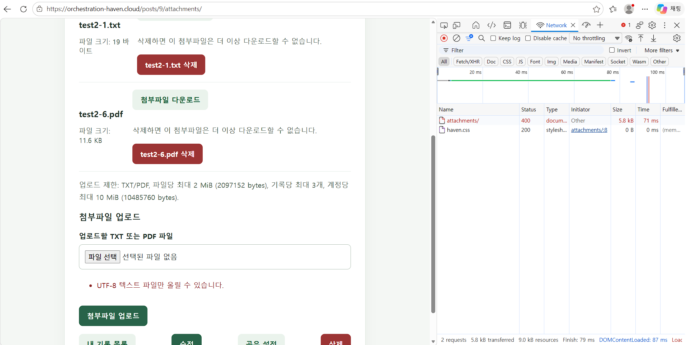

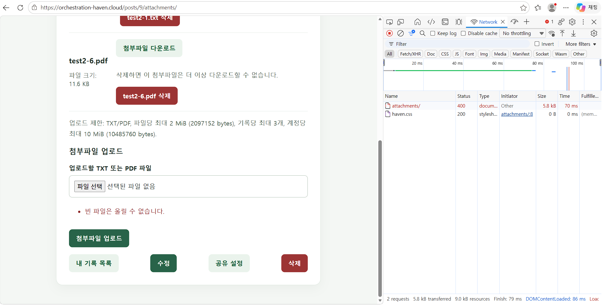
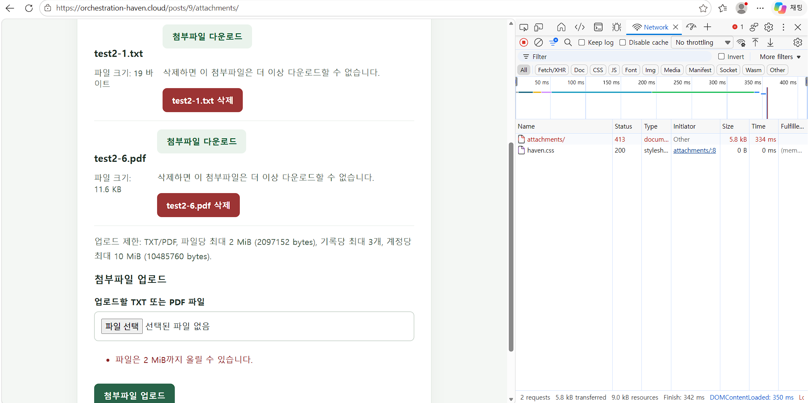
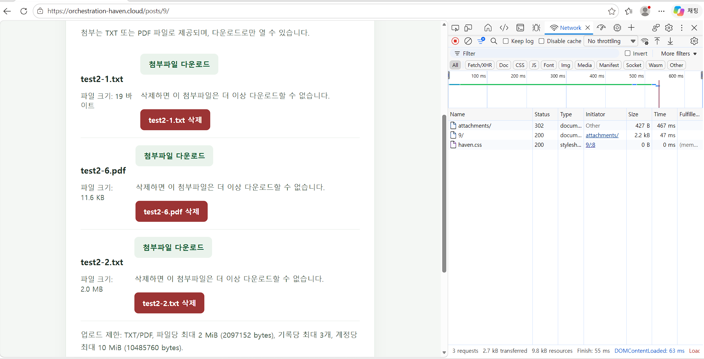

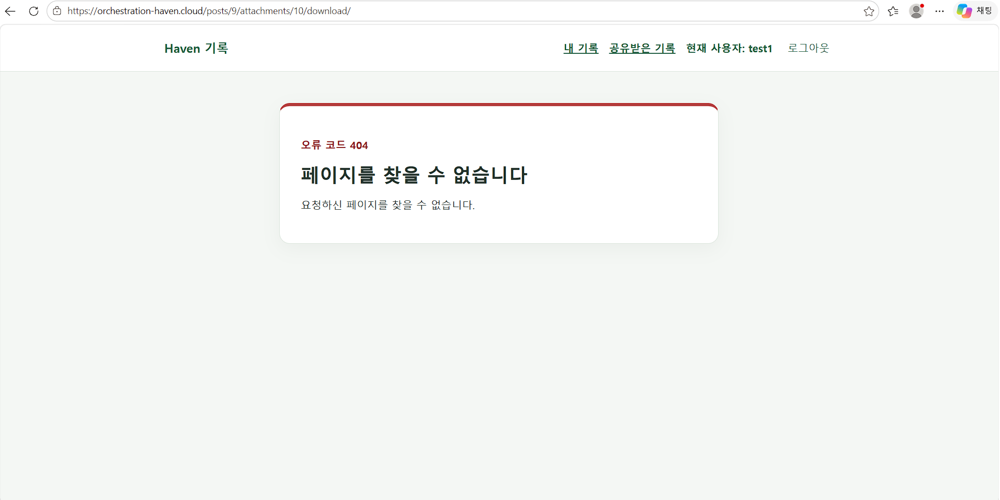

## 5. 계정 10 MiB 한도 (test1)

| #   | 위치                        | 기대  | 실제                                 | 누적 (대략)  |
| --- | ------------------------- | --- | ---------------------------------- | -------- |
| A1  | 글 '첨부 시험'에 `test2-2.txt`  | 성공  | 302 → 200 (글 9 첨부 3개)              | 4.01 MiB |
| A2  | 글 '첨부 시험2'에 `test2-2.txt` | 성공  | 302 → 200                          | 6.01 MiB |
| A3  | 글 '첨부 시험2'에 `test2-2.txt` | 성공  | 302 → 200 (글 10 첨부 2개)             | 8.01 MiB |
| A4  | 글 '첨부 시험2'에 `test2-2.txt` | 400 | **400**, "계정 첨부 용량(10 MiB)을 넘습니다." | 거부       |

- A4 시점에 글 10의 첨부는 2개라 기록당 3개 제한이 아니다. 문구도 계정 용량 오류로 나와 계정 단위 한도가 동작함을 확인했다.
- 시험 후 글 10의 2 MiB 첨부 2개를 삭제해 용량을 비웠다.

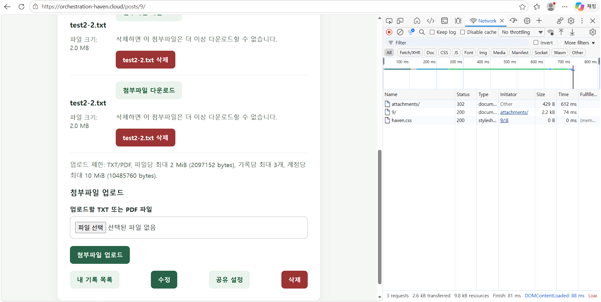
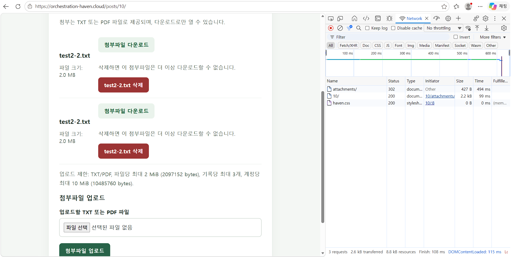
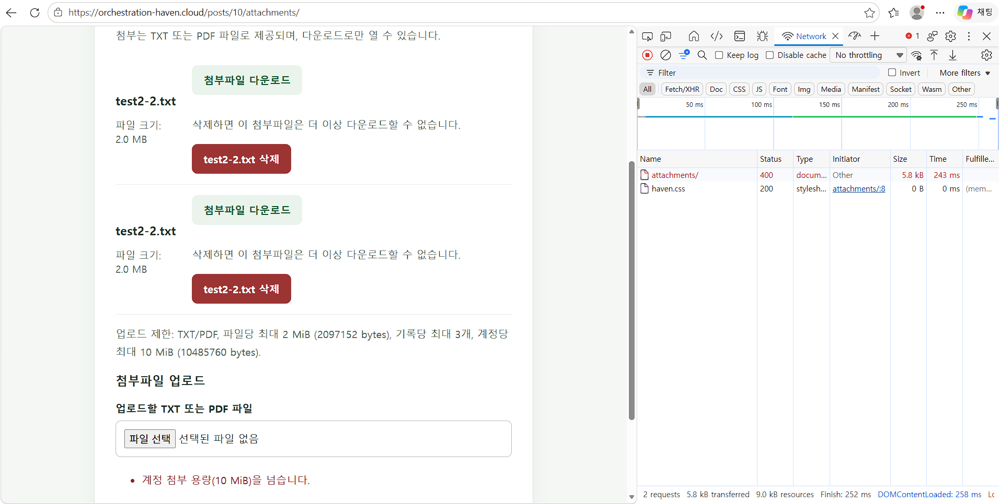

## 6. 공유받은 사용자의 업로드 직접 요청 (조장 코멘트 2번)

| 항목  | 내용                                                                                                                            |
| --- | ----------------------------------------------------------------------------------------------------------------------------- |
| 상황  | test1의 글 '첨부 시험2'을 test2에게 읽기 공유 (15:19)                                                                                      |
| 화면  | test2 화면에 업로드 칸 없음 (현재 사용자: test2, 작성자: test1)                                                                                |
| 요청  | test2 로그인 상태로 Chrome 개발자 도구 Console에서 `fetch`로 `/posts/10/attachments/`에 POST 1회. 정상 TXT(`b_test.txt`, 13바이트)와 화면의 CSRF 토큰 포함 |
| 기대  | 404 (소유자 아님), 첨부 저장 안 됨                                                                                                       |
| 실제  | **404 Not Found**, 요청 후에도 글 '첨부 시험2' 첨부는 "아직 첨부파일이 없습니다"                                                                      |

- 403이 아니라 404이므로 CSRF 검사는 통과했고 "소유자 아님"으로 거부되었다. 앱계약과 일치한다.
- 화면에서 버튼을 숨기는 것뿐 아니라 서버가 업로드 권한을 직접 검사함을 확인했다.
- 본인 가상 계정끼리 1회만 보냈다. 쿠키·토큰 값은 기록하지 않았다.

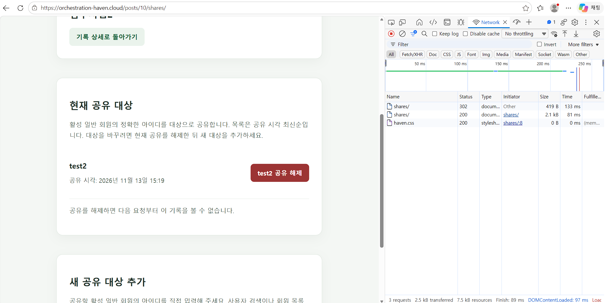
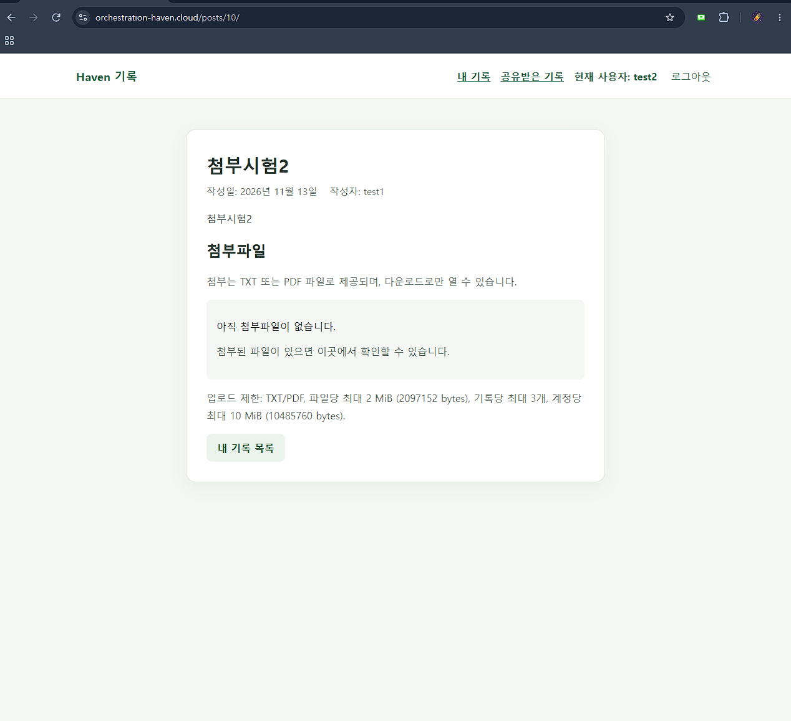
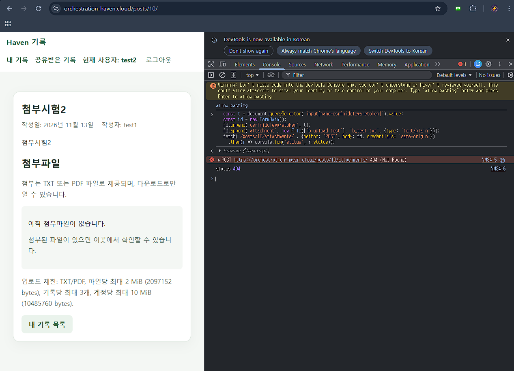

## 7. 추가 시험 (2026-11-16, 조장 11/13 코멘트 "남은 일")

11/13에 확인하지 못한 항목 중 화면에서 할 수 있는 3가지를 추가로 시험했다.

| 항목 | 내용 |
|---|---|
| 시각·배포 | 2026-11-16 12:3x~12:41 KST (다운로드 응답 Date 03:39:07Z·03:41:01Z), 운영 `370b22e` (11/16 민성 배포 기준) |
| 계정·대상 | test1, 본인 글(첨부 `test1.txt`·`test2-6.pdf`가 있는 글). 화면의 업로드 칸과 첨부 다운로드 버튼만 사용 |
| 환경 | Chrome, 개발자 도구 Network(Keep log·Disable cache) |

### 7.1 업로드 거부

| # | 파일 | 기대 | 실제 상태 코드 | 화면 문구 | 첨부 목록 |
|---|---|---|---|---|---|
| U12 | 암호화 PDF (`sample_encrypted.pdf`, `권혁민/fixtures`) | 400 | **400** | 암호화된 PDF는 올릴 수 없습니다. | 그대로 |
| U13 | `test..txt` (이름에 `..`, 내용은 정상 TXT) | 400 | **400** | 파일 이름을 확인해 주세요. | 그대로 |

- 앱계약 4장 첨부 업로드 폼("PDF는 구조·암호화 아님", "`..` 이름 거부")과 일치한다.
- 이름 오류는 다른 내용 오류와 달리 특정 규칙을 알려 주지 않는 일반 문구로 표시되었다.

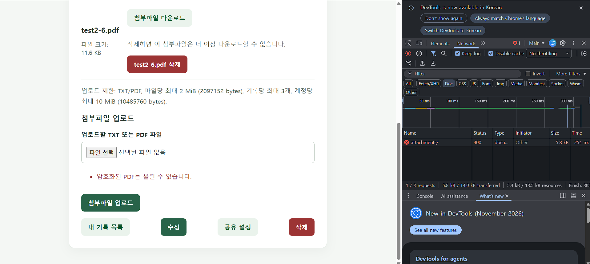

### 7.2 다운로드 응답 헤더

| 헤더 | 기대 (앱계약 3장) | TXT (`test1.txt`) | PDF (`test2-6.pdf`) | 판정 |
|---|---|---|---|---|
| `Content-Disposition` | `attachment` + 파일 이름 | `attachment; filename="test1.txt"` | `attachment; filename="test2-6.pdf"` | 일치 |
| `Content-Type` | 검증된 형식 | `text/plain; charset=utf-8` | `application/pdf` | 일치 |
| `X-Content-Type-Options` | `nosniff` | `nosniff` | `nosniff` | 일치 |
| `Cache-Control` | `private, no-store` | `private, no-store` | `private, no-store` | 일치 |
| `Content-Length` | 실제 크기 | 5 | 11846 | 일치 (화면 11.6 KB) |

- 그 밖에 `X-Frame-Options: DENY`, `Referrer-Policy: same-origin`, `Cross-Origin-Opener-Policy: same-origin`, `Vary: Cookie`, `X-Request-Id`가 함께 왔다.
- `Content-Disposition: attachment`이므로 브라우저가 파일을 화면에 열지 않고 내려받는다. `nosniff`로 브라우저가 형식을 추측해 실행하지 않는다.
- 캡처는 응답 헤더만 남겼다(요청 헤더의 쿠키는 기록하지 않음).

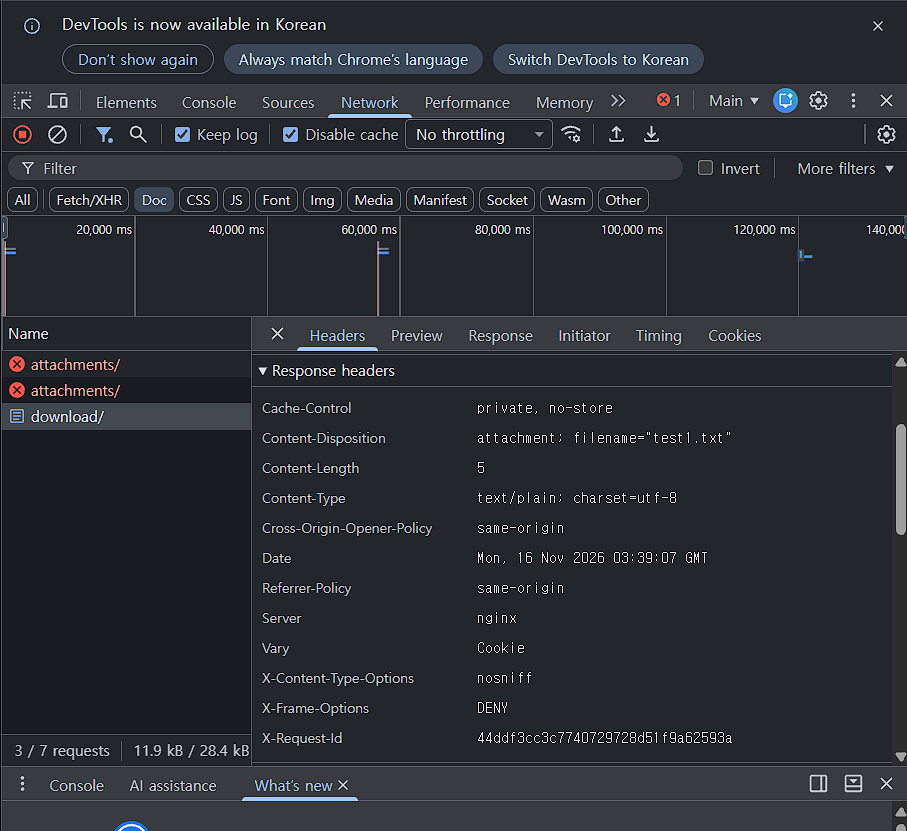
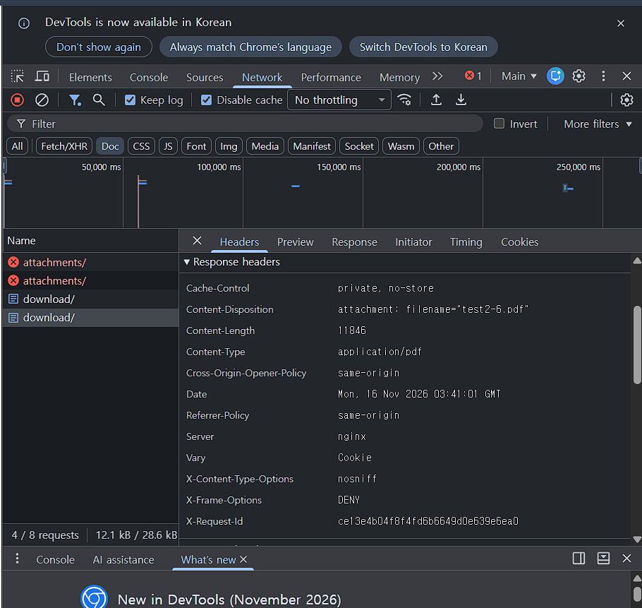

## 8. 확인하지 못한 것

- ~~공통 400.html (파일 2개 동시 업로드)~~ → 11/13 [2회차 공통400 검증보고서](../2회차%20공통400%20검증보고서/2회차_공통400_검증보고서.md)로 확인
- ~~PDF 암호화 거부~~ → 11/16 7.1 U12로 확인
- ~~다운로드 응답 헤더~~ → 11/16 7.2로 확인
- 이름 규칙 위반 중 `..`는 11/16 7.1 U13로 확인. **경로 문자(`/`, `\`), 제어문자, 255자 초과 이름**은 Windows에서 그런 파일을 만들 수 없어 화면으로 시험하지 않음(개발자 도구로 요청을 직접 만들어야 하므로 조장 허용 필요). 앱 자동 시험 결과로 대신함
- 참고: 첨부 흐름 시험 글 9(`/posts/9/`)는 11/16 운영 사이트 시험 데이터 정리로 삭제함. 4장 결과는 이 보고서의 캡처 기준이다.

## 9. 결론

- TODO 4장 **첨부**: 허용 형식, 파일당 2 MiB 경계, 기록당 3개, 계정 10 MiB, 잘못된 업로드 거부 5종, 삭제 후 다운로드 404까지 모두 기대대로 동작했다.
- TODO 4장 **공유**: 1회차 보고서(#92)의 읽기·다운로드 허용, 수정·삭제·공유 설정 404, 해제 후 404에 더해, 공유받은 사용자의 업로드 직접 요청도 404로 거부됨을 확인했다.
- 11/16 추가: 암호화 PDF·`..` 이름 업로드가 400으로 거부되었고, 다운로드 응답에 `Content-Disposition: attachment`, `nosniff`, `Cache-Control: private, no-store`가 붙어 앱계약과 일치했다.
