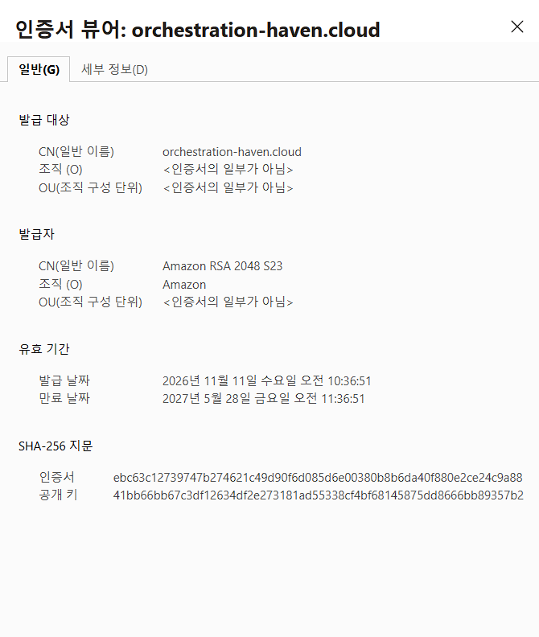
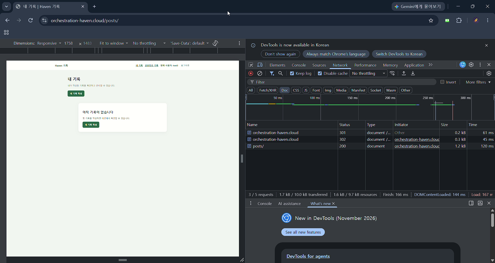
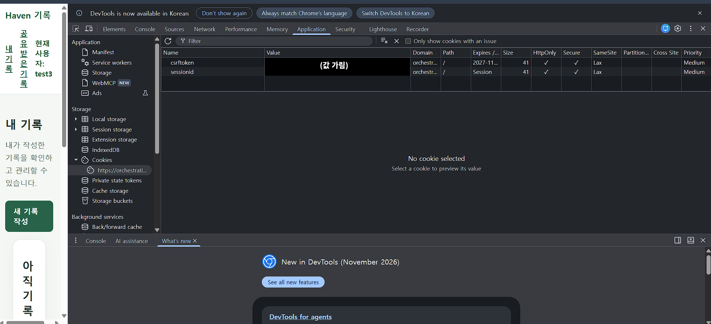
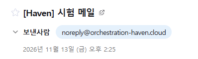
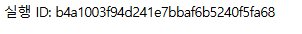
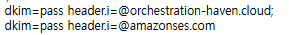

# 2회차 HTTPS·쿠키·시험 메일 독립 확인 보고서 (C1)

Team2 · Haven 프로젝트 · 작성 구민철

| 항목 | 내용 |
|---|---|
| **프로젝트** | Haven (team2-project) |
| **검증 일자** | 2026년 11월 16일 10:17~10:47 |
| **보고 일자** | 2026년 11월 16일 |
| **검증 계정** | test3 — 본인이 가입한 일반 회원 (쿠키 확인용) |
| **웹 시험 환경** | AWS 운영 사이트 https://orchestration-haven.cloud (Chrome) |
| **운영 배포 커밋** | `370b22e` (11/16 민성 배포 기준) |
| **확인 도구** | 브라우저 인증서 뷰어, 개발자 도구 Network·Application 탭 |
| **대조 기록** | 권혁민 #62 `시험결과/2026-11-11_AWS_01.md`(쿠키), `신요찬/app/config/settings.py`(쿠키 설정), `신요찬/4회차_앱_검증기록.md` 1장(시험 메일 EXT-03) |
| **종합 결과** | 기대 결과와 일치 (메일은 스팸함 도착을 추가로 확인) |

## 1. 검증 목적

TODO 4장(2회차) "HTTPS·메일 독립 확인: 브라우저에서 HTTPS 접속과 쿠키 속성, 시험 메일 실제 수신 결과를 확인해 요찬·보람의 기록과 맞춘다(C1)"를 수행한다.

- 운영 사이트가 공인 인증서로 HTTPS를 제공하고, HTTP 접속을 HTTPS로 보내는지 확인한다.
- 로그인 쿠키가 결정된 속성(Secure·HttpOnly·SameSite=Lax)으로 발급되는지 확인한다.
- 11/13 시험 메일(EXT-03)이 기록대로 실제로 도착했는지 받은 메일로 대조한다.

## 2. 방법

| 순서 | 내용 |
|---|---|
| 1 | 주소창 자물쇠 → 인증서 보기에서 발급 대상·발급자·유효 기간 확인 |
| 2 | 개발자 도구 Network 탭에서 **Disable cache**와 Keep log를 켜고 `http://orchestration-haven.cloud` 접속 |
| 3 | test3로 로그인한 뒤 Application → Cookies에서 `csrftoken`·`sessionid` 속성 확인, 확인 후 로그아웃 |
| 4 | 김보람에게 11/13에 받은 시험 메일의 제목·보낸 사람·받은 시각·실행 ID·DKIM 결과를 받아 기록과 대조 (받는 주소는 가림) |

- 처음 HTTP 접속 시험(Edge)에서는 301 응답이 브라우저 캐시(`(disk cache)`, 0 B)에서 나와 서버 응답 증거로 쓰지 않았다. Disable cache를 켜고 다시 시험했다.
- 쿠키 캡처의 값(Value) 열은 가렸다. `sessionid` 값은 로그인 세션 자체이므로 공개 자료에 넣지 않는다.

## 3. 결과

### 3.1 인증서

| 확인 | 기대 | 실제 | 판정 |
|---|---|---|---|
| 발급 대상 | `orchestration-haven.cloud` | CN `orchestration-haven.cloud` | 일치 |
| 발급자 | Amazon(ACM) | CN `Amazon RSA 2048 S23`, O `Amazon` | 일치 |
| 유효 기간 | 현재 유효 | 2026-11-11 ~ 2027-05-28 (발급일이 HTTPS 연결일 11/11과 같음) | 일치 |

### 3.2 HTTP → HTTPS

| 확인 | 기대 | 실제 | 판정 |
|---|---|---|---|
| HTTP 첫 응답 | 301 (서버 응답) | **301**, 0.2 kB, 61 ms (Disable cache 상태, 캐시 아님) | 일치 |
| 이후 흐름 | HTTPS 페이지 | 302 → `posts/` **200** (로그인 상태라 내 기록으로 이동) | 일치 |
| 최종 주소 | https | `orchestration-haven.cloud/posts/` (HTTPS) | 일치 |

### 3.3 쿠키 속성

| 쿠키 | Secure | HttpOnly | SameSite | 만료 | 판정 |
|---|---|---|---|---|---|
| `csrftoken` | ✓ | ✓ | Lax | 2027-11 (1년) | 일치 |
| `sessionid` | ✓ | ✓ | Lax | Session (브라우저를 닫으면 삭제) | 일치 |

- `settings.py` 설정(`SESSION_COOKIE_SECURE`·`CSRF_COOKIE_SECURE`·`*_HTTPONLY = True`·`*_SAMESITE = "Lax"`·`SESSION_EXPIRE_AT_BROWSER_CLOSE = True`)과 권혁민 11/11 기록(두 쿠키 모두 Secure·HttpOnly·SameSite=Lax)과 같다.
- HSTS(`Strict-Transport-Security`)는 보내지 않는다. `settings.py`에 "도메인 운영이 안정된 뒤 정한다"고 적힌 의도된 보류이며 결함으로 보지 않는다.

### 3.4 시험 메일 (EXT-03) 수신 대조

| 확인 | 기록 (`신요찬/4회차_앱_검증기록.md` 1장) | 받은 메일 (김보람 제공) | 판정 |
|---|---|---|---|
| 제목 | `[Haven] 시험 메일` | `[Haven] 시험 메일` | 일치 |
| 보낸 사람 | `noreply@orchestration-haven.cloud` | `noreply@orchestration-haven.cloud` | 일치 |
| 시각 | 11/13 14:25 KST | 2026-11-13(금) 오후 2:25 | 일치 |
| 실행 ID | `b4a1003f94d241e7bbaf6b5240f5fa68` | `b4a1003f94d241e7bbaf6b5240f5fa68` | 32자리 일치 |
| DKIM | 기록 없음 | `dkim=pass header.i=@orchestration-haven.cloud`, `dkim=pass header.i=@amazonses.com` | 추가 확인 |
| 도착 위치 | 기록 없음 | **스팸함** (김보람이 확인 후 스팸 해제) | 추가 확인 |

- EXT-04(등록하지 않은 주소, 실패 표시)는 메일이 오지 않는 것이 정상이므로 수신 대조 대상이 아니다. 판정은 요찬 기록(실행 화면 기준)을 따른다.

## 4. 결론

- 운영 사이트는 Amazon(ACM) 공인 인증서로 HTTPS를 제공하고, HTTP 접속은 서버가 301로 HTTPS에 보낸다.
- `csrftoken`·`sessionid` 모두 Secure·HttpOnly·SameSite=Lax로 발급되며, 설정·이전 기록과 일치한다.
- 11/13 시험 메일(EXT-03)은 기록의 제목·보낸 사람·시각·실행 ID와 모두 일치해 실제 도착이 확인됐다. 우리 도메인 DKIM 서명도 통과했다.
- TODO 4장 C1 항목을 완료로 본다.

## 5. 참고와 확인하지 않은 것

| 항목 | 내용 |
|---|---|
| 메일 스팸함 도착 | DKIM은 통과했지만 스팸함으로 분류됐다. 새 도메인의 발송 평판 부족, DMARC 레코드 부재, SPF가 amazonses.com 기준으로만 통과하는 경우 등이 흔한 원인이나 확인하지 않았다. 메일 원본의 `spf=`·`dmarc=` 결과를 받으면 원인을 좁힐 수 있다. DMARC 레코드·SES 사용자 지정 MAIL FROM 도메인은 DNS·SES 담당(이민성·김보람)이 정할 개선 후보로 남긴다 |
| 301의 `Location` 헤더 | 흐름(301 → HTTPS 페이지)으로 확인했고, 301 요청의 Headers(`Request URL: http://…`, `Location: https://…`) 캡처는 남기지 않았다 |
| HSTS | 의도된 보류(`settings.py` 79행). 적용 여부는 운영 안정 뒤 결정 |
