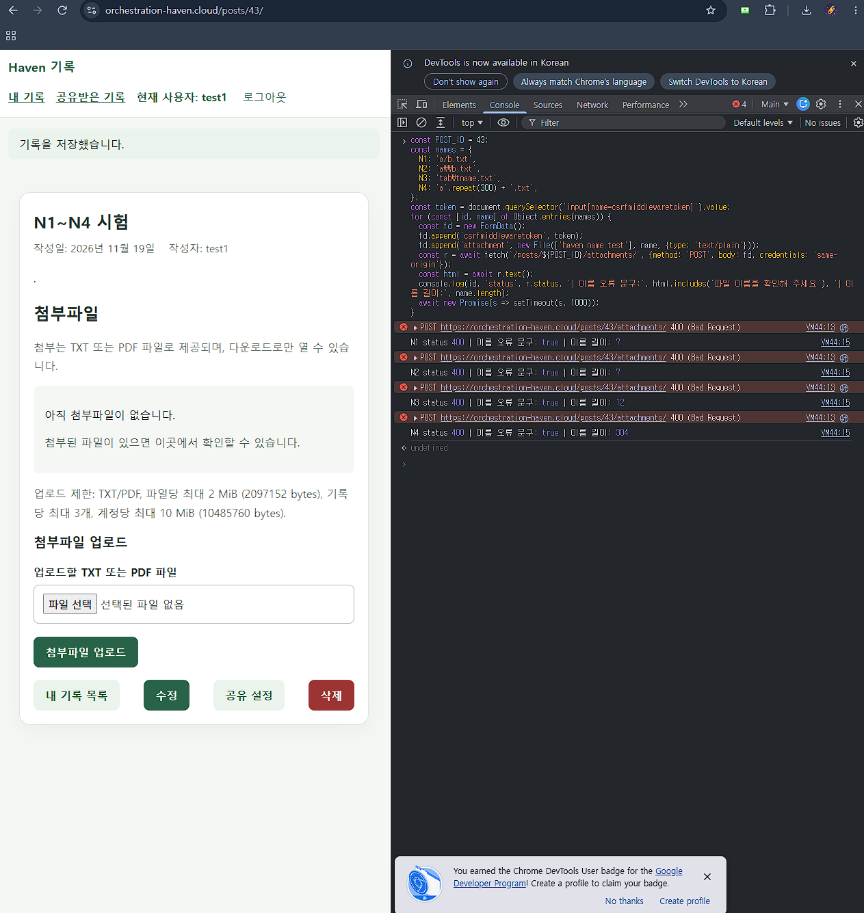
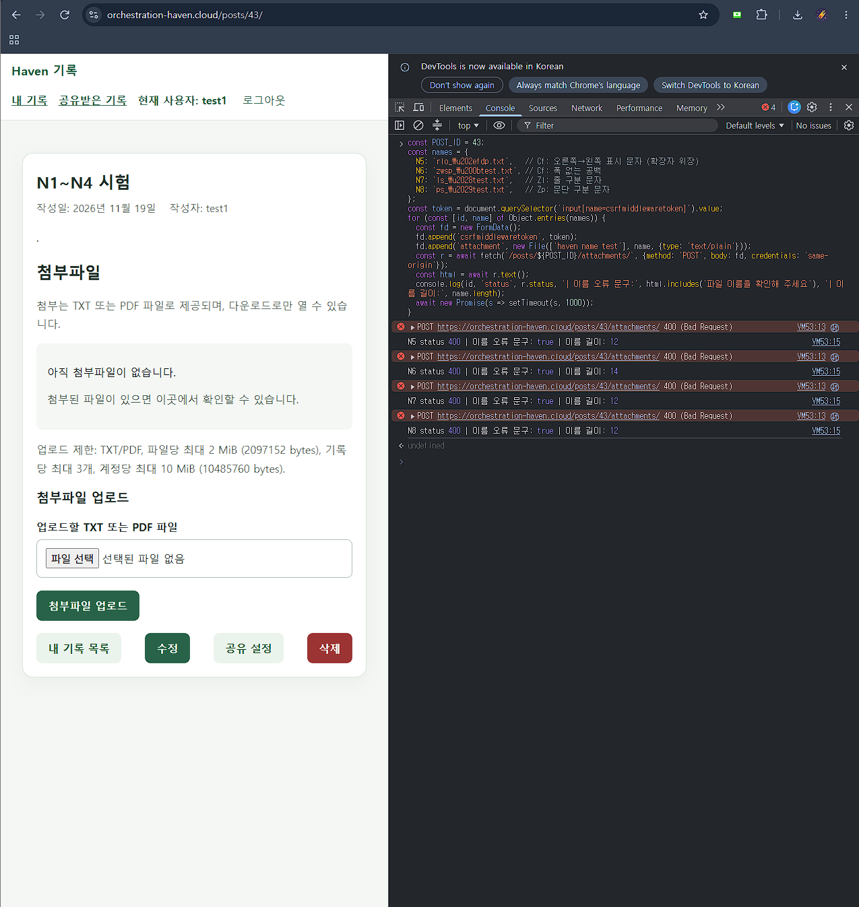
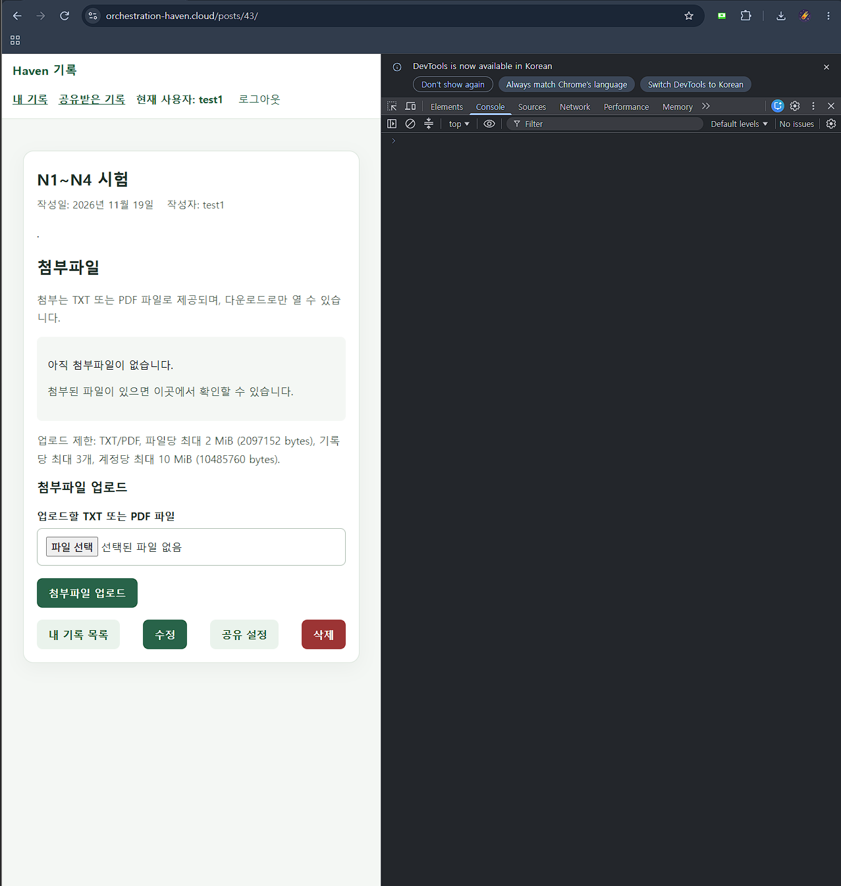

# 2회차 첨부 파일 이름 규칙 검증 보고서

Team2 · Haven 프로젝트 · 작성 구민철

| 항목 | 내용 |
|---|---|
| **프로젝트** | Haven (team2-project) |
| **검증 일자** | 2026년 11월 19일 10:30 무렵 (N1~N4), 10:37 무렵 (N5~N8) |
| **보고 일자** | 2026년 11월 19일 |
| **검증 계정** | test1 — 본인이 가입한 일반 회원 |
| **웹 시험 환경** | AWS 운영 사이트 https://orchestration-haven.cloud (Chrome) |
| **운영 배포 커밋** | `187090a` (11/18 17:42~17:46 배포, 운영 기록 기준. 11/19 시험 전 재배포 기록 없음) |
| **요청 방법** | 브라우저 개발자 도구 Console에서 `fetch`로 업로드 요청 전송 |
| **대상 글** | `/posts/43/` (test1 본인 글, 이 시험을 위해 새로 작성, 첨부 없음) |
| **종합 결과** | 기대 결과와 일치 (8건 모두 400, 첨부 저장 없음) |

## 1. 검증 목적

첨부 파일 이름 규칙 중 **화면의 파일 선택 창으로는 만들 수 없는 이름**이 서버에서 거부되는지 확인한다.

- 11/16에 `test..txt`(점 두 개)는 화면 업로드로 확인했다([2회차 첨부·공유 보고서](../2회차%20첨부%2C공유%20검증%20보고서/2회차_첨부%2C공유_검증보고서.md) 7장).
- 경로 구분자(`/`, `\`), 제어 문자, 255자를 넘는 이름은 Windows 파일 이름으로 만들 수 없거나 브라우저가 바꿔 버린다. 그래서 개발자 도구 Console에서 파일 이름을 직접 지정해 요청을 보냈다.
- 앱 기준(신요찬 `posts/attachments.py`, `posts/upload_handlers.py`)
  - 이름이 255자를 넘거나, `/` 또는 `\`가 있거나, 제어·서식 문자(Unicode 분류 Cc, Cf, Zl, Zp)가 있으면 거부한다.
  - Django는 이런 이름을 받으면 경로 부분이나 제어 문자를 조용히 지우고 넘긴다. 앱은 지우기 전과 후가 다르면 표시해 두었다가 400으로 거부한다. 그래서 `a/b.txt`가 `b.txt`로 바뀌어 저장되면 안 된다.
  - 기대 결과: 400, 오류 문구 "파일 이름을 확인해 주세요.", 첨부 저장 안 됨

## 2. 방법

| 순서 | 내용 |
|---|---|
| 1 | Chrome에서 test1로 로그인, 새 글 `/posts/43/`("N1~N4 시험") 작성 |
| 2 | 글 상세 화면에서 개발자 도구 Console 열기 |
| 3 | 화면의 CSRF 토큰을 읽어, 파일 이름만 바꾼 TXT 파일(내용 `haven name test`)을 `POST /posts/43/attachments/`로 전송 (N1~N4 4건, 이어서 N5~N8 4건. 1초 간격, 경우마다 1회) |
| 4 | 응답 상태 코드와, 응답 화면에 "파일 이름을 확인해 주세요"가 있는지 Console에 출력 |
| 5 | 글 상세 화면을 새로고침해 첨부가 저장되지 않았는지 확인 |

- 비정상 요청이라 본인 글에서만, 경우마다 1회씩 보냈다.
- CSRF 토큰 값은 Console에 출력하지 않았다.
- Chrome은 파일 이름의 줄바꿈(`\n`, `\r`)과 큰따옴표만 `%0A` 등으로 바꿔 보내고 나머지 문자는 그대로 보낸다. 그래서 줄바꿈은 제외하고, 제어 문자는 탭으로 확인했다.

Console에 입력한 코드 (N1~N4. N5~N8은 `names`만 아래처럼 바꿔 같은 코드로 보냈다):

```js
const POST_ID = 43;
const names = {
  N1: 'a/b.txt',
  N2: 'a\\b.txt',
  N3: 'tab\tname.txt',
  N4: 'a'.repeat(300) + '.txt',
};
const token = document.querySelector('input[name=csrfmiddlewaretoken]').value;
for (const [id, name] of Object.entries(names)) {
  const fd = new FormData();
  fd.append('csrfmiddlewaretoken', token);
  fd.append('attachment', new File(['haven name test'], name, {type: 'text/plain'}));
  const r = await fetch(`/posts/${POST_ID}/attachments/`, {method: 'POST', body: fd, credentials: 'same-origin'});
  const html = await r.text();
  console.log(id, 'status', r.status, '| 이름 오류 문구:', html.includes('파일 이름을 확인해 주세요'), '| 이름 길이:', name.length);
  await new Promise(s => setTimeout(s, 1000));
}
```

```js
const names = {
  N5: 'rlo_\u202efdp.txt',   // Cf: 오른쪽→왼쪽 표시 문자 (확장자 위장)
  N6: 'zwsp_\u200btest.txt', // Cf: 폭 없는 공백
  N7: 'ls_\u2028test.txt',   // Zl: 줄 구분 문자
  N8: 'ps_\u2029test.txt',   // Zp: 문단 구분 문자
};
```

## 3. 결과

| ID | 보낸 파일 이름 | 확인하는 규칙 | 이름 길이 | 기대 | 결과 | 이름 오류 문구 | 판정 |
|---|---|---|---|---|---|---|---|
| N1 | `a/b.txt` | 경로 구분자 `/` | 7 | 400 | 400 | 있음 | 통과 |
| N2 | `a\b.txt` | 경로 구분자 `\` | 7 | 400 | 400 | 있음 | 통과 |
| N3 | `tab`(탭)`name.txt` | 제어 문자(Cc) | 12 | 400 | 400 | 있음 | 통과 |
| N4 | `a` 300개 + `.txt` | 255자 초과 | 304 | 400 | 400 | 있음 | 통과 |
| N5 | `rlo_`(U+202E)`fdp.txt` | 서식 문자(Cf), 확장자 위장 | 12 | 400 | 400 | 있음 | 통과 |
| N6 | `zwsp_`(U+200B)`test.txt` | 서식 문자(Cf), 폭 없는 공백 | 14 | 400 | 400 | 있음 | 통과 |
| N7 | `ls_`(U+2028)`test.txt` | 줄 구분 문자(Zl) | 12 | 400 | 400 | 있음 | 통과 |
| N8 | `ps_`(U+2029)`test.txt` | 문단 구분 문자(Zp) | 12 | 400 | 400 | 있음 | 통과 |

- N2는 Console에 `a₩b.txt`로 보인다. 한국어 글꼴이 백슬래시(`\`)를 ₩ 모양으로 그리기 때문이며, 실제로 보낸 값은 `\`이다.
- N5~N8의 이름 길이는 특수 문자 1글자를 포함한 길이와 같다. 문자가 빠지지 않고 전송됐다는 뜻이다.
- 8건 모두 400 응답과 함께 "파일 이름을 확인해 주세요." 문구가 나왔다. 첨부가 저장되지 않은 것(N1·N2가 `b.txt`로 바뀌어 저장되지 않은 것 포함)은 아래 새로고침 화면(N1~N4 뒤, N5~N8 뒤 각 1장)으로 확인했다.



시험 후 새로고침한 글 43 화면 — 저장 안내 문구가 사라졌고, 첨부는 "아직 첨부파일이 없습니다" 그대로다.




N5~N8 시험 후 새로고침한 글 43 화면 — 페이지를 다시 불러와 Console 기록이 비었고, 첨부는 "아직 첨부파일이 없습니다" 그대로다.



## 4. 결론

- 경로 구분자(`/`, `\`), 제어 문자(탭), 255자를 넘는 이름, 서식 문자(U+202E, U+200B), 줄·문단 구분 문자(U+2028, U+2029)가 들어간 파일 이름은 모두 **400으로 거부**되고 **첨부가 저장되지 않았다.**
- 특히 U+202E는 화면에 `rlo_txt.pdf`처럼 확장자를 바꿔 보이게 하는 문자인데, 이름 단계에서 막힌다.
- Django가 이름을 고쳐서 저장하는 대신, 앱이 고쳐진 것을 감지해 거부하는 동작이 운영 사이트에서 확인됐다.
- 11/16의 `test..txt` 결과와 합치면, 화면 업로드와 직접 요청 모두에서 이름 규칙이 지켜진다.

## 5. 한계

- 줄바꿈(`\n`, `\r`)은 Chrome이 `%0A`·`%0D`로 바꿔 보내므로 브라우저로는 서버에 원래 문자를 보낼 수 없어 제외했다. 같은 제어 문자(Cc) 분류인 탭은 N3에서 거부를 확인했다. 앱 단위 시험(`test_up03_unsafe_file_names_are_400`)은 NUL·BEL 등 제어 문자 이름을 직접 만든 요청으로 400을 확인하지만, 줄바꿈 자체는 시험 목록에 없다.
- 응답은 상태 코드와 문구 포함 여부만 확인했다. 서버 로그는 보지 않았다.
- 운영 배포 커밋은 조장 운영 기록(11/18)으로 확인했고, 서버에서 직접 확인하지는 않았다. `187090a` 이후 main에는 앱 코드 변경이 없다.
