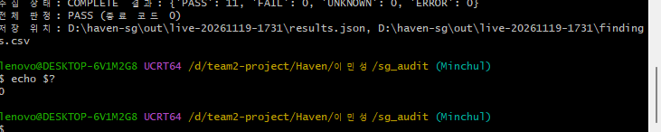
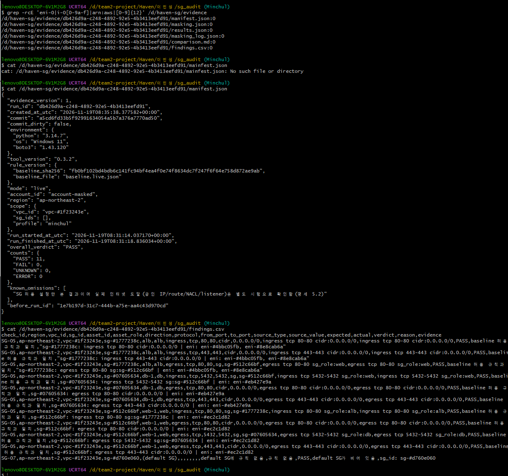
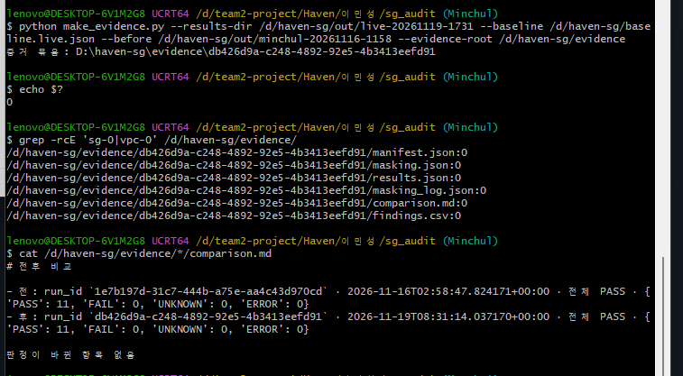
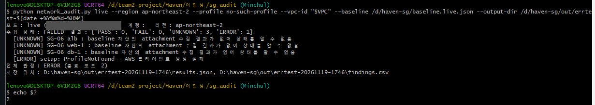

# 3회차 SG 정식 점검 검증 보고서 (C3)

Team2 · Haven 프로젝트 · 작성 구민철

| 항목 | 내용 |
|---|---|
| **프로젝트** | Haven (team2-project) |
| **점검 일시** | 2026년 11월 19일 17:31:14~17:31:18 (KST) |
| **보고 일자** | 2026년 11월 19일 |
| **실행자** | 구민철 (IAM 사용자 `minchul`, 프로필 `minchul`, 조회 권한 4개·서울 리전만) |
| **도구** | `이민성/sg_audit/network_audit.py` 0.3.2, live 모드 |
| **저장소 커밋** | `a5cd6fd` (커밋 안 된 변경 없음, `commit_dirty: false`) |
| **실행 환경** | Windows 11, Python 3.14.7, boto3 1.43.120 |
| **범위** | 서울 리전(ap-northeast-2), Haven VPC 전체(`--vpc-id`) |
| **기준(baseline)** | `baseline.live.json` (조장 DM 전달, 저장소 밖 보관, SHA-256 `fb0bf102…e758d872ae9ab`) |
| **비교 대상** | 11/16 11:58 실행 (0.3.1, run-id `1e7b197d-…`) |
| **증거 묶음** | [`구민철/sg_evidence/db426d9a-c248-4892-92e5-4b3413eefd91/`](../../sg_evidence/db426d9a-c248-4892-92e5-4b3413eefd91/) (가림 처리됨) |
| **종합 결과** | **PASS 11, FAIL 0, UNKNOWN 0, ERROR 0 · 종료 코드 0** · 11/16과 판정 변화 없음 |

## 1. 점검 목적

AWS에 실제로 걸려 있는 보안 그룹(SG) 규칙을 읽기 전용으로 가져와, 설계의 기대 규칙과 같은지 판정한다(과제 기본 3 도전 "개방 포트 자동 점검", C3).

- 정답: `이민성/network/설계.md` 4장(sg-alb·sg-web·sg-db 허용 규칙)을 옮긴 baseline
- 판정 원칙: 허용 목록 방식. baseline에 없는 규칙이 열려 있거나, baseline 규칙이 실제로 없으면 FAIL
- 11/16 실행(0.3.1)은 권한 정리 확인용이었고, 이번이 0.3.2 기준 정식 점검이다.

## 2. 준비와 확인

| 순서 | 내용 | 결과 |
|---|---|---|
| 1 | 저장소 새로 받기(11/19 기록 재작성 뒤), `Minchul` 브랜치 | main과 같은 `a5cd6fd` |
| 2 | 도구 시험 `python -B -m unittest discover -s 이민성/sg_audit -p "test_*.py" -v` | 11/18 66개 OK (0.3.2) |
| 3 | `baseline.live.json`과 결과 폴더를 저장소 밖(`D:\haven-sg`)에 둠 | 저장소 퍼블릭 전환에 따른 조장 지시 |
| 4 | baseline 확인 (값은 화면에 띄우지 않음) | `sg-fixture` 0개, `sg-0` 3개, JSON 문법 정상 |
| 5 | `aws login --profile minchul` | 로그인 |

- 처음 받은 첨부는 저장소의 연습용 `baseline.json`(가짜 ID `sg-fixture` 3개)이었다. 실행 전 확인에서 걸러내고 조장에게 실제 파일을 다시 받았다.
- 첫 실행 시도 두 번은 명령 입력 문제(`--vpc-id` 누락, 파일 경로)로 AWS를 읽기 전에 멈췄다(종료 코드 2, 결과 폴더 생성 없음).

## 3. 실행

```bash
python network_audit.py live --region ap-northeast-2 --profile minchul --vpc-id "$VPC" \
  --baseline /d/haven-sg/baseline.live.json --output-dir /d/haven-sg/out/live-20261119-1731
echo $?   # 0

python make_evidence.py --results-dir /d/haven-sg/out/live-20261119-1731 \
  --baseline /d/haven-sg/baseline.live.json --before /d/haven-sg/out/minchul-20261116-1158 \
  --evidence-root /d/haven-sg/evidence
echo $?   # 0
```

- VPC ID는 셸 변수로 넘겨 명령과 캡처에 남기지 않았다.
- 수집 상태 `COMPLETE`, 전체 판정 PASS, 종료 코드 0.



## 4. 결과: 설계 4장과 한 줄씩 대조

`findings.csv`의 SG 규칙 판정(SG-05 PASS = baseline 규칙과 정확히 일치)을 설계 4장 표와 대조했다. SG ID는 증거 묶음의 가림 값이다.

| # | 설계 4장 | 실제 규칙 (findings) | 붙은 ENI 수 | 판정 |
|---|---|---|---|---|
| 1 | sg-alb inbound TCP 443 ← `0.0.0.0/0` | alb ingress tcp 443 cidr `0.0.0.0/0` | 2 | PASS |
| 2 | sg-alb inbound TCP 80 ← `0.0.0.0/0` | alb ingress tcp 80 cidr `0.0.0.0/0` | 2 | PASS |
| 3 | sg-alb outbound TCP 80 → sg-web | alb egress tcp 80 → sg_role:web | 2 | PASS |
| 4 | sg-web inbound TCP 80 ← sg-alb | web ingress tcp 80 ← sg_role:alb | 1 | PASS |
| 5 | sg-web outbound TCP 5432 → sg-db | web egress tcp 5432 → sg_role:db | 1 | PASS |
| 6 | sg-web outbound TCP 443 → `0.0.0.0/0` | web egress tcp 443 cidr `0.0.0.0/0` | 1 | PASS |
| 7 | sg-web outbound TCP 80 → `0.0.0.0/0` | web egress tcp 80 cidr `0.0.0.0/0` | 1 | PASS |
| 8 | sg-db inbound TCP 5432 ← sg-web | db ingress tcp 5432 ← sg_role:web | 1 | PASS |
| 9 | sg-db outbound TCP 443 → `0.0.0.0/0` | db egress tcp 443 cidr `0.0.0.0/0` | 1 | PASS |
| 10 | sg-db outbound TCP 80 → `0.0.0.0/0` | db egress tcp 80 cidr `0.0.0.0/0` | 1 | PASS |
| 11 | (SG-07) VPC 기본 SG는 비어 있어야 함 | default SG에 규칙 없음 | - | PASS |

- **설계 4장의 10개 규칙이 모두 실제로 있고, 그 밖의 규칙은 없다.** baseline에 없는 규칙이 있었다면 SG-01~05 중 하나로 FAIL이 나왔을 것이다.
- 설계 4.3의 "어디서든 22/3389 거부", "인터넷 → DB 5432 거부"에 해당하는 SG-01 FAIL이 없다. SG 규칙 기준으로 22·3389·5432가 인터넷에 열려 있지 않다.
- SG-06(UNKNOWN: 연결되지 않은 SG, 역할을 모르는 ENI 등)도 0건이다. VPC 안의 ENI가 모두 기대 SG로 설명된다.


- ALB SG가 붙은 ENI는 2개(ALB는 가용 영역마다 ENI를 만든다), web·db SG는 각각 1개다.

## 5. 11/16 실행과 비교

`comparison.md` (도구가 자동 생성):

| 구분 | run-id | 실행 시각 (KST) | 결과 |
|---|---|---|---|
| 전 | `1e7b197d-31c7-444b-a75e-aa4c43d970cd` | 11/16 11:58:47 (0.3.1) | PASS 11 |
| 후 | `db426d9a-c248-4892-92e5-4b3413eefd91` | 11/19 17:31:14 (0.3.2) | PASS 11 |

- **판정이 바뀐 항목 없음.** 11/16 이후 SG 규칙이 바뀌지 않았다.
- 같은 SG에는 두 실행 모두 같은 가림 값이 붙어 전후를 비교할 수 있다.



## 6. 증거와 가림 처리

| 파일 | 내용 |
|---|---|
| `manifest.json` | 커밋·환경·도구 버전·baseline 해시·범위·실행 시각·알려진 누락 |
| `results.json`, `findings.csv` | 가린 판정 결과 11건 |
| `masking.json`, `masking_log.json` | 가림 설정, 종류별 가린 개수 |
| `comparison.md` | 11/16과 비교 |

- 저장소에는 가린 증거 묶음만 올렸다. `baseline.live.json`, 원본 결과(`out/`), 원래 값 대응표(`masking_map.json`)는 저장소 밖에만 있다.
- 올리기 전 확인 (6개 파일 모두 0건)
  - `grep -rcE 'sg-0|vpc-0'` (README 기준)
  - `grep -rcE 'eni-0|i-0[0-9a-f]|arn:aws|[0-9]{12}'` (ENI·인스턴스 ID, ARN, 12자리 계정 번호)
- 계정 번호는 `account-masked`로 기록됐다.
- 보고서 캡처 중 VPC ID가 보이는 것(7장)은 가렸다. 나머지 캡처에는 가림 값과 run-id만 있다.

## 7. 실패 경로 확인 (인계 문서 6장)

도구가 AWS를 읽지 못했을 때 PASS로 착각하지 않는지 확인했다. 11/19 17:46, 존재하지 않는 프로필로 같은 조건(같은 VPC, 같은 baseline)에서 실행했다.

```bash
python network_audit.py live --region ap-northeast-2 --profile no-such-profile --vpc-id "$VPC" \
  --baseline /d/haven-sg/baseline.live.json --output-dir /d/haven-sg/out/errtest-20261119-1746
echo $?   # 2
```

| 항목 | 결과 |
|---|---|
| 수집 상태 | FAILED |
| 오류 | `[ERROR] setup: ProfileNotFound - AWS 클라이언트 생성 실패` |
| 결과 | PASS 0, FAIL 0, UNKNOWN 3, ERROR 1 |
| UNKNOWN 3건 | SG-06 alb·web-1·db-1: baseline 자산의 연결 수집 결과가 없어 상태를 알 수 없음 |
| 전체 판정 | **ERROR (종료 코드 2)** |



- 읽지 못한 자산을 PASS로 세지 않고 UNKNOWN으로 남겼고, 전체 판정은 ERROR > UNKNOWN 순서대로 ERROR가 됐다. 기대대로다.
- 바로 앞의 시도 한 번은 baseline 경로 오타(`bseline`)로 "파일이 없습니다" 오류가 나 프로필 확인 전에 멈췄다. 목적과 다른 실패라 결과로 쓰지 않고 다시 실행했다.
- 이 실행의 결과 파일은 저장소 밖(`D:\haven-sg\out\errtest-20261119-1746`)에만 두고 증거 묶음은 만들지 않았다.

## 8. 결론

- 11/19 17:31 기준, Haven VPC의 SG 규칙은 **설계 4장과 정확히 일치**한다(PASS 11, 종료 코드 0).
- 인터넷에 열린 것은 ALB의 80·443뿐이고, Web은 ALB에서만, DB는 Web에서만 들어올 수 있다. 22·3389는 어디에도 열려 있지 않다.
- 11/16 이후 규칙 변경은 없다.
- AWS를 읽지 못하면 PASS가 아니라 ERROR(2)로 끝나는 것도 확인했다.

## 9. 한계

- **SG 허용 설정만 본 결과다.** 실제 인터넷에서 닿는지(공인 IP·라우팅·NACL·ALB listener)는 별도 시험으로 확인한다(명세 5.2, 도구가 기록한 알려진 누락).
- 설계 4장의 남은 위험(Web·DB outbound 80·443이 `0.0.0.0/0`)은 설계상 허용한 것이라 PASS다. 위험이 없다는 뜻이 아니다.
- 결과는 실행 시점(11/19 17:31) 기준이다. 이후 변경은 다시 실행해야 안다.
- baseline은 조장에게 받은 파일이다. baseline이 설계 4장과 같은지는 README의 규칙표와 설계 4장을 대조해 확인했고, 실제 SG ID가 맞는 SG인지는 도구 판정(기대 SG가 ENI에 연결됨)으로 확인했다.
