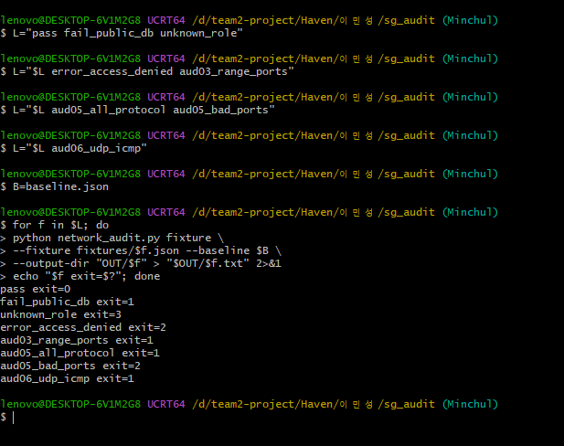
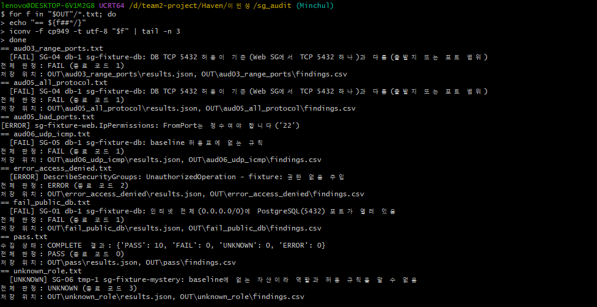
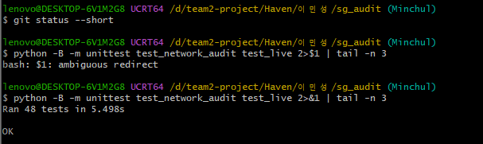

# C3 SG 점검 도구 fixture 대조 검증 보고서

Team2 · Haven 프로젝트 · 작성 구민철

| 항목 | 내용 |
|---|---|
| **대상** | 기본3 도전(C3) 네트워크 자동점검 스크립트: `이민성/sg_audit/network_audit.py` 0.3.2 (제작 이민성) |
| **검증 일시** | 2026년 11월 26일 15:40 ~ 15:58 (KST) |
| **보고 일자** | 2026년 11월 26일 (워드로 조장에게 전달), 11/27 저장소에 md로 등록 |
| **실행 환경** | 구민철 PC, Windows, MSYS2 UCRT64 셸, 브랜치 `Minchul` 커밋 `8765750` (`이민성/sg_audit`는 main과 같음) |
| **AWS 접속** | 없음. fixture(가짜 AWS 응답) 파일만 읽음 |
| **결과 저장** | 저장소 밖 `D:\haven-sg\fixture-20261126-1540\` |
| **기준** | 명세 `docs/구현명세/기본프로젝트_구현명세.md` SG CLI 시험 AUD-01~11 |
| **종합 결과** | AUD-01~11 모두 합격 조건과 일치. fixture 8개 기대 종료 코드와 일치, 자동 시험 48개 OK, 실제 설정 대조(AUD-10)는 11/19 PASS 11 |

## 1. 목적

- 실제 AWS 점검(11/19, AUD-10)과 별도로, **도구가 맞는 건 PASS, 위반은 FAIL, 모르는 건 UNKNOWN, 못 읽은 건 ERROR로 판정하는지** 가짜 설정 파일로 확인한다.
- 명세의 AUD-01~11을 한 표로 모아, C3 산출물의 "실제 실행·대조 결과"로 쓴다.

## 2. 방법

| 순서 | 내용 |
|---|---|
| 1 | `이민성/sg_audit` 폴더에서 fixture 8개를 하나씩 `fixture` 모드로 실행하고 종료 코드를 기록 |
| 2 | 각 실행 로그(`.txt`)의 마지막 판정 줄 확인 |
| 3 | 도구에 들어 있는 자동 시험 `test_network_audit`·`test_live` 실행 (fixture가 없는 AUD-04·07·11은 `test_live`의 가짜 AWS 시험 L13·L9·L16이 맡음) |
| 4 | AUD-10은 11/19 실제 점검 결과(`3회차_SG정식점검_검증보고서`, `sg_evidence/db426d9a…`)를 연결 |

- 종료 코드 뜻: 0 = PASS, 1 = FAIL, 2 = ERROR, 3 = UNKNOWN (도구 README)

## 3. AUD-01~11 대조 결과

**AUD-01~11 모두 합격 조건을 만족했다.** fixture 파일이 있는 7개는 이번에 직접 실행했고, 나머지 4개는 자동 시험과 11/19 실제 점검으로 확인했다.

### 3-1. fixture로 확인 (11/26 직접 실행)

| AUD | 무엇을 보는가 | fixture 파일 | 결과 | 판정 |
|------|------------------------|----------------|------------------------------|--------|
| AUD-01 | 설계대로인 설정을 PASS로 보는가 | `pass.json` | PASS (종료 코드 0), 10개 항목 모두 PASS | 합격 |
| AUD-02 | DB 포트 공개를 FAIL로 잡는가 | `fail_public_db.json` | FAIL (1), SG-01 "인터넷 전체(0.0.0.0/0)에 PostgreSQL(5432) 열림" | 합격 |
| AUD-03 | 포트 범위 안에 숨은 관리·DB 포트를 잡는가 | `aud03_range_ports.json` | FAIL (1), 범위 규칙 안의 DB 5432 허용을 SG-04로 잡음 | 합격 |
| AUD-05 | 전체 프로토콜·깨진 포트 입력에도 죽지 않고 판정하는가 | `aud05_all_protocol.json` `aud05_bad_ports.json` | 전체 프로토콜은 FAIL (1). 깨진 포트(`"22"`)는 ERROR (2)로 멈추고 프로그램이 죽지 않음 | 합격 |
| AUD-06 | UDP·ICMP를 TCP 웹 허용과 구분하는가 | `aud06_udp_icmp.json` | FAIL (1), SG-05 "허용표에 없는 규칙" | 합격 |
| AUD-08 | 권한 거부 때 PASS 없이 ERROR로 끝나는가 | `error_access_denied.json` | ERROR (2), "DescribeSecurityGroups: UnauthorizedOperation" | 합격 |
| AUD-09 | 모르는 서버를 단정하지 않고 UNKNOWN으로 두는가 | `unknown_role.json` | UNKNOWN (3), SG-06 "baseline에 없는 자산이라 역할을 알 수 없음" | 합격 |

- 종료 코드 8개(0·1·3·2·1·1·2·1)가 모두 도구 README의 기대값과 같았다.
- `aud05_bad_ports`는 결과 파일을 만들기 전에 ERROR로 멈추는 것이 기대 동작이라 결과 폴더가 없고 로그만 있다.

### 3-2. fixture 없이 확인

| AUD | 무엇을 보는가 | 확인 방법 | 결과 | 판정 |
|------|------------------------|----------------|------------------------------|--------|
| AUD-04 | IPv6 `::/0` 공개와 정상 참조를 구분하는가 | 자동 시험 L13 (가짜 AWS) | 자동 시험 48개 OK에 포함 | 합격 |
| AUD-07 | API 결과가 여러 페이지여도 끝까지 읽는가 | 자동 시험 L9 (가짜 AWS) | 자동 시험 48개 OK에 포함 | 합격 |
| AUD-10 | 실제 AWS 설정이 설계와 맞는가 | 11/19 live 정식 점검 | PASS 11·FAIL 0·UNKNOWN 0·ERROR 0, 11/16과 바뀐 판정 없음 | 합격 |
| AUD-11 | 정상 SG에 공개 SG가 덧붙은 경우(합집합)를 잡는가 | 자동 시험 L16 (가짜 AWS) | 자동 시험 48개 OK에 포함 | 합격 |

- AUD-08은 11/19 실제 점검 때 없는 프로필로 실행한 실패 경로 시험(`ProfileNotFound` → ERROR, 종료 코드 2)에서도 같은 동작을 확인했다.

## 4. 화면

## 5. 실행 중 있었던 일

- 처음 실행할 때 `--output-dir`의 `$`가 빠져 결과 파일(`results.json`·`findings.csv`)이 저장소 안 `sg_audit/OUT/`에 저장됐다(그림 2의 "저장 위치"가 `OUT\…`인 이유). 판정 결과는 같아 다시 실행하지 않고 저장소 밖 `D:\haven-sg\fixture-20261126-1540\`으로 옮긴 뒤 빈 폴더를 지웠다. `git status --short`가 비어 있어 저장소에 남은 파일은 없다.
- 실행 로그는 Windows 한글 인코딩(CP949)으로 저장돼 `iconv`로 바꿔서 읽었다.

## 6. 다른 기록과의 관계

- 도구 제작과 fixture·자동 시험 작성: 이민성(`이민성/sg_audit/README.md`, 0.3.2 11/18).
- AUD-10 실제 점검: [3회차 SG 정식 점검 검증보고서](../3회차_SG정식점검_검증보고서/3회차_SG정식점검_검증보고서.md)(11/19), 공개용 증거 `구민철/sg_evidence/db426d9a-c248-4892-92e5-4b3413eefd91/`(`results.json`·`findings.csv`, ID 가림).
- 이 보고서는 위 두 기록을 AUD 번호로 묶고, fixture 시험을 검증자가 직접 다시 실행한 결과다.

## 7. 한계

- fixture는 가짜 AWS 응답이다. 실제 AWS의 모든 응답 모양을 대표하지는 않는다.
- AUD-04·07·11은 fixture 파일이 없어 `test_live`의 가짜 AWS 시험으로 대신했다. 개별 시험 이름별 결과는 캡처하지 않았고 "48개 OK"로만 확인했다.
- 그림 2는 각 로그의 마지막 3줄이라, 여러 개가 걸린 fixture(AUD-03·05·06)는 마지막 위반 한 줄만 보인다. 전체 판정 줄과 종료 코드로 판정했다.
- 화면에 본인 PC 이름(`lenovo@DESKTOP-…`)이 보인다. AWS 접근 정보가 아니라 가리지 않았다([증거 가림 점검표](../4회차_증거가림점검표/4회차_증거가림점검표.md) 6장과 같은 판단). 화면의 sg-fixture-*·db-1·tmp-1은 fixture 안의 가짜 이름이다.
