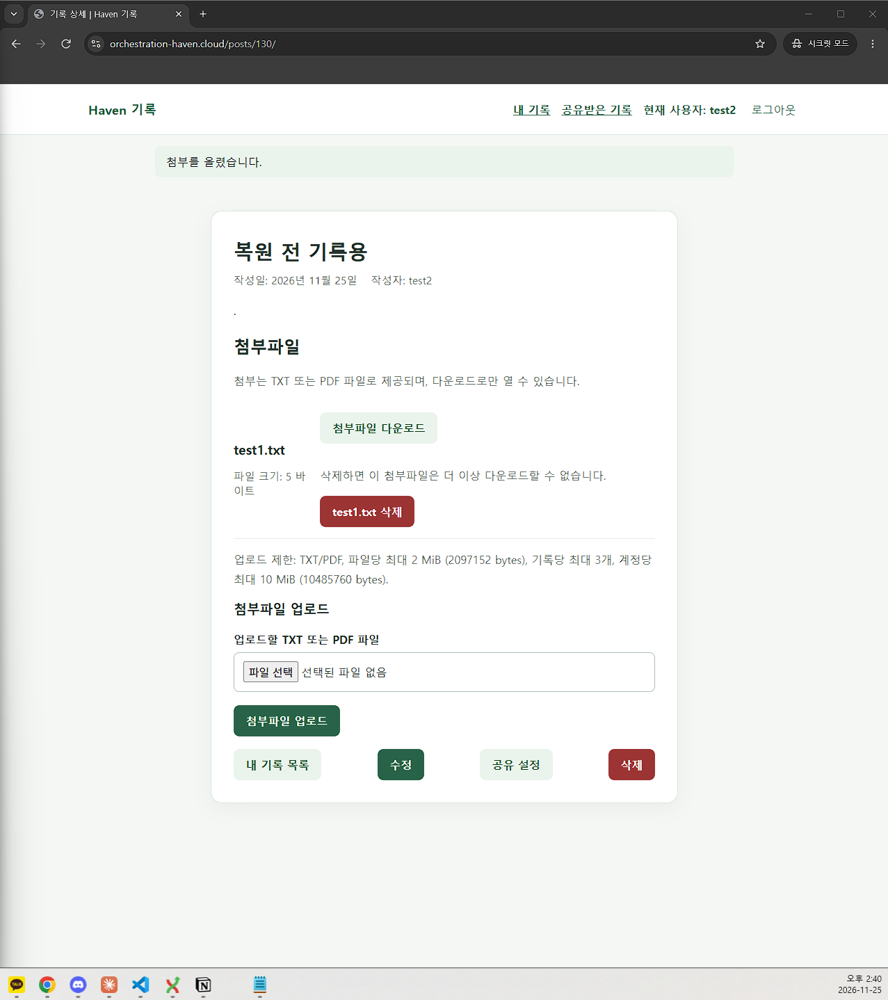
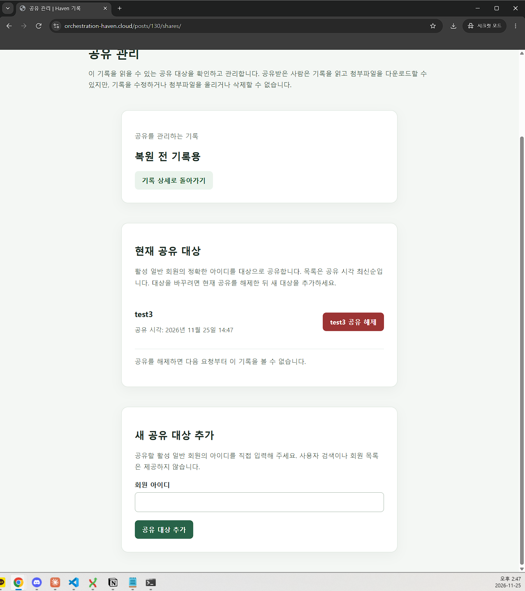
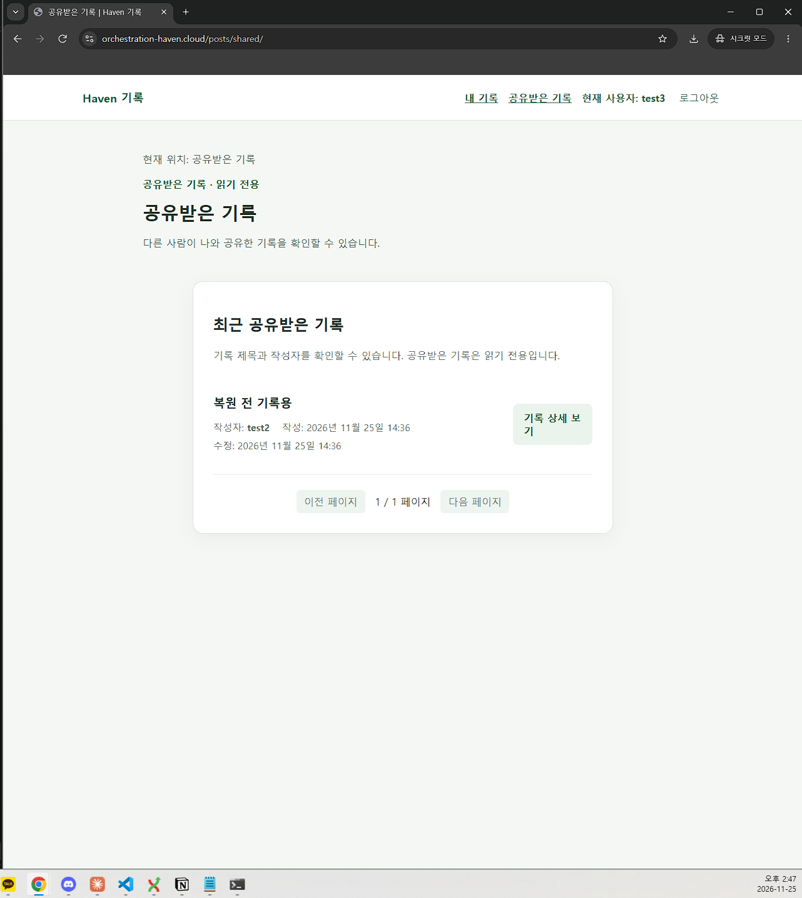
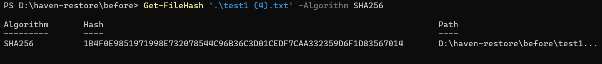
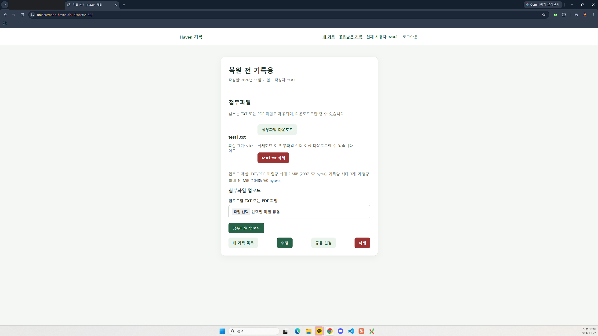
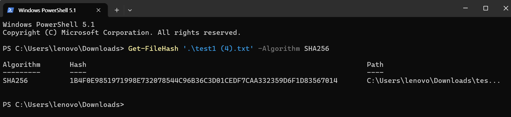
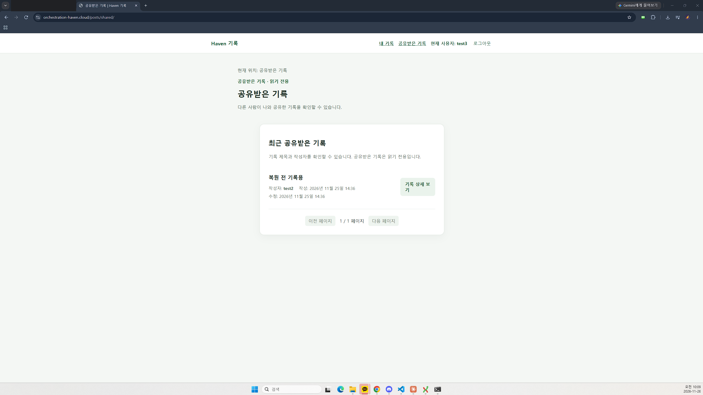

# 4회차 격리 복원 입회 검증 보고서

Team2 · Haven 프로젝트 · 작성 구민철

| 항목 | 내용 |
|---|---|
| **프로젝트** | Haven (team2-project) |
| **입회 일시** | 2026년 11월 26일 10:01 ~ 11:00 (KST) |
| **기준값 준비** | 2026년 11월 25일 14:36 ~ 14:47 (KST) |
| **보고 일자** | 2026년 11월 26일 |
| **역할** | 백업·복원·삭제 실행 이민성(조장), UP-10 시험 데이터·권한 질의·기록 신요찬, 입회·기준값 대조 구민철 (조장 결정 11/20, 요찬 4회차 기록 8장) |
| **대상** | 운영 DB(db-1)와 운영 첨부(web-1)의 최종 백업, 그 백업을 격리 DB `haven_restore_check`·격리 폴더 `/srv/haven/restore-check/uploads`에 복원한 복원본 |
| **내 기준값** | test2의 130번 기록 "복원 전 기록용"(첨부 `test1.txt` 5바이트), test3 공유 |
| **종합 결과** | 기대 결과와 일치. 백업·복원 OK, UP-10 통과(요찬 판정), 내 130번 글·첨부·공유가 복원본과 운영 모두 그대로, 격리본 삭제 확인 |

## 1. 목적

- 백업한 DB와 첨부를 **운영과 떨어진 곳에 복원했을 때 원본과 같은지** 입회해 확인한다(명세 UP-10).
- 운영 데이터는 되돌리지 않는다. 복원본은 사이트에 연결하지 않고 대조만 한 뒤 지운다.
- 구민철은 팀 시험 데이터(요찬 UP-10)와 별도로 **직접 만든 기준값(130번 기록)**이 백업·복원을 거쳐도 같은지 대조한다.

## 2. 시간 순서

서버 시각은 UTC이며 9시간을 더해 KST로 적었다(괄호는 서버 출력 원래 값).

| 시각 (KST) | 한 일 | 실행 | 결과 |
|---|---|---|---|
| 11/25 14:36~14:47 | 기준값 만들기: test2로 130번 기록·첨부 작성, sha256 기록, test3에게 공유 | 구민철 | 3장 |
| **10:01:06** (01:01:06) | web-1 사이트 중단 `systemctl stop haven` | 조장 | `inactive` |
| **10:01:33** (`20261126T010133Z`) | db-1 `backup.sh` | 조장 | OK, 덤프 77,442바이트, 테이블 14개 |
| 10:01:33 이후 | web-1 `backup-uploads.sh` (DB와 같은 시각 값) | 조장 | OK, 파일 17개 |
| **10:03:08** (01:03:08) | 사이트 재개 `systemctl start haven` | 조장 | `active`, `/healthz` 200 |
| 10:07~10:09 | 재개 뒤 운영 사이트에서 130번 글·첨부·공유 확인 | 구민철 | 3장 |
| 10:01:33 이후 ~ 10:10경 전 | db-1 `restore.sh` → 격리 DB `haven_restore_check` | 조장 | OK, 테이블 14개, 행 수가 백업과 일치 |
| 10:03 이후 | web-1 `restore-uploads.sh` → 격리 폴더 | 조장 | OK, 파일 17개(조장 보고) |
| 10:10경 | `up10_check.sql`(sha256 확인 OK) 권한 질의 1~5번 | 조장 실행·요찬 기준 | 모두 기대값 |
| 10:13경 | DB가 가리키는 첨부 17개를 격리 폴더와 sha256 대조 | 조장 | 17줄 = 17개, `sha256sum -c` 통과 |
| **10:19:32** (01:19:32) | 복원본·운영 DB에서 130번 글과 test3 공유 행 수 조회 | 조장(구민철 요청) | 둘 다 1 / 1 |
| 10:45~10:46 | UP-10 시험 글 삭제(첨부 2개 같이 삭제), 시험 계정 4개 비활성화 | 요찬 | 재개 뒤 DB 쓰기 정상 |
| **11:00:02** (02:00:02) | db-1 격리 DB 삭제 `DROP DATABASE haven_restore_check` | 조장 | 삭제 뒤 DB 목록 `haven`만 |
| **11:00:10** (02:00:10) | web-1 격리 폴더 삭제 `rm -rf /srv/haven/restore-check` | 조장 | 삭제 뒤 `No such file or directory` |

- **사이트 중단 시간: 2분 2초**(10:01:06 ~ 10:03:08). 순서는 중단 → DB·첨부 백업 → 재개였다. 첨부 백업 스크립트는 사이트가 멈춰 있을 때만 돌아가므로 DB와 첨부가 같은 시점이다.

## 3. 내 기준값 대조 (130번 기록)

| 확인 | 백업 전 (11/25) | 재개 뒤 운영 (11/26) | 격리 복원본 (11/26) | 판정 |
|---|---|---|---|---|
| 130번 글 | 있음. 제목 "복원 전 기록용", 작성자 test2, 작성·수정 14:36 | 있음, 같음 (10:07 화면) | 1행 (10:19:32 조회) | **일치** |
| 첨부 `test1.txt` | 5바이트 | 5바이트 (10:07 화면) | - | **일치** |
| 첨부 sha256 | `1B4F0E9851971998E732078544C96B36C3D01CEDF7CAA332359D6F1D83567014` (11/25 14:41 다운로드) | 같음 (11/26 재개 뒤 새로 다운로드) | 첨부 대조 목록 17줄에 같은 값이 있고 `sha256sum -c` 통과 | **일치(복원본은 간접 확인)** |
| test3 공유 | 공유 시각 14:47, test3 공유받은 기록에 보임 | test3 공유받은 기록에 보임 (10:09 화면) | test3 공유 행 1 (10:19:32 조회) | **일치** |

- 운영 DB `haven`에서도 같은 시각에 130번 글 1, test3 공유 행 1이었다.
- 재개 뒤 다운로드한 파일은 다운로드 폴더(`C:\Users\…\Downloads`)에 저장됐고, 백업 전 파일은 `D:\haven-restore\before`로 옮겨 둔 것이다. 두 파일은 이름(`test1 (4).txt`)은 같지만 위치가 다른 별개 파일이다.

### 화면

| 번호 | 내용 |
|---|---|
| [rs-01](img/rs-01_1125_1440_post130.png) | 11/25 14:40 130번 기록 작성·첨부 업로드 |
| [rs-02](img/rs-02_1125_1447_share_test3.png) | 11/25 14:47 test3 공유 |
| [rs-03](img/rs-03_1125_1447_test3_list.png) | 11/25 14:47 test3 공유받은 기록 |
| [rs-04](img/rs-04_before_sha256.png) | 백업 전 다운로드 파일 sha256 (`D:\haven-restore\before`) |
| [rs-05](img/rs-05_1126_1007_post130.png) | 11/26 10:07 재개 뒤 130번 기록 |
| [rs-06](img/rs-06_after_sha256.png) | 재개 뒤 새로 다운로드한 파일 sha256 (다운로드 폴더) |
| [rs-07](img/rs-07_1126_1009_test3_list.png) | 11/26 10:09 재개 뒤 test3 공유받은 기록 |

## 4. 백업·복원 결과 (입회 확인)

| 항목 | 결과 |
|---|---|
| DB 백업 `backup.sh` | OK, 77,442바이트, 테이블 14개 |
| 첨부 백업 `backup-uploads.sh` | OK, 파일 17개, DB와 같은 시각 값 `20261126T010133Z` |
| DB 격리 복원 `restore.sh` | OK, 테이블 14개, 행 수가 백업과 일치 |
| 첨부 격리 복원 `restore-uploads.sh` | OK, 파일 17개(조장 보고, 화면 없음) |
| 첨부 대조 | DB 정상 첨부 17개 = 대조 목록 17줄 = 복원 폴더 파일 17개, `sha256sum --quiet -c` 통과("DB가 가리키는 첨부 모두 있음, sha256 일치") |
| UP-10 권한 질의 | 1. 시험 글 1 / 2. 계정 4개 모두 활성, 읽기 권한 a t·b t·c f·d f / 3. 공유 행 `up10_b`만 / 4. 시험 글 정상 첨부 2 / 5. 전체 정상 첨부 17개·49,048바이트. **모두 기대값** |
| UP-10 판정 | **통과** (요찬 판정, `신요찬/4회차_앱_검증기록.md` 8-5) |

- UP-10의 자세한 기준과 판정은 요찬 기록 8장(#255)을 따른다. 이 보고서는 입회자가 같은 결과를 화면으로 확인했다는 기록이다.

## 5. 격리본 삭제와 운영 확인 (11:00)

| 확인 | 삭제 전 | 삭제 뒤 |
|---|---|---|
| db-1 DB 목록(`haven%`) | `haven`, `haven_restore_check` | **`haven`만** |
| web-1 `/srv/haven/restore-check` | 있음 | **없음** (`No such file or directory`) |
| 운영 DB `haven` 글 수 | - | 23 |
| 운영 첨부 폴더 `/srv/haven/uploads` | 있음 | 그대로, 파일 15개 |
| S3 최종 백업 `20261126T010133Z` | - | `manifest` 195바이트, `uploads.manifest` 187바이트로 남아 있음 |

- **운영 첨부 15개와 백업 17개의 차이:** 요찬이 10:45에 UP-10 시험 글을 지우면서 첨부 2개가 같이 지워졌다(요찬 기록 8-6). 17 − 2 = 15로 맞는다.
- S3 최종 백업에는 UP-10 시험 데이터가 백업 때 모습 그대로 남는다. 이 백업으로 다시 복원하면 시험 글·첨부와 활성 시험 계정 4개가 돌아오므로 복원 뒤 다시 정리해야 한다(요찬 기록 8-6).

## 6. 증거 보관

- 서버 화면 캡처(사이트 중단, 백업, 재개, `/healthz`, 복원, UP-10 질의, 첨부 대조, 130번 조회, 격리본 삭제)에는 **서버 내부 호스트 이름, 백업 버킷 이름(AWS 계정 번호 포함), 첨부 저장 키·sha256 목록**이 보인다. 그래서 저장소에 올리지 않고 숫자만 이 보고서에 옮겼다. 원본은 조장이 보관한다(요찬 기록 8-7에 조장 캡처 7장의 sha256). 130번 조회와 격리본 삭제 화면은 조장이 11/26 팀 채팅으로 공유했다.
- 저장소에 넣은 화면은 구민철의 브라우저·PowerShell 화면 7장뿐이다. 관계없는 브라우저 탭 제목은 가렸다.

## 7. 한계

- **복원본은 화면으로 확인하지 않았다.** 사이트에 연결하지 않으므로 앱 화면 대신 같은 권한 조건의 질의(UP-10)와 개수 조회로 대신했다.
- `restore.sh`·`restore-uploads.sh`는 명령마다 시각을 찍지 않아 정확한 복원 시각은 없다(둘 다 백업 10:01:33 뒤, 질의 10:10경 전. `restore-uploads.sh`는 재개 10:03:08 뒤).
- `restore-uploads.sh` 화면은 없고 조장 보고로 적었다. 첨부 대조(17개 sha256 일치)가 같은 내용을 따로 확인한다.
- **재개 뒤 다운로드 파일의 저장 시각은 캡처하지 않았다.** 다운로드 폴더의 파일이 11/26에 새로 받은 것이라는 근거는 확인한 사람(구민철)의 기록이다.
- 130번 첨부의 내용이 `test1` 5바이트라 같은 sha256의 첨부가 더 있을 수 있다. 복원본에서 130번 첨부의 저장 키를 따로 조회하지 않았으므로, 130번 첨부의 일치는 정상 첨부 17개 전체 대조 통과로 간접 확인한 것이다.
- 기준값은 글 1개·첨부 1개·공유 1개다. 다른 회원의 실제 글은 전체 개수(첨부 17개, 테이블 14개 행 수)로만 맞췄다.
