# 4회차 시연 회귀 검증 보고서

Team2 · Haven 프로젝트 · 작성 구민철

| 항목 | 내용 |
|---|---|
| **프로젝트** | Haven (team2-project) |
| **검증 일자** | 2026년 11월 25일 17:12 ~ 17:20 (KST, 화면 시계) |
| **보고 일자** | 2026년 11월 25일 |
| **검증 계정** | A = test1(작성자), B = test3(공유받는 사람) — 모두 본인이 가입한 일반 회원 |
| **웹 시험 환경** | AWS 운영 사이트 https://orchestration-haven.cloud (Windows, Chrome. A·B는 다른 창) |
| **운영 배포 커밋** | `5d0e370` (11/19 배포, 11/25 앱·서버 배포 없음. 조장 운영기록 11/25) |
| **WAF 상태** | 4단계(11/25 09:24:47 조장 적용) 뒤. `GenericLFI_BODY` Count, `SQLiExtendedPatterns_BODY` 글·첨부 주소 예외 |
| **대상 글** | `/posts/132/` "4회차 시연 회귀" (A가 이 시험을 위해 새로 작성) |
| **요청 방법** | 브라우저 화면 조작. 수정 거부 확인만 B가 주소창에 수정 주소를 한 번 직접 입력 |
| **증거** | 화면 녹화(작업 표시줄 시계 포함)에서 장면을 이미지로 옮김, sha256 계산 화면 |
| **종합 결과** | 기대 결과와 일치 (7단계 모두 기대대로, **WAF 403 화면 0건**) |

## 1. 검증 목적

4회차 시연 순서(TODO 6장)대로 **사용자 흐름 전체가 지금 운영 사이트에서 그대로 동작하는지** 확인한다.

- 시연 순서: 작성/첨부 → 공유 → 수신자 읽기·다운로드와 수정 거부 → 공유 해제 후 거부 → 잘못된 업로드 거부 → 설정 점검/WAF 개선
- 특히 **WAF 4단계(11/25 09:24:47) 뒤 브라우저 흐름**을 확인한다. 4단계 뒤에는 혁민 CLI 재시험(#235)만 있었고 브라우저 흐름은 확인하지 않았다(`3회차_WAF결과표` 5장).
- 정상 단계에서 WAF가 막으면 흰 바탕의 `403 Forbidden` 화면이 나온다. 이번 시험에서 이 화면이 한 번이라도 나오는지 함께 본다.

## 2. 준비

| 항목 | 내용 |
|---|---|
| 정상 첨부 | `4회차 시연 회귀(텍스트).txt`, 21바이트, 개인 정보 없음. sha256 `49C7A72872EE4EDA588E1F992997B1360D1430FF747739B0D559221ADDEDABD3` |
| 잘못된 첨부 | `4회차 시연 회귀(html).html` (허용되지 않는 형식. 위험한 스크립트는 넣지 않음) |
| 보관 위치 | 시험 파일과 녹화 원본(mp4)은 저장소 밖(본인 PC)에 둔다 |

## 3. 결과

| # | 시각 (KST) | 누가 | 한 것 | 기대 | 실제 | 판정 | 증거 |
|---|---|---|---|---|---|---|---|
| 1 | 17:12 | A | 새 기록 "4회차 시연 회귀" 작성 | 저장 후 상세 화면 | "기록을 저장했습니다", `/posts/132/` | 일치 | [demo-01](img/demo-01_saved.png) |
| 2 | 17:12 | A | 정상 txt 첨부 업로드 | 업로드 성공 | "첨부를 올렸습니다", 파일 크기 21바이트 | 일치 | [demo-02](img/demo-02_uploaded.png) |
| 3 | 17:13 | A | 공유 설정에서 test3 추가 | 공유 대상에 test3 | "공유했습니다", 현재 공유 대상 test3(공유 시각 17:13) | 일치 | [demo-03](img/demo-03_shared.png) |
| 4-1 | 17:13 | B | 공유받은 기록 열기 | 132번이 목록에 보임 | "4회차 시연 회귀"(작성자 test1, 17:12) 보임 | 일치 | [demo-04](img/demo-04_b_list.png) |
| 4-2 | 17:13 | B | 글 상세 보기 | 읽기만 가능, 관리 버튼 없음 | 제목·첨부·다운로드 버튼과 "내 기록 목록"만 보임. **수정·삭제·공유 설정·첨부 업로드·첨부 삭제 없음** | 일치 | [demo-05](img/demo-05_b_detail.png) |
| 4-3 | 17:14 | B | 첨부 다운로드, sha256 비교 | 올린 파일과 같음 | 다운로드 완료. 받은 파일과 원본의 sha256이 같음(`49C7A728…DABD3`) | 일치 | [demo-06](img/demo-06_b_download.png), [demo-07](img/demo-07_sha256.png) |
| 5 | 17:17 | B | 주소창에 `/posts/132/edit/` 직접 입력(1회) | 수정 거부 | 공통 404 화면 "페이지를 찾을 수 없습니다" | 일치 | [demo-08](img/demo-08_b_edit_404.png) |
| 6-1 | 17:18 | A | 공유 설정에서 test3 공유 해제 | 공유 대상 없음 | "공유를 해제했습니다", "아직 공유한 사용자가 없습니다" | 일치 | [demo-09](img/demo-09_before_unshare.png), [demo-10](img/demo-10_unshared.png) |
| 6-2 | 17:19 | B | 공유받은 기록 다시 보기 | 132번이 사라짐 | "복원 전 기록용"(test2)만 남고 132번 없음 | 일치 | [demo-11](img/demo-11_b_list_after.png) |
| 6-3 | 17:19 | B | `/posts/132/` 다시 열기 | 접근 거부 | 공통 404 화면 | 일치 | [demo-12](img/demo-12_b_post_404.png) |
| 7 | 17:20 | A | `.html` 파일 업로드 시도 | 거부, 첨부 저장 안 됨 | "TXT 또는 PDF 파일만 올릴 수 있습니다." 첨부 목록은 정상 txt 1개 그대로 | 일치 | [demo-13](img/demo-13_bad_selected.png), [demo-14](img/demo-14_bad_rejected.png) |
| 8 | - | - | 설정 점검 / WAF 개선 | 문서로 확인 | 아래 4장 | (문서) | - |

- **WAF 403 화면은 한 번도 나오지 않았다.** 막힌 화면은 5번·6-3번의 Haven 공통 404와 7번의 앱 업로드 거부 문구뿐이며, 모두 앱이 기대대로 거부한 것이다.
- 4-2번은 화면에 버튼이 없는 것을 본 것이고, B의 수정 요청 거부는 5번에서 따로 확인했다.

### 화면

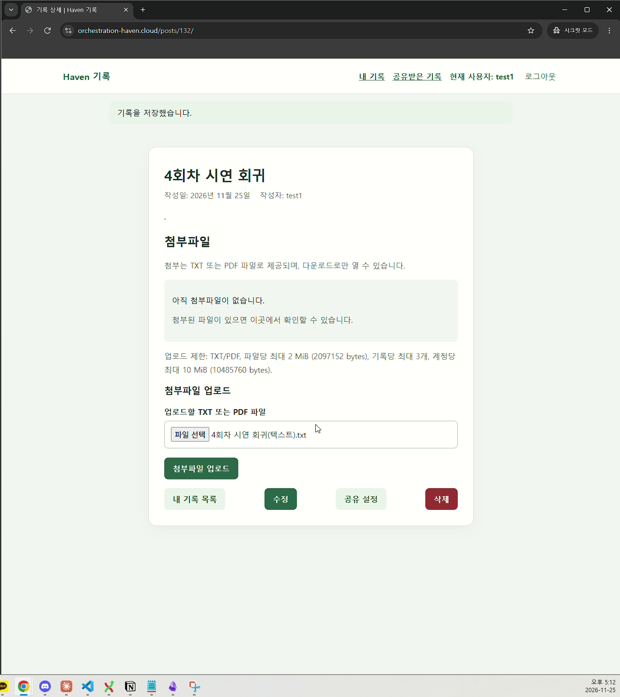
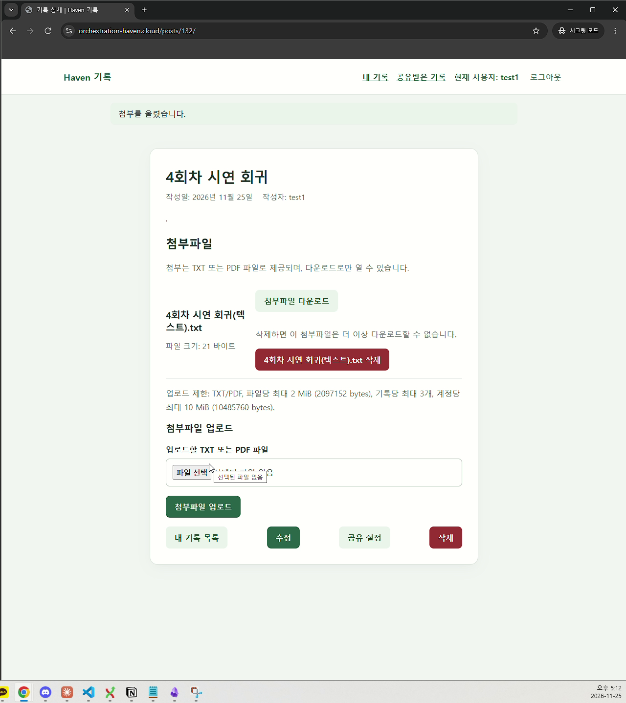
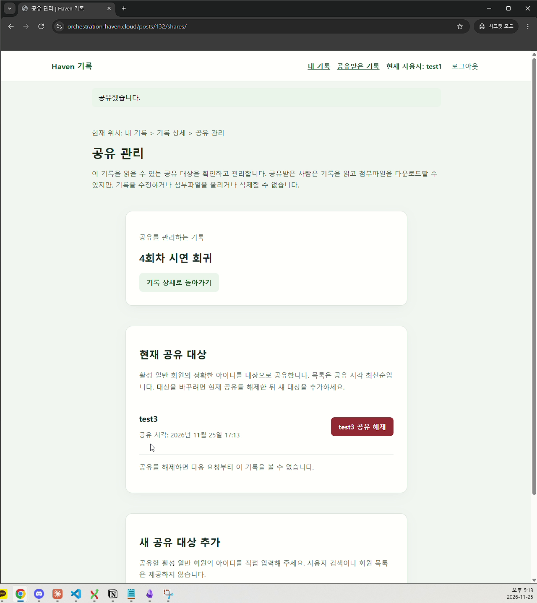
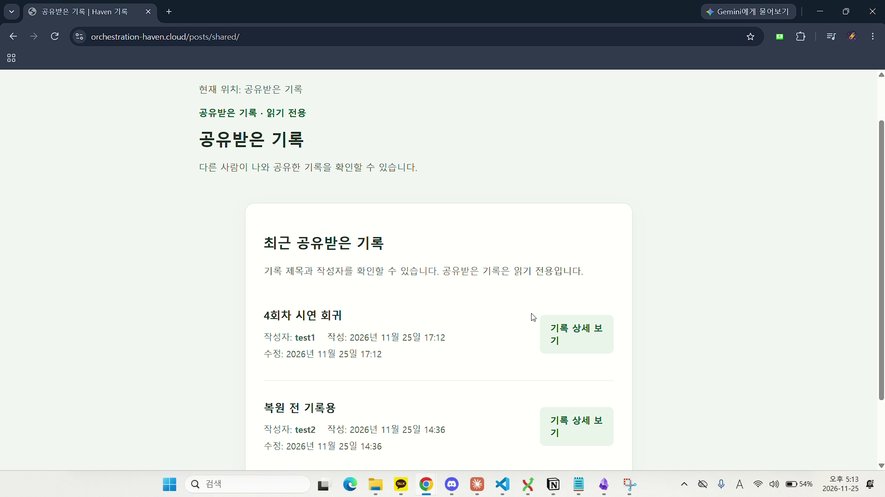
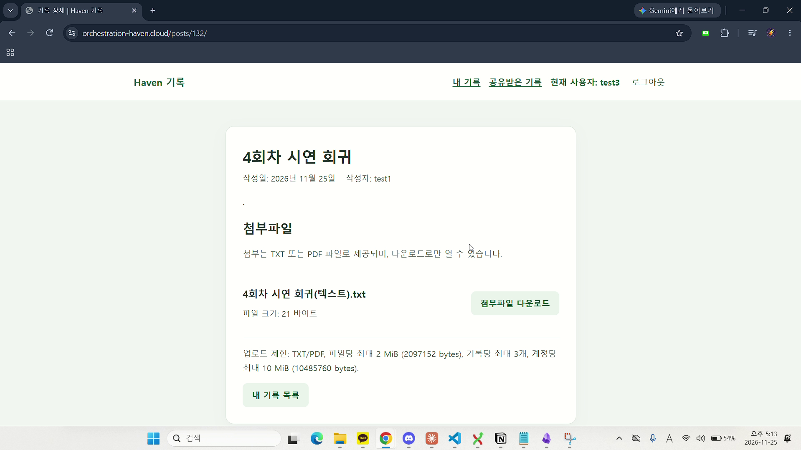
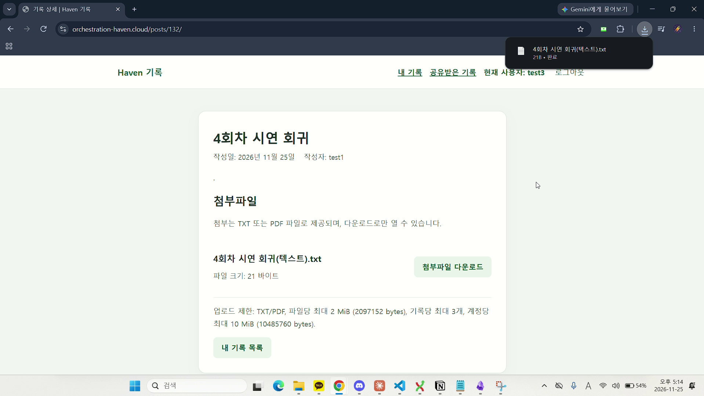
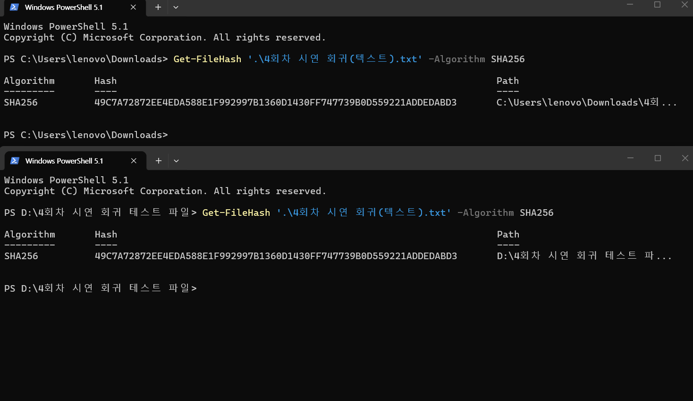
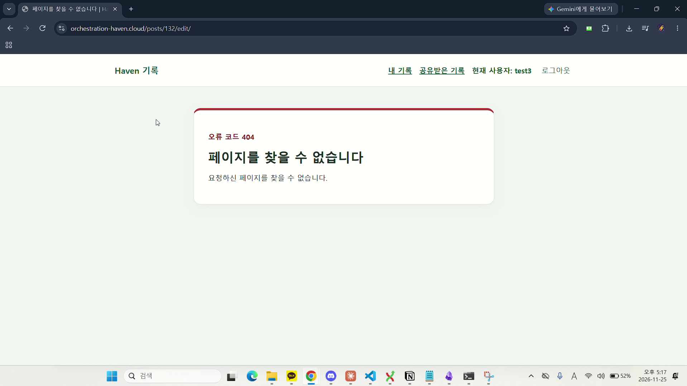
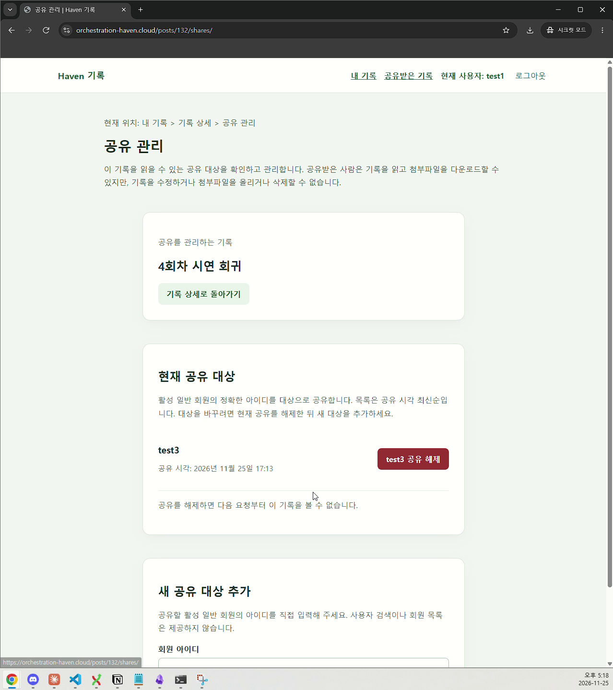
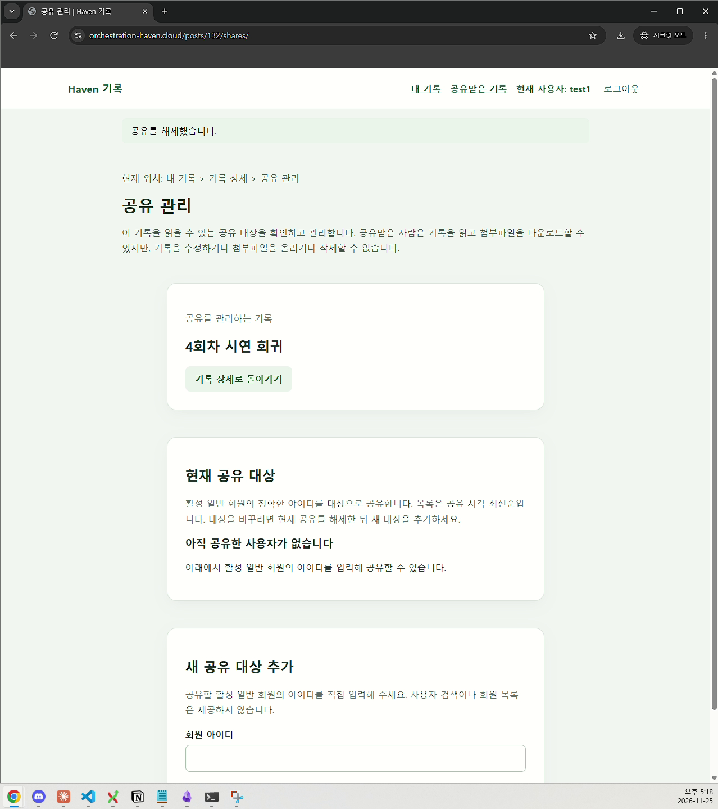
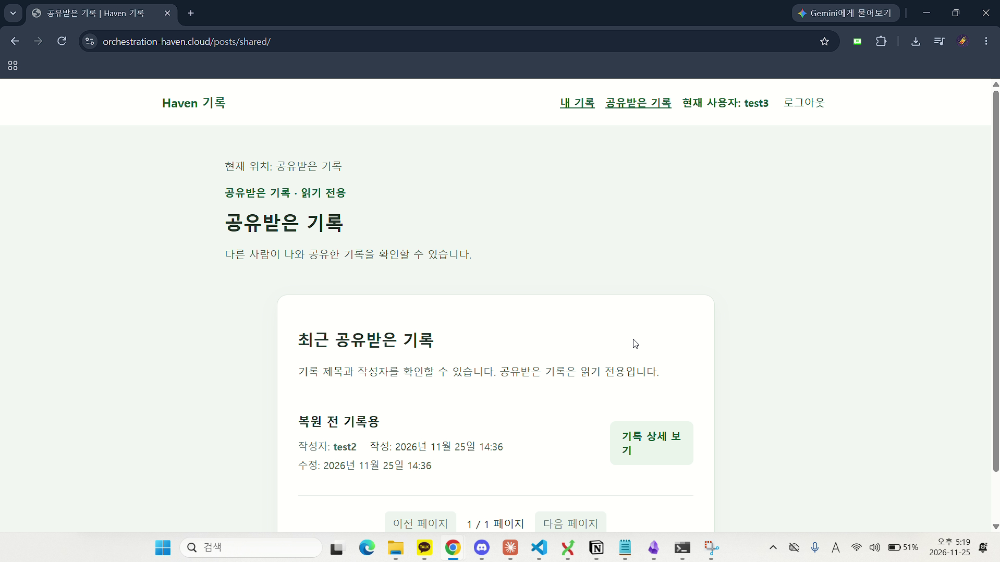

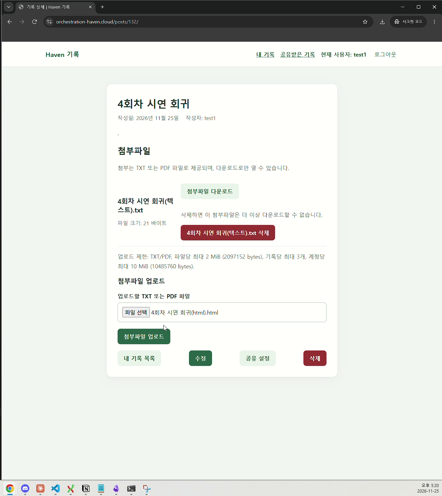
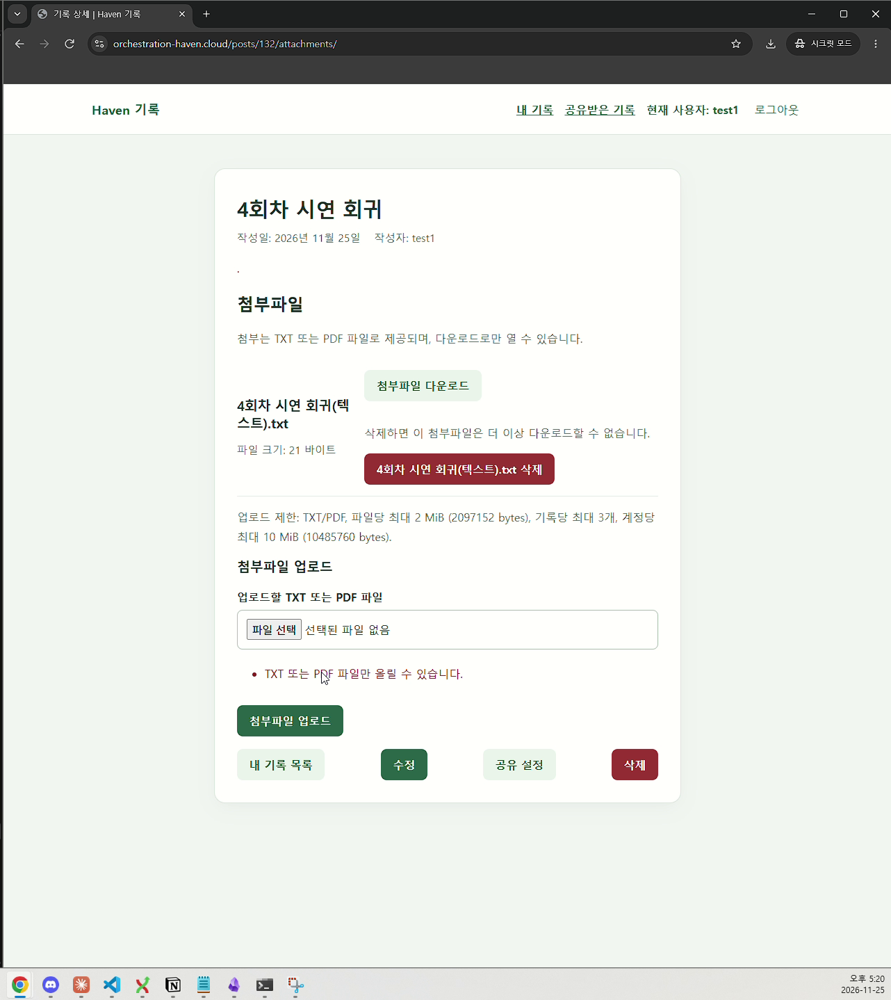

## 4. 시연 마지막 단계: 설정 점검 / WAF 개선 (문서 근거)

브라우저로 하는 단계가 아니어서 이미 있는 검증 문서를 근거로 연결한다.

| 항목 | 근거 | 요약 |
|---|---|---|
| 보안 그룹 점검 | [3회차 SG 정식 점검 보고서](../3회차_SG정식점검_검증보고서/3회차_SG정식점검_검증보고서.md) | 점검 도구 live 실행 결과와 판정 |
| WAF 개선 | [3회차 WAF 결과표](../3회차_WAF결과표/3회차_WAF결과표.md) 5장 | Block 1~4단계 전후 비교 정상 요청 403 0건, 24시간 관찰 시험 아닌 요청 BLOCK 0건 |
| WAF 4단계 뒤 브라우저 흐름 | 이 보고서 3장 | 시연 흐름 전체에서 WAF 403 0건 |

## 5. 다른 기록과의 관계

- 노푸른 11/24 최종 사용자 흐름 재시험(#224, `노푸른/1회차_앱_검증기록.md`)과 같은 흐름이다. 이번 시험은 **WAF 4단계 뒤**이고, B의 수정 주소 직접 접근(5번)과 잘못된 형식 업로드 거부(7번)를 더했다.
- 요찬 11/23 Block 뒤 앱 회귀(#216, 4회차 앱 검증기록 7장)는 3단계 뒤 결과다. 이 보고서로 4단계 뒤 브라우저 흐름도 확인됐다.
- 3회차 WAF 결과표 5장의 "브라우저 흐름은 아직 확인하지 않았다(4회차 시연 회귀에서 확인)" 문장은 이 보고서로 갱신할 수 있다.

## 6. 한계

- 결과는 **화면 표시 기준**이다. HTTP 상태 코드와 WAF 로그(ALLOW·BLOCK)는 조회하지 않았다. "WAF 403 0건"은 화면에 WAF 차단 화면이 나오지 않았다는 뜻이다.
- 본문과 첨부는 평범한 내용이다. 4단계에서 풀린 오탐 모양(`../` 메모, 영어 SQL 글, `!@#` 비밀번호)은 이번에 넣지 않았다. 그 확인은 혁민 재시험(#235)이 근거다.
- 화면 시계는 분 단위다.
- 한 번의 시험, 계정 두 개(A·B)다. 공유받지 않은 제3 계정(C)의 접근은 이번에 다시 하지 않았다(1·2회차 보고서에서 확인).
- 녹화 원본에는 브라우저 자동 완성 목록 등 시험과 관계없는 화면이 일부 들어 있어 저장소에 넣지 않고, 필요한 장면만 이미지로 옮겼다.
