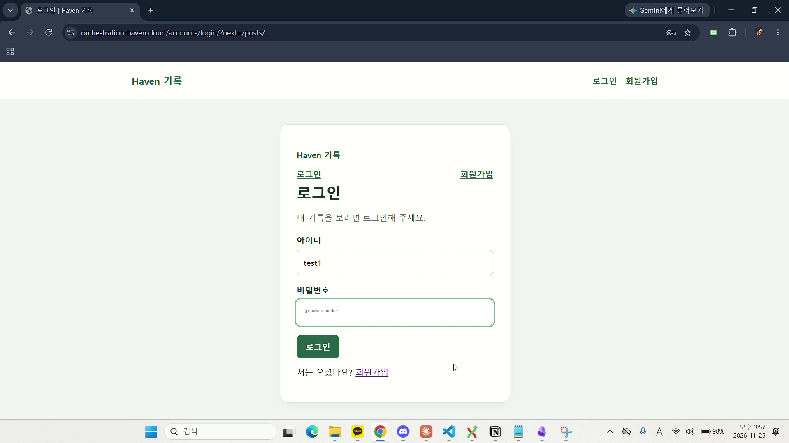
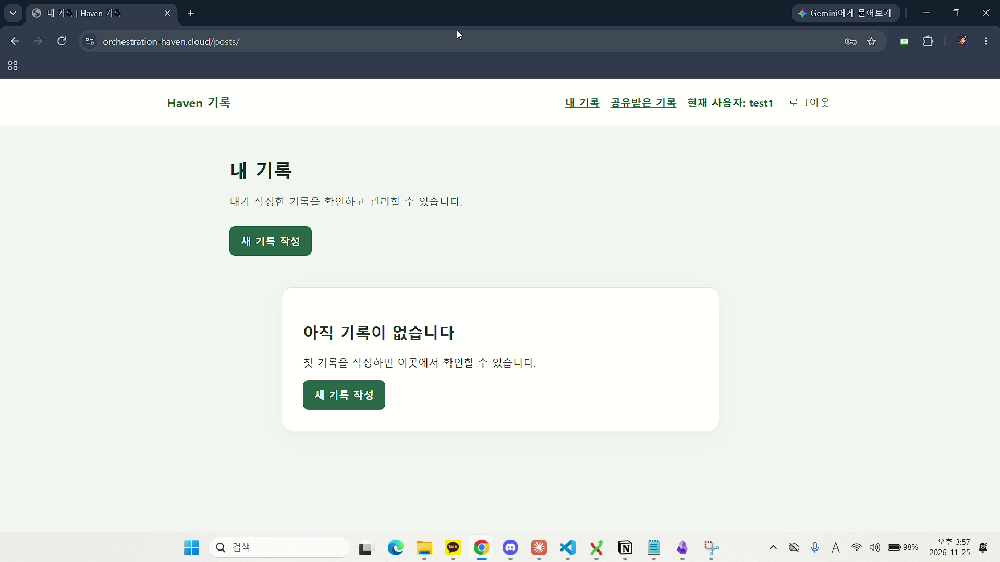
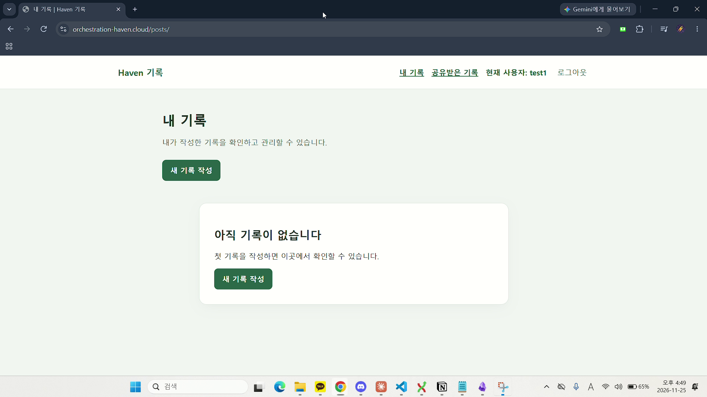
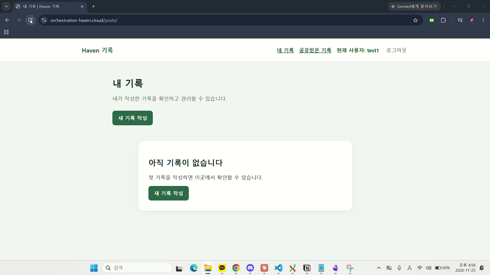
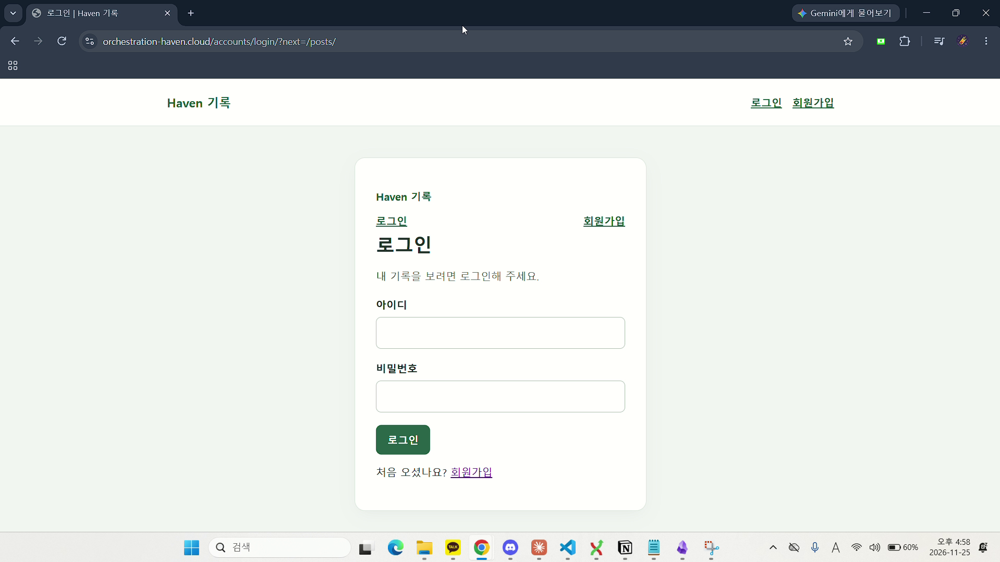

# 4회차 자연 로그인 만료 검증 보고서

Team2 · Haven 프로젝트 · 작성 구민철

| 항목 | 내용 |
|---|---|
| **프로젝트** | Haven (team2-project) |
| **검증 일자** | 2026년 11월 25일 15:57 ~ 16:58 (KST) |
| **보고 일자** | 2026년 11월 25일 |
| **검증 계정** | test1 — 본인이 가입한 일반 회원 |
| **웹 시험 환경** | AWS 운영 사이트 https://orchestration-haven.cloud (Windows, Chrome 일반 창) |
| **운영 배포 커밋** | `5d0e370` (11/19 배포, 11/25 앱·서버 배포 없음. 조장 운영기록 11/25) |
| **요청 방법** | 브라우저 화면 조작만 (로그인, 새로고침). 비정상 요청 없음 |
| **증거** | 화면 녹화 3개(작업 표시줄 시계 포함)에서 장면을 이미지로 옮김 |
| **종합 결과** | 기대 결과와 일치 (로그인 52분 뒤 유지, 61분 뒤 로그인 화면으로 이동) |

## 1. 검증 목적

로그인한 뒤 아무것도 하지 않고 **1시간이 지나면 로그인이 끝나는지**(자연 만료) 운영 사이트에서 직접 확인한다. 브라우저를 닫아 끝나는 경우나 로그아웃 버튼으로 끝나는 경우는 이 시험의 범위가 아니다.

- 앱 설정(신요찬 `app/config/settings.py` 167~169행)
  - `SESSION_COOKIE_AGE = 3600`: 로그인 유지 시간 1시간
  - `SESSION_SAVE_EVERY_REQUEST = False`: 화면을 새로고침해도 유지 시간이 늘어나지 않는다
  - `SESSION_EXPIRE_AT_BROWSER_CLOSE = True`: 브라우저를 닫으면 바로 끝난다. 그래서 시험하는 동안 브라우저를 닫지 않았다
- 기대 결과: 로그인 뒤 1시간 안에는 로그인 상태 유지, 1시간이 지난 뒤 보호된 화면(내 기록)을 새로고침하면 로그인 화면으로 이동

## 2. 방법

| 순서 | 시각 (KST, 화면 시계) | 내용 |
|---|---|---|
| 1 | 15:57 | Chrome 일반 창에서 test1로 로그인하는 장면부터 녹화. 로그인 뒤 내 기록 화면(`/posts/`) 확인 |
| 2 | 15:57 ~ 16:48 | 브라우저는 열어 둔 채 이 창은 사용하지 않음 |
| 3 | 16:48 ~ 16:49 | 같은 창을 새로고침하며 녹화. 로그인 상태가 유지되는지 확인(약 51~52분 경과) |
| 4 | 16:49 ~ 16:58 | 다시 사용하지 않음 |
| 5 | 16:58 | 같은 창을 새로고침하며 녹화. 로그인 화면으로 이동하는지 확인(약 61분 경과) |

- 3번의 새로고침은 `SESSION_SAVE_EVERY_REQUEST = False`라서 유지 시간을 늘리지 않는다.
- 녹화 원본(mp4)은 저장소 밖에 보관하고, 이 보고서에는 장면만 이미지로 옮겼다. 로그인 장면의 비밀번호 칸은 가렸다(점 개수로 길이가 드러나지 않도록).

## 3. 결과

| # | 시각 (KST) | 로그인 뒤 경과 | 화면 | 판정 | 증거 |
|---|---|---|---|---|---|
| 1 | 15:57 | 0분 | 로그인 화면에 아이디 test1 입력, 비밀번호 입력(가림) | 로그인 시작 | [exp-01](img/exp-01_1557_login_input.png) |
| 2 | 15:57 | 0분 | 내 기록, "현재 사용자: test1", 로그아웃 링크 표시 | 로그인 상태 | [exp-02](img/exp-02_1557_logged_in.png) |
| 3 | 16:49 | 약 52분 | 새로고침 뒤에도 내 기록, "현재 사용자: test1" 그대로 | **유지 (기대대로)** | [exp-03](img/exp-03_1649_still_logged_in.png) |
| 4 | 16:58 | 약 61분 | 새로고침 직전: 열려 있던 내 기록 화면 | (새로고침 전 화면) | [exp-04](img/exp-04_1658_before_refresh.png) |
| 5 | 16:58 | 약 61분 | 새로고침 뒤 주소가 `/accounts/login/?next=/posts/`로 바뀌고 "내 기록을 보려면 로그인해 주세요." 로그인 화면. 메뉴에 로그인·회원가입만 보임 | **만료 (기대대로)** | [exp-05](img/exp-05_1658_login_page.png) |

- 로그인(15:57) 뒤 52분(16:49)에는 유지되고, 61분(16:58)에는 같은 창의 새로고침이 로그인 화면으로 이어졌다. 설정값 1시간(만료 예상 16:57 무렵)과 맞는다.
- 로그인 화면 주소의 `?next=/posts/`는 원래 열려던 화면(내 기록)으로 로그인 뒤 돌아가기 위한 값이다. 로그인이 끝나 보호된 화면에서 로그인 화면으로 보내졌다는 뜻이다.

## 4. 다른 기록과의 관계

- **같은 날 첫 시도(14:31 ~ 15:46):** test1로 14:31 이전에 로그인 → 15:23(약 52분) 유지 → 15:46 로그인 화면. 결과는 같지만 정확한 로그인 시각이 없고 마지막 장면에 시계가 없어, 로그인 장면부터 시계와 함께 녹화해 이 보고서의 시험을 다시 했다.
- **노푸른 11/24 시험(#225, `노푸른/1회차_앱_검증기록.md`):** Chrome 시크릿 창에서 15:15 로그인, 16:16~16:17쯤 새로고침 → 로그인 화면. 새로고침 시각은 기억 기준이었다.
- 이 시험은 **로그인 시각, 유지 시점, 만료 시점을 모두 시계와 함께** 남겼다. 시크릿 창이 아닌 일반 창에서도 같은 결과다.
- ASVS 5.0.0 매핑 v5.0.0-7.3.2(최대 세션 시간 초과 시 재인증) 증거에 **[직접]**으로 보탤 수 있다.

## 5. 한계

- 화면 시계는 분 단위라 시각은 1분 오차가 있다. 만료는 16:49(유지)와 16:58(만료) 사이에 일어났고, 설정상 16:57 무렵이다.
- 결과는 화면 표시 기준이며 HTTP 상태 코드나 쿠키·서버 세션 값은 확인하지 않았다(세션 값은 비밀 정보라 기록하지 않는다).
- 한 계정, 한 번의 시험이다(첫 시도 포함 두 번 같은 결과).
- 비활동 시간 초과(7.3.1)는 Haven에 따로 정한 값이 없어 이 시험의 대상이 아니다. 1시간 안에서는 활동이 없어도 유지된다.
