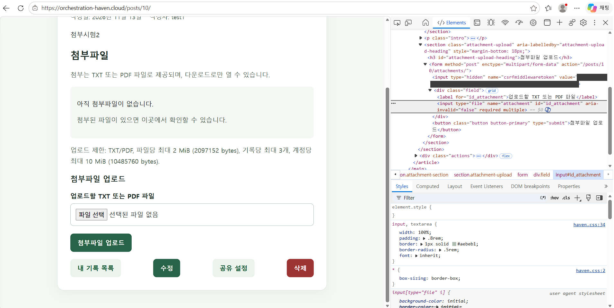
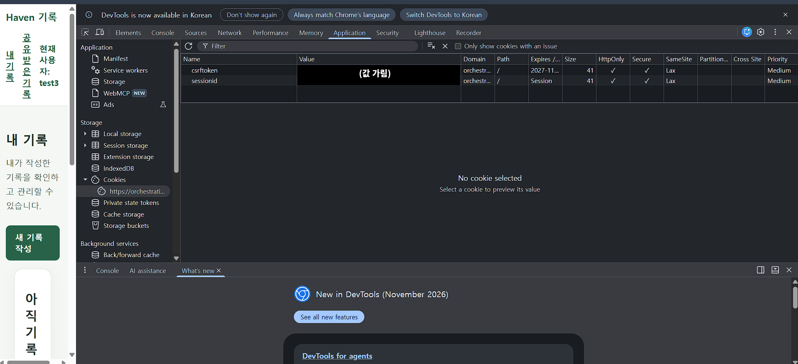
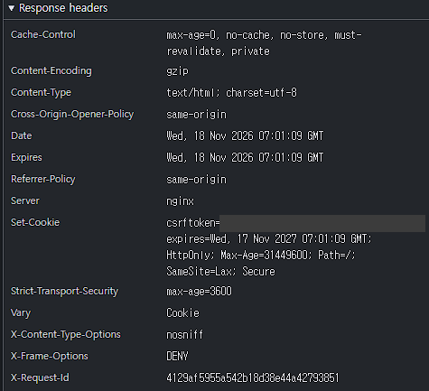
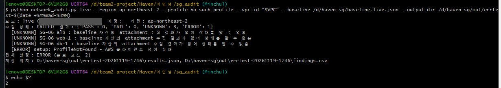
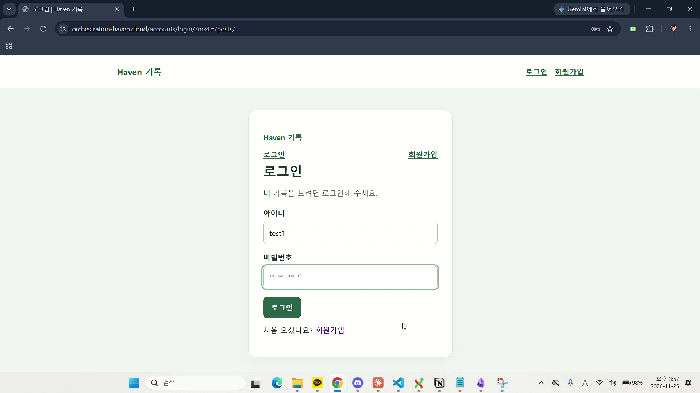
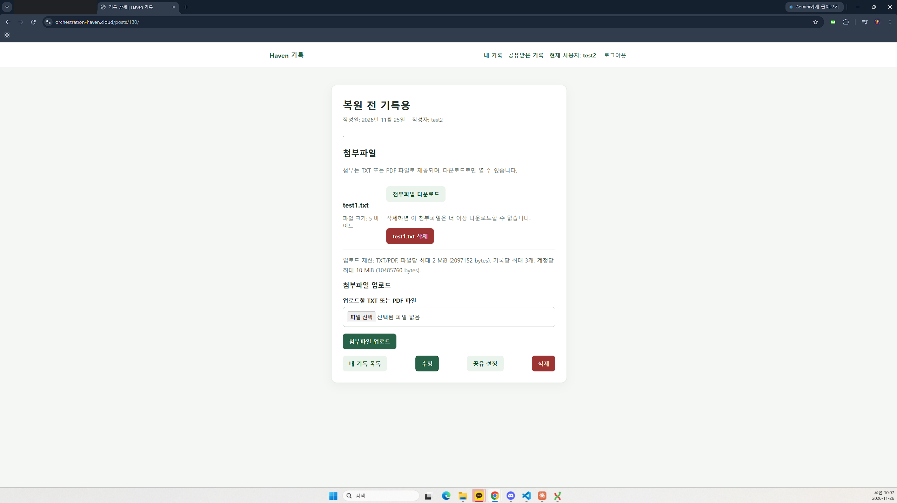

# 증거 가림 점검표

Team2 · Haven 프로젝트 · 작성 구민철

| 항목 | 내용 |
|---|---|
| **대상** | `구민철/` 아래 보고서 이미지 87장, 보고서·표 문서 13개, SG 점검 증거 묶음(`sg_evidence/`) 6개 파일 |
| **기준 커밋** | main `582f528` (#260 병합 뒤) |
| **점검 일자** | 2026년 11월 26일 (워드로 조장에게 전달), 11/27 저장소에 md로 등록 |
| **가릴 것** | AWS 계정 번호, IP 주소, 실제 SG·VPC·ENI·인스턴스 ID, ARN, 키·토큰·쿠키·CSRF 값, 비밀번호, 서버 호스트 이름, 백업 버킷 이름, 실사용 아이디와 실명이 보이는 자동 완성 목록 |
| **결과** | 가려야 할 값이 남은 곳 0건. 낮은 위험으로 남겨 둔 것 1종(6장) |

## 1. 점검 방법

1. **문서:** main의 `구민철/` 전체 텍스트 파일을 아래 패턴으로 검색했다.
   - 12자리 숫자(계정 번호), `arn:aws`, `sg-0`·`vpc-0`·`eni-0`·`i-0`로 시작하는 실제 ID
   - IPv4 주소(`0.0.0.0/0`은 판정 근거라 제외), `ip-10-`(서버 호스트 이름)
   - 실사용 아이디, `AKIA`(접근 키), `sessionid=`·`csrftoken=` 값, `haven-backup-` 뒤 숫자(버킷 이름)
2. **이미지:** main의 이미지 87장을 모두 내려받아 한 장씩 눈으로 확인했다. 토큰·쿠키·비밀번호 칸은 확대해서 가림 상태를 봤다.

## 2. 문서 결과

| 대상 | 결과 |
|---|---|
| 보고서·표 문서 13개 | 걸린 곳 없음. SG 보고서 110행의 검색 패턴 설명(`[0-9]{12}` 등)만 걸렸고 실제 값이 아니다 |
| `sg_evidence/` 6개 파일 | 실제 ID 없음. SG·VPC·ENI는 `sg-#…`·`vpc-#…`·`eni-#…` 해시로, 계정은 `account-masked`로 바뀌어 있다(도구의 가림 규칙 `masking.json`). `0.0.0.0/0`은 판정 근거라 그대로 둔다 |

## 3. 이미지 결과 (보고서별)

| 보고서 | 장수 | 가림 처리된 것 | 남은 민감 값 |
|---|---|---|---|
| 1회차 검증보고서 | 19 | - (공통 오류 화면·시험 실행 화면) | 없음 |
| 2회차 공통400 | 3 | CSRF 토큰 값(검은 막대, 400-00) | 없음 |
| 2회차 첨부·공유 | 20 | - | 없음 |
| 2회차 HTTPS·메일 | 7 | 쿠키 값(c1-03), Set-Cookie의 csrftoken 값(hsts_1118_masked) | 없음 (인증서 지문·메일 실행 ID·DKIM 결과는 공개 값) |
| 2회차 첨부 이름 규칙 | 4 | - | 없음 |
| 로그인 실패 제한 | 4 | - (비밀번호 칸은 점으로만 보이고, 일부러 틀린 비밀번호) | 없음 |
| 3회차 SG 정식 점검 | 4 | AWS 프로필 이름(sg-04), 증거 묶음의 ID 해시 | 없음 (6장 참고) |
| 4회차 자연 로그인 만료 | 5 | 비밀번호 칸(exp-01) | 없음 |
| 4회차 시연 회귀 | 14 | 자동 완성 목록이 보이는 녹화 장면은 고르지 않음 | 없음 |
| 4회차 격리 복원 입회 | 7 | 시험과 관계없는 브라우저 탭 제목(rs-05·rs-07) | 없음 |
| **합계** | **87** | | **0** |

## 4. 가림 처리 예시

3장의 가림 처리가 실제로 되어 있는 화면이다. 각 보고서 이미지에서 해당 부분을 잘라 왔다.

## 5. 저장소에 넣지 않은 원본

| 원본 | 이유 | 보관 |
|---|---|---|
| 시연 회귀·자연 만료 녹화(mp4) | 자동 완성 목록에 실사용 아이디·실명, 관계없는 화면 | 구민철 PC |
| 격리 복원 서버 캡처 | 서버 호스트 이름, 백업 버킷 이름(계정 번호), 첨부 저장 키 | 조장 보관 (요찬 4회차 기록 8-7에 sha256) |
| SG 실행 원본(`baseline.live.json`, `out/`) | 실제 VPC·SG ID | 구민철 PC, 저장소 밖 폴더 |
| 가리기 전 캡처 원본 | 토큰·쿠키 값 | 구민철 PC |

## 6. 낮은 위험으로 남겨 둔 것

- **본인 PC 이름과 Windows 사용자 이름:** SG 점검 이미지 4장(sg-01~sg-04)의 터미널 앞부분에 `lenovo@DESKTOP-…`가 보이고, PowerShell 이미지(rs-04·rs-06·demo-07 등)의 경로에 `C:\Users\lenovo`가 보인다.
- AWS나 서비스에 접근하는 정보가 아니고 제조사 기본 이름이라 사람을 특정하기 어렵다. 그래서 가리지 않았다. 조장이 가리라고 하면 해당 이미지의 그 부분만 가린다.

## 7. 한계

- 이미지는 사람이 눈으로 확인했다. 아주 작은 글씨(개발자 도구 표의 작은 칸 등)는 확대해서 본 곳 외에는 놓쳤을 수 있다.
- 다른 팀원 폴더의 증거는 이 점검 대상이 아니다.

## 8. 저장소에 올리면서 늘어난 것 (11/27)

이 점검표와 [C3 SG fixture 대조 검증 보고서](../4회차_C3_SG_fixture대조_검증보고서/4회차_C3_SG_fixture대조_검증보고서.md)를 md로 올리면서 문서 2개와 이미지 9장이 늘었다. 같은 기준으로 다시 확인했다.

| 대상 | 장수 | 결과 |
|---|---|---|
| 이 점검표 `img/` (ev-01~06) | 6 | 3장 보고서 이미지에서 가림 처리된 부분을 자른 것. 남은 민감 값 없음 |
| C3 보고서 `img/` (c3-01~03) | 3 | 터미널 화면. `sg-fixture-*`·`db-1`·`tmp-1`은 fixture 안의 가짜 이름이고 AWS 값 없음. PC 이름만 보임(6장과 같은 판단) |
| 두 md 문서 | 2 | 1장 패턴 검색에 걸린 실제 값 없음 |

- 그래서 11/27 기준 대상은 이미지 96장, 보고서·표 문서 15개, `sg_evidence/` 6개 파일이고, 남은 민감 값은 그대로 0이다.
