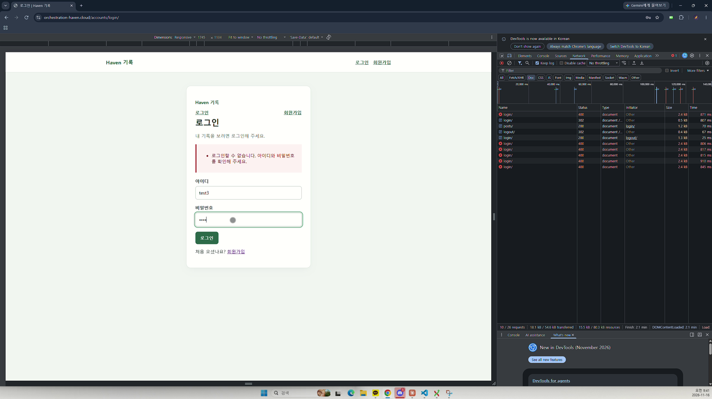
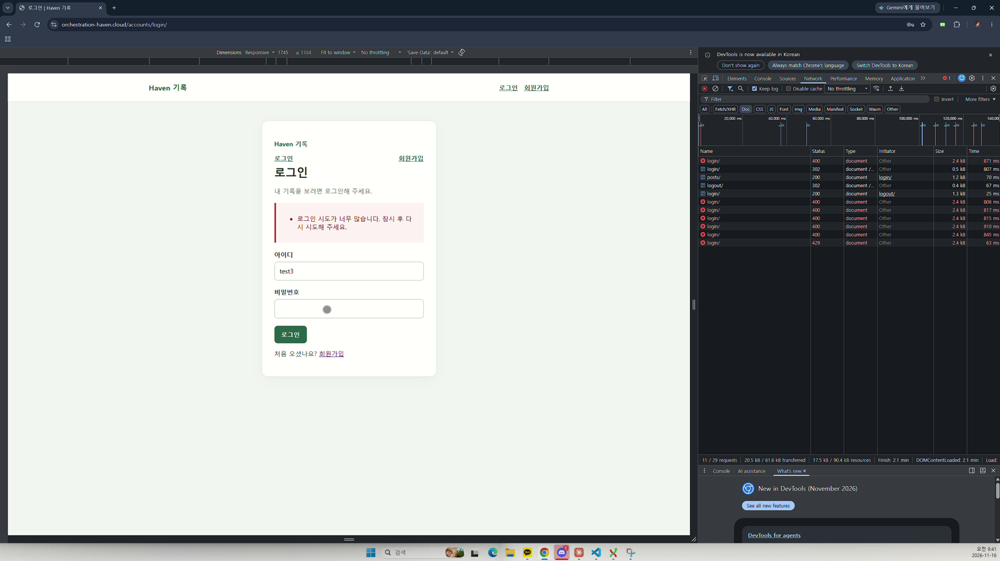
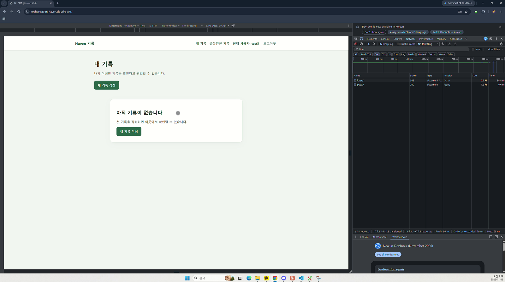

# 2회차 로그인 실패 제한 검증 보고서

Team2 · Haven 프로젝트 · 작성 구민철

| 항목 | 내용 |
|---|---|
| **프로젝트** | Haven (team2-project) |
| **검증 일자** | 2026년 11월 16일 09:40~09:59 |
| **보고 일자** | 2026년 11월 16일 |
| **검증 계정** | test3 — 본인이 가입한 일반 회원 (공유 시험에 쓰는 test1·test2를 막지 않으려고 선택) |
| **웹 시험 환경** | AWS 운영 사이트 https://orchestration-haven.cloud (Chrome) |
| **운영 배포 커밋** | `808465d` (#88 로그인 실패 제한, 11/13 17시 민성 운영 기록 기준, 이후 재배포 여부는 확인 필요) |
| **상태 코드 확인** | 브라우저 개발자 도구 Network 탭 (Keep log 켬, Doc 필터) |
| **기준** | `신요찬/앱계약.md` 8장 13번, `신요찬/로그인실패제한_안.md` (#75 조장 결정) |
| **종합 결과** | 기대 결과와 일치 |

## 1. 검증 목적

로그인 실패 제한(#88)이 운영 서버에서 결정된 수치대로 동작하는지 독립적으로 확인한다.

- 같은 아이디로 15분 안에 5번 실패하면 로그인이 제한(429)되는지 확인한다.
- 제한 중에는 맞는 비밀번호를 넣어도 막히는지(비밀번호를 확인하지 않는지) 확인한다.
- 시간이 지나면 관리자 조치 없이 자동으로 풀리는지(영구 잠금 없음) 확인한다.

결정된 기준: 관찰 15분, 같은 아이디 5번 또는 같은 IP 30번 실패 시 제한, 평소 실패 400, 제한 중 429, 제한 중 시도는 세지 않고 비밀번호도 확인하지 않음, 자동 회복.

## 2. 방법

| 순서 | 내용 |
|---|---|
| 1 | Chrome에서 로그인 화면을 열고 개발자 도구 Network 탭(Keep log 켬)을 연 채 화면 녹화 시작 |
| 2 | test3에 틀린 비밀번호로 5번 로그인 |
| 3 | 틀린 비밀번호로 6번째 로그인 |
| 4 | 7번째는 맞는 비밀번호로 로그인 |
| 5 | 마지막 실패에서 15분 넘게 기다린 뒤(09:59) 맞는 비밀번호로 로그인 |

- 녹화 2개: `로그인_횟수_제한.mp4`(시험 1·2, 09:40~09:41), 15분 뒤 영상(시험 3, 09:59). 작업 표시줄 시계가 함께 찍히도록 했다.
- 녹화 중에는 요청 상세(Payload)를 열지 않았다. 비밀번호가 평문으로 보이기 때문이다.
- 시험 전 Network 목록 맨 위의 400 1건과 302(로그인 성공)·로그아웃은 시험 전 기록이다. 로그인에 성공하면 그 아이디의 실패 기록이 지워지므로 이번 시험에는 영향이 없다.
- 7번째 시도가 맞는 비밀번호였다는 것은 화면에 점으로만 보여 영상으로 증명되지 않는다. 시험자가 기록한다.

## 3. 결과

| # | 시험 | 기대 | 실제 | 판정 |
|---|---|---|---|---|
| 1 | 틀린 비밀번호 1~5번째 | 일반 실패 400 | **400** ×5, "로그인할 수 없습니다. 아이디와 비밀번호를 확인해 주세요." (응답 806~910 ms) | 일치 |
| 1 | 틀린 비밀번호 6번째 | 제한 429 | **429**, "로그인 시도가 너무 많습니다. 잠시 후 다시 시도해 주세요." (63 ms) | 일치 |
| 2 | 제한 중 맞는 비밀번호(7번째) | 계속 429 | **429**, 같은 제한 안내 (71 ms) | 일치 |
| 3 | 마지막 실패(09:41) 18분 뒤 맞는 비밀번호 | 로그인 성공 | `login/` **302** → `posts/` **200**, "내 기록" 화면, 상단 "현재 사용자: test3" | 일치 |

- 400 응답은 806~910 ms, 429 응답은 63·71 ms로 열 배 이상 빨랐다. 제한 중에는 비밀번호 확인(해시 계산)을 건너뛴다는 설계와 맞는 관찰이다.
- 제한 안내 문구에는 아이디가 있는지, 비밀번호가 맞았는지 등 추가 정보가 없었다.
- 시험 3에서 로그인 직후 Chrome이 "비밀번호 변경" 경고를 띄웠다. 브라우저가 유출 목록에 같은 비밀번호가 있다고 알려 주는 기능이며 Haven 서버 동작과는 무관하다.

## 4. 결론

- 같은 아이디로 5번 실패한 뒤 6번째 시도부터 429로 제한되었다.
- 제한 중에는 맞는 비밀번호도 429로 막혔고 응답이 빨라, 비밀번호를 확인하지 않는다는 설계와 맞았다.
- 마지막 실패 18분 뒤 관리자 조치 없이 로그인에 성공해 자동 회복(영구 잠금 없음)을 확인했다.
- 계정 기준(5번), 제한 중 동작, 자동 회복 3가지는 결정된 수치와 일치한다.

## 5. 이번에 확인하지 않은 것

| 항목 | 이유 |
|---|---|
| IP 기준(같은 IP 30번) | 같은 공간의 팀원 로그인까지 막을 수 있어 운영 서버에서 시험하지 않음. 요찬 로컬 시험(#88) 결과 참고 |
| 없는 아이디의 실패도 똑같이 세는지(계정 존재 비노출) | 이번 범위 밖. 필요하면 가상 아이디로 별도 시험 |
| 정확한 회복 시점(첫 실패 15분 뒤) | 여유를 두고 18분 뒤에 확인함. 15분 직후 경계는 확인하지 않음 |
