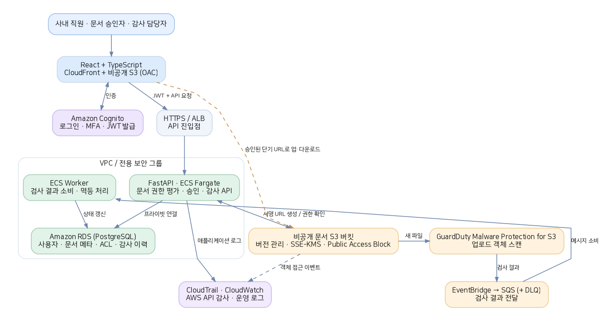
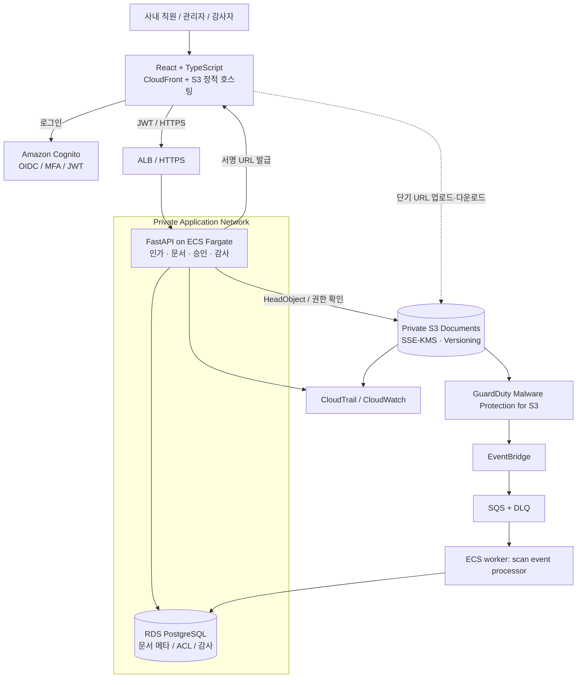
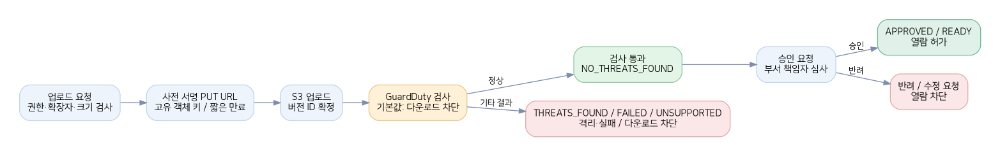
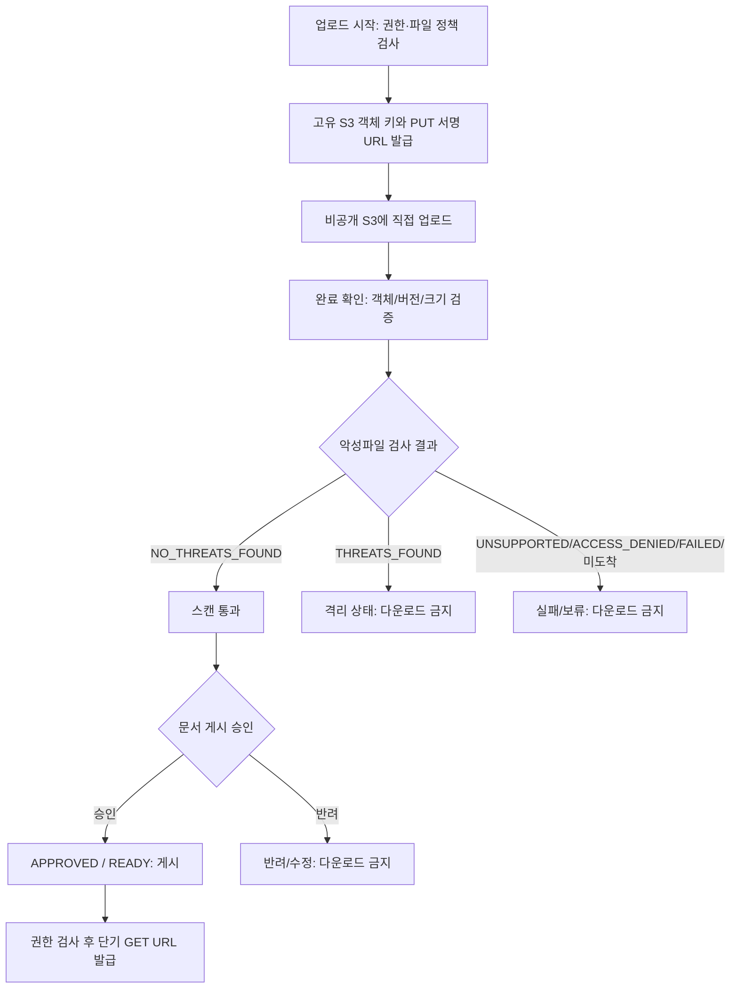
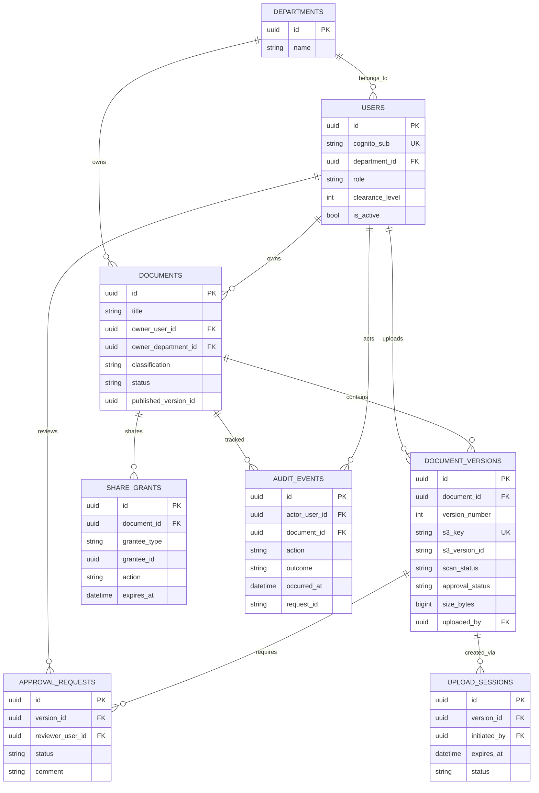
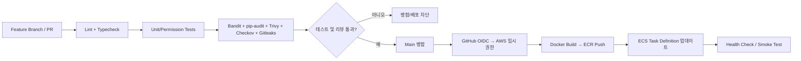
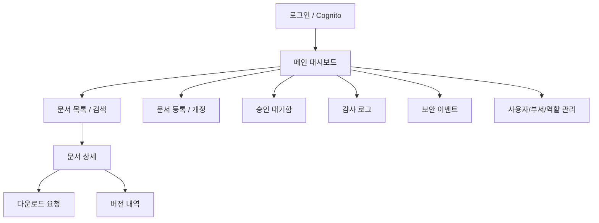

# AWS 기반 기업용 보안 문서 관리 및 클라우드 접근 통제 플랫폼

## 목차

1. [프로젝트 개요](#1-프로젝트-개요)
2. [문제 정의와 목표](#2-문제-정의와-목표)
3. [범위와 우선순위](#3-범위와-우선순위)
4. [서비스 이용자와 핵심 시나리오](#4-서비스-이용자와-핵심-시나리오)
5. [기술 스택 및 선택 이유](#5-기술-스택-및-선택-이유)
6. [AWS 제공 기능 vs 직접 구현할 기능](#6-aws-제공-기능-vs-직접-구현할-기능)
7. [전체 시스템 아키텍처](#7-전체-시스템-아키텍처)
8. [서비스 모듈과 코드 구조](#8-서비스-모듈과-코드-구조)
9. [인증·인가 및 접근 통제 설계](#9-인증인가-및-접근-통제-설계)
10. [문서 업로드·검사·승인·다운로드 흐름](#10-문서-업로드검사승인다운로드-흐름)
11. [데이터베이스 및 저장소 설계](#11-데이터베이스-및-저장소-설계)
12. [API 명세 초안](#12-api-명세-초안)
13. [보안 설계 및 위협 모델](#13-보안-설계-및-위협-모델)
14. [인프라·CI/CD·운영 구성](#14-인프라cicd운영-구성)
15. [화면 및 사용자 경험 설계](#15-화면-및-사용자-경험-설계)
16. [6인 역할 분담과 협업 규칙](#16-6인-역할-분담과-협업-규칙)
17. [30일 상세 일정](#17-30일-상세-일정)
18. [테스트 시나리오와 완료 기준](#18-테스트-시나리오와-완료-기준)
19. [예상 리스크 및 비용 관리](#19-예상-리스크-및-비용-관리)
20. [결과물과 발표 시연 구성](#20-결과물과-발표-시연-구성)
21. [단계별 확장 로드맵](#21-단계별-확장-로드맵)
22. [공식 참고 자료](#22-공식-참고-자료)

---

## 1. 프로젝트 개요

### 1.1. 한 줄 소개

**기업 내부 문서를 AWS에 안전하게 저장하고, 직원·부서·문서 등급에 따라 열람/업로드/승인/공유 권한을 제한하며, 모든 중요 행위를 감사할 수 있는 웹 기반 통합 플랫폼**을 개발한다.

### 1.2. 개발 배경

기업의 인사, 재무, 계약, 기술 설계 문서 등을 단순 파일 서버나 일반 클라우드 저장소에 보관할 경우, 다음과 같은 관리 문제가 발생할 수 있다.

- 파일이 어디에 저장되는지, 어떤 부서가 소유하는지 관리하기 어렵다.
- 계정만 있으면 지나치게 많은 문서를 읽는 **과도한 권한**이 발생할 수 있다.
- 문서가 수정·삭제되었을 때 작성자와 이전 버전을 추적하기 어렵다.
- 민감 문서를 다운로드하거나 타 부서에 공유할 때 별도 승인이 필요할 수 있다.
- 잘못된 클라우드 설정이나 무단 열람 시도를 신속하게 파악하기 어렵다.
- 파일을 저장하는 기능과 기업이 요구하는 **업무 승인·감사 정책**은 별개다.

### 1.3. 핵심 가치 제안

| 기존 파일 저장 서비스만 사용할 때 | 본 프로젝트가 추가하는 기업 업무 기능 |
|---|---|
| 파일 보관 및 다운로드 | 사용자·부서·문서 등급별 권한 평가 |
| 파일 업로드와 버전 유지 | 검사 → 승인 → 게시의 업무 상태 관리 |
| AWS 계정/리소스 차원의 접근 제어 | **개별 문서**에 대한 업무 권한 제어 |
| AWS API 활동 로그 | 문서 번호, 신청자, 승인자, 접근 사유를 포함한 감사 로그 |
| 암호화·인프라 보안 구성 요소 | 보안 이벤트 대시보드, 승인 요청, 정책 위반 알림 |

### 1.4. 정량 목표(제안 KPI)

| 항목 | 목표 | 검증 방법 |
|---|---|---|
| 권한 차단 | 비인가 문서 조회/다운로드 요청 **100% 거부** | 권한 매트릭스 자동 테스트 |
| 핵심 업무 | 업로드 → 검사 통과 → 승인 → 다운로드 end-to-end 성공 | 통합 시나리오 |
| 감사 추적 | 문서 다운로드 URL 발급·승인·권한변경·삭제 등 주요 이벤트 기록 | API 및 DB 조회 |
| 악성 파일 통제 | `NO_THREATS_FOUND`가 아닌 모든 검사 상태에서 다운로드 URL 미발급 | 상태 전이 테스트 |
| 배포 자동화 | `main` 승인 병합 후 테스트·검증된 빌드 배포 | GitHub Actions 실행 기록 |
| 복구 | 삭제·수정된 문서의 이전 버전 정보 확인 및 허용된 복구 절차 시연 | 버전 관리 테스트 |
| 문서화 | 아키텍처·API·ERD·테스트 결과·운영 가이드 작성 | 최종 제출물 점검 |

> KPI는 상용 서비스 수준 보장이 아니라 **프로젝트 수용 기준**이다. 지연 시간·가용성 등은 테스트 환경 및 예산을 확인한 후 추가 수치화한다.

---

## 2. 문제 정의와 목표

### 2.1. 구축 대상

- **단일 기업 내부 문서 시스템**. 초기 MVP는 여러 기업이 함께 쓰는 멀티테넌트 SaaS가 아니다.
- 직원, 부서 관리자, 보안 담당자, 감사 담당자가 서로 다른 권한으로 사용한다.
- 문서는 PDF, DOCX, XLSX, PPTX, TXT 등 일반적인 업무용 파일을 대상으로 하되, 파일 형식과 최대 크기는 운영 정책으로 제한한다.
- **문서 원본 파일은 S3**, 문서 제목·소유자·부서·등급·상태·권한·승인·감사 이력은 **PostgreSQL**에 저장한다.

### 2.2. 주요 목표

1. **안전한 인증**: Cognito 기반 로그인, 비밀번호 관리, MFA 적용.
2. **세밀한 접근 통제**: 역할(RBAC)과 문서/부서/등급 속성(ABAC 유사 규칙)을 조합.
3. **안전한 파일 저장**: S3 비공개 버킷, 버전 관리, 암호화, 짧은 유효기간의 서명 URL.
4. **업무 승인**: 문서 등록 및 제한적 공유 시 승인·반려·철회 처리.
5. **보안 감사**: 애플리케이션 이벤트와 AWS API 이벤트를 역할별로 구분해 기록.
6. **운영 자동화**: 코드 검사, 이미지 검사, IaC 검사, 배포, 보안 상태 모니터링.

### 2.3. 프로젝트 특색

단순 클라우드 드라이브 복제품이 아니라 **기업 정보보안 정책을 코드로 집행하는 문서 관리 시스템**을 지향한다. 예를 들어 시스템 관리자는 인프라를 관리하지만, 별도 권한이 없으면 기밀 문서 본문을 볼 수 없도록 **관리자 권한과 정보 열람 권한을 분리**한다.

---

## 3. 범위와 우선순위

### 3.1. 기능 우선순위

| 분류 | 기능 | 완료 조건 | 우선순위 |
|---|---|---|---|
| 인증 | 로그인/로그아웃, MFA, JWT 검증 | 미인증 API 차단 | **P0** |
| 조직 | 사용자·부서·역할 등록/조회 | 부서 및 역할 변경 반영 | **P0** |
| 문서 | 업로드, 목록, 상세, 다운로드 | 비공개 S3 연동 | **P0** |
| 권한 | 소유자·부서·등급·명시적 공유 판정 | API·문서 단위 차단 | **P0** |
| 문서 생명주기 | 검사 상태, 승인, 반려, 게시 | 승인 전 열람 차단 | **P0** |
| 감사 | 업로드/다운로드 URL 발급/권한변경/승인 기록 | 사용자·문서·시간 조회 | **P0** |
| 버전 | 개정 업로드, 이전 버전 메타 조회 | 버전 ID 유지·복구 검증 | **P0** |
| 운영 | 컨테이너 배포, 테스트, 보안 검사 | 자동 파이프라인 통과 | **P0** |
| 탐지 | 비정상 권한 요청, 스캔 실패, 보안 알림 | 대시보드에 사건 표시 | **P1** |
| 검색 | 제목/태그/부서/등급 검색 | 권한 있는 결과만 표시 | **P1** |
| 공유 | 사용자·부서 단위 공유, 만료 설정 | 공유 취소 및 만료 확인 | **P1** |
| 문서 보존 | 삭제·복원·보존 기간 안내 | 우발 삭제 방지 | **P1** |
| 외부 조직 SSO | 사내 IdP 연동 | 테스트 IdP 연계 | P2 |
| 정교한 정책 엔진 | Cedar / Verified Permissions | 속성 기반 규칙 시연 | P2 |
| DLP/문서 내용 검사 | 민감정보 탐지·OCR | 별도 정밀 기능 | P2 |
| AI 검색 | RAG 기반 문서 질의응답 | 검색 권한 누출 방지 필수 | P2 |

### 3.2. 명시적으로 제외할 항목

**30일 MVP에서는 제외**: 모바일 앱, 실시간 공동 편집, Office 온라인 편집기, 전체 본문 검색 인덱싱, 복잡한 전사 SSO, 멀티테넌트 격리, 자체 암호 알고리즘 개발, 자체 안티바이러스 엔진, 무중단 멀티리전 DR, 법적 규제 적합성 인증.

### 3.3. 범위 축소 기준

일정이 부족하면 P2 → P1 순으로 줄인다. **접근 통제·검사 상태 확인·승인·감사 로직은 제거하지 않는다.** 이 기능을 제외하면 프로젝트 주제가 단순 파일 업로드 서비스로 바뀐다.

---

## 4. 서비스 이용자와 핵심 시나리오

### 4.1. 사용자 페르소나

| 이용자 | 업무 목표 | 주요 화면 |
|---|---|---|
| 일반 직원 | 본인 및 허가받은 문서 열람, 신규 문서 등록 | 내 문서, 문서 목록 |
| 문서 소유자 | 자신의 문서 개정, 공유 요청 | 문서 상세, 개정 이력 |
| 부서 관리자 | 부서 문서 승인/반려, 부서 업무 관리 | 승인 대기함 |
| 보안 관리자 | 권한 정책, 검사 실패, 이상 접근 모니터링 | 보안 대시보드 |
| 감사 담당자 | 중요 행위 추적, 보고서 작성 | 감사 로그 조회 |
| 시스템 관리자 | 사용자 상태, 시스템 설정 관리 | 조직/운영 관리 |

> **중요:** 웹 애플리케이션의 보안 관리자나 시스템 관리자라고 해서 모든 문서 원본을 열람하도록 설계하지 않는다. 필요할 경우 별도의 승인된 열람 권한을 부여한다. 단, AWS 계정의 최고 관리자처럼 IAM/KMS 설정 자체를 바꿀 수 있는 주체까지 앱 권한 정책만으로 완전히 제한할 수는 없으므로, 클라우드 운영 권한 분리·키 정책·감사·필요 시 조직 차원의 통제를 별도로 적용해야 한다.

### 4.2. 업무 시나리오 A — 기밀 문서 등록

1. 개발 부서 직원이 `신규 제품 설계서.pdf` 등록을 요청한다.
2. 문서 분류 `CONFIDENTIAL`, 소유 부서 `개발팀`, 열람 대상 `개발팀`을 지정한다.
3. 백엔드가 업로드 권한을 검증하고 고유 객체 키에 대한 단기 업로드 URL을 생성한다.
4. 사용자가 파일을 비공개 S3 버킷으로 업로드한다.
5. 업로드 완료 후 백엔드가 정확한 S3 객체 버전 ID 및 크기를 검증한다.
6. GuardDuty Malware Protection for S3 검사 결과가 도착할 때까지 문서 다운로드를 금지한다.
7. 검사 결과 정상이라면 개발팀 관리자에게 승인 요청을 생성한다.
8. 부서 관리자가 승인하면 해당 **문서 버전**을 게시하고 허가된 직원만 조회/다운로드한다.
9. 모든 중요 이벤트가 감사 로그에 기록된다.

### 4.3. 업무 시나리오 B — 권한 없는 사용자의 접근

1. 인사팀 사용자가 개발팀 기밀 문서 ID를 알고 직접 상세 API를 호출한다.
2. JWT는 정상이나 문서의 소유 부서/명시적 공유 권한 조건을 만족하지 않는다.
3. 백엔드가 **문서 단위 인가**를 거부하며 다운로드 URL을 발급하지 않는다.
4. 감사 로그에 거부된 접근 요청을 남기고 필요하면 보안 관리자에게 경고한다.
5. 검색/목록에서도 해당 문서 제목이나 파일 메타데이터가 노출되지 않는다.

### 4.4. 업무 시나리오 C — 문서 개정과 회수

- 소유자가 기존 문서의 새로운 버전을 업로드한다.
- 새 버전은 `PENDING_SCAN` 및 `PENDING_APPROVAL` 상태로 독립 관리한다.
- 이전에 승인된 버전은 회사 정책에 따라 계속 제공하거나 게시를 일시 중단한다. MVP는 **새 버전 승인 전까지 직전 승인 버전 유지**를 채택한다.
- 새 버전 승인 후 `published_version_id`를 교체한다.
- 문서 공유 권한이 철회되면 이후 새 다운로드 URL은 발급되지 않는다. **이미 발급된 URL은 만료 전까지 사용할 수 있으므로 단기 만료가 필요**하다.

---

## 5. 기술 스택 및 선택 이유

### 5.1. 권장 조합

| 계층 | 기술 | 선택 이유 | 난이도 |
|---|---|---|---|
| 프론트엔드 | **React + TypeScript + Vite** | 팀 분업, 컴포넌트화, 타입 기반 API 연동 | 중 |
| UI/상태 관리 | TanStack Query, React Router, Tailwind CSS | 서버 상태 캐싱, 라우팅, 일관된 UI | 중 |
| 백엔드 | **Python FastAPI** | 빠른 API 구현, OpenAPI 자동 문서, AWS SDK 연동 | 중 |
| ORM/마이그레이션 | SQLAlchemy + Alembic + Pydantic | 스키마 변경 및 입력 데이터 검증 | 중 |
| DB | **PostgreSQL (Amazon RDS)** | 관계형 권한·승인·감사 모델에 적합 | 중 |
| 파일 저장 | **Amazon S3** | 대용량 파일, 비공개 버킷, 버전 관리 | 중 |
| 저장 암호화 | S3 SSE-KMS / AWS KMS | 관리형 키 및 IAM 통합 접근 관리 | 중 |
| 사용자 인증 | **Amazon Cognito User Pools** | 로그인/MFA/토큰/사용자 디렉터리 관리 | 중 |
| 인프라 권한 | AWS IAM (Task Role) | 애플리케이션의 AWS API 권한 최소화 | 중 |
| 앱 권한 | **직접 구현하는 RBAC + 조건 기반 정책** | 문서/부서/보안등급별 세밀한 인가 | 상 |
| 컨테이너 | Docker + Amazon ECR | 동일 빌드로 로컬/클라우드 실행 | 중 |
| 애플리케이션 실행 | **Amazon ECS on Fargate** | EC2 서버 운영 부담 완화 | 중~상 |
| 프론트 배포 | CloudFront + 프라이빗 S3 + OAC | HTTPS·정적 서비스·원본 보호 | 중 |
| 라우팅 | Application Load Balancer (ALB) | HTTPS 및 ECS 서비스 진입 | 중 |
| 비밀 설정 | AWS Secrets Manager | DB 접속 정보 등을 소스 밖에서 관리 | 중 |
| 악성파일 검사 | **GuardDuty Malware Protection for S3** | 업로드 객체에 대한 관리형 멀웨어 검사 | 중 |
| 이벤트 | **EventBridge + SQS + ECS worker** | 검사 결과를 안정적으로 수신하고 비동기 상태 반영 | 중 |
| 관측성 | CloudWatch Logs/Alarms | 백엔드 및 함수 로그/경보 | 중 |
| AWS 감사 | CloudTrail (필요한 S3 Data Events 선택) | AWS API 수준 증적 | 중 |
| IaC | **Terraform** | 인프라 재현·변경 리뷰 | 중~상 |
| CI/CD | GitHub Actions + AWS OIDC | 장기 Access Key 없이 임시 권한 기반 배포 | 중 |
| 보안 검사 | Trivy, Bandit, pip-audit, Checkov, Gitleaks | 이미지·코드·의존성·IaC·비밀 탐지 | 중 |
| 테스트 | pytest, httpx, Playwright | API/권한/E2E 테스트 | 중 |

**선택하지 않은 기술과 이유**

- **EKS/Kubernetes**: 운영 학습 비용이 커서 30일 MVP에서 제외.
- **마이크로서비스 분산 아키텍처**: 서비스 간 인증·네트워크·장애 처리 복잡도가 높아짐. 초기에는 모듈형 모놀리식 API + 소수의 비동기 워커가 적절.
- **Amazon Verified Permissions**: 세밀한 Cedar 정책은 유용하지만, 첫 버전은 Python 정책 모듈로 검증 가능하게 만든 뒤 선택적 확장.
- **Amazon OpenSearch**: 제목/태그 검색은 PostgreSQL로 충분. 전체 문서 본문 색인은 범위 외.
- **AI 기반 문서 요약**: 민감 정보 유출 통제와 품질 평가가 추가되므로 초기에 제외.

### 5.2. 대체 가능한 저비용 MVP 구성

ECS·ALB·RDS·네트워크 관련 고정비가 부담이라면 **개발/시연 환경에 한해** `EC2 1대 + Docker Compose(FastAPI, PostgreSQL)`로 시작할 수 있다. S3, Cognito, KMS, CloudTrail, GuardDuty 검사 등 문서 보안 핵심 기능은 동일하게 유지한다. 다만 단일 EC2/로컬 DB는 고가용성·장애 격리·데이터 관리 면에서 상용 기준보다 낮다. **본 계획서의 기준 아키텍처는 ECS + RDS**로 통일한다.

---

## 6. AWS 제공 기능 vs 직접 구현할 기능

> 이 절은 **우리 팀이 어디까지 개발했는지**를 발표와 기술 보고서에서 정확히 설명하기 위한 핵심이다.

| 기능 | AWS가 기본 제공하는 것 | 팀이 직접 구현해야 하는 것 | 책임 구분 |
|---|---|---|---|
| 로그인 | Cognito 계정 저장, 인증 흐름, MFA, 토큰 발급 | 화면 연결, 앱 사용자 동기화, 비활성 계정 대응 | 공동 |
| 사용자 조직 | Cognito 그룹/사용자 속성 | 부서 테이블, 직무, 소유자·부서 관리 화면 | 팀 |
| AWS 권한 | IAM Role/Policy, 조건·리소스 수준 권한 | 서비스 Role 설계 및 최소 권한 검증 | 공동 |
| 문서별 인가 | S3/IAM 수준 리소스 권한 | `문서 A를 직원 B가 읽을 수 있는가?` 판정 | **팀 핵심 개발** |
| 파일 저장 | S3 내구성, 객체 저장·조회 | 문서 메타데이터, 업로드 프로토콜, 객체 키 관리 | 공동 |
| 저장 암호화 | S3 SSE-S3 기본, 선택 시 SSE-KMS | 키 정책/기본 암호화 설정, 부적절한 접근 차단 | 공동 |
| 버전 관리 | S3 객체 버전 ID 및 보관 | 문서 개정 번호, 게시 버전 선택, 개정 이력 UI | 팀 |
| 다운로드 | S3 단기 Presigned URL API | 사전 권한 검사, URL 발급 정책, 발급 로그 | **팀 핵심 개발** |
| 악성파일 검사 | GuardDuty Malware Protection for S3 검사 결과 | 검사 상태 추적, 미검사·실패 파일 차단, 이벤트 처리 | 공동 |
| 승인 | 없음(일반 문서 업무 맥락) | 승인 요청/반려/재승인/만료·철회 | **팀 핵심 개발** |
| 업무 감사 | CloudTrail의 AWS API 이벤트 | 실제 사내 사용자·문서 ID·승인 사유·거절 사유 연결 | **팀 핵심 개발** |
| 서비스 모니터링 | CloudWatch 로그/메트릭/알람 | 비정상 요청 규칙, 운영 대시보드, 경보 정책 | 공동 |
| UI | AWS는 문서 업무 UI를 제공하지 않음 | 직원·관리자·감사 대시보드 전체 | 팀 |
| CI/CD | ECR/ECS와 배포 API | GitHub Actions 워크플로, 승인·보안 검사 | 공동 |
| 데이터 백업 | RDS 백업 및 S3 버전 기능 | 복구 절차, 복구 검증, 삭제·보존 정책 | 공동 |

### 6.1. 반드시 구분해야 할 4가지

1. **Cognito 인증 ≠ 문서 인가**: 로그인되었다는 이유만으로 특정 문서를 볼 수 있지는 않다.
2. **S3 암호화 ≠ 업무 접근 통제**: 저장 시 암호화되어도 부적절한 S3 읽기 권한이 있으면 내용이 노출될 수 있다.
3. **S3 버전 관리 ≠ 회사 문서 결재 이력**: AWS 객체 버전과 승인한 업무 버전은 별도로 매핑해야 한다.
4. **CloudTrail ≠ 사용자 단위 업무 감사**: 서명 URL 발급 서비스 Role의 S3 접근 이력만으로 최종 직원의 업무 의도를 모두 알 수 없다.

### 6.2. 본 프로젝트의 직접 개발 성과로 강조할 항목

- 문서 인가 정책 함수와 **테스트 가능한 정책 매트릭스**
- 문서 버전별 검사·승인 **상태 머신**
- 서명 URL 발급 전 **서버 측 정책 평가**
- **업무 감사 이벤트 스키마**, 검색/필터 및 이벤트 연관 ID
- 실패·중복·지연 이벤트에 대한 **멱등성 처리**
- 보안 정책을 실제로 위반했을 때의 **재현 가능한 통합 테스트**

---

## 7. 전체 시스템 아키텍처

### 7.1. 이미지 기반 구성도



> **설명:** 정적 웹은 CloudFront+비공개 S3로 제공하고, API는 ALB를 통해 ECS Fargate의 FastAPI로 연결한다. 문서 본문은 별도의 S3 버킷에 두며, PostgreSQL에는 문서 메타데이터와 권한·감사 정보를 저장한다. GuardDuty 검사 결과는 EventBridge → SQS → ECS 워커를 통해 DB 상태에 반영한다. 그림은 개념도이며 자세한 서브넷/인터넷 경계는 아래에서 정의한다.

### 7.2. GitHub에서 바로 렌더링되는 Mermaid 구성도



### 7.3. 네트워크 설계

| 컴포넌트 | 네트워크 배치 | 보안 정책 |
|---|---|---|
| CloudFront | AWS 관리형 엣지 | HTTPS, 정적 파일만 서비스 |
| 프론트 정적 S3 | **비공개 S3** | CloudFront OAC만 읽기 허용, Public Access Block |
| ALB | 퍼블릭 서브넷 | HTTPS 443만 외부 허용, TLS 인증서 연결 |
| ECS Tasks | 프라이빗 서브넷 | ALB 보안 그룹에서 API 포트만 허용 |
| RDS PostgreSQL | 프라이빗 DB 서브넷 | ECS 보안 그룹에서 5432만 허용, 퍼블릭 접근 비활성화 |
| 문서 S3 | 비공개 서비스 | 지정 서비스 Role만 객체 API, 사용자 직접 IAM 키 사용 금지 |
| ECS worker | ECS Tasks와 같은 프라이빗 네트워크 | SQS 메시지를 읽고 RDS에 상태 반영; 필요한 Endpoint/NAT 확인 |

**중요한 구현 선택:** 본 계획서에서는 **EventBridge → SQS → ECS worker → RDS**를 표준 구현으로 고정한다. 별도 ECS worker는 동일 백엔드 저장소의 워커 진입점으로 실행하고, 메시지를 읽어 검사 상태를 멱등하게 반영한다. 실패 메시지는 SQS DLQ로 보내 재처리한다. 단, **별도 ECS worker 태스크 실행비**가 추가로 발생한다. 대안인 `EventBridge → VPC Lambda → RDS`는 VPC 연결·DB 연결 관리 문제가 있어 비용/일정 검토 후 *단일 대안*으로만 선택할 수 있다. 두 방식을 중복 구축하지 않는다.

**서브넷·비용 관련 사항**

- ECS Tasks가 프라이빗 서브넷에 있고 ECR/Secrets Manager/CloudWatch로 통신하려면 **NAT Gateway 또는 필요한 VPC Endpoint** 구성이 필요하다.
- S3 Gateway Endpoint 등으로 일부 트래픽을 사설 경로화할 수 있으나, 서비스별 엔드포인트 지원·요금을 확인해야 한다.
- ALB, NAT Gateway, RDS, ECS는 짧은 사용 기간에도 비용이 발생할 수 있다.
- **포트 5432를 인터넷에 열지 않는다.** 관리 편의를 이유로 DB를 퍼블릭으로 전환하지 않는다.

### 7.4. 인증 경계와 데이터 경계

- **사용자 인증 경계**: Cognito는 사용자 본인 확인 및 토큰 발급 담당.
- **업무 인가 경계**: FastAPI는 매 API 호출마다 `user_id`, 문서 ID, 부서, 권한, 상태를 검증.
- **클라우드 권한 경계**: ECS Task Role만 제한된 S3, SQS, KMS 작업을 수행.
- **저장 경계**: 문서 원본 S3는 퍼블릭 접근이 불가능하며 RDS는 메타데이터만 저장.
- **감사 경계**: 애플리케이션 감사와 CloudTrail을 구분해 기록하고 요청 ID로 연관 분석.

---

## 8. 서비스 모듈과 코드 구조

### 8.1. 논리 모듈

| 모듈 | 주요 책임 | 입력/출력 |
|---|---|---|
| Identity | JWT 검증, Cognito 계정과 앱 사용자 매핑 | 토큰 → 사용자 컨텍스트 |
| Organization | 부서, 역할, 사용자 소속 관리 | 사용자/부서/역할 CRUD |
| Authorization | 리소스 단위 정책 평가 | `(주체, 행위, 문서) → Allow/Deny + 사유` |
| Documents | 문서 메타, 개정, 목록, 검색 | 문서/버전 데이터 |
| Storage | S3 사전 서명, HeadObject, 버전/키 검증 | 업·다운로드 URL |
| Scan Worker | 검사 결과 이벤트 소비, 상태 변경 | SQS 메시지 → DB 상태 |
| Approval | 승인 신청, 승인/반려/철회 | 승인 상태 및 기록 |
| Audit | 중요 행동 저장, 필터, 내보내기 | 불변에 가까운 감사 이벤트 |
| Security | 이상 접근 집계, 위험 경고 | 보안 이벤트/통계 |

### 8.2. Monorepo 권장 폴더 구조

```text
securedocs-cloud/
├── README.md
├── docs/
│   ├── project-plan.md
│   ├── architecture.md
│   ├── api-spec.md
│   ├── erd.md
│   ├── security-test-plan.md
│   └── runbook.md
├── frontend/
│   ├── src/
│   │   ├── pages/                 # 로그인, 대시보드, 목록, 승인, 감사
│   │   ├── components/            # 테이블, 문서 카드, 권한 경고 등
│   │   ├── features/              # documents, approvals, admin, audit
│   │   ├── api/                   # 타입 안전 API 호출
│   │   ├── auth/                  # Cognito 로그인 연동
│   │   └── routes/
│   ├── package.json
│   └── vite.config.ts
├── backend/
│   ├── app/
│   │   ├── main.py
│   │   ├── core/                  # 설정, 인증 의존성, 공통 오류
│   │   ├── modules/
│   │   │   ├── identity/
│   │   │   ├── organizations/
│   │   │   ├── authorization/
│   │   │   ├── documents/
│   │   │   ├── storage/
│   │   │   ├── approvals/
│   │   │   ├── audit/
│   │   │   └── security/
│   │   ├── db/                    # 모델, 세션, repository
│   │   └── workers/               # SQS 이벤트 소비/멱등 처리
│   ├── alembic/
│   ├── tests/                      # 단위, 권한, 통합 테스트
│   ├── Dockerfile
│   └── pyproject.toml
├── infrastructure/
│   ├── terraform/
│   │   ├── modules/              # network, ecs, rds, s3, iam, cognito
│   │   └── environments/dev/
│   └── scripts/
├── .github/workflows/
│   ├── backend-ci.yml
│   ├── frontend-ci.yml
│   ├── security-scan.yml
│   └── deploy-dev.yml
└── docker-compose.yml             # 로컬 API + PostgreSQL
```

### 8.3. 설계 원칙

- **라우터 → 서비스 → 저장소(repository)** 계층을 분리해 비즈니스 정책을 HTTP 코드에서 떼어낸다.
- 권한 판정은 `AuthorizationService.can(user, action, resource)` 하나를 중심으로 통일한다.
- 기본은 **deny-by-default**. 어떤 필드가 누락되거나 DB 조회가 실패하면 허용하지 않는다.
- API는 OpenAPI 스키마를 공유하고 프론트는 해당 스키마에서 타입/클라이언트를 생성할 수 있게 한다.
- S3 URL, 토큰, 비밀번호, 문서 내용은 애플리케이션 로그에 넣지 않는다.
- 상태 전이는 서비스 계층의 명시적인 상태 머신으로 관리한다.

---

## 9. 인증·인가 및 접근 통제 설계

### 9.1. 인증(Authentication): Cognito 활용

**사용하는 AWS 기능**

- Cognito User Pools 사용자 디렉터리
- Managed login / OAuth 2.0 Authorization Code + PKCE
- MFA, 암호 정책, 로그인/로그아웃, JWT 발급
- 사용자 그룹 및 사용자 식별자(`sub`)

**직접 구현하는 코드**

1. React 로그인 화면에서 Cognito 인증 페이지로 리디렉션.
2. 로그인 완료 후 OAuth/OIDC 콜백 처리.
3. API에 Access Token을 첨부.
4. FastAPI는 **JWT 서명(JWKS), issuer, audience/client ID, token_use, 만료**를 검증하며 필요한 그룹/스코프를 해석.
5. Cognito `sub`로 PostgreSQL `users` 레코드를 조회한다. 부서·권한·계정 상태는 **DB의 최신 정책**을 신뢰한다.
6. 프론트에서 버튼을 숨기더라도 **백엔드가 매번 권한 재검사**한다.

**토큰 저장 권장:** SPA에서 장기 토큰을 `localStorage`에 영구 보관하지 않는다. 사용 라이브러리의 PKCE 및 토큰 유지 옵션을 검토하고, 보안 요구가 높으면 BFF+`HttpOnly`/`Secure` 쿠키 방식으로 개선한다. 본 MVP는 인증 라이브러리의 표준 PKCE 플로를 사용하며 토큰 노출과 XSS를 별도 테스트한다.

### 9.2. 인가(Authorization): 팀 직접 구현

**역할(role)**은 사용자의 일반 행동 범위를, **부서 및 문서 속성**은 구체적인 문서 접근 여부를 결정한다.

#### 권한 매트릭스(예시)

| 동작 | 일반 직원 | 문서 소유자 | 부서 관리자 | 보안 관리자 | 감사 담당자 | 시스템 관리자 |
|---|---:|---:|---:|---:|---:|---:|
| 허가된 문서 조회 | ○ | ○ | ○ | 별도 허가 | 별도 허가 | 별도 허가 |
| 문서 등록 | ○ | ○ | ○ | 정책별 | × | 정책별 |
| 본인 문서 새 버전 등록 | × | ○ | 정책별 | × | × | × |
| 문서 게시 승인 | × | × | ○ | 정책별 | × | × |
| 문서 공유 요청 | △ | ○ | ○ | 정책별 | × | × |
| 감사 로그 조회 | × | 본인 이력 | 부서 이력 | ○ | ○ | 운영 이력 |
| 사용자·역할 관리 | × | × | 제한적 | 보안 정책별 | × | ○ |
| 보안 경고 확인 | × | × | 부서 요약 | ○ | ○ | 운영 요약 |

`○`는 **역할상 수행 가능**을 의미하며, 실제 문서 열람은 부서·등급·게시상태·명시적 공유 조건을 추가로 통과해야 한다. `△`는 일부 조건에서만 허용.

#### 문서 속성

- `owner_user_id`: 문서 작성자
- `owner_department_id`: 문서 소유 부서
- `classification`: `INTERNAL`, `CONFIDENTIAL`, `RESTRICTED`
- `published_version_id`: 실제 배포 가능한 버전
- `document_status`: `ACTIVE`, `ARCHIVED`, `DELETED`
- `share_grants`: 사용자/부서에 대한 명시적 읽기 권한 및 만료 시간
- `approval_status`: 문서 버전별 `DRAFT`, `PENDING`, `APPROVED`, `REJECTED`
- `scan_status`: 문서 버전별 `PENDING`, `CLEAN`, `THREAT`, `UNSUPPORTED`, `FAILED`

#### 문서 읽기 정책 예시(의사코드)

```python
def can_read_document(user, document, published_version, now):
    if not user.active or document.status != "ACTIVE":
        return False
    if published_version is None:
        return False
    if published_version.scan_status != "CLEAN":
        return False
    if published_version.approval_status != "APPROVED":
        return False
    if user.clearance < document.classification_level:
        return False
    # 소유자 또는 소유 부서 구성원 또는 명시적 유효 공유 권한
    same_department = document.owner_department_id in user.department_ids
    is_owner = document.owner_user_id == user.id
    explicitly_shared = has_valid_share_grant(user, document.id, now)
    return is_owner or same_department or explicitly_shared
```

실제 구현에는 **행위별 정책**을 추가한다. 읽기·개정·승인·공유·삭제는 같은 권한이 아니다. `clearance` 등급만으로 타 부서 접근이 자동 허용되지 않는다. 승인자는 자신이 등록한 문서의 결재를 수행하지 못하게 하는 등 **업무 분리(SoD)** 규칙을 P1로 추가할 수 있다.

### 9.3. AWS IAM의 역할

- **ECS Task Role**: 해당 S3 버킷/접두사의 `PutObject`, `GetObject`, `HeadObject` 등 업무에 필요한 작업만 허용.
- **SQS 소비 Role**: 지정 큐의 수신/삭제만 허용. GuardDuty 스캔에는 해당 객체를 읽고 필요한 경우 복호화할 수 있는 전용 서비스 권한도 정확히 설정한다.
- **CloudFront OAC**: 정적 웹용 S3 버킷을 CloudFront에서만 읽음.
- **KMS Key Policy**: 사용 대상 서비스/역할에만 암호화·복호화 허용.
- **CI/CD 배포 Role**: GitHub OIDC의 신뢰 조건에 저장소·브랜치/환경 제한 적용.
- **운영자**: 루트 사용자나 장기 Access Key로 애플리케이션을 운영하지 않는다.

> 실무 포인트: 사내 직원은 Cognito로 로그인하지만 **S3에 직접 전달할 AWS Access Key는 발급하지 않는다.** IAM은 서버와 AWS 서비스 간 권한을 통제한다.

### 9.4. 권한 검증 우회 방지

- `/documents/{id}`뿐 아니라 `/documents/{id}/download-url`, `/documents/{id}/versions/{version_id}`, 검색, 승인, 공유, 감사 API 모두 서버측 권한 확인.
- 클라이언트가 보낸 `user_id`, `department_id`, `is_admin`은 권한 근거로 신뢰하지 않는다.
- 목록 API에 **권한 조건을 먼저 적용**하고 페이징한다. 비인가 항목 제목/개수도 숨긴다.
- 로그에 `DENY`, 정책 이름, 요청 ID를 남기되 개인정보/문서 내용은 마스킹한다.
- 민감한 권한 변경은 기존 JWT가 살아 있어도 DB 상태를 재조회해 즉시 새 URL 발급을 중단한다.

---

## 10. 문서 업로드·검사·승인·다운로드 흐름

### 10.1. 문서 생명주기 그림





### 10.2. 업로드 API 상세

**(1) `POST /api/v1/documents/uploads` — 업로드 세션 생성**

- JWT 검증 → 문서 작성 권한 확인.
- 파일명(표시용), 확장자, MIME, 예상 크기, 문서 등급 검증.
- 허용 목록 예: `pdf`, `docx`, `xlsx`, `pptx`, `txt`; 최대 크기 예: 20 MiB(팀 환경에 맞게 확정).
- `upload_session_id`와 추측하기 어려운 **고유 객체 키** 생성.
- `documents/{document_uuid}/versions/{version_uuid}/{random_uuid}` 형태의 신규 키 사용. 이용자 파일명을 그대로 S3 키로 사용하지 않는다.
- `PENDING_UPLOAD` 레코드를 DB에 등록하고 **1~3분 정도의 짧은 PUT Presigned URL** 발급.
- 파일 크기 제한·체크섬 등 조건을 실제로 강제할 수 있는 S3 서명 방식/헤더 또는 Presigned POST 정책을 검토한다. **클라이언트의 파일 크기 선언만 믿지 않는다.**

**(2) 브라우저 → S3 PUT**

- 브라우저가 반환된 URL/필수 헤더로 직접 업로드.
- 파일 바이트가 백엔드를 통과하지 않아 서버 메모리 사용량과 중계 비용 감소.
- 프론트에서 업로드 진행률 표시.
- S3 버킷의 CORS에 승인된 프론트 Origin과 필요한 메서드/헤더만 허용.

**(3) `POST /api/v1/documents/uploads/{session_id}/complete`**

- 업로드 세션 소유자/만료/사용 여부 검증.
- 서버에서 `HeadObject`로 실제 파일 크기, 파일 형식 관련 정보, 객체 존재 여부 확인.
- **실제 S3 객체 VersionId를 문서 버전 레코드에 고정**하고 DB 상태를 `PENDING_SCAN`으로 변경.
- 파일 확장자·MIME만 신뢰하지 않고 필요 시 파일 시그니처 검사(범위 내 파일 포맷) 추가.
- 재시도는 멱등으로 처리하여 같은 요청이 와도 중복 게시하지 않는다.

**(4) 멀웨어 검사 결과 처리**

- GuardDuty Malware Protection for S3가 업로드한 객체/버전을 검사한다.
- 기본 EventBridge 이벤트 → SQS 큐 → ECS 워커가 검사 결과를 처리한다.
- 검사 대상의 **버킷·키·버전 식별**을 기존 DB와 일치시킨다.
- `NO_THREATS_FOUND`만 `CLEAN`으로 전이한다.
- `THREATS_FOUND`, `UNSUPPORTED`, `ACCESS_DENIED`, `FAILED`, 이벤트 미도착은 모두 **fail-closed(배포 금지)** 처리한다.
- 중복 이벤트를 여러 번 수신해도 같은 결과가 중복 승인되지 않도록 `processed_events`/고유 키 사용. SQS 메시지는 성공적 DB 커밋 이후에만 삭제하며, 소비 실패는 재시도 후 DLQ로 이동하도록 설정한다.
- 이벤트가 누락·지연될 경우 일정 시간 후 실패/조사 대상 표시와 재검사/관리자 조치 안내.

**(5) 게시 승인**

- 검사 통과 버전에 대해 부서 관리자에게 승인 요청.
- 승인자는 문서 정보와 접근 범위를 확인하고 승인/반려 사유를 입력.
- 승인 처리와 `published_version_id` 변경은 **DB 트랜잭션**으로 일관되게 반영.
- 승인되지 않은 버전은 검색 및 다운로드 대상에서 제외.

### 10.3. 다운로드 API 상세

**`POST /api/v1/documents/{id}/download-url`**

1. JWT 및 계정 상태 검증.
2. 문서와 **승인된 게시 버전** 조회.
3. 문서 상태 `ACTIVE`, 검사 상태 `CLEAN`, 승인 상태 `APPROVED` 확인.
4. 사용자·부서·등급·공유 권한·만료 조건 검사.
5. 앱 감사 로그에 `DOWNLOAD_URL_ISSUED` 또는 `ACCESS_DENIED` 저장. 감사 기록 저장에 실패하면 민감 다운로드 URL 발급을 중단하는 정책을 사용한다.
6. S3 `GetObject`에 대한 **60초 내외 단기 서명 URL** 반환. 반드시 게시 버전의 정확한 `VersionId`를 지정.
7. 브라우저가 해당 URL로 S3 객체를 직접 다운로드.

**중요 보안 한계:** S3 Presigned URL은 소지자가 사용할 수 있는 **bearer URL**이며, 발급 후 사용 횟수와 즉시 철회를 앱 DB만으로 제어할 수 없다. 또한 생성에 사용한 권한이 유효한 동안 만료 시점까지 재사용할 수 있다. 따라서 짧은 만료, URL 로그/화면 노출 금지, 최소 권한, 실제 버전 고정이 필요하다. **즉시 철회 또는 1회성 열람이 절대적인 요구사항이라면 별도의 인증 프록시/스트리밍 방식을 설계해야 한다.**

### 10.4. 검사 우회·재업로드 대응

- 하나의 Presigned PUT URL은 만료 전 재사용 가능할 수 있다. **고유 객체 키**, **짧은 만료**, **버전 ID 고정**, **검사 완료한 바로 그 버전만 게시**하여 재업로드에 따른 레이스를 제한한다.
- 파일이 나중에 새 버전으로 덮어써져도 이전 검사 통과 버전만 허용되도록 `VersionId`를 `GetObject`에 포함한다.
- GuardDuty 결과를 식별할 수 없다면 임의로 `CLEAN` 상태로 전이하지 않는다.
- S3 객체 태그 기반 정책도 보강할 수 있지만, **앱 DB의 버전별 상태와 업로드 원본 식별을 생략해서는 안 된다.**

---

## 11. 데이터베이스 및 저장소 설계

### 11.1. 핵심 ERD



> 위 ERD는 논리 모델이다. `published_version_id`의 유효 참조·동일 문서 소속 검증, 감사 이벤트의 `actor`가 없는 시스템 사건 지원, `share_grants`의 다형 참조 무결성 등은 실제 DDL에서 별도 제약/서비스 검증이 필요하다.

### 11.2. 권장 테이블 상세

| 테이블 | 핵심 컬럼 | 비고 |
|---|---|---|
| `departments` | `id`, `name`, `created_at` | 부서명 유일 |
| `users` | `id`, `cognito_sub`, `email`, `department_id`, `role`, `clearance_level`, `is_active` | Cognito `sub` 유일; 이메일은 식별 기본키로 사용 X |
| `documents` | `id`, `title`, `description`, `owner_user_id`, `owner_department_id`, `classification`, `status`, `published_version_id`, `created_at` | 업무 문서 1개 |
| `document_versions` | `id`, `document_id`, `version_number`, `s3_bucket`, `s3_key`, `s3_version_id`, `size_bytes`, `sha256`, `scan_status`, `approval_status`, `uploaded_by`, `created_at` | 물리 S3 객체 버전 매핑 |
| `upload_sessions` | `id`, `version_id`, `initiated_by`, `status`, `expires_at`, `completed_at` | 단기 업로드 프로토콜 상태 |
| `approval_requests` | `id`, `version_id`, `requested_by`, `reviewer_user_id`, `status`, `comment`, `requested_at`, `decided_at` | 결재 대상은 **버전** |
| `share_grants` | `id`, `document_id`, `grantee_type`, `grantee_id`, `permission`, `expires_at`, `revoked_at`, `created_by` | 문서 단위 공유 |
| `audit_events` | `id`, `actor_user_id`, `action`, `outcome`, `document_id`, `version_id`, `request_id`, `ip_hash_or_masked`, `metadata_json`, `occurred_at` | 추가 기록 중심, 일반 사용자의 수정 금지 |
| `security_events` | `id`, `source`, `severity`, `event_type`, `resource_id`, `status`, `detected_at` | 검사 실패 및 비정상 요청 추적 |
| `processed_events` | `id`, `source_event_id`, `event_type`, `processed_at` | 비동기 중복 처리 방지 |

**데이터 무결성 규칙**

- `(document_id, version_number)` 유니크.
- `s3_key` 유니크(업무 버전당 신규 키).
- `s3_version_id`가 비어 있으면 게시 금지.
- 게시 버전은 **동일 document_id에 속하며 CLEAN+APPROVED**여야 한다.
- `documents.status=DELETED` 상태에서는 신규 URL 발급 거부.
- 승인 중복·경합을 막기 위한 행 잠금 또는 낙관적 버전 관리.
- 업로드 세션과 `processed_events`에 unique 제약으로 멱등성 보장.
- 개인정보는 최소한만 저장; 감사 기록에는 비밀번호·토큰·원문 URL 미저장.

### 11.3. 객체 스토리지 설계

```text
securedocs-web-assets-<env>        # 프론트엔드 정적 배포용, 비공개/OAC
securedocs-documents-<env>         # 업무 문서 원본, 비공개/SSE-KMS/Versioning
securedocs-audit-<env>             # AWS 감사 로그 전용 (선택)

# documents 버킷 객체 키 예시
org/default/documents/{document_id}/versions/{version_uuid}/{random_uuid}
```

- 문서 파일명은 PostgreSQL에 저장하며, **S3 객체 키에 개인정보·비밀 정보를 포함하지 않는다.**
- S3 `Block Public Access`를 활성화하고 ACL 대신 버킷 정책 및 IAM 사용.
- 버킷은 버전 관리 활성화. 단, **버전 관리만으로 불변성과 법적 보존이 보장되는 것은 아님**.
- S3는 2023년부터 SSE-S3가 기본 암호화이지만, 본 설계는 **보안 시연 목적상 SSE-KMS** 사용. KMS API·키 보관 비용 고려.
- 장기 보존이 요구되면 S3 Object Lock을 검토하되, 보존·삭제 정책이 복잡하므로 MVP에서는 제외한다.

### 11.4. 삭제와 복구

- 사용자 화면의 삭제는 우선 `documents.status=DELETED`로 처리하는 **소프트 삭제**.
- S3 물리 삭제는 별도 관리자 정책/보존 만료 작업으로 분리.
- 복원은 업무 상태만 복구할지 특정 S3 버전을 재게시할지 승인 절차에 따라 수행.
- S3 Versioning은 이전 객체 버전을 남기지만 영구 삭제·비최신 버전 수명주기 규칙을 잘못 설정하면 복구할 수 없다.
- DB 백업도 필수이며 RDS 백업 정책과 복구 실습을 계획한다.

---

## 12. API 명세 초안

### 12.1. API 공통 규칙

- Base path: `/api/v1`
- 표준 응답: `{ "data": ..., "request_id": "..." }` / 오류: `{ "error": {"code": "...", "message": "..."}, "request_id": "..." }`
- 기본 인증: `Authorization: Bearer <access_token>`
- `401`: 인증 실패, `403`: 역할/권한 거부, `404`: 리소스 없음 또는 존재 정보 은닉, `409`: 상태 충돌, `422`: 입력 오류.
- 쓰기 작업은 재시도·중복에 대비해 선택적으로 `Idempotency-Key` 지원.
- API 엔드포인트의 실제 입력/출력 스키마는 OpenAPI 자동 문서로 유지.

### 12.2. 엔드포인트 목록

| HTTP | 경로 | 설명 | 권한/상태 |
|---|---|---|---|
| GET | `/me` | 로그인한 사용자 프로필 | 인증 |
| GET | `/departments` | 부서 목록 | 인증 |
| GET | `/users` | 사용자 조회 | 관리자 |
| PATCH | `/users/{id}/role` | 사용자 역할 변경 | 시스템 관리자 + 감사 |
| GET | `/documents` | 허가된 문서 검색 | 권한 필터 |
| POST | `/documents/uploads` | 업로드 세션 + URL 발급 | 등록 권한 |
| POST | `/documents/uploads/{id}/complete` | 업로드 확정 | 세션 소유자 |
| GET | `/documents/{id}` | 문서 상세 | 읽기 권한 |
| GET | `/documents/{id}/versions` | 문서 버전 목록 | 버전 조회 권한 |
| POST | `/documents/{id}/versions/uploads` | 개정 업로드 URL | 개정 권한 |
| POST | `/documents/{id}/download-url` | 게시 파일 다운로드 URL 발급 | **문서 단위 읽기 권한** |
| POST | `/documents/{id}/approvals` | 승인 요청 | 작성자/관리자 |
| GET | `/approvals/pending` | 결재 대기 | 승인자 |
| POST | `/approvals/{id}/approve` | 승인 및 게시 | 승인자, CLEAN 검사 상태 |
| POST | `/approvals/{id}/reject` | 반려 | 승인자 |
| POST | `/documents/{id}/shares` | 명시적 공유 권한 추가 | 문서 공유 권한 |
| DELETE | `/documents/{id}/shares/{grant_id}` | 공유 철회 | 공유 관리자 |
| DELETE | `/documents/{id}` | 소프트 삭제 | 삭제 권한 |
| GET | `/audit-events` | 업무 감사 로그 검색 | 감사/보안 관리자 |
| GET | `/security-events` | 검사 실패·거부 접근 집계 | 보안 관리자 |
| GET | `/healthz` | 서비스 헬스 체크 | 민감정보 미노출 |

### 12.3. 핵심 API 요청/응답 예시

**업로드 URL 요청**

```http
POST /api/v1/documents/uploads
Authorization: Bearer <access_token>
Content-Type: application/json

{
  "title": "제품 설계서",
  "filename": "design.pdf",
  "size_bytes": 1048576,
  "content_type": "application/pdf",
  "owner_department_id": "<department_uuid>",
  "classification": "CONFIDENTIAL"
}
```

```json
{
  "data": {
    "document_id": "<document_uuid>",
    "version_id": "<version_uuid>",
    "upload_session_id": "<session_uuid>",
    "upload_url": "<short-lived-s3-presigned-put-url>",
    "expires_in_seconds": 120,
    "required_headers": {"Content-Type": "application/pdf"}
  },
  "request_id": "req-example-001"
}
```

> 실제 AWS 서명 URL이나 AWS 계정 ID를 문서에 기재하지 않는다. 필수 서명 헤더는 사용하는 업로드 방식에 맞춰 응답하도록 구현한다.

**다운로드 URL 요청에 대한 실패 예시**

```http
POST /api/v1/documents/<document_uuid>/download-url
Authorization: Bearer <access_token>
```

```json
{
  "error": {
    "code": "DOCUMENT_ACCESS_DENIED",
    "message": "이 문서에 대한 다운로드 권한이 없습니다."
  },
  "request_id": "req-example-002"
}
```

### 12.4. 권한 검사 미들웨어/서비스 예시

```python
@router.post("/documents/{document_id}/download-url")
async def create_download_url(document_id: UUID, user=Depends(current_user)):
    document = await document_service.get(document_id)
    published_version = await document_service.get_published_version(document)
    decision = authorization.can_download(user, document, published_version)
    await audit.log_download_decision(user, document, decision)
    if not decision.allowed:
        raise HTTPException(status_code=403, detail="DOCUMENT_ACCESS_DENIED")
    return await storage.create_version_pinned_get_url(
        key=published_version.s3_key,
        version_id=published_version.s3_version_id,
        expires_seconds=60,
    )
```

위 코드는 **설계 의사코드**이며 DB 트랜잭션, 예외 처리, S3 IAM 권한, 실제 Pydantic 타입은 별도로 구현한다.

---

## 13. 보안 설계 및 위협 모델

### 13.1. 보호해야 할 자산

1. **문서 파일 내용**: 기술/인사/재무/계약 자료.
2. **문서 메타데이터**: 제목, 작성자, 부서, 등급, 공유 범위.
3. **사용자/조직 정보**: 사내 계정 및 권한 관계.
4. **인증 토큰 및 IAM 자격 증명**.
5. **승인 이력과 감사 로그**: 조작/삭제 방지 필요.
6. **CI/CD 배포 권한**: 인프라/코드 변조 위험.

### 13.2. 예상 위협과 대응

| 위협 | 공격/실패 사례 | 설계 대응 | 검증 |
|---|---|---|---|
| BOLA/IDOR | 다른 문서 ID로 다운로드 요청 | 서버 측 `can_download` | 부서/소유자 교차 테스트 |
| 과도한 관리자 권한 | 시스템 관리자가 기밀 문서 열람 | 관리 권한과 문서 권한 분리 | 관리자 열람 거부 테스트 |
| 토큰 위조 | 다른 사용자 JWT 서명/발급자 위조 | Cognito JWKS, `iss`, `token_use`, 만료 검증 | 잘못된 토큰 401 |
| 권한 변경 반영 지연 | 역할 철회 후 기존 토큰 사용 | DB 권한 최신값 조회 | 철회 후 신규 URL 차단 |
| S3 직접 노출 | 공개 버킷/잘못된 ACL | Public Access Block, 전용 IAM Role | 익명 요청 403 |
| 사전 서명 URL 유출 | URL만 알면 파일 다운로드 | 짧은 만료, HTTPS, 로그 비노출 | 만료 URL 실패 확인 |
| 검사 우회 | 파일 검사 전 게시 | `scan_status=CLEAN` 필수 | 미검사·실패 차단 |
| 재업로드/경합 | 검사 후 같은 키 재업로드 | 고유 키 및 **버전 ID 고정** | 이전/새 버전 구분 |
| 파일 위장 | 확장자와 내용 불일치 | 파일 시그니처 확인, 타입 제한 | 위장 파일 거부 |
| 과도한 대용량/압축 | 비용 증가, 압축 폭탄 | 크기 제한, 압축 처리 범위 제한 | 정책 한도 테스트 |
| SQL Injection | 검색/필터 파라미터 조작 | ORM 파라미터 바인딩, 입력 검증 | 자동화 테스트 |
| XSS | 문서 제목/설명에 스크립트 | 안전한 React 렌더링, CSP 고려 | 제목 악성 문자열 테스트 |
| 감사 로그 변조 | 사후 행동 기록 삭제 | append-only 권한, 운영자 분리, 별도 로그 저장 | 수정·삭제 접근 거부 |
| 이벤트 중복/유실 | 스캔 완료 메시지 재처리 | 유니크 이벤트 키, SQS 재시도/DLQ | 동일 이벤트 2회 |
| 비밀 노출 | GitHub에 키 업로드 | OIDC, Secrets Manager, Gitleaks | 비밀 탐지 테스트 |
| 네트워크 노출 | RDS 5432 인터넷 공개 | 프라이빗 DB, SG 최소 허용 | 포트 접근 점검 |

### 13.3. 감사 이벤트 분리

**애플리케이션 감사 예시**

- `DOCUMENT_UPLOAD_INITIATED`
- `DOCUMENT_UPLOAD_COMPLETED`
- `DOCUMENT_SCAN_RESULT_RECEIVED`
- `APPROVAL_REQUESTED`
- `APPROVAL_APPROVED` / `APPROVAL_REJECTED`
- `DOWNLOAD_URL_ISSUED` / `ACCESS_DENIED`
- `SHARE_GRANTED` / `SHARE_REVOKED`
- `ROLE_CHANGED`, `DOCUMENT_DELETED`, `DOCUMENT_RESTORED`

**AWS 감사 예시**

- AWS 계정의 관리 API 작업: CloudTrail Management Events.
- S3 `GetObject`, `PutObject`, `DeleteObject` 등: **CloudTrail S3 Data Events를 별도로 활성화해야 함**(기본 수집이라고 가정하면 안 됨).
- ECS/애플리케이션 로그: CloudWatch Logs.

**중요:** S3 Presigned URL 요청의 AWS API 주체와 앱 사용자의 관계는 CloudTrail만으로 완전히 복원되지 않을 수 있다. `actor_user_id`, `document_id`, `version_id`, `request_id`를 앱 감사에 기록하고, 가능한 수준에서 CloudTrail의 객체 키·시각과 연관 분석한다. 애플리케이션의 `DOWNLOAD_URL_ISSUED`는 **실제 다운로드 완료와 동일한 사실이 아니다**.

### 13.4. 암호화 정책

- 브라우저 ↔ CloudFront/ALB: HTTPS(TLS) 강제.
- ECS ↔ RDS: TLS 연결 사용, DB 자격 증명 Secrets Manager.
- S3 문서 버킷: SSE-KMS, S3 버전 관리, 비공개 버킷 정책.
- CloudTrail 전용 S3 버킷: 별도 쓰기 권한/보존 정책.
- 로그에는 문서 본문, JWT, 서명 URL, 비밀번호, AWS 비밀 값을 기록하지 않는다.
- 기밀 문서 다운로드 시 브라우저·운영체제의 로컬 저장까지 완전히 통제하지 못한다는 점을 요구사항에 명시한다.

---

## 14. 인프라·CI/CD·운영 구성

### 14.1. Terraform 관리 리소스

| 모듈 | 구축 리소스 |
|---|---|
| `network` | VPC, 서브넷, 라우팅, Security Group, 필요한 Endpoint/NAT |
| `storage` | 문서 버킷/정적 버킷, Versioning, 암호화, Bucket Policy |
| `identity` | Cognito User Pool, App Client, 도메인/콜백 설정 |
| `database` | RDS PostgreSQL, DB 서브넷 그룹, 비밀 정보 |
| `compute` | ECR, ECS Cluster, Task Definition/Service, ALB |
| `events` | EventBridge 규칙, SQS 큐, DLQ, IAM Role |
| `observability` | CloudWatch Log Group, 알람, 최소 모니터링 |
| `frontend` | CloudFront, OAC, 정적 버킷 정책 |
| `audit` | CloudTrail 설정 및 기록 대상 버킷 |

**Terraform 운영 수칙**

- 팀원 개인 로컬 상태 파일로 공동 AWS 리소스를 동시에 수정하지 않는다.
- 원격 State 백엔드와 잠금/협업 정책을 설정한다. State·변수에 비밀정보가 포함되지 않도록 설계한다.
- `terraform fmt`, `validate`, `plan`, Checkov를 PR에서 실행한다.
- 프로덕션성 리소스 `apply/destroy`는 승인자를 정해 수행한다.
- 최소 `dev` 환경을 하나 만들고, 예산상 `staging`은 로컬 통합 테스트로 대체할 수 있다.
- Terraform 버전/Provider 버전을 잠금 파일로 고정한다.

### 14.2. GitHub Actions 파이프라인



**배포 전 필수 게이트**

- FastAPI: `ruff`, 타입 검토(mypy 또는 pyright), `pytest`.
- 프론트: ESLint, TypeScript 타입 검사, 빌드 테스트.
- SAST: Bandit(파이썬), CodeQL은 가능하면 추가.
- 라이브러리 취약점: `pip-audit`, `npm audit` 또는 팀 합의 도구.
- 이미지 및 IaC: Trivy, Checkov.
- 비밀 탐지: Gitleaks.
- 보안 도구 결과는 심각도·오탐을 구분하고, 허용 예외는 사유를 기록한다.

### 14.3. GitHub OIDC 최소 권한

- GitHub Actions에 AWS 장기 Access Key를 저장하지 않는다.
- 저장소, 브랜치, GitHub Environment 조건을 제한한 **OIDC 신뢰 정책** 설정.
- 배포 Role은 ECR Push, ECS Update 등 필요한 작업만 허용.
- Terraform 관리 권한과 애플리케이션 배포 권한은 역할을 분리할 수 있다.
- GitHub `main` 브랜치 보호, 최소 1명 리뷰, 필수 CI 체크 통과.

### 14.4. 운영 로그와 모니터링

| 모니터링 | 구현 방식 | 관리자 확인 항목 |
|---|---|---|
| API 오류율 | FastAPI structured log + CloudWatch | 4xx/5xx 추이 |
| 문서 보안 이벤트 | `security_events` DB 및 대시보드 | 접근 거부 급증, 검사 실패 |
| 스캔 처리 지연 | `PENDING_SCAN` 시간 경과 검사 | 미처리 문서 수 |
| 비동기 이벤트 실패 | SQS DLQ 및 CloudWatch Alarm | 재처리 대상 |
| AWS 감사 | CloudTrail | 권한/설정 변경, 필요 시 S3 data event |
| DB/컨테이너 | RDS 및 ECS 메트릭 | CPU, 메모리, 연결 수, 재시작 |

### 14.5. 배포 및 운영 체크리스트

- [ ] HTTPS로만 접근 가능.
- [ ] 문서 S3/정적 웹 S3 모두 공개 접근 차단.
- [ ] 정적 웹은 CloudFront OAC로만 버킷 읽기.
- [ ] Cognito 로그인 및 JWT 검증 정상.
- [ ] 권한 없는 API 접근 401/403.
- [ ] RDS 비공개, ECS에서만 5432 접근.
- [ ] ECS Task Role 최소 권한.
- [ ] GuardDuty 검사 활성 및 결과 이벤트 수신 확인.
- [ ] SQS DLQ 설정과 실패 알람.
- [ ] 앱 감사 로그 누락 여부 확인.
- [ ] CloudTrail 관리 이벤트 및 필요한 문서 S3 Data Events 기록.
- [ ] AWS Budgets 알림과 리소스 종료 방법 문서화.

---

## 15. 화면 및 사용자 경험 설계

### 15.1. 사이트맵



### 15.2. 핵심 화면 요구사항

| 화면 | UI 구성 | 주요 API |
|---|---|---|
| 로그인 | Cognito 로그인 연결, MFA 안내, 세션 만료 처리 | Cognito |
| 대시보드 | 내 문서 수, 승인 대기 수, 검사 실패 건수, 최근 이벤트 | `GET /documents`, `GET /security-events` |
| 문서 목록 | 제목, 부서, 등급, 게시 여부, 검색/필터 | `GET /documents` |
| 문서 상세 | 메타데이터, 권한 상태, 버전, 승인/공유 내역 | `GET /documents/{id}` |
| 업로드 | 드래그 앤 드롭, 파일 검증, 진행률, 스캔 상태 | uploads API |
| 승인함 | 대기/승인/반려, 코멘트 | approvals API |
| 보안 로그 | 접근 거부, 스캔 실패, 역할 변경 필터 | security/audit API |
| 조직 관리 | 부서, 사용자 활성/비활성, 역할 설정 | users/departments API |

### 15.3. UX 설계 주의사항

- `PENDING_UPLOAD → PENDING_SCAN → PENDING_APPROVAL → PUBLISHED` 상태를 사용자에게 명확하게 보여준다.
- 보안상 차단된 작업은 `권한 없음` 등 적절한 메시지로 안내하되 타 부서 문서의 존재 정보를 노출하지 않는다.
- 승인·권한 변경·삭제 버튼은 확인 단계와 감사 사유 입력을 둔다.
- 일반 직원과 감사/보안 담당자의 메뉴를 다르게 보여주되, **화면 메뉴 숨김에만 의존하지 않는다.**
- 시연 계정은 역할별로 따로 준비해 권한 차이를 직접 보여준다.

---

## 16. 6인 역할 분담과 협업 규칙

### 16.1. 추천 역할

| 인원 | 주책임 | 실제 구현 담당 | 산출물 및 소유 책임 |
|---|---|---|---|
| **A — 팀장/클라우드** | 기술 리드·인프라 | AWS 네트워크, ECS, RDS, S3, Terraform, 비용 모니터링 | 인프라 구성도, 배포환경, IaC |
| **B — 인증/인가 백엔드** | 사용자·보안 정책 | Cognito 연동, JWT, 조직/부서, RBAC/문서 정책 함수 | 권한 정책표, 권한 테스트 |
| **C — 문서 백엔드** | 파일 관리 | 문서/버전 API, S3 업로드/다운로드, 버전 고정, 검색 | 문서 API, S3 통합 테스트 |
| **D — 승인·감사·이벤트** | 업무 절차 | 승인 상태 머신, 감사 로그, SQS 스캔 처리, 경고 | 승인/감사 API, 이벤트 테스트 |
| **E — 프론트엔드** | UX/UI | React 공통 레이아웃, 로그인 연동, 문서 목록·상세·업로드·관리자 화면 | 화면 설계, E2E 테스트 |
| **F — DevSecOps/QA** | 보안 품질·자동화 | GitHub Actions, 보안 스캐너, 테스트 시나리오, 경보, 통합 검증 | CI/CD, 시험 결과, 데모 시나리오 |

### 16.2. 교차 지원 원칙

- A와 F는 인프라/CI 파이프라인 문제를 공동 해결.
- B와 C는 매일 문서 권한/URL 발급 인터페이스를 맞춘다.
- D와 C는 업로드 이벤트·승인·문서 버전 상태를 공동 검증.
- E는 혼자 UI를 과도하게 맡지 않도록 **D가 승인/감사 화면**, **B가 조직/사용자 관리 화면**의 API와 UI 일부를 지원한다.
- F가 권한 우회·S3 공개·검사 누락 등 반례를 만들고 모든 팀원이 수정에 참여한다.

### 16.3. 협업 규칙

- `main`: 배포 가능한 코드만, `develop`은 선택사항, 기능은 `feature/<name>` 브랜치.
- GitHub Issue에 **요구사항, 담당자, 완료 조건, 예상 API** 작성.
- PR에는 변경 범위, 화면/테스트 증거, 보안 영향, 관련 Issue 포함.
- 최소 1명 리뷰, 핵심 보안 정책/인프라 변경은 **B 또는 F** 추가 리뷰.
- 매일 10~15분 스탠드업: 전날 완료/오늘 작업/막힌 점 공유.
- 주 2회 통합 테스트, 주 1회 실제 AWS 배포 데모.
- 장애나 시간 지연 시 P2 먼저 제외하고 P0를 보호한다.

### 16.4. API·DB 계약 우선 확정

| 인터페이스 | 담당 | 확정 시점 |
|---|---|---|
| Cognito `sub` ↔ `users.id` | B + D | D3 |
| 문서 권한 함수 | B + C | D4 |
| 문서·버전·업로드 상태 | C + D | D4 |
| 업로드/다운로드 API 스키마 | C + E | D5 |
| 승인 API·이벤트 페이로드 | D + E + F | D6 |
| IaC 환경 변수 및 비밀 계약 | A + B + F | D5 |

---

## 17. 30일 상세 일정

### 17.1. 추진 원칙

- **일정은 30일 달력일** 기준이다. 휴일/실수업 시간을 고려하여 실제 집중 작업은 약 20~22일로 예상한다.
- 첫 주에 AWS 비용·계정·권한·DB·API 계약을 정하고, **D10 이전에 최소 기능을 통합**한다.
- 3주 차 후반부터 신기능을 늘리기보다 실패 케이스와 테스트에 집중한다.

### 17.2. 주차별 단계/게이트

| 기간 | 목표 | 필수 완료 기준 |
|---|---|---|
| **1주차 (D1~D7)** | 설계·환경 구축 | 아키텍처/ERD/API 초안, Terraform 기반 기반 리소스, React/FastAPI 실행 |
| **2주차 (D8~D14)** | 문서·인증 핵심 동작 | 로그인, 사용자·부서, 업로드 세션, S3 저장, 목록/상세, 최소 권한 판정 |
| **3주차 (D15~D21)** | 보안 기능·업무 흐름 통합 | GuardDuty 검사→상태 반영, 승인·반려, 서명 다운로드, 감사 기록 |
| **4주차 (D22~D28)** | 검증·운영 완성 | 권한 우회 테스트, CI/CD, 실패/중복 이벤트 테스트, CloudTrail, 문서화 |
| **마무리 (D29~D30)** | 시연·발표·동결 | 데모, 복구 리허설, 보고서, 발표자료, 리소스 정리 |

### 17.3. 일자별 할 일

| 일자 | 공통/주요 작업 | 우선 담당 | 완료 확인 |
|---|---|---|---|
| D1 | 요구사항 확정, AWS 비용 상한, 역할 분담, GitHub 저장소 생성 | 전원 / A | 범위·기능 목록 |
| D2 | 아키텍처·위협 모델·보안 등급·권한 매트릭스 초안 | A/B/F | 도식·권한표 |
| D3 | ERD와 API 초안, Cognito 계정 모델 | B/C/D | DB/API 계약 |
| D4 | Terraform VPC·S3·KMS·IAM 모듈, 로컬 Compose | A/F/C | 기본 인프라 |
| D5 | FastAPI/React 프로젝트, DB 마이그레이션, 공통 API 타입 | B/C/E | 기본 동작 |
| D6 | Cognito 인증 연결, UI 디자인 시스템, S3 비공개 확인 | B/E/A | 로그인/403 |
| D7 | 1주차 리뷰, 위험 항목 재평가, 테스트 데이터 생성 | 전원 | 설계 게이트 |
| D8 | 사용자/부서/역할 API, 문서 생성 API | B/C | API 테스트 |
| D9 | 정책 엔진 기본 구현, 업로드 세션 설계 | B/C | 권한 단위 테스트 |
| D10 | 브라우저 → S3 PUT 업로드, 업로드 확인 | C/E/A | 초기 E2E 업로드 |
| D11 | 문서 목록/검색·상세 화면 및 권한 필터 | C/E | IDOR 차단 |
| D12 | 버전 관리, 업로드 상태 머신 | C/D | 버전 ID 기록 |
| D13 | 승인 요청/승인/반려 API, 대시보드 초안 | D/E | 승인 처리 |
| D14 | 2주차 통합 데모, 장애·기술 부채 정리 | 전원 | E2E 중간 시연 |
| D15 | GuardDuty Malware Protection 설정 및 이벤트 경로 | A/D/F | 검사 이벤트 수신 |
| D16 | SQS 워커, 중복 이벤트·상태 일치 검증 | D/C | CLEAN/차단 전이 |
| D17 | 다운로드 URL 권한 및 짧은 만료, 버전 고정 | B/C | 정상/거부 다운로드 |
| D18 | 승인 완료 버전 게시 및 버전 내역 UI | C/D/E | 게시 전후 비교 |
| D19 | 감사 로그, 검색·필터 및 거부 접근 기록 | D/F/E | 감사 조회 |
| D20 | 비정상 접근 경고·보안 대시보드 기본 | D/F/E | 보안 이벤트 화면 |
| D21 | 3주차 전체 흐름 시연, P1 잔여 판단 | 전원 | 핵심 기능 잠금 |
| D22 | JWT 위조/만료/잘못된 issuer·클레임 테스트 | B/F | 인증 보안 테스트 |
| D23 | 문서 IDOR, 부서 이동, 역할 철회, 공유 만료 테스트 | B/C/F | 권한 매트릭스 통과 |
| D24 | S3 공개/서명 URL/검사 실패/버전 경합 테스트 | A/C/D/F | 스토리지 보안 테스트 |
| D25 | GitHub Actions 전체 CI/CD, 이미지/IaC 검사 | A/F | 배포 파이프라인 |
| D26 | CloudTrail·CloudWatch·DLQ, RDS 백업·복구 가이드 | A/D/F | 운영 점검 |
| D27 | UI 오류 처리/접근성 개선, 통합 회귀 테스트 | E/전원 | 회귀 테스트 |
| D28 | 문서·코드·시연 동결, 최종 보안 점검 | 전원 | 릴리스 후보 |
| D29 | 발표 시나리오 2~3회 리허설, 보고서/슬라이드 완성 | 전원 | 시연 영상/자료 |
| D30 | 최종 발표, 데이터·설정·비용 점검, 불필요 리소스 중지/삭제 | 전원 / A | 제출 완료 |

### 17.4. 핵심 마일스톤

1. **M1 / D7**: 합의된 설계 + 로그인 + 기본 AWS/로컬 개발환경.
2. **M2 / D14**: 로그인·업로드·문서 목록·버전·정책 단위 테스트.
3. **M3 / D21**: 검사·승인·권한 기반 다운로드·감사가 연결된 전체 업무 흐름.
4. **M4 / D28**: 보안·회귀 테스트, CI/CD, 운영 로그, 문서 완성.
5. **M5 / D30**: 최종 시연, 결과 발표, AWS 리소스 종료 계획.

---

## 18. 테스트 시나리오와 완료 기준

### 18.1. 기능 및 보안 테스트

| ID | 테스트 상황 | 기대 결과 | 우선순위 |
|---|---|---|---|
| AUTH-01 | 정상 직원 Cognito 로그인 | 액세스 토큰·사용자 정보 획득 | P0 |
| AUTH-02 | 토큰 없이 보호 API 호출 | 401 | P0 |
| AUTH-03 | 서명 위조/만료/다른 발급자 JWT | 401 | P0 |
| AUTH-04 | 비활성화한 사용자 세션 | API 거부 | P0 |
| ACL-01 | 타 부서 기밀 문서 IDOR 시도 | 목록/상세/다운로드 차단 | P0 |
| ACL-02 | 직원이 승인 API 직접 호출 | 403 | P0 |
| ACL-03 | 시스템 관리자 기밀 본문 열람 시도 | 별도 허가 없으면 거부 | P0 |
| ACL-04 | 공유 권한 철회 후 새 URL 발급 | 거부 | P0 |
| ACL-05 | 등급 부족 사용자의 공유된 문서 요청 | 거부 | P0 |
| DOC-01 | 승인된 형식 파일 정상 업로드 | S3 객체/DB 메타 생성 | P0 |
| DOC-02 | 미허용 확장자 또는 허용 크기 초과 | 차단 | P0 |
| DOC-03 | 업로드 완료 요청 두 번 | 중복 문서/버전 없음 | P0 |
| DOC-04 | 새 문서 버전 업로드 | 이전 버전 보존 | P0 |
| DOC-05 | 미승인·미검사 파일 다운로드 | 거부 | P0 |
| DOC-06 | 검사 통과+승인 완료 버전 다운로드 | 지정된 버전만 허용 | P0 |
| SCAN-01 | `THREATS_FOUND` | 격리/다운로드 차단 | P0 |
| SCAN-02 | `UNSUPPORTED`, `ACCESS_DENIED`, `FAILED` | 차단/운영 경고 | P0 |
| SCAN-03 | 같은 검사 이벤트 중복 수신 | 상태/감사 중복 이상 없음 | P0 |
| SCAN-04 | 검사 이벤트 지연 또는 DLQ | 파일 게시 금지·경고 | P0 |
| AUDIT-01 | 다운로드 URL 발급 | 사용자/문서/시간/판정 기록 | P0 |
| AUDIT-02 | 실패한 권한 접근 | 거부 기록, 원문 URL 미노출 | P0 |
| INFRA-01 | 공개 URL로 문서 S3 접근 | 익명 요청 거부 | P0 |
| INFRA-02 | 외부에서 DB 포트 접속 시도 | 연결 불가 | P0 |
| CICD-01 | 취약 IaC/비밀 포함 PR | 보안 검사 실패 | P0 |
| RECOVERY-01 | 문서 소프트 삭제 후 복원 | 권한 재검증 후 복원 | P1 |

### 18.2. 테스트용 계정

- `employee-dev`: 개발팀 일반 직원
- `employee-hr`: 인사팀 일반 직원
- `manager-dev`: 개발팀 관리자
- `security-admin`: 보안 관리자(기본 문서 열람 권한 없음)
- `auditor`: 감사 담당자(기본 문서 본문 열람 권한 없음)
- `system-admin`: 사용자 및 시스템 관리자

실제 기업 데이터 대신 **합성된 가상 문서**를 사용한다. 테스트 계정은 시연 전 최소 권한으로 정리한다.

### 18.3. 최종 완료(Definition of Done)

- [ ] 모든 P0 기능 구현과 통합 테스트 통과.
- [ ] 위험한 권한 우회 사례에서 재현 가능하게 거부됨.
- [ ] 새 업로드 파일이 검사 완료+승인 이전에는 다운로드되지 않음.
- [ ] 감사 기록에 사용한 계정, 행위, 문서 ID, 시간, 결과가 남음.
- [ ] 주요 AWS 리소스를 Terraform으로 재생성할 수 있음.
- [ ] 문서/DB/인증/배포/보안 테스트에 대한 설명 자료 존재.
- [ ] 예산 알림 및 리소스 삭제/종료 절차 확인.
- [ ] 테스트 실패나 운영상 제약은 보고서에 **있는 그대로** 기록.

---

## 19. 예상 리스크 및 비용 관리

### 19.1. 위험 등록부

| 위험 | 영향 | 예방/완화 | 책임 |
|---|---|---|---|
| AWS 비용 초과 | 프로젝트 중단 | Budgets 설정, 고정비 리소스 목록, 일일 점검 | A |
| ECS/RDS/VPC 설정 난이도 | 일정 지연 | D5 전에 인프라 프로토타입, 저비용 EC2 대안 | A/F |
| 권한 로직 복잡성 | 데이터 유출 | 초기에 권한표 확정, 기본 거부, 단위 테스트 | B/F |
| 검사 기능 비용·동작 제한 | 업로드 중단 | 파일 형식·크기 한도, `PENDING_SCAN` 실패 닫힘 | C/D |
| 프론트 담당 과부하 | 통합 실패 | 관리자 UI/승인 UI는 B/D가 보조 | E/B/D |
| 이벤트 순서·중복 | 상태 불일치 | 버전별 상태 머신, 중복 키, SQS DLQ | D |
| IAM/KMS 권한 오류 | 배포/다운로드 실패 | 최소 권한 표·동일한 테스트 Role | A/F |
| 시연 중 네트워크/서비스 장애 | 발표 차질 | 시연 영상·스크린샷, 사전 리허설 | 전원 |

### 19.2. 비용이 발생할 수 있는 AWS 항목

| 서비스 | 주요 과금 요인 | 관리 방안 |
|---|---|---|
| ECS Fargate | vCPU/메모리 실행 시간 | 테스트 외 최소 태스크, 사용 시간 제한 |
| ALB | 로드밸런서 운영 시간/처리량 | 실습 환경 불필요할 때 종료 여부 검토 |
| RDS | DB 인스턴스 시간, 스토리지, 백업 | 가장 작은 적정 규격, 사용시간 관리 |
| NAT Gateway | 시간당 요금 및 처리 데이터 | Endpoint 대체 가능성, 지속 운영 여부 검토 |
| S3 | 저장 용량, 요청, 버전·전송량 | 테스트 문서 크기 제한, 수명주기 정책 |
| KMS | 키 및 API 요청 | 꼭 필요한 버킷에만 적용 |
| CloudFront | 전송량/요청 | 테스트 접근 및 캐시 정책 |
| Cognito | 활성 사용자/인증 방식에 따른 과금 | 테스트 계정 수 제한, 요금제 확인 |
| GuardDuty Malware Protection for S3 | 검사한 파일·데이터 관련 요금 | 테스트 시기와 업로드량 통제 |
| CloudTrail S3 Data Events | 데이터 이벤트 수 | 특정 버킷만 선택, 보존 기간 설정 |
| CloudWatch | 로그 수집/보관, 메트릭/경보 | 불필요 상세 로그 비활성, 보존 정책 |
| Secrets Manager | 시크릿 수와 API 호출 | 소수 비밀 값만 운영 |

**예산 수치에 대한 판단:** AWS 서비스 가격은 **리전, 사용량, 무료 제공 범위, 예약·할인 조건**에 따라 달라진다. 본 계획서는 실제 계정·리전·일별 운영 시간 정보가 없으므로 임의의 월 요금을 적지 않는다. 착수 D1에 [AWS Pricing Calculator](https://calculator.aws/)로 실측 가정을 입력하고 예산 상한·경고 임계값을 확정한다. **Budgets 알림은 비용이 발생하지 않도록 보장하지 않는다.**

### 19.3. 범위 축소·비용 절감 우선순위

1. P2의 AI/SSO/정교한 정책 엔진은 도입하지 않는다.
2. GuardDuty 일반 위협 탐지는 선택 기능으로 두고 **문서 업로드 파일 검사**만 먼저 실습한다.
3. 고정비가 부담되면 ECS+RDS의 배포 시간을 줄이고 로컬 Compose 테스트를 늘린다.
4. 필요 시 문서 관리 API를 단일 EC2에서 시연하되 보안·가용성 차이를 분명히 적는다.
5. 클라우드 리소스는 **종료가 아니라 삭제해야 과금이 멈추는 종류**가 있음을 숙지한다(예: 일부 스토리지/로그/DB 스냅샷).

---

## 20. 결과물과 발표 시연 구성

### 20.1. 제출 산출물

1. 프로젝트 계획서(Markdown), 아키텍처 및 기능 범위 정의.
2. GitHub 소스(프론트/백엔드/인프라/테스트).
3. API 명세(OpenAPI), ERD, 역할별 권한 매트릭스.
4. Terraform 구성 및 배포 절차.
5. 보안 테스트 케이스·성공/실패 결과 보고서.
6. 시연 자료(스크린샷/영상), 운영 절차 및 비용 추정표.
7. 회고: 직접 구현한 부분, AWS 관리형 기능, 개선 과제 구분.

### 20.2. 추천 발표 시연(약 10~12분)

| 단계 | 시연 내용 | 어필할 기술 |
|---|---|---|
| 1 | 프로젝트 문제·구조 소개 (1분) | AWS 아키텍처 이해 |
| 2 | 개발팀 직원 로그인 후 기밀 문서 업로드 (2분) | Cognito, S3 Presigned URL |
| 3 | 검사 중에는 다운로드 금지 → 검사 완료 (1.5분) | GuardDuty S3, 상태 머신 |
| 4 | 부서 관리자 승인 후 허가된 직원 다운로드 (2분) | 승인 업무 로직, RBAC/ABAC |
| 5 | 인사팀 사용자의 IDOR 방식 접근 거부 (1분) | 서버 측 객체 권한 통제 |
| 6 | 문서 새 버전 등록, 이전 버전 유지 확인 (1분) | S3 Versioning, 메타데이터 |
| 7 | 감사 로그 및 보안 이벤트 화면 (1.5분) | CloudTrail/앱 감사 차이 |
| 8 | PR 보안 검사 및 자동 배포 소개 (1분) | DevSecOps, Terraform, OIDC |

### 20.3. 시연 성공 스토리

> “직원이 기밀 문서를 올리면 AWS가 안전하게 저장하고 검사합니다. 그러나 AWS만으로는 우리 회사의 부서별 결재 정책을 알 수 없습니다. 그래서 **문서 등급·부서·공유 여부를 판단하는 인가 엔진, 문서 버전별 승인 워크플로, 사용자 단위 감사 기능을 직접 구현했습니다.** 권한이 없는 사람이 URL을 조작해도 백엔드에서 차단되며, 승인되지 않은 파일은 다운로드할 수 없습니다.”

---

## 21. 단계별 확장 로드맵

### 21.1. 1차 완성: 30일 MVP

- Cognito 로그인/MFA
- 사용자·부서·RBAC 및 문서 단위 인가
- S3 업로드·버전·다운로드
- 검사 상태 게이트·승인 워크플로
- 감사 로그·간단한 보안 대시보드
- GitHub Actions + Terraform + AWS 배포

### 21.2. 2차 고도화: 4~8주 추가

- **Amazon Verified Permissions + Cedar**: 정책을 앱 코드에서 정책 저장소로 분리, 복잡한 ABAC 관리.
- **사내 SSO**: 기업 IdP와 Cognito 연계.
- **문서 공유 만료/일회 승인**: 승인 범위·요청 사유·시간 기반 정책.
- **감사 내보내기/보존 정책**: 별도 보관, 접근 제한, 위변조 탐지.
- **AWS Config / Security Hub CSPM**: S3/네트워크/IAM 구성 드리프트 탐지.
- **PDF 미리보기/워터마크**: 민감 문서에 대한 제한적 기능.

### 21.3. 3차 확장: 별도 프로젝트 수준

- 문서 본문 검색 및 인덱스 권한 상속.
- PII/DLP(개인정보 탐지) 및 문서 반출 정책.
- AI 기반 문서 검색(RAG) — 검색/인덱스/응답 모두 문서 ACL 검증 필요.
- 멀티테넌트 설계 — 기업별 테넌트 키·버킷/경로·DB·권한 분리 검증 필수.
- 다중 AZ, 고가용성·재해 복구, 운영 SLO/침해사고 대응 절차.

**취업 포트폴리오에서는** 2차 확장의 기술 이름을 많이 나열하기보다, **1차 MVP의 권한 정책과 보안 테스트를 수치와 재현 과정으로 입증한 내용**이 더 높은 설득력을 가진다.

---

## 22. 공식 참고 자료

> 2026-11-04 기준 AWS 공식 문서를 중심으로 선정했다. AWS 콘솔 메뉴, 리전 제공 여부, 가격, IAM 조건 및 이벤트 스키마는 배포 시 최신 문서를 다시 확인한다.

| ID | 공식 자료 | 본 설계에서 확인할 사항 |
|---|---|---|
| AWS-01 | [Amazon Cognito User Pools](https://docs.aws.amazon.com/cognito/latest/developerguide/cognito-user-pools.html) | 인증, 그룹, 토큰, IdP 연동 |
| AWS-02 | [Cognito Managed Login](https://docs.aws.amazon.com/cognito/latest/developerguide/cognito-user-pools-managed-login.html) | OIDC/로그인/MFA UI |
| AWS-03 | [S3 Presigned URLs](https://docs.aws.amazon.com/AmazonS3/latest/userguide/using-presigned-url.html) | URL 유효기간, 권한, 재사용 가능성 |
| AWS-04 | [S3 SSE-KMS](https://docs.aws.amazon.com/AmazonS3/latest/userguide/UsingKMSEncryption.html) | S3 암호화 및 KMS 연동 |
| AWS-05 | [S3 Versioning](https://docs.aws.amazon.com/AmazonS3/latest/userguide/versioning-workflows.html) | 버전 ID 및 삭제 마커 |
| AWS-06 | [GuardDuty Malware Protection for S3](https://docs.aws.amazon.com/guardduty/latest/ug/gdu-malware-protection-s3.html) | 신규 업로드 객체 검사 |
| AWS-07 | [Malware Scan Result Status](https://docs.aws.amazon.com/guardduty/latest/ug/monitoring-malware-protection-s3-scans-gdu.html) | 검사 결과 enum, 미지원/실패 처리 |
| AWS-08 | [CloudTrail S3 Data Events](https://docs.aws.amazon.com/AmazonS3/latest/userguide/enable-cloudtrail-logging-for-s3.html) | 객체 수준 감사는 별도 설정 필요 |
| AWS-09 | [CloudFront OAC for Private S3](https://docs.aws.amazon.com/AmazonCloudFront/latest/DeveloperGuide/private-content-restricting-access-to-s3.html) | 정적 웹 버킷 공개 차단 |
| AWS-10 | [Amazon S3 Event Notifications](https://docs.aws.amazon.com/AmazonS3/latest/userguide/notification-how-to-event-types-and-destinations.html) | 중복/순서 역전 이벤트 처리 |
| AWS-11 | [EventBridge retry and DLQ](https://docs.aws.amazon.com/eventbridge/latest/userguide/eb-rule-retry-policy.html) | 이벤트 재시도와 실패 메시지 |
| AWS-12 | [AWS Pricing Calculator](https://docs.aws.amazon.com/pricing-calculator/latest/userguide/getting-started.html) | 비용 추정 방법 |
| AWS-13 | [ECS on Fargate architecture](https://docs.aws.amazon.com/prescriptive-guidance/latest/patterns/access-container-applications-privately-on-amazon-ecs-by-using-aws-fargate-aws-privatelink-and-a-network-load-balancer.html) | ECS/Fargate와 VPC 구성 참고 |

---

## 최종 제안

**추천 최종 범위는 “보안 문서 보관 + 문서별 접근 통제 + 악성 파일 검사 + 승인 워크플로 + 감사 추적”의 5개 핵심 축**이다. AWS가 이미 잘 제공하는 인증·저장·암호화·이벤트 기능은 최대한 재사용하고, 기업의 업무 규칙과 보안 정책을 결합하는 부분을 직접 개발한다.

프로젝트를 성공적으로 끝내는 기준은 사용한 AWS 서비스 개수가 아니라, **(1) 정상 업무가 이어지고, (2) 비인가 접근은 반드시 차단되며, (3) 모든 중요 상태 변화가 추적되고, (4) 그 사실을 테스트로 증명할 수 있는가**이다.

---

_문서 끝 — SecureDocs Cloud 프로젝트 상세 계획서 v1.0_
