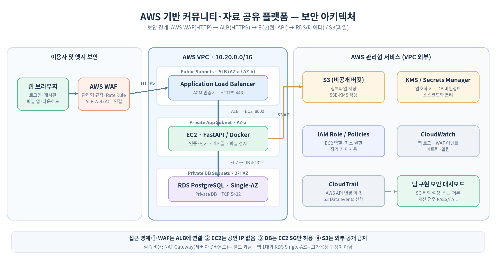
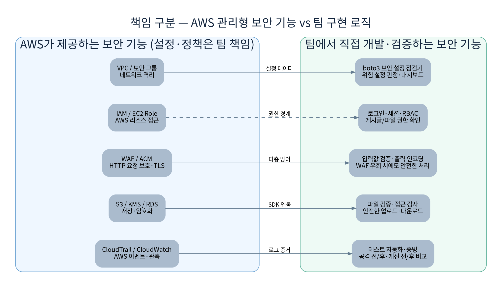
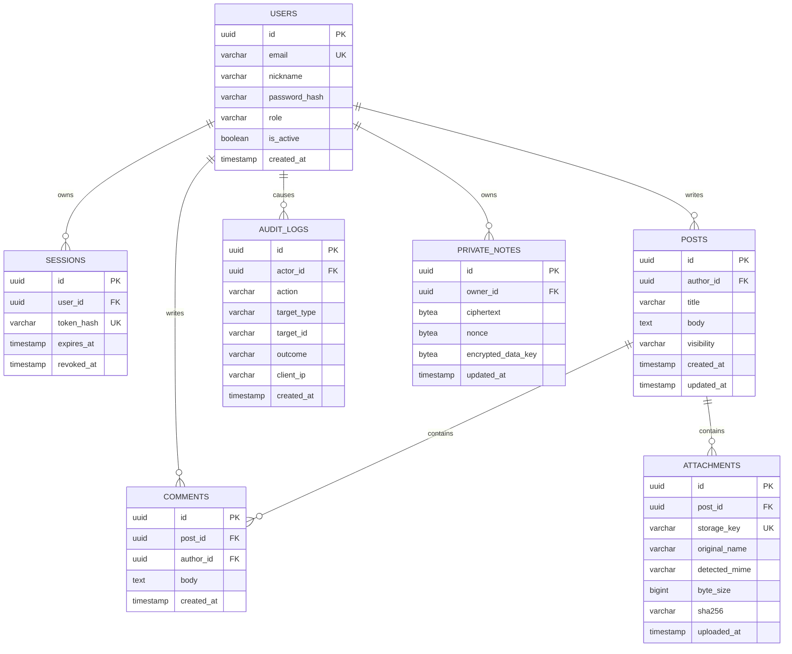
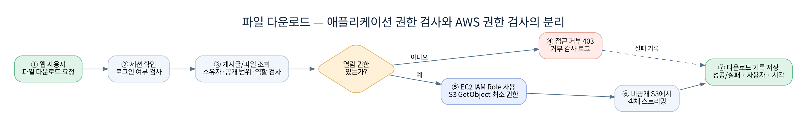

# AWS 기반 커뮤니티·자료 공유 서비스 클라우드 보안 프로젝트 계획서

## 0. 한눈에 보는 요약

**주제:** 로그인, 게시판, 댓글, 파일 업로드·다운로드가 가능한 소규모 커뮤니티를 AWS에 구축하고, IAM·네트워크 격리·WAF·암호화·PKI/TLS·감사 로그·보안 설정 점검을 적용하는 통합 보안 실습 프로젝트.

**최종 발표에서 입증할 핵심 성과**

1. **서비스 정상 동작:** 회원·게시글·파일을 처리하는 실제 웹 서비스 제공.
2. **최소 권한:** AWS 계정 권한(IAM)과 웹 회원 권한(RBAC)을 구분하여 적용하고, 허용/거부 결과 검증.
3. **네트워크 격리:** 외부에서 DB 및 애플리케이션 서버로 직접 접속되지 않도록 VPC·서브넷·보안 그룹 구성.
4. **공격 대응:** WAF에서 SQLi/XSS 패턴·과도한 요청을 탐지/차단하고, 애플리케이션에서도 별도 방어.
5. **데이터 보호:** S3 비공개 저장, SSE-KMS, DB 암호화, HTTPS, 실습용 CA 및 인증서 검증.
6. **가시성:** 애플리케이션 접근 감사 로그와 AWS 운영·보안 이벤트를 수집하고, 위험 설정을 점검.
7. **개선 증빙:** 안전하지 않은 실습 설정 → 보안 조치 → 동일 테스트 재실행 결과를 표·스크린샷·로그로 비교.

**선정 이유:** 게시판과 파일 공유는 구현 난도가 비교적 낮지만, 로그인·권한 우회·SQLi·XSS·파일 업로드·다운로드·스토리지 권한 같은 보안 시나리오가 자연스럽게 발생한다. 따라서 서비스 개발보다 보안 구현과 검증에 시간을 집중하기 좋다.

### 0.1 범위 우선순위

| 우선순위 | 반드시 완성할 것(MVP) | 시간이 남을 때만 진행할 것 |
|---|---|---|
| 웹 서비스 | 로그인/로그아웃, 글 CRUD, 댓글, 파일 업로드·다운로드, 관리자 화면 | 검색 고도화, 좋아요, 실시간 알림, 소셜 로그인 |
| 인프라 | EC2, 웹/DB, VPC, 서브넷, SG, IAM, ALB, WAF | 다중 EC2, Auto Scaling, 고가용성 Multi-AZ DB |
| 보안 | 세션·RBAC, 파일 권한 검증, HTTPS, S3 비공개, KMS, 로그 | 정교한 악성코드 분석, 대규모 SIEM, mTLS |
| 자체 개발 | 보안 점검 스크립트 1종 이상(보안 그룹), 보안 이벤트 조회 화면 | IAM 과다 권한 자동 분석, 자동 조치, 점수화 |

> **중요:** 본 계획은 실습 목적의 단일 인스턴스/단일 DB 구성을 기본으로 한다. 운영 서비스 수준의 무중단 가용성과 복구 체계를 제공한다고 주장하지 않는다.

---

## 1. 프로젝트 가이드 요구사항과의 대응 관계

근거 문서: **「사이버보안_프로젝트가이드(최종).pdf」, PROJECT 3, 24~33쪽**. 아래 표의 **가이드 요구**는 해당 문서에 따른 것이며, **우리의 구현·산출물**은 이 계획서에서 추가로 설계한 구체안이다.

### 1.1 기본 프로젝트 — 필수 4단계

| 가이드 단계 | 가이드 필수 요구 | 우리가 구현할 것 | 제시할 결과물 |
|---|---|---|---|
| 기본 1 (26쪽) | AWS EC2로 클라우드 서버 구축, Web·DB 구성 | ALB→EC2(FastAPI)→RDS(PostgreSQL), 게시판 동작 | 서비스 접속 화면, 구성도, 구축 결과서 |
| 기본 2 (27쪽) | IAM 사용자·그룹 생성, 정책 적용, 사용자별 권한 관리 | `SecurityAdmin`, `Auditor`, `Developer`용 실습 IAM 그룹/권한 정책; EC2 실행 Role 별도 | IAM 정책 JSON, 권한 허용/거부 검증표 |
| 기본 3 (28쪽) | VPC·서브넷·보안 그룹·네트워크 접근 통제 | Public ALB / Private EC2 / Private RDS, SG 최소 허용 | VPC·SG 구성도, 포트 접근 테스트 |
| 기본 4 (29쪽) | WAF/IPS 등 보안 장비 및 정책 적용 | AWS WAF를 ALB에 연결, 관리형 규칙·속도 기반 규칙·로그 | WAF 설정 화면, Count/Block 비교, 정책서 |

**기본 선택(도전) 과업 연계:** 도메인/DNS 연동, IAM 과다 권한 점검, 불필요한 개방 포트 자동 점검, 보안 정책 개선 전후 비교. MVP의 핵심 구현이 안정된 후 선택한다.

### 1.2 심화 프로젝트 — 필수 3단계

| 가이드 단계 | 가이드 필수 요구 | 우리가 구현할 것 | 제시할 결과물 |
|---|---|---|---|
| 심화 1 (31쪽) | 검증된 암호 라이브러리로 데이터 암·복호화, 키를 코드와 분리 | Python `cryptography` AES-GCM으로 비공개 메모 1개 필드 암·복호화 + KMS로 데이터 키 보호; S3 SSE-KMS | 암·복호화 단위 테스트, 암호문/평문 비교, 키 접근 정책 |
| 심화 2 (32쪽) | OpenSSL 실습용 CA·인증서 발급/검증, 웹 HTTPS/TLS | **실습용 내부 CA**로 테스트 서버 인증서 발급·체인 검증; 공개 웹은 ACM 인증서를 ALB에 적용 | CA 구성도, OpenSSL 명령·출력, HTTPS 인증서 검사 |
| 심화 3 (33쪽) | IAM과 웹 인증·인가를 구분해 검증, 암호화/HTTPS/접근 제어 통합 | 웹 세션·RBAC 테스트 + AWS IAM 허용/거부 테스트 + 최종 보안 시나리오 | 인증·인가 구조도, 통합 테스트표, 최종 시연 영상/화면 |

**심화 선택(도전) 과업:** 암호화 성능 비교, 인증서 만료 알림, mTLS. 일정상 가장 현실적인 확장 순서는 `인증서 만료 알림 → IAM 점검 확대 → 암호화 성능 비교 → mTLS`이다.

> **가이드 해석상 유의:** AWS ACM만 쓰면 가이드가 명시한 **OpenSSL로 실습용 CA 구성** 과업을 대체하기 어렵다. 따라서 공개 HTTPS 구성과 실습용 PKI 과업을 별도로 수행한다. 또한 S3의 기본 암호화만 켠 것으로 끝내지 않고, 코드에서 직접 AES-GCM 암·복호화 기능을 구현한다.

---

## 2. 서비스 기획: 최소한의 커뮤니티·자료 공유

### 2.1 목표 사용자와 사용 사례

| 역할 | 가능한 행위 | 불가능해야 하는 행위 |
|---|---|---|
| 비회원(`GUEST`) | 공개 게시글 목록·상세 읽기 | 글/댓글 작성, 비공개 파일 다운로드, 관리자 접근 |
| 일반 회원(`USER`) | 로그인, 본인 글/댓글 CRUD, 허용된 첨부파일 업·다운로드 | 타인 비공개 글/첨부파일 접근, 타인 글 수정, 관리자 접근 |
| 관리자(`ADMIN`) | 부적절한 글 관리, 회원 계정 활성/비활성, 접근 감사 로그 열람 | IAM 정책을 웹 세션으로 임의 수정, DB 관리자 권한 획득 |

- 게시글 공개 범위: `PUBLIC`(누구나 열람), `MEMBERS`(로그인한 회원), `PRIVATE`(작성자와 관리자만).
- 첨부파일은 **게시글의 공개 범위를 상속**한다. URL에 있는 `file_id`를 바꿔도 권한을 다시 확인한다.
- 계정 생성은 테스트용 이메일·닉네임만 사용하며 실제 개인 정보·실제 업무 문서는 업로드하지 않는다.
- 가입/로그인/게시글 작성/파일 올리기/내려받기/관리자 감사 화면이 최종 시연의 주요 동선이다.

### 2.2 화면 목록

| 화면 | 필수 UI | 연결되는 보안 과제 |
|---|---|---|
| `/` 및 `/posts` | 글 목록, 공개 범위 표기 | 공개/회원/비공개 조회 차단 |
| `/register`, `/login`, `/logout` | 계정 생성, 로그인, 로그아웃 | 암호 해시, 세션, 로그인 실패 기록 |
| `/posts/new` | 제목·본문·공개 범위·첨부파일 | XSS/SQLi 방어, 업로드 제한 |
| `/posts/{id}` | 본문, 댓글, 첨부파일 다운로드 | 객체 수준 권한(IDOR/BOLA) 방어 |
| `/mypage` | 본인 글·세션/비공개 메모 | 본인 정보 접근 제한, AES-GCM |
| `/admin` | 회원/게시글 관리 | 관리자 RBAC, 접근 실패 로그 |
| `/admin/security` | 감사 로그·AWS SG 진단 결과 | AWS API 조회, 로그 분석, 자동 점검 |

### 2.3 이번 프로젝트에서 만들지 않을 것

실시간 채팅, 대용량 동영상 스트리밍, 결제, 추천 AI, 모바일 앱, 멀티테넌트 조직 관리, 자체 OAuth 서버, 복잡한 승인 워크플로, 다중 마이크로서비스는 제외한다. **처음에는 모놀리식 웹 애플리케이션**으로 구현해 배포·보안·테스트를 단순화한다.

---

## 3. 전체 아키텍처



### 3.1 계층별 구성

1. **접속 계층:** 사용자가 HTTPS로 ALB에 접속한다. AWS WAF의 Regional Web ACL을 **ALB 리소스에 연결**하고, ACM 공개 인증서를 ALB의 443 리스너에 적용한다. `HTTP 80`은 필요할 때 `HTTPS 443`으로 리다이렉트한다.
2. **애플리케이션 계층:** EC2 단일 인스턴스에 Docker로 FastAPI 애플리케이션을 실행한다. EC2는 Private App Subnet에 배치하고 **Public IP를 할당하지 않는다**.
3. **데이터 계층:** RDS PostgreSQL은 비공개 DB 서브넷에 둔다. RDS DB subnet group은 서로 다른 AZ의 서브넷 **2개 이상**을 포함하지만 실제 DB 인스턴스는 비용을 고려해 Single-AZ로 시작한다.
4. **파일 계층:** 첨부파일 자체는 S3 **비공개 버킷**에 저장하고 DB에는 파일 메타데이터만 저장한다. S3 Block Public Access를 켜고 SSE-KMS를 적용한다.
5. **운영 계층:** EC2 Instance Role, KMS, Secrets Manager, CloudWatch, CloudTrail, Systems Manager를 활용한다.
6. **직접 개발 영역:** 세션, RBAC, 게시글/파일 권한 검증, 파일 타입·크기 검사, 접근 감사 로그, boto3 보안 설정 점검 API/화면은 팀이 만든다.

> **실습 운영 메모:** 프라이빗 EC2에서 외부 패키지를 다운로드하거나 GitHub 배포 파일을 받으려면 아웃바운드 경로가 필요하다. 최초 MVP에서는 **NAT Gateway 1개**를 통해 필요한 다운로드/배포를 수행한다. NAT는 시간당·처리량 비용이 있어 종료 시 삭제한다. 이후 S3 Gateway Endpoint와 SSM 관련 Interface Endpoint로 전환하면 NAT 의존도를 줄일 수 있지만, Interface Endpoint 자체에도 비용이 있으므로 별도 비교한다.

### 3.2 AWS 계정과 권한 경계

- **AWS 계정 IAM:** AWS 운영자가 EC2/S3/RDS/VPC/WAF 같은 *클라우드 리소스*를 관리·조회하도록 제한한다.
- **EC2 Instance Role:** 애플리케이션 인스턴스가 S3의 지정 버킷, 필요한 KMS 키, Secrets Manager 비밀정보 등에 접근하는 권한이다. 장기 Access Key를 소스코드나 `.env`에 넣지 않는다.
- **웹 서비스 RBAC:** 웹 사용자가 자기 게시글과 파일을 볼 수 있는지 판정한다. **IAM 정책이 웹 회원별 파일 권한을 자동으로 판단해 주지 않는다.**



### 3.3 네트워크 주소·라우팅 예시

| 구성 | 예시 CIDR/배치 | 외부 인터넷 연결 | 목적 |
|---|---|---|---|
| VPC | `10.20.0.0/16` | - | 전체 실습 네트워크 |
| Public Subnet A | `10.20.0.0/24` (AZ-a) | IGW 연결 | ALB 1번 AZ, NAT |
| Public Subnet B | `10.20.1.0/24` (AZ-b) | IGW 연결 | ALB 2번 AZ |
| Private App Subnet A | `10.20.10.0/24` | NAT 경유 아웃바운드 | EC2 웹 애플리케이션 |
| Private App Subnet B | `10.20.11.0/24` | NAT 경유 아웃바운드 | 향후 확장용(초기 EC2 미배치) |
| Private DB Subnet A | `10.20.20.0/24` | 직접 인터넷 경로 없음 | RDS DB subnet group |
| Private DB Subnet B | `10.20.21.0/24` | 직접 인터넷 경로 없음 | RDS DB subnet group |

**주의:** CIDR은 예시이며 실제 AZ ID·리전·IP 대역을 결정한 다음 충돌 없이 변경할 수 있다. ALB는 적어도 두 AZ에 걸쳐 구성한다.

### 3.4 보안 그룹 설계

| 보안 그룹 | 인바운드 규칙 | 아웃바운드 원칙 | 검증 포인트 |
|---|---|---|---|
| `sg-alb` | TCP 443: 허용된 테스트 클라이언트 또는 공개 시 `0.0.0.0/0`; 80은 리다이렉트용 선택 | `sg-app`의 TCP 8000 | WAF/ALB 경유만 공개 |
| `sg-app` | TCP 8000: **출처 `sg-alb`만** | DB 5432, S3/관리 서비스에 필요한 HTTPS 443, 필요한 업데이트 경로 | 외부에서 EC2 직접 접속 불가 |
| `sg-db` | TCP 5432: **출처 `sg-app`만** | 기본 불필요 통신 제한 | 일반 인터넷에서 DB 접속 불가 |
| 관리 접근 | SSH 22 인바운드 **미개방** | SSM Agent 경유 | 보안 그룹 22 개방 여부 점검 |

- Security Group은 **상태 저장(stateful)** 방화벽이며, NACL은 선택적 추가 검증 대상으로 둔다.
- 운영 편의를 위해 `0.0.0.0/0:22`, `0.0.0.0/0:5432`, `0.0.0.0/0:8000`을 허용하지 않는다.
- SSM Session Manager를 사용해 관리하고 EC2 Role에 필요한 SSM 관리 권한을 부여한다. NAT 미사용 형태에서는 SSM 연결을 위한 VPC Endpoint 및 DNS 구성이 필요하다.
- 보안 그룹 판정은 소스 IP 외에 **다른 SG ID를 출처로 참조**하는 방식으로 작성해, 동적으로 IP가 바뀌어도 허용 대상을 좁게 유지한다.

---

## 4. 기술 스택과 선정 이유

### 4.1 애플리케이션·개발 도구

| 계층 | 선택 기술 | 선택 이유 / 구현 방식 | 대안 |
|---|---|---|---|
| 백엔드 | **Python 3.12/3.13 + FastAPI** | REST API, 요청 검증, boto3 연동, 자동 API 문서 | Django |
| 웹 화면 | **Jinja2 + Bootstrap 5 + 기본 JavaScript** | 별도 SPA 빌드 없이 CRUD 화면을 빠르게 구현 | React/Vue (추가 시간 필요) |
| ORM/DB | **SQLAlchemy 2 + Alembic + PostgreSQL** | 파라미터 바인딩, ORM 모델·마이그레이션, RDS 연동 | Django ORM, MySQL |
| 인증 | `pwdlib[argon2]` 또는 동등한 검증된 Argon2id 구현 | 비밀번호는 복구 불가능한 해시로 저장 | bcrypt |
| 세션 | 난수 기반 **서버 저장형 세션** + `HttpOnly/Secure/SameSite` 쿠키 | 강제 로그아웃·세션 만료·탈취 완화 | JWT (이번에는 불필요) |
| AWS SDK | **boto3** | S3 접근, EC2 보안 그룹 조회, KMS 데이터 키 관리 | AWS CLI (관리용) |
| 앱 암호화 | **cryptography / AES-GCM** | 인증 태그를 포함한 암·복호화, 키는 KMS로 보호 | libsodium 계열 |
| 배포 | **Docker + Docker Compose (앱 1개)** | 실행 환경 일치, 로컬·EC2 재현 | systemd + venv |
| 버전 관리 | GitHub + PR + GitHub Actions | 리뷰·테스트·CI | 수동 배포 |
| 인프라 구성 | **Terraform**(가능하면) + AWS CLI | 보안 설정 재현·변경 추적; 콘솔 구축 결과와 비교 가능 | 콘솔 + 설정 내역 Markdown |
| 테스트 | pytest, httpx, Playwright(핵심 화면), OWASP ZAP baseline | 기능·권한·웹 취약점 테스트 | Postman, curl, Burp Community |

**의도적인 절충:** 보안 프로젝트이므로 프런트엔드 프레임워크 학습에 많은 시간을 쓰지 않고 서버 렌더링 방식으로 구현한다. 팀원 숙련도가 충분할 때만 React로 교체한다.

### 4.2 AWS 서비스별 역할

| 서비스 | AWS가 이미 제공하는 것 | 팀에서 설정/개발할 것 | 단계 |
|---|---|---|---|
| EC2 | 가상 서버 실행 | OS 강화, Docker 배포, Instance Role, 패치·관리 | 기본 |
| VPC/Subnet/Route/IGW/NAT | 가상 네트워크 구성 요소 | 공용/사설 분리, 라우팅, 통신 차단 검증 | 기본 |
| Security Group | 네트워크 상태 기반 필터 | 최소 허용 규칙, 취약 규칙 탐지 코드 | 기본+도전 |
| ALB | L7 트래픽 분산·리스너 | HTTPS 리스너, 타깃 그룹·헬스 체크, WAF 연동 | 기본 |
| IAM | 정책·역할·그룹·임시 자격증명 | 운영 그룹 구성, 최소 권한 JSON, 정책 검증 | 기본 |
| AWS WAF | 규칙 엔진·관리형 보호 규칙 | Web ACL 연결, Count/Block, 속도 제한, 테스트·로그 | 기본 |
| RDS PostgreSQL | 관리형 관계형 DB | 스키마, Private 접근, 백업·암호화 옵션 | 기본 |
| S3 | 객체 저장 및 기본 SSE-S3 암호화 | 비공개 버킷, 앱 파일 연동, 선택적 SSE-KMS·수명주기 | 기본/심화 |
| KMS | 암호화 키 생성·권한 관리 | 키 정책, S3/RDS 연계, 데이터 키를 쓰는 암호화 코드 | 심화 |
| Secrets Manager | 비밀정보 안전 저장·조회 | DB 접속정보 저장·인스턴스 Role의 읽기 제한 | 심화 |
| ACM | AWS 통합 TLS 인증서 관리 | 공개 도메인 검증 후 ALB HTTPS 적용 | 심화 |
| CloudWatch | 메트릭, 경보, 로그 수집 | 앱 보안 이벤트 출력·경보·대시보드 | 기본+심화 |
| CloudTrail | AWS API 활동 감사(설정에 따라 범위 차이) | 추적 구성·보존·조회, 필요한 데이터 이벤트 선택 | 심화 |
| Systems Manager | EC2 관리/Session Manager | SSH 없는 운영, 권한과 세션 검증 | 기본 |
| AWS Budgets | 사용량·예산 경보 | 비용 임계값·알림 설정 | 프로젝트 운영 |

> **정확한 구분:** S3는 기본적으로 **SSE-S3** 암호화를 지원한다. **SSE-KMS는 별도 설정**해야 하고 KMS 관련 비용·권한이 생긴다. CloudTrail은 기본 관리 이벤트와 별개로 **S3 객체 단위 데이터 이벤트를 명시적으로 활성화**해야 `GetObject/PutObject`와 같은 활동을 수집할 수 있다. 웹 사용자의 로그인·게시글 다운로드 이력은 CloudTrail이 아니라 **애플리케이션이 직접 기록**한다.

---

## 5. 직접 구현할 소프트웨어 아키텍처

```text
community-security/
├── README.md
├── docs/
│   ├── 계획서.md
│   ├── architecture/             # 구성도, 네트워크/IP 계획
│   ├── iam/                      # 역할·그룹·정책 JSON, 검증 결과
│   ├── tests/                    # 공격 시나리오, 개선 전후 증빙
│   └── reports/                  # 구축/보안/최종 보고서
├── app/
│   ├── main.py                   # FastAPI 진입점
│   ├── api/
│   │   ├── auth.py               # 회원가입/로그인/로그아웃
│   │   ├── posts.py              # 게시글 CRUD
│   │   ├── comments.py           # 댓글 CRUD
│   │   ├── files.py              # 파일 업로드·다운로드
│   │   ├── admin.py              # 관리자 및 사용자 관리
│   │   └── security.py           # 감사 로그/점검 API
│   ├── models/                   # SQLAlchemy 모델
│   ├── schemas/                  # Pydantic 요청·응답 모델
│   ├── services/
│   │   ├── auth_service.py       # Argon2id/세션 관리
│   │   ├── authorization.py      # 사용자/자원 권한 판정
│   │   ├── storage_service.py    # S3 업·다운로드
│   │   ├── encryption_service.py # AES-GCM + KMS
│   │   ├── audit_service.py      # 애플리케이션 감사 기록
│   │   └── cloud_audit.py        # boto3 보안 그룹 점검
│   ├── templates/                # Jinja2 HTML
│   ├── static/                   # CSS/JS/이미지
│   └── core/                     # 설정, DB 세션, 오류 처리
├── migrations/                   # Alembic
├── infra/                        # Terraform 또는 IaC 보조 파일
│   ├── network/
│   ├── compute/
│   ├── data/
│   ├── iam/
│   ├── waf/
│   └── monitoring/
├── scripts/
│   ├── security_group_audit.py
│   ├── certificate_expiry_check.py
│   └── smoke_test.sh
├── tests/
│   ├── unit/
│   ├── integration/
│   └── security/
├── .github/workflows/
│   └── ci.yml
├── Dockerfile
├── compose.yaml                  # 로컬/실습용, RDS 접속 환경값 분리
├── requirements.txt
├── .env.example                  # 비밀정보 없이 키 이름만
└── .gitignore
```

### 5.1 실행 구조

- 단일 FastAPI 프로세스(또는 소수 worker)가 HTML 및 API 요청을 처리한다.
- 서비스 계층은 `auth` / `posts` / `files` / `security` 기능을 분리하지만 **배포 단위는 하나**로 유지한다.
- DB는 사용자·게시글·파일 정보와 접근 감사 기록을 저장한다.
- S3는 파일의 실제 바이너리만 저장한다. DB에 파일 바이트를 직접 넣지 않는다.
- 관리자 보안 페이지는 앱의 `AuditLog` 조회와 boto3 점검 결과를 각각 표시한다. **WAF/CloudTrail 모든 이벤트를 SIEM처럼 통합 분석하는 것은 범위 밖**이다.

---

## 6. 데이터베이스 설계

### 6.1 ERD (GitHub Mermaid 지원)



### 6.2 주요 제약과 인덱스

| 테이블/필드 | 설계 규칙 | 이유 |
|---|---|---|
| `users.email` | UNIQUE, 정규화(소문자), 중복 가입 검사 | 계정 충돌 방지 |
| `users.password_hash` | Argon2id 해시만 저장, 평문 저장 금지 | 자격증명 보호 |
| `sessions.token_hash` | 서버 DB에 세션 원문 대신 해시 저장 | 세션 DB 유출 피해 완화 |
| `posts.author_id` | FK, 수정/삭제 시 현재 사용자와 비교 | IDOR 방어 |
| `posts.visibility` | `PUBLIC/MEMBERS/PRIVATE` 제한 | 열람 정책 일관성 |
| `attachments.storage_key` | 랜덤 UUID 기반 키, UNIQUE | 원본 파일명 추측/경로 조작 방어 |
| `audit_logs` | `created_at`, `actor_id`, `action` 인덱스 | 이벤트 검색 |
| `private_notes` | 암호문·nonce·암호화된 데이터 키 저장 | 심화 AES-GCM 실습 |

- 실제 `AUDIT_LOGS.actor_id`는 비회원의 로그인 실패 기록을 위해 `NULL`을 허용할 수 있다.
- 삭제 방식은 MVP에서 물리 삭제로 시작하되 감사 로그는 별도 보존한다. 테스트 데이터만 다룬다.
- 관리자 비밀번호 초기값을 코드/README에 넣지 않는다. 최초 계정 생성은 환경 분리된 관리 명령으로 수행한다.

### 6.3 권한 매트릭스

| 작업 | GUEST | USER | 글 작성자 USER | ADMIN |
|---|:---:|:---:|:---:|:---:|
| PUBLIC 글 열람 | O | O | O | O |
| MEMBERS 글 열람 | X | O | O | O |
| PRIVATE 글 열람 | X | X | O | O |
| 새 글·댓글 작성 | X | O | O | O |
| 본인 글 수정·삭제 | X | X | O | O |
| 타인 PRIVATE 첨부파일 다운로드 | X | X | 작성자 본인만 | O |
| `/admin` 및 `/admin/security` | X | X | X | O |

> `USER` 열의 O/X는 **글 작성자가 아닌 일반 회원**을 뜻한다. 모든 서버 엔드포인트에서 이 매트릭스를 재검증하며 화면에서 버튼을 숨기는 것만으로 권한 제어를 끝내지 않는다.

---

## 7. API 및 주요 비즈니스 로직

### 7.1 API 초안

| 메서드 | 경로 | 용도 | 인증/권한 |
|---|---|---|---|
| `POST` | `/api/auth/register` | 가입 | 비회원 |
| `POST` | `/api/auth/login` | 로그인·세션 발급 | 비회원 |
| `POST` | `/api/auth/logout` | 세션 무효화 | 로그인 |
| `GET` | `/api/posts` | 목록 조회 | 공개 범위 필터 |
| `POST` | `/api/posts` | 글 생성 | 로그인 + CSRF |
| `GET` | `/api/posts/{id}` | 글 열람 | 공개 범위 검사 |
| `PATCH` | `/api/posts/{id}` | 글 수정 | 작성자 또는 관리자 |
| `DELETE` | `/api/posts/{id}` | 글 삭제 | 작성자 또는 관리자 |
| `POST` | `/api/posts/{id}/comments` | 댓글 작성 | 로그인 + 대상 글 접근 가능 |
| `POST` | `/api/posts/{id}/files` | 첨부파일 업로드 | 작성자 + 파일 검증 + CSRF |
| `GET` | `/api/files/{id}/download` | 파일 다운로드 | 게시글/첨부 권한 확인 |
| `GET` | `/api/admin/audit-logs` | 접근 감사 기록 | 관리자 |
| `POST` | `/api/admin/security-group-scan` | 지정 SG 점검 | 관리자 + 읽기 전용 AWS 권한 |
| `GET/PUT` | `/api/me/private-note` | 비공개 메모 암·복호화 | 본인 |

### 7.2 파일 업로드·다운로드 흐름



**업로드:** 세션·작성 권한 검사 → 최대 파일 크기 검사(예: 10MB) → 허용 확장자(`.pdf`, `.png`, `.jpg`, `.txt`) 및 실제 파일 시그니처/MIME 검사 → 랜덤 S3 키 생성 → 서버에서 S3 `PutObject` → DB 메타데이터 저장 → 감사 기록.

**다운로드:** 세션/공개 범위 검사 → 파일이 포함된 게시글 권한 재검증 → EC2 Role로 S3 `GetObject` → 서버가 바이너리를 스트리밍 → 다운로드 결과 감사 기록. **MVP는 프리사인드 URL 없이 서버 경유 스트리밍**을 사용해 제어 흐름을 쉽게 검증한다. 대용량 확장 시 짧은 만료기간의 프리사인드 URL은 별도 선택 과업으로 검토한다.

**방어 기준:**

- 업로드 디렉터리를 웹서버 정적 경로로 공개하지 않는다. S3 Block Public Access를 켠다.
- 파일명은 S3 객체 키로 그대로 사용하지 않고 UUID로 변환한다. 원본 파일명은 안전하게 인코딩하여 표시한다.
- HTML/SVG/실행 파일은 MVP에서 허용하지 않는다. 파일은 다운로드 첨부(`Content-Disposition: attachment`)로 제공한다.
- 확장자만 검사하지 않고 파일 헤더와 실제 콘텐츠 타입을 점검한다. 이 검사만으로 악성 파일을 완전히 탐지할 수 있는 것은 아니므로, ClamAV와 EICAR를 이용한 테스트는 선택 과업으로 둔다.
- DB 쓰기와 S3 쓰기가 한 트랜잭션이 아니므로 업로드 실패 시 객체 삭제/DB 정리 보상 로직을 구현한다.

### 7.3 로그인·세션·CSRF

- 로그인 시 사용자 식별자를 통해 DB에 저장된 Argon2id 해시를 검증한다.
- 충분한 엔트로피의 난수 세션 토큰을 생성하고, DB에는 세션 토큰 **해시**를 저장한다.
- 쿠키 속성은 `Secure`, `HttpOnly`, `SameSite=Lax`를 기본으로 한다. 프로덕션은 HTTPS에서만 운영한다.
- 세션 만료(예: 30분 비활성), 로그아웃 시 세션 폐기, 가입/로그인/다운로드/관리자 권한 실패 감사 기록을 구현한다.
- 쿠키 기반 상태 변경 요청에는 CSRF 토큰을 검증한다. `SameSite`만으로 CSRF 방어를 대체하지 않는다.
- 로그인 횟수 제한은 서버 측 실패 카운트 또는 WAF 속도 기반 규칙과 함께 적용한다. 실제 계정 잠금 정책은 사용성·오탐을 고려해 정한다.

---

## 8. 보안 설계: AWS 제공 기능과 직접 구현 기능

### 8.1 AWS IAM 정책 설계

가이드의 IAM 사용자/그룹 생성 과업을 만족시키되, **개인용 AWS IAM 사용자**와 **EC2 실행 Role**을 섞지 않는다.

| 주체 | 권한 예시 | 제한/검증 |
|---|---|---|
| `SecurityAdminGroup` | 팀 실습 AWS 보안 리소스 관리(기간·대상 계정 제한) | MFA, 관리자 기능 사용 감사 |
| `AuditorGroup` | IAM/SG/WAF/CloudTrail/CloudWatch 조회 | 수정 API 명시적 비허용 |
| `DeveloperGroup` | 개발 단계의 지정 EC2 조회·배포 관련 제한 권한 | IAM 사용자/정책 변경 권한 없음 |
| `CommunityAppRole`(EC2 Role) | 지정 S3 버킷의 객체 읽기/쓰기, 지정 Secrets Manager 비밀 읽기, 필요한 KMS 암복호화 | `s3:*`, `AdministratorAccess` 같은 광범위 권한 금지 |
| `GitHubDeployRole`(선택) | GitHub Actions OIDC로 배포 산출물 업로드/배포 호출 | 신뢰 조건에 저장소·브랜치 제한, 장기 AWS 키 미사용 |
| `SecurityAuditRole`(선택) | `ec2:DescribeSecurityGroups` 등 진단에 필요한 읽기 권한 | 정책 변경·삭제 API 없음 |

**정책 검증:** `Auditor`로 SG를 조회하면 성공, SG 규칙을 수정하면 거부. `CommunityAppRole`로 지정 버킷의 첨부파일을 읽으면 성공, 다른 버킷의 객체에는 접근 거부. AWS IAM Policy Simulator 또는 실습 전용 IAM 사용자/임시 역할로 테스트한다.

### 8.2 웹 RBAC와 AWS IAM을 함께 적용하기

| 접근 요청 | 웹 앱의 판단 | AWS의 판단 | 기대 결과 |
|---|---|---|---|
| 본인이 작성한 PRIVATE 글/파일 조회 | 허용 | EC2 Role의 S3 객체 조회 허용 | 다운로드 성공 |
| 타인이 작성한 PRIVATE 파일 `id` 변경 시도 | **거부** | S3 호출 자체를 하지 않음 | 403 + 감사 기록 |
| 관리자가 감사 화면 진입 | 웹 ADMIN 확인 | 읽기 전용 진단 Role/API 권한 확인 | 결과 조회 |
| 일반 회원이 감사 화면 진입 | **거부** | AWS API 호출 자체를 하지 않음 | 403 + 감사 기록 |
| EC2 Role로 타 버킷 객체 접근 | 앱 기능 없음 | **IAM 정책으로 거부** | AWS AccessDenied |

### 8.3 WAF 구성과 검증

1. ALB에 AWS WAF **Regional Web ACL** 연결.
2. AWS Managed Rules(일반적인 공격 패턴 및 SQLi 관련 규칙)를 적용하되 **먼저 `Count` 모드**로 탐지와 오탐을 확인.
3. 테스트가 끝나면 필요한 규칙을 `Block` 모드로 전환. 로그인 경로와 주요 API는 별도 관찰.
4. 단시간 반복 요청에 대한 **Rate-based rule** 추가(임계값은 실습 트래픽을 보고 결정).
5. 정해진 테스트 문자열과 정상 요청을 반복해 **차단 성공 / 정상 사용자 영향**을 같이 기록.

**한계:** WAF는 애플리케이션의 SQL 파라미터 바인딩, 출력 인코딩, CSRF 방어, 사용자별 권한 검사 대신이 아니다. WAF에서 탐지하지 못하는 입력에도 앱 자체 방어가 유지되어야 한다. 공격 검증은 팀이 소유한 승인된 실습 주소에서만 수행한다.

### 8.4 데이터 암호화·키 관리

| 데이터 | 암호화 방식 | 팀 작업 |
|---|---|---|
| S3 첨부파일 | 버킷 기본 **SSE-KMS** | 고객 관리 KMS 키/키 정책, 버킷 기본 암호화, IAM 연동 검증 |
| RDS | RDS 저장 데이터 암호화(KMS) | 생성 시 암호화 선택, 비공개 접속 및 저장 데이터 암호화 확인 |
| 개인정보 성격의 실습 메모 | **애플리케이션 AES-256-GCM** | 암호화 코드·복호화 코드·무결성 검증·단위 테스트 |
| TLS 통신 | HTTPS + ACM 공개 인증서 | ALB 443 리스너, 인증서 유효성 및 리다이렉트 점검 |
| 암호화 데이터 키 | AWS KMS `GenerateDataKey`로 생성 후 암호화된 키만 DB 저장 | 암·복호화 때 KMS 권한 분리, 평문 키 로깅 금지 |
| DB 자격증명 | Secrets Manager | EC2 Role에 특정 비밀 읽기 허용, 비밀 평문 커밋 방지 |

**AES-GCM 구체 흐름:** 새 메모 저장 시 `GenerateDataKey`로 평문 데이터 키와 암호화된 데이터 키를 받는다 → 서버 메모리의 평문 데이터 키로 `AESGCM.encrypt` 실행(각 암호화마다 고유한 12바이트 nonce) → DB에 암호문·nonce·암호화된 데이터 키 저장 → 평문 키는 보관하지 않는다. 열람 시 사용자 본인 검증 → KMS `Decrypt`로 데이터 키 복구 → `AESGCM.decrypt` 호출. 태그 불일치 시 복호화를 실패 처리한다. **Key Policy, IAM, encryption context/AAD는 사전에 일관되게 설계**한다.

**주의:** S3 SSE-KMS와 앱 수준 AES-GCM은 서로 다른 목적의 실습이다. KMS 키를 삭제하면 암호문을 복구할 수 없을 수 있어 실습 종료 시 데이터 보존 요구를 먼저 확인한다.

### 8.5 PKI/TLS 실습

- **공개 서비스:** Route 53 또는 외부 DNS의 소유 도메인을 ALB에 연결하고, ACM 공개 인증서를 발급받아 HTTPS를 구성한다(도메인 보유가 필요).
- **별도 실습용 CA:** OpenSSL로 Root CA 비밀키/인증서 생성 → 실습 서버 키와 CSR 생성 → CA로 서버 인증서 서명 → `openssl verify -CAfile ...` 등으로 유효성 검사 → 브라우저/`curl`에서 신뢰 전후 동작 확인.
- **증빙:** CA/서버 인증서 관계도, 인증서의 CN/SAN·유효기간·발급자, HTTP→HTTPS 처리, 잘못된 체인 검증 실패.
- **제약:** 실습용 Root CA 개인키는 GitHub에 올리지 않는다. 자체 서명/사설 CA 인증서는 일반 브라우저가 기본 신뢰하지 않으며 공개 서비스에서 그대로 쓰지 않는다.

### 8.6 로그와 모니터링

| 이벤트 | 어디서 발생 | 수집·표시 방식 |
|---|---|---|
| 회원 로그인 성공/실패 | FastAPI | `audit_logs` + CloudWatch 앱 로그(비밀번호·세션 토큰 제외) |
| 타인 파일/관리자 페이지 접근 실패 | FastAPI | `audit_logs`에서 403, actor, 대상, 시간 조회 |
| SQLi/XSS 탐지·차단 | AWS WAF | Web ACL 지표/샘플 요청, 필요 시 WAF 로그 활성화 |
| SG/IAM/WAF 설정 변경 | AWS 제어 평면 | CloudTrail 관리 이벤트 |
| S3 `GetObject/PutObject` | S3 데이터 평면 | 필요 시 CloudTrail **Data events를 별도 활성화**(비용 고려) |
| EC2/ALB 상태·오류 | AWS CloudWatch/ALB | 상태 지표·알람, 서비스 로그 |
| 인증서 만료 | OpenSSL 또는 ACM | 수동 점검, 선택 시 스케줄 알림 |

**개인정보 최소화:** 접근 로그에는 토큰·패스워드·첨부파일 원문을 기록하지 않는다. IP·계정 식별자는 필요한 범위에서만 보관한다. 로그 보존기간(예: 실습 기간 + 7일)은 팀 정책으로 명시한다.

---

## 9. 직접 구현하는 클라우드 보안 점검기

### 9.1 기본 목표: 보안 그룹 자동 점검

**사용 API:** boto3 `ec2.describe_security_groups`. `SecurityAuditRole` 또는 별도 읽기 전용 정책으로 호출한다.

**최소 점검 규칙**

| 규칙 ID | 판정 조건 | 기대 경보 | 자동 조치 여부 |
|---|---|---|---|
| `SG-001` | `0.0.0.0/0` 또는 `::/0`에 TCP 22 허용 | SSH 전체 공개 | **조치 없음**, 관리자에게 경고 |
| `SG-002` | DB SG의 TCP 5432 전체 공개 | DB 외부 노출 위험 | 조치 없음 |
| `SG-003` | 앱 SG의 TCP 8000 전체 공개 | ALB 우회 직접 접근 | 조치 없음 |
| `SG-004` | 앱 SG의 접근 출처가 `sg-alb`가 아닌 과도한 범위 | 앱 노출 범위 확대 | 조치 없음 |
| `SG-005` | 사용자 관리 대상으로 지정한 SG의 규칙과 기준 정책 불일치 | 구성 드리프트 | 조치 없음 |

**출력 예시(가상 데이터)**

```json
{
  "scan_id": "example-001",
  "resource_id": "sg-example",
  "rule_id": "SG-002",
  "severity": "HIGH",
  "status": "FAIL",
  "reason": "PostgreSQL 5432 is open to 0.0.0.0/0",
  "recommendation": "Only allow TCP 5432 from sg-app"
}
```

**검증:** 테스트용 별도 SG에 임시로 취약 규칙 생성 → 점검에서 `FAIL` 확인 → 규칙 제거 → 재점검 `PASS` 확인. 실제 운영 SG를 외부에 노출하지 않고 **비연결 테스트용 SG**에서 검증할 수 있다.

**구현 파일:** `scripts/security_group_audit.py`, `app/services/cloud_audit.py`, `/admin/security` 화면, pytest 단위 테스트(mock API 응답 사용).

### 9.2 확장 목표 (여유 시)

- IAM 사용자에 MFA/접근 키/권한 관련 상태 조회(가능한 API와 각 정책의 의미를 구분하여 구현).
- S3 Block Public Access 및 버킷 정책 조회.
- 이전 점검과 현재 점검 비교(`PASS → FAIL`, `FAIL → PASS`).
- 위험도는 **팀 자체 기준**임을 표시하고 AWS 공식 보안 평가와 혼동하지 않는다.
- 자동 수정은 권한 오남용 위험이 있으므로 30일 범위에서는 제외한다.

---

## 10. 6인 팀 역할 분담 및 협업 규칙

| 인원 | 주 담당 | 상세 작업 | 주요 산출물 | 교차 검토 |
|---|---|---|---|---|
| **A — PM/클라우드 네트워크** | 일정·VPC·ALB·배포 | 프로젝트 관리, IP·서브넷·라우팅, SG, EC2/ALB, 비용 관리 | 인프라 구성도, 네트워크 점검표, 구축 결과서 | B와 IAM/보안 검토 |
| **B — IAM/암호·PKI** | AWS IAM·KMS·HTTPS | 사용자/그룹/Role, 최소 권한, Secrets Manager, AES-GCM 지원, OpenSSL CA·ACM | IAM 정책서, 암호화·TLS 테스트 | C와 암호화 연동 |
| **C — 백엔드/DB** | 회원·게시글·DB | 데이터 모델, 로그인/세션, 글·댓글 API, Alembic | API 명세, DB ERD, 백엔드 코드 | D와 UI/인증 통합 |
| **D — 프런트엔드/웹 RBAC** | 화면·권한 UX | Jinja2/Bootstrap, 로그인·게시판·관리자 UI, CSRF, 권한별 메뉴 | 화면·사용 시나리오, 웹 권한 테스트 | C/E와 리뷰 |
| **E — 파일 보안/WAF** | S3 파일·웹 공격 방어 | 파일 업·다운로드, 접근 제어, 파일 검증, WAF 규칙·테스트 | 파일 보안 모듈, WAF 차단·오탐 증빙 | B와 S3 권한 검토 |
| **F — 보안 점검/관측/QA** | 스캐너·로그·CI/테스트 | boto3 SG 점검, 감사 화면, CloudWatch/CloudTrail, pytest/CI, 통합 테스트 | 자동 점검 도구, 로그 대시보드, 검증 보고서 | A와 운영 검토 |

**원칙:** 한 사람이 AWS 또는 웹 전체를 독점하지 않는다. 모든 기능은 담당자 1명 + 리뷰어 1명이 맡고, 최종 시연은 6명 모두 자기 분야를 설명할 수 있도록 준비한다.

**협업 규칙**

- GitHub 브랜치: `main`(시연용 안정 버전), `develop`(통합), `feature/<기능>`(개발).
- PR에 변경 목적/테스트 방법/보안 영향/스크린샷(해당 시)을 작성하고 최소 1명 리뷰 후 병합.
- AWS 리소스 이름에 프로젝트 접두사(예: `csp-`)와 `dev`/`demo` 표기를 사용하고 태그 `Project`, `Owner`, `Environment`를 부착.
- `.env`, 계정 비밀번호, AWS 키, PKI 개인키, 실제 접속 URL에 포함된 토큰 등은 저장소에 커밋하지 않는다.
- PR 완료의 정의: 코드 + 테스트 + 필요한 구성 문서 + 결과 캡처를 모두 남긴 상태.
- 매일 10~15분 회의, 5일마다 통합 빌드·테스트, 개발 종료 전 기능 동결을 원칙으로 한다.

---

## 11. 30일 상세 일정

### 11.1 스프린트 기준

| 기간 | 목표 | 반드시 통과할 완료 조건 |
|---|---|---|
| **1~5일** | 요구사항·설계·로컬 기본 서비스 | ERD/API/권한 표 확정, 로컬에서 회원가입·글 생성 |
| **6~10일** | AWS 기초 인프라·IAM·DB 연결 | ALB→EC2→RDS 정상, 기본 SG 거부 테스트, IAM 정책 배포 |
| **11~15일** | 게시판·파일·인증 기능 완성 | 글/댓글 CRUD, S3 업·다운로드, PRIVATE 파일 403 동작 |
| **16~20일** | WAF·로그·자동 점검 | SQLi/XSS Count/Block 비교, SG 점검 FAIL/PASS, 감사 로그 |
| **21~25일** | KMS·PKI/TLS·통합 보안 | AES-GCM 왕복·변조 실패, OpenSSL CA, 공개 HTTPS |
| **26~30일** | 회귀 테스트·결과서·시연 | 보안 테스트표, 개선 전후 증빙, 비용 정리·리소스 정리 계획 |

### 11.2 일자별 실행 계획

| 일차 | 공통/세부 목표 | 주 담당 | 확인·산출물 |
|---:|---|---|---|
| D01 | 킥오프, 가이드의 기본/심화 요구사항 정리, AWS 비용 상한 합의 | A, 전원 | 요구사항 추적표, 역할 분담 |
| D02 | 화면 목록·사용자 시나리오·권한 매트릭스 확정 | C, D, E | 기능 목록, RBAC 표 |
| D03 | 아키텍처, 네트워크 CIDR, DB ERD, API 명세 합의 | A, C, B | 설계 문서·구성도 |
| D04 | GitHub 저장소·브랜치/PR 규칙·개발환경·Docker 세팅 | F, C | 저장소/로컬 실행 가이드 |
| D05 | 로컬 회원가입·로그인·글 작성 프로토타입 | C, D | 스프린트 1 시연 |
| D06 | VPC, public/private 서브넷, IGW/라우팅 작성 | A | VPC 캡처·라우팅표 |
| D07 | EC2·ALB·타깃 그룹·보안 그룹 설정 | A, E | 접속·격리 검증 |
| D08 | RDS PostgreSQL 사설 접속, DB 마이그레이션 | C, A | DB 연결/외부 접속 거부 |
| D09 | IAM 사용자/그룹/Role, 최소 권한, MFA 정책 적용 | B | IAM 정책/허용·거부 테스트 |
| D10 | 앱 1차 배포·SSM 관리·예산/모니터링 기본 설정 | A, F | 스프린트 2 통합 시연 |
| D11 | 글 CRUD 및 공개 범위 `PUBLIC/MEMBERS/PRIVATE` 구현 | C, D | 게시글 권한 테스트 |
| D12 | 댓글 CRUD, 작성자·관리자 RBAC, 세션 만료 처리 | C, D | RBAC 단위 테스트 |
| D13 | S3 비공개 버킷·EC2 Role 객체 접근 권한 구현 | E, B | 버킷 직접 접근 거부 |
| D14 | 파일 업로드·다운로드·파일 검증·감사 기록 연결 | E, C | 파일 기능/403 테스트 |
| D15 | CSRF·로그인 오류·관리자 UI·MVP 회귀 테스트 | D, F | 스프린트 3 시연 |
| D16 | AWS WAF Web ACL 생성, ALB 연동, Count 테스트 | E, A | WAF 탐지 캡처 |
| D17 | WAF 규칙 고도화(관리형/속도 기반), Block 전환·오탐 확인 | E, F | 정상/공격 요청 비교표 |
| D18 | 앱 감사 로그 포맷·CloudWatch 수집·CloudTrail 관리 이벤트 확인 | F, B | 감사 로그 조회 화면 |
| D19 | boto3 보안 그룹 점검 스크립트 및 테스트용 취약 SG 구성 | F, A | 점검 결과 JSON |
| D20 | SG 개선 전후 비교와 관리자 보안 대시보드 연결 | F, D | 스프린트 4 시연 |
| D21 | S3 SSE-KMS·RDS 암호화·KMS/Secret 권한 점검 | B, E | 암호화 설정 검증 |
| D22 | 앱 AES-GCM 비공개 메모 기능 및 단위 테스트 | B, C | 암·복호화/변조 방어 |
| D23 | OpenSSL 사설 CA, 서버 인증서 발급·검증 실습 | B | CA 구성·명령 기록 |
| D24 | ACM 공개 HTTPS 연결, TLS·리다이렉트 확인 | A, B | HTTPS 증빙 |
| D25 | IAM vs RBAC 통합 검증, 비정상 사례 재시험 | 전원 | 스프린트 5 통합 시연 |
| D26 | 기능·인증·권한·파일·네트워크 테스트 전수 실행 | F, 전원 | 테스트 케이스 결과표 |
| D27 | WAF/암호화/CloudTrail/SG 최종 증빙 및 오탐 조정 | E, B, F | 보안 검증 보고서 |
| D28 | 버그 수정·운영 절차·비용 확인·백업/정리 계획 확정 | A, C, D | 릴리스 후보 |
| D29 | 최종 발표용 시나리오 리허설·역할별 발표자료 | 전원 | 발표자료·시연 영상 |
| D30 | 최종 발표, 결과물 인계, 평가 후 유료 리소스 종료 | 전원 | 최종 보고서·정리 체크리스트 |

### 11.3 일정 위험과 완충 전략

- **1주차에 DB/로그인 기능이 지연되면:** 댓글, 비공개 메모 UI를 미루고 기본 게시판을 우선 완성.
- **AWS 권한·네트워크 문제로 배포가 막히면:** 로컬 Docker 환경으로 기능 개발을 병행하면서 A/B가 인프라를 복구.
- **25일차에도 심화 과업이 미완이면:** IAM 자동 분석·mTLS·클라이언트 프레임워크 확장을 중단하고 가이드의 필수 심화(암·복호화, CA, HTTPS, 통합 검증)를 먼저 마감.
- **AWS 계정 비용 부담이 큰 경우:** 실습 계정의 이용 조건을 확인하고, 필요 시 RDS를 EC2 DB로 대체하되 Private DB 및 접근 통제 테스트는 유지(가이드 필수는 Web·DB 서비스 구성이지 RDS 지정은 아님).

---

## 12. 단계별 구축·실습·검증 방법

### 12.1 기본 1 — AWS 환경과 웹·DB

**실습:** VPC/ALB/EC2/RDS 생성 → FastAPI Docker 이미지 배포 → DB 마이그레이션 → 글/첨부파일 API 확인.  
**검증:** HTTPS 접속·회원가입·글 생성/조회, EC2→RDS 연결, DB에 외부 클라이언트가 직접 접속할 수 없는지 확인.  
**제출:** 구성도, EC2/RDS/ALB 화면, 서비스 동작 캡처, 네트워크 연결 테스트 기록.

### 12.2 기본 2 — IAM

**실습:** IAM 그룹 3개/개인 실습 사용자 구성, 사용자 정책 분리, EC2 Role 생성, MFA 적용.  
**검증:** 조회 전용 사용자는 `DescribeSecurityGroups` 성공/수정 실패, 앱 Role 지정 S3만 접근 가능, 관리자 변경은 CloudTrail에 남는지 확인.  
**제출:** 정책 파일, 역할 관계도, AccessDenied/성공 결과.

### 12.3 기본 3 — 네트워크

**실습:** Public ALB와 Private EC2/DB, SG 체인 설정.  
**검증:** 외부 브라우저의 ALB HTTPS 정상, 공인 IP 없는 EC2·DB 직접 접근 거부, `sg-app` 외 출처의 DB 포트 차단.  
**제출:** 라우팅 테이블, SG 표, 접근 성공/거부 테스트 로그.

### 12.4 기본 4 — WAF

**실습:** Count→Block 순서로 SQLi/XSS 패턴 규칙 적용, 속도 제한.  
**검증:** 정상 글 작성 성공, 실습 공격 문자열의 WAF 탐지/차단, 오류 응답/이벤트 기록, 오탐 사례 검토.  
**제출:** Web ACL 설정, 규칙별 지표/로그, 정상·공격 비교 결과.

### 12.5 심화 1 — 암호화·키

**실습:** S3 SSE-KMS와 앱 AES-GCM 구현, 키/비밀정보의 저장소 분리.  
**검증:** 원문→암호문→복호문 일치, 암호문 바이트 변조 시 실패, KMS Decrypt 권한 제거 시 복호화 거부, S3 객체 암호화 유형 확인.  
**제출:** 코드, 키 접근 정책, 암·복호화 테스트 캡처.

### 12.6 심화 2 — PKI·HTTPS

**실습:** OpenSSL Root CA/서버 CSR/서명 인증서 발급·검증, ACM 공개 인증서 연동.  
**검증:** 올바른 CA 신뢰 시 검증 성공, 잘못된 CA 또는 만료/불일치 인증서 검증 실패, HTTPS 443 연결·HTTP 리다이렉트.  
**제출:** PKI 구조도, 명령·검증 결과, 공개 서비스 HTTPS 검사 화면.

### 12.7 심화 3 — 통합 검증

**실습:** AWS IAM과 웹 RBAC를 구분한 권한 시나리오를 함께 실행.  
**검증:** 다른 사용자 PRIVATE 파일 403, IAM 타 버킷 GetObject AccessDenied, WAF SQLi 차단, DB 외부 격리, TLS 정상, 감사 로그 기록.  
**제출:** 통합 테스트 케이스, 개선 전후 비교표, 최종 시연.

---

## 13. 테스트 케이스와 합격 기준

아래는 **목표 테스트 목록**이며 현재 성공했다고 주장하는 결과가 아니다. 테스트 실행 뒤 담당자·실행일·실제 결과·로그/스크린샷 링크를 채운다.

| ID | 영역 | 테스트 절차(승인된 실습 환경) | 기대 결과 | 우선순위 |
|---|---|---|---|---|
| T01 | 기능 | 신규 회원가입/로그인/로그아웃 | 성공, 로그아웃 뒤 세션 불가 | P0 |
| T02 | 게시글 | 글/댓글 작성·조회·수정·삭제 | CRUD 정상 | P0 |
| T03 | RBAC | 비회원이 MEMBERS 글 열람 | 401/403 또는 로그인 유도 | P0 |
| T04 | IDOR | 회원 B가 회원 A의 PRIVATE 글/파일 ID 조회 | 403, 감사 로그 | P0 |
| T05 | 관리자 | 일반 회원이 `/admin/security` 직접 요청 | 403 | P0 |
| T06 | 파일 | 정상 PDF/PNG 업로드·다운로드 | 정상, DB/S3 일치 | P0 |
| T07 | 파일 | 제한 초과·허용 외 형식·위장 MIME 업로드 | 거절, S3 객체 없음 | P0 |
| T08 | S3 | 브라우저에서 비공개 S3 객체 URL 직접 접근 | AccessDenied | P0 |
| T09 | SQLi | 게시글 검색/로그인 입력에서 테스트 패턴 사용 | 서버 SQL 처리 안전, WAF 결과 기록 | P0 |
| T10 | XSS | 게시글 본문에 무해한 스크립트 테스트 문자열 삽입 | 출력에서 실행되지 않음 | P0 |
| T11 | CSRF | 토큰 없는 상태 변경 POST | 거부 | P0 |
| T12 | WAF | SQLi/XSS 패턴 Count → Block 비교 | 탐지/차단 로그와 요청 결과 확인 | P0 |
| T13 | 네트워크 | 인터넷에서 EC2 8000·RDS 5432 직접 연결 시도 | 연결 불가 | P0 |
| T14 | IAM | 감사 권한으로 리소스 조회 후 수정 시도 | 조회 성공·수정 거부 | P0 |
| T15 | IAM/S3 | 앱 Role이 다른 S3 버킷 객체 조회 | AccessDenied | P0 |
| T16 | 점검 자동화 | 비연결 테스트 SG에서 5432 전체 공개 → 제거 | FAIL → PASS | P0 |
| T17 | 암호화 | AES-GCM 메모 저장·복구·암호문 변조 | 왕복 성공·변조 실패 | P0 |
| T18 | KMS | 권한 없는 주체로 키 복호화 | AccessDenied | P0 |
| T19 | TLS | 공개 HTTPS 인증서와 OpenSSL 실습 CA 검증 | 정상 체인 성공/잘못된 체인 실패 | P0 |
| T20 | 감사 | 로그인 실패/403 다운로드/WAF 이벤트 확인 | 각 책임 시스템에 이벤트 존재 | P0 |
| T21 | 비용/운영 | 미사용 리소스/알람/예산 검토 | 비용 관리·종료 계획 확인 | P1 |
| T22 | 회귀 | 수정 전후 동일 테스트 재실행 | 재현 가능한 결과 비교 | P0 |

**합격 기준(팀 자체 정의)**

- P0 테스트 **전부 통과** 또는 남은 미통과 항목을 최종 보고서에서 원인·위험·향후 조치로 명시(발표에서 미완을 완료로 표시하지 않음).
- Web ACL 활성, 외부 DB 미노출, S3 퍼블릭 액세스 차단, 비밀번호 해시 저장, PRIVATE 파일 접근 403, HTTPS 적용을 **필수 시연 항목**으로 지정.
- 최소 **5개 이상의 차단/거부 시나리오**와 **3개 이상의 개선 전후 비교 증거**를 확보.
- 기능, 인프라, 보안 자동 점검, 키/PKI 실습에 **담당자와 검토자**가 각각 명시되어 있을 것.

---

## 14. 최종 발표 시연 흐름(12~15분 기준 예시)

1. **1분 — 목표/아키텍처:** 전체 구성도, AWS 책임과 직접 구현 책임 구분.
2. **2분 — 정상 서비스:** 회원 로그인 → 게시글 작성 → 파일 업로드/다운로드.
3. **2분 — 웹 RBAC:** PRIVATE 파일을 다른 계정으로 요청 → 403, 로그 확인.
4. **2분 — 네트워크/IAM:** EC2/RDS Private 구성과 SG, 조회 전용 IAM 거부 사례.
5. **2분 — WAF:** 정상 요청 허용, 공격 테스트 패턴 탐지/차단 및 로그 확인.
6. **2분 — 암호화/TLS:** S3 SSE-KMS, 앱 AES-GCM 변조 테스트, 공개 HTTPS 및 OpenSSL CA.
7. **2분 — 자동 점검/개선:** 취약한 테스트 SG `FAIL` → 정책 조정 → `PASS`.
8. **1~2분 — 결과/한계:** 테스트 합격표, 비용, 운영상 남은 과제.

> 라이브 시연의 외부 요청·AWS 비용/권한 문제에 대비해 동일 화면을 녹화하고, 캡처·콘솔 로그를 `docs/tests/`에 보관한다.

---

## 15. 비용·운영·보안 주의사항

### 15.1 예상 과금 항목과 줄이는 방법

| 항목 | 비용 요인 | 대응 |
|---|---|---|
| EC2 / EBS | 실행 시간·인스턴스·디스크 | 작은 실습 사양, 미사용 시 정지, 스냅샷 정리 |
| RDS | DB 실행 시간·스토리지/백업 | Single-AZ 작은 사양, 완료 후 인스턴스 삭제/스냅샷 검토 |
| ALB | 사용 시간·처리량 | 실습이 끝나면 삭제, 연결 리소스 검토 |
| NAT Gateway | 가동 시간 + 처리량 | 개발 중 시간 관리, 종료 후 삭제; VPC Endpoint와 비교 |
| AWS WAF | Web ACL·규칙·요청 수, 선택 기능 | 필요한 관리형 규칙만, 유료 Bot Control 등은 기본 제외 |
| S3 | 객체 저장량·요청·전송 | 작은 테스트 파일, 버킷 수명주기·정리 |
| KMS / Secrets Manager | 키·API 요청·저장 비밀 | 최소 개수만 운영, 키/비밀 정리 계획 |
| CloudWatch/CloudTrail | 로그 수집·저장·조회, Data events 등 | 로그 보존기간과 데이터 이벤트 범위 제한 |
| VPC Interface Endpoint | 엔드포인트 가동 시간·처리량 | NAT와 비용 비교 후 선택 |

**첫날 필수:** AWS Budgets 예산 경보, 비용 확인 담당자(A), 팀 전체 계정/리소스 태그, 실습 종료 즉시 삭제할 리소스 목록을 정한다. **AWS 무료 티어가 모든 구성 요소를 무료로 제공하는 것은 아니다.** 특정 월 비용은 리전·사양·기간을 확정한 뒤 [AWS Pricing Calculator](https://calculator.aws/)로 계산해야 한다.

### 15.2 운영 보안 체크리스트

- [ ] 루트 계정 일상 사용 금지, MFA 적용, 개인별 실습 계정 분리
- [ ] EC2 공개 SSH 22 없음, 웹 8000/DB 5432 전체 공개 없음
- [ ] S3 Block Public Access 적용, 업로드 파일 직접 공개 금지
- [ ] `AdministratorAccess`를 앱 Role에 부여하지 않음
- [ ] 비밀번호·세션 토큰·PKI 개인키·AWS 키 GitHub 커밋 금지
- [ ] WAF 규칙은 Count로 오탐 확인 후 Block
- [ ] 자체 앱 권한 검사/입력 검증은 WAF와 무관하게 항상 실행
- [ ] S3/RDS/KMS 암호화 및 HTTPS 정상 동작 확인
- [ ] 감사 로그에 민감정보가 기록되지 않는지 점검
- [ ] 종료 시 ALB/NAT/RDS/Elastic IP/로그/버킷/KMS 키 등 정리·비용 확인

---

## 16. 위험 요소 및 대응 계획

| 위험 | 가능성/영향 | 대응 |
|---|---|---|
| 30일 동안 기능 범위가 과대해짐 | 높음/높음 | 서버 렌더링 단순 UI, MVP 고정, 확장 기능은 마지막에 |
| AWS 권한 또는 리전별 제한 | 중간/높음 | D01 계정 권한·예산 확인, 관리자와 조기 협의 |
| DB/프라이빗 네트워크 연결 문제 | 중간/높음 | D08까지 연결 테스트, SG/Route 표 고정, 로컬 개발 병행 |
| NAT/WAF/로그로 예상외 과금 | 중간/높음 | 예산 경보·일일 비용 확인, 종료 자동/수동 절차 문서화 |
| WAF 오탐으로 정상 사용 불가 | 중간/중간 | Count→Block 전환, 정상 기능 회귀 테스트 |
| 암호화 구현 오류·키 유실 | 중간/높음 | 검증된 라이브러리, 테스트 키, 키 삭제 전 데이터 정리 |
| 역할별 코드 연동 충돌 | 높음/중간 | D03 API/DB 계약 확정, 작은 PR, 5일마다 통합 |
| 실습용 공개 취약 설정이 남음 | 중간/높음 | 비연결 테스트 SG 사용, 테스트 후 즉시 원상복구·재점검 |

---

## 17. 제출 결과물 체크리스트

### 17.1 기본 프로젝트 제출

- [ ] **클라우드 환경 구축 결과서:** EC2/웹·DB, 서비스 동작 캡처, AWS 인프라 구성도
- [ ] **IAM 사용자 및 권한 관리 결과서:** 그룹·사용자·Role·정책 파일, 허용/거부 테스트
- [ ] **클라우드 네트워크 보안 구성도/설정서:** VPC/서브넷/SG/라우팅, 외부·내부 접근 검증
- [ ] **클라우드 보안 장비 구축 결과서:** AWS WAF, 보안 정책, 이벤트/차단 테스트

### 17.2 심화 프로젝트 제출

- [ ] **데이터 암호화 코드 및 테스트:** AES-GCM, S3 SSE-KMS, 키 관리와 권한 검증
- [ ] **PKI/인증서 구성·검증 자료:** OpenSSL CA, 서버 인증서, HTTPS 검사
- [ ] **인증·인가/데이터 보호 통합 테스트:** 웹 RBAC와 AWS IAM 차이, 전체 보안 검증

### 17.3 자율 추가 산출물

- [ ] SG 자동 점검 프로그램과 테스트용 FAIL→PASS 결과
- [ ] 애플리케이션 감사 로그 및 관리자 보안 대시보드
- [ ] 기능·보안 테스트 케이스표, 개선 전후 비교표
- [ ] GitHub README/구동 가이드, 배포 스크립트/IaC, 역할별 작업 내역
- [ ] 발표자료·시연 영상·AWS 비용/리소스 정리 결과

---

## 18. 핵심 구현 순서: 팀이 바로 시작할 작업

1. **기능 명세를 먼저 고정:** `로그인 → 게시글 → 파일 → 관리자`의 최소 구현만 승인한다.
2. **권한 매트릭스부터 작성:** `PUBLIC/MEMBERS/PRIVATE`와 `USER/ADMIN`를 확정해 DB/API/화면이 동일한 정책을 사용하게 한다.
3. **1주차는 로컬 완성:** FastAPI + PostgreSQL + 게시판 API/화면을 먼저 연결한다.
4. **2주차에는 AWS 경로 검증:** ALB→EC2→RDS와 IAM/보안 그룹을 실제로 구성한다.
5. **3주차에는 보안 특징 확보:** WAF, 파일 권한, 감사 로그, SG 점검을 묶어 보여준다.
6. **4주차에는 가이드 심화 완성:** OpenSSL CA, 공개 HTTPS, AES-GCM/KMS, 최종 권한·암호화 검증.

**완성된 프로젝트의 핵심 메시지:** “간단한 커뮤니티를 만들었다”가 아니라 **“AWS의 관리형 보안 기능과 직접 개발한 웹 보안 로직을 결합하고, 정상·비정상 요청과 개선 전후 테스트를 통해 클라우드 보안 통제를 검증했다”**가 되도록 한다.
