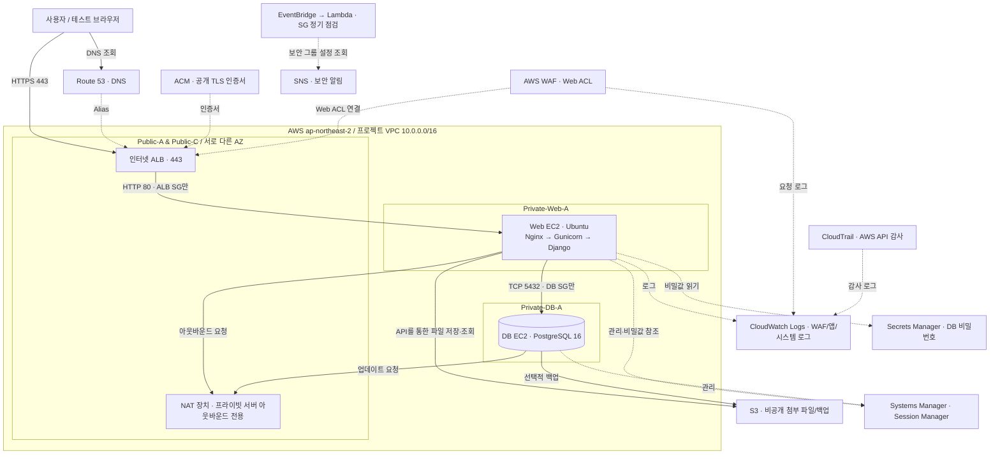
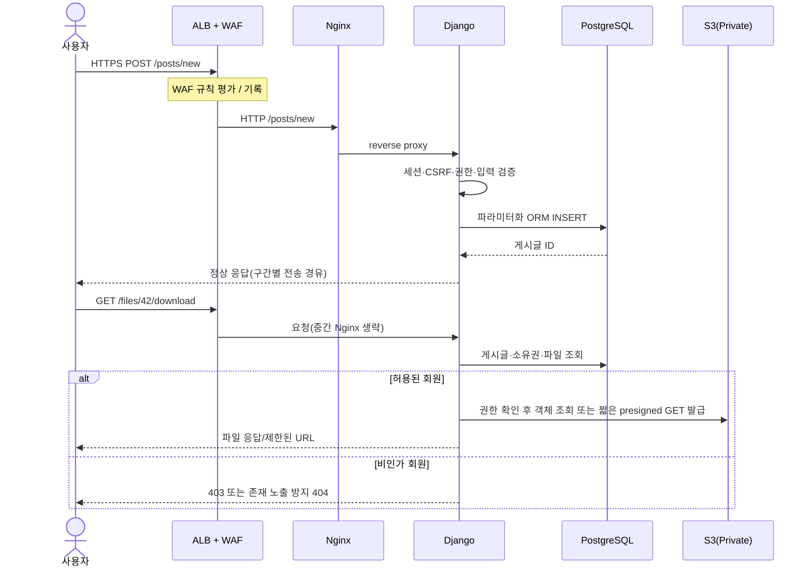
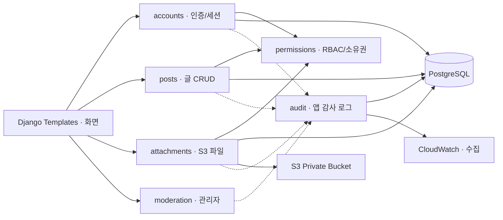
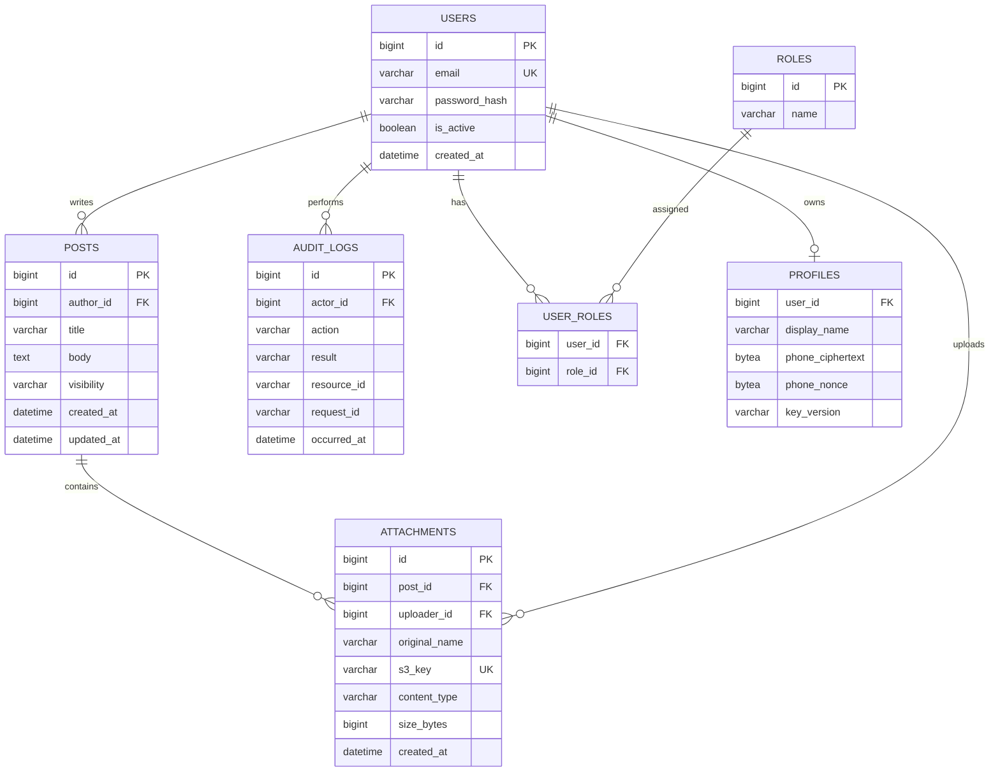
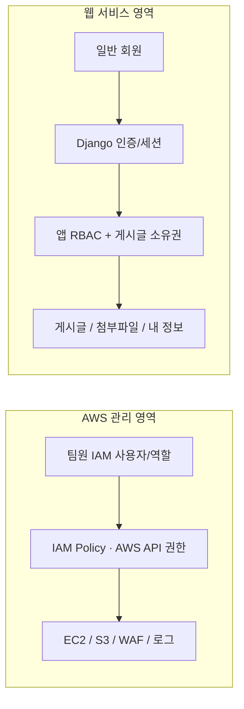
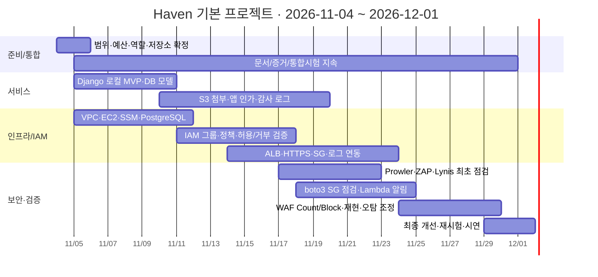

# PROJECT 3 — AWS 클라우드 보안 프로젝트 계획서

## 1. 먼저 읽을 결론

### 최종 권장 구성

1. **서비스**: 회원가입·로그인·게시판·파일 업로드/다운로드·내 정보·관리자 기능이 있는 소규모 커뮤니티. 화면과 API는 단순하게 만들고, 계정·데이터·파일 권한·로그를 보안 실습 대상으로 활용한다.
2. **웹 기술**: **Django + Django Templates + Bootstrap + Nginx + Gunicorn**. Python을 점검 도구에서도 재사용하고, Django 내장 인증·관리 기능·CSRF·ORM을 활용해 6인 초급 팀의 시간을 절약한다.
3. **DB**: **PostgreSQL 16을 별도 비공개 EC2**에 설치한다. DB 격리·계정·백업·OS 점검을 직접 실습하기 좋다. RDS는 나중에 관리형 DB와 비교하는 선택안으로 남긴다.
4. **AWS 공개 진입점**: **Route 53 → HTTPS ALB + AWS WAF → 비공개 Web EC2 → 비공개 DB EC2**. 파일은 **비공개 S3**, 비밀값은 **Secrets Manager**, 접속은 **SSM Session Manager**로 통일한다.
5. **감사·점검**: CloudTrail·CloudWatch·VPC Flow Logs·WAF 로그를 수집하고, **Prowler / OWASP ZAP / Lynis / pip-audit** 결과를 확보한다. **boto3 보안 그룹 점검기**와 **WAF 검증 요청 스크립트**를 직접 개발한다.
6. **IPS**: AWS WAF와 **Suricata를 서로 다른 계층으로 분리**한다. 4주 기본 과제는 WAF 실동작 및 정책 개선을 반드시 완료하고, Suricata는 **패킷이 실제 통과하는 격리된 시험 경로**에서 탐지·차단을 확인하는 실습으로 운영한다. NAT와 inline IPS를 한 서버에 억지로 결합하는 구성은 검증 후에만 확장한다.
7. **심화**: 12월에 **AES-256-GCM/KMS**, **자체 OpenSSL CA/인증서 검증**, **앱 인가·DB RLS/mTLS 선택 실습**을 추가한다. 공인 HTTPS는 11월에 ACM으로 먼저 적용하고 자체 CA 실습과 구분한다.

### 작업 우선순위

| 등급 | 의미 | 이번 통합안에서의 처리 |
|---|---|---|
| **P0 — 기본 필수** | 없으면 프로젝트 목표 성립이 어려움 | Web+DB, IAM, VPC/SG, WAF, 로그인/게시글/파일, 기본 로그·검증 |
| **P1 — 기본 도전** | 기본 4개 과제의 도전 항목 | 도메인·메일, 최소권한 개선, 네트워크 자동점검, WAF 정책 개선·재시험 |
| **P2 — 권장** | 보안 완성도 향상 | Suricata 실습, 알림·정기 점검, 데이터 복원, 관리자 보안 이벤트 뷰 |
| **P3 — 심화/선택** | 기본 완성 후 진행 | AES-GCM/KMS, 자체 CA, 인증서 검증, RLS, mTLS, 패스키, 고급 CI/IaC |

> **범위 통제**: 기본 4주 동안 **마이크로서비스·Kubernetes·React SPA·자체 인증 프레임워크·복잡한 실시간 채팅·전체 SOC 대시보드**는 만들지 않는다. 필요한 경우 12월 이후 별도 이슈로 관리한다.

---

## 2. 무엇을 만드는가: 서비스 범위

### 2.1 서비스의 목적

**Haven**은 회원이 게시글과 학습 자료 파일을 올리고, 허용된 회원만 조회·다운로드할 수 있는 작은 플랫폼이다. 쇼핑몰이나 복잡한 협업툴보다 개발 시간이 적게 들면서 **인증, 인가, DB, 파일, 네트워크, 웹 공격 방어, 감사 로그**를 한 번에 시험할 수 있다.

### 2.2 화면 설계 — 5개 핵심 영역

| 화면 | 최소 기능(P0) | 확장(P1~P3) | 직접 검증하는 보안 |
|---|---|---|---|
| 회원가입·로그인 | 가입, 로그인, 로그아웃, 유효성 검사 | SES 인증 메일, 로그인 실패 제한 | 비밀번호 해시, 세션/CSRF, brute-force 완화 |
| 내 정보 | 프로필 조회·변경, 비밀번호 변경 | 개인정보 AES-GCM 암호화 | 다른 회원의 정보 접근 거부, 민감정보 보호 |
| 게시판 | 글 목록, 상세, 작성, 수정, 삭제 | 검색·페이지네이션·공개범위 | ORM 쿼리, XSS 방어, 게시글 소유권/IDOR 방어 |
| 자료 공유 | 글에 파일 첨부, 회원 전용 다운로드 | 다운로드 이력, 파일 검사 강화 | S3 접근 제어, 파일 검증, 파일별 인가 |
| 관리자 | 회원 상태·게시글 관리, 감사 기록 조회 | 보안 이벤트 화면, 정책 변경 이력 | 앱 RBAC, 관리 기능 접근 통제 |

> 기존 문서의 “5개 화면” 취지는 유지하되, **자료 공유를 하나의 화면 영역**으로 추가했다. 메뉴/URL은 여러 개여도 화면 개발의 복잡도는 최소화한다.

### 2.3 정확한 회원 권한 정책

| 사용자 | 비회원 | 로그인 회원 | 운영 관리자 |
|---|---|---|---|
| 회원가입·로그인 | 허용 | 로그인 페이지 재진입 제한 가능 | 허용 |
| 회원 전용 게시글 목록/상세 | 거부 | 허용 | 허용 |
| 본인 게시글 작성·수정·삭제 | 거부 | 본인만 허용 | 운영 정책에 따라 관리 허용 |
| 본인/공개 범위에 맞는 파일 다운로드 | 거부 | 파일이 연결된 게시글 권한 확인 후 허용 | 관리 정책에 따라 허용 |
| 다른 회원 비공개 글·첨부 조회 | 거부 | **거부** | 관리자 권한 검사 후 허용 |
| 회원 정지·역할 변경·감사 조회 | 거부 | 거부 | 허용 |

- **앱 관리자**는 Django 내부 역할/권한이며, **AWS IAM 관리자와 별개**다.
- 게시글의 `visibility`는 `members`(로그인한 회원 모두) 또는 `private`(작성자와 승인된 관리자) 중 하나로 제한한다.
- 게시글 삭제 시 연결된 S3 파일의 삭제 처리도 권한 검사 및 감사 로그에 남긴다.

### 2.4 개발하지 않는 기능

실시간 채팅, 친구 추천, 좋아요/알림 피드, 고급 검색 엔진, 모바일 앱, 소셜 로그인, 대용량 스트리밍, 다중 파일 동시 전송·버전 비교, 결제 시스템은 제외한다.

---

## 3. 전체 시스템 아키텍처

### 3.1 AWS 배치도(목표 상태)



> **그림 읽는 법**: AWS WAF는 ALB에 연결되는 정책이며 독립 패킷 중계 서버가 아니다. S3·SSM·Secrets Manager·CloudWatch는 VPC의 EC2가 아니라 AWS 서비스다. 점선은 관리·정책·로그의 논리적 연결이며 네트워크 인바운드 허용을 뜻하지 않는다. 실제 API 통신에는 NAT 또는 VPC Endpoint 같은 **아웃바운드 경로**가 필요할 수 있다.

### 3.2 네트워크 CIDR 및 라우팅

| 이름 | CIDR(예시) | AZ | 리소스 | 공개 IP |
|---|---|---|---|---|
| `public-a` | `10.0.1.0/24` | ap-northeast-2a | ALB, NAT 후보 | NAT에만 필요할 수 있음 |
| `public-c` | `10.0.2.0/24` | ap-northeast-2c | ALB | 해당 없음 |
| `private-web-a` | `10.0.11.0/24` | ap-northeast-2a | Web EC2 | **없음** |
| `private-db-a` | `10.0.21.0/24` | ap-northeast-2a | DB EC2 | **없음** |

- **Public Route Table**: VPC CIDR → `local`, `0.0.0.0/0` → Internet Gateway.
- **Private Web Route Table**: VPC CIDR → `local`, 외부 통신 필요 시 `0.0.0.0/0` → 선택한 NAT 또는 필요한 서비스의 Endpoint.
- **Private DB Route Table**: VPC CIDR → `local`, 시스템 업데이트용 NAT 경로는 운영 시에만, S3 백업용 Gateway Endpoint는 별도 적용 가능.
- **DB 접근 경로**: Web EC2의 SG를 소스로 하는 PostgreSQL `5432`만 허용. ALB나 인터넷에서 DB로 연결하지 않는다.
- **관리 경로**: SSM Agent의 outbound HTTPS가 필요하다. VPC Endpoint를 채택하면 해당 endpoint SG·프라이빗 DNS 등을 구성해야 한다.
- **중요**: 네트워크 격리와 고가용성은 다르다. 이 계획은 **ALB만 다중 AZ**, Web/DB는 단일 EC2로 시작하므로 서비스 전체는 HA가 아니다.

### 3.3 보안 그룹 기준표

| SG | 방향 | 허용 소스/대상 | 포트 | 설명 |
|---|---|---|---|---|
| `alb-sg` | In | 인터넷 `0.0.0.0/0` (필요시 IPv6) | TCP 443, 80 | 80은 443 리디렉션만. 공개 엔드포인트 |
| `alb-sg` | Out | `web-sg` | TCP 80 | Web 대상 그룹 연결 |
| `web-sg` | In | `alb-sg` | TCP 80 | **유일한 웹 진입**. 인터넷 직접 80/443 금지 |
| `web-sg` | Out | `db-sg` | TCP 5432 | DB 조회·쓰기 |
| `web-sg` | Out | 필요한 NAT/Endpoint 경로 | TCP 443 등 | AWS API/패키지 업데이트 |
| `db-sg` | In | `web-sg` | TCP 5432 | DB 서버만. 인터넷/관리자 직접 연결 금지 |
| `db-sg` | Out | 업데이트·백업 경로만 | 필요한 포트 | 가능한 범위에서 제한 |
| EC2 관리 | In | 없음 | **SSH 22 미개방** | SSM 세션으로 접속 |

**NACL**: 처음에는 기본 NACL과 SG로 정합성을 확보한다. 3주차에 필요한 경우 명시적 NACL을 추가하고, **stateless 특성상 요청/응답 임시 포트와 양방향 규칙**을 검증한다. 단순한 “22/5432 차단”으로 정상 응답이 끊기지 않도록 한다.

### 3.4 인터넷 출구와 IPS의 실제 배치 선택

| 옵션 | 장점 | 단점 | 채택 시점 |
|---|---|---|---|
| **NAT 인스턴스** | 저비용 가능, Linux 라우팅/방화벽 학습 | OS·IP 포워딩·소스/목적지 검사 해제·라우팅·가용성 관리 필요 | **초기 비용 검토 시 추천 후보** |
| NAT Gateway | 관리형·상대적으로 간단 | 시간+처리 데이터 요금 지속, 삭제 전 계속 과금 | NAT 인스턴스 설치가 지연될 때 대안 |
| VPC Interface Endpoint 중심 | 외부 인터넷 없이 SSM/일부 AWS 서비스 접근 | 서비스별 엔드포인트 비용, 패키지 다운로드 경로는 별도 설계 | 인터넷 출구 최소화 실습/심화 |
| Suricata IDS/IPS 실습 | 실제 규칙 로그와 drop 결과 검증 | inline 패킷 처리 설계가 별도 필요, HTTPS 페이로드는 원칙상 암호화됨 | **4주차 P2**, 팀 역량에 따라 |
| AWS Network Firewall | AWS 관리형 네트워크 방화벽 실습 | 구성·시간당 요금 부담, 라우팅 정확성 요구 | 예산·평가 요구가 확실할 때만 |

**권장 실행 순서**: 먼저 NAT/SSM/배포가 **안정적으로 작동**하게 한다 → Suricata는 테스트 EC2 또는 격리된 경로에서 탐지와 inline drop 여부를 시험한다 → NAT+Suricata 결합은 경로·성능·복구를 측정했을 때만 통합한다. **Suricata 설치만으로 VPC 전체 IPS가 되었다고 발표하지 않는다.** 또한 `fail2ban`은 호스트 로그 기반 IP 차단 도구이며 SSH를 열지 않으면 `sshd` jail 자체가 시연 포인트가 아니다. 앱의 로그인 실패 로그 연동은 별도 구현을 요구한다.

### 3.5 실제 사용자의 요청 흐름



> 다이어그램은 논리 경로 표현이다. 업로드 MVP는 **브라우저→Django→S3**를 이용한다. 다운로드 시에는 권한 검사를 마친 뒤 짧은 만료의 URL을 발급하거나 Django가 전달한다. **S3 객체를 공개 URL로 제공하지 않는다.**

---

## 4. 기술과 프로그램: 무엇을 설치하고 왜 쓰는가

### 4.1 개발 기술 스택(확정 권장)

| 계층 | 기술/도구 | 설치·사용 위치 | 맡는 역할 | 직접 구현하는 부분 |
|---|---|---|---|---|
| OS | Ubuntu Server 24.04 LTS | Web/DB EC2 | 서버 운영 | OS 계정·패치·로그·하드닝 |
| 언어 | Python 3, `venv` | 개발 PC·Web EC2 | 앱/스크립트 공통 언어 | 웹 로직과 진단기 |
| 웹 프레임워크 | Django(팀에서 지원 버전 고정) | Web EC2 | 인증·ORM·라우팅·템플릿·관리 | 게시글·파일·권한·감사 모듈 |
| UI | HTML/CSS/Bootstrap + 소량의 JS | Django Templates | 화면 구성 | 5개 화면의 사용성 |
| 앱 실행 | Gunicorn + systemd | Web EC2 | Django 프로세스 관리 | 서비스 파일·재시작 정책 |
| Reverse Proxy | Nginx | Web EC2 | 정적 파일, 프록시, 요청 크기 제한 | 보안 헤더·프록시 설정 |
| DB | PostgreSQL 16 | DB EC2 | 관계형 저장소 | 스키마·권한·백업 복원 |
| ORM/마이그레이션 | Django ORM / migrations | Web EC2·개발 PC | 안전한 SQL과 스키마 변경 | 엔터티·모델·쿼리 |
| 객체 저장 | boto3 + S3 | Web EC2/AWS | 첨부 저장 | 검증·접근제어·다운로드 서비스 |
| 비밀번호 | `argon2-cffi` + Django password hasher | Web EC2 | Argon2 기반 해시 | 가입·로그인 정책 연동 |
| 테스트 | pytest + pytest-django / Django TestCase | 개발 PC·CI | 자동 검증 | API·인가·에지 케이스 |
| 버전관리 | Git, GitHub, VS Code | 6명 PC | 협업 | PR, 리뷰, 기록, 이슈 |
| API/디버깅 | curl, Postman/Insomnia | 개발 PC | 요청 검증 | 시나리오 재현 |

**FastAPI 대안**: 이미 팀 전체가 FastAPI에 익숙하다면 채택 가능하다. 단, 내장 회원 인증·관리 화면·CSRF·세션 처리를 별도 설계해야 하므로 기본 권장 스택에서는 제외한다.

### 4.2 AWS 서비스별 담당 경계

**'AWS 제공'은 자동으로 안전한 설정이 완료된다는 뜻이 아니다.** 대부분의 리소스·정책·연결은 **팀이 직접 설계·설정·검증**한다.

| AWS 서비스 | AWS가 제공하는 것 | 팀이 직접 구축·설정할 것 | 목표 |
|---|---|---|---|
| **EC2 / EBS** | VM·디스크 | Ubuntu 준비, 보안 업데이트, IMDSv2, 암호화, 애플리케이션 배포 | P0 |
| **VPC / Subnet / RT / IGW** | 격리된 네트워크 자원 | CIDR·Public/Private 구역, 라우팅, 접근 경로 | P0 |
| **Security Group / NACL** | 네트워크 정책 기능 | 최소포트 정책, ALB→Web→DB 연결, 차단 실험 | P0 |
| **IAM User/Group/Role/Policy** | AWS API 인증·권한 체계 | 사용자/그룹 분리, 최소권한, MFA, 허용·거부 검증 | P0 |
| **ALB / Target Group** | L7 로드밸런싱 | 2AZ, HTTPS 리스너, 앱 health check, 리디렉션 | P0 |
| **AWS WAF** | 관리형 규칙/평가 엔진 | Web ACL 연결, Count→Block, 사용자 규칙, 오탐 조정 | P0 |
| **S3** | 객체 저장 | Block Public Access, 버킷 정책, 객체 키/첨부 접근, 백업 | P0 |
| **CloudTrail** | AWS API 이벤트 기록 | 필요한 트레일/이벤트·보존·조회·검증 | P0 |
| **CloudWatch Logs/Metrics** | 로그·지표 기반 서비스 | WAF/앱/시스템 수집·보존·알림/대시보드 | P0 |
| **Systems Manager** | Agent 및 Session Manager | 역할·아웃바운드 경로·접속 권한·22 차단 | P0 |
| **ACM** | 공개 TLS 인증서 발급/관리 | DNS 도메인 검증, ALB 리스너 연결 | P1(실제로 공개 HTTPS면 필요) |
| **Route 53** | DNS 호스팅 | 도메인 구매·레코드 설정·Alias 검증 | P1 |
| **SES** | 메일 전송 인프라 | 발신자 검증·sandbox 확인·가입/알림 이메일 | P1 |
| **Secrets Manager** | 비밀값 저장·읽기 API | DB 자격증명, Role 권한·앱 연동·회전 전략 | P1 |
| **Lambda / EventBridge / SNS** | 함수 실행·일정·알림 | **직접 작성한** SG 점검 로직과 메시지 연동 | P1 |
| **VPC Flow Logs** | 네트워크 흐름 기록 | 수집 지점, REJECT 분석, 보존·비용 | P1 |
| **GuardDuty / Security Hub / Inspector** | 관리형 위협·보안 설정·취약점 탐지 | 활성화 범위·발견 항목 분석·실제 개선 전후 증거 | P2(요금 검토) |
| **KMS** | 키 관리·암복호화 API | 키 정책, 데이터 키 방식, 앱/DB 암호화 연결 | 심화 |

### 4.3 별도 오픈소스 점검 프로그램

| 도구 | 누가 실행하는가 | 점검 대상 | 중요한 한계/판단 기준 |
|---|---|---|---|
| **Prowler CLI** | IAM/보안 담당 | AWS 계정의 IAM·VPC·EC2·S3 보안 설정 | 권한·대상 범위가 부족하면 미검사/오류. 모든 경고가 실제 취약점은 아님 |
| **OWASP ZAP Baseline** | 웹 보안 담당 | 실제 사이트의 HTTP 응답, 헤더, 공개 화면 | 수동적 분석 중심. WAF 차단 증명은 별도 요청+WAF 로그 필요 |
| **Lynis** | 서버 담당 | Web/DB Ubuntu OS 설정 | 제안을 검토하고 안전한 항목만 조치, 점수만으로 성공 판단 금지 |
| **pip-audit** | 백엔드 담당 | Python requirements의 알려진 취약점 | 실제 배포 의존성을 고정해 비교. 소스 코드 전체 취약점 검사는 아님 |
| **Suricata** | 네트워크 보안 담당 | 관측 가능한 시험 트래픽 | IDS 로그 확인과 IPS drop 증명은 구분; inline 미연결이면 차단 불가 |
| **AWS CLI / boto3** | 인프라·자동화 담당 | AWS 구성 조회/설정 | 직접 구현할 SG 점검기의 기반 라이브러리 |
| **Checkov / Trivy** | 필요할 경우 | IaC / 컨테이너 | **Terraform·컨테이너를 실제 도입할 때만** 추가 |

---

## 5. 직접 개발해야 하는 기능 — 상세 구현 명세

### 5.1 모듈 경계



### 5.2 `accounts` — 인증/인가

- [ ] Django `User` 기반 사용자 모델(**프로젝트 첫 migration 전에 커스텀 User 사용 여부 결정**). 이메일 유일성, 활성/정지 상태.
- [ ] 가입·로그인·로그아웃, 세션 만료·재로그인 확인.
- [ ] `argon2-cffi` 설치 후 Django 해시 정책에서 Argon2 사용. 비밀번호 평문·복호화 저장 금지.
- [ ] HTTPS에서 `Secure`·`HttpOnly`·`SameSite` 쿠키, 적절한 CSRF 검사 및 신뢰 프록시 설정.
- [ ] 로그인 실패 횟수 제한(앱 및 WAF rate 규칙 보조), 계정 열거를 줄이는 오류 처리.
- [ ] 회원 권한 `MEMBER`와 `ADMIN`을 Django Group/permission 또는 `is_staff`와 명시적으로 매핑.
- [ ] 비회원·타회원·정지 회원·관리자별 권한 자동 테스트.
- [ ] 전화번호/주소 등은 **11월에는 테스트용 데이터만**, 민감정보를 실제로 저장하지 않거나 화면을 제한한다. **12월 암호화 적용 후 활성화**한다.

### 5.3 `posts` — 게시판

- [ ] 작성/목록/상세/수정/삭제, 작성자 ID와 수정 시각 저장.
- [ ] `members`, `private` 공개범위 적용, `private` 접근은 소유자/관리자만.
- [ ] 검색은 Django ORM 파라미터화 쿼리 사용, Raw SQL 문자열 결합 금지.
- [ ] 기본 화면에서 글 내용은 템플릿 자동 이스케이프. HTML 직접 입력/렌더링 허용 금지.
- [ ] 삭제/수정은 POST 등 상태 변경 메서드 + CSRF 확인. 권한은 URL에서 받은 사용자 ID를 믿지 않고 **서버 세션의 사용자**로 검사.
- [ ] 페이지네이션을 도입해 테스트 데이터 수가 늘어도 가동 가능하게 유지.

### 5.4 `attachments` — 파일 업로드·다운로드

**구현 경로(P0)**: 회원이 업로드 → Django가 세션·게시글 소유권 확인 → 파일 크기/확장자/실제 파일 형식 검사 → boto3로 **비공개 S3** 저장 → PostgreSQL에 S3 key·메타데이터 기록.

- [ ] 1개 파일 최대 **10 MiB** 등 제한을 팀에서 정해 Nginx·Django·폼에 일치 적용.
- [ ] 허용 형식은 초기 **PDF·PNG·JPG·TXT** 등 소수만. `.php`, `.html`, `.js`, 실행 파일, 압축 파일은 MVP에서 금지.
- [ ] 표시 이름과 S3 실제 키를 분리한다. 실제 객체 키는 난수 UUID 기반, `../` 경로와 원본 파일명으로 경로를 결정하지 않음.
- [ ] 파일 확장자뿐 아니라 signature/MIME을 검증하고 콘텐츠를 이미지/HTML로 자동 실행시키지 않음. 다운로드시 안전한 Content-Disposition·Content-Type 사용.
- [ ] 버킷 **Block Public Access ON**, 원칙적으로 인터넷 공개 ACL 없음, 서버 EC2 Role에 필요한 버킷 prefix만 접근 허용.
- [ ] 다운로드는 **파일→게시글→공개범위/소유권** 순서로 접근을 검증한 후 객체를 전달하거나 **짧은 만료의 presigned GET**을 발급.
- [ ] 업로드 실패 시 DB 메타데이터/실제 S3 객체 불일치를 처리하는 보상(rollback/정리) 로직과 최대 저장량 관리.
- [ ] 업로드 자체를 악성코드 무해성 보증으로 생각하지 않는다. 악성파일 스캔·quarantine→승인 흐름(ClamAV 또는 AWS 관련 검사)은 **P2**로 별도 실습.
- [ ] **파일 업로드 대용량 전체를 WAF가 검사한다고 가정하지 않는다.** ALB 연결 WAF의 body 검사 범위는 제한되므로 서버 측 검사 필수.

**확장(P2)**: presigned POST/PUT 직접 업로드, 격리 접수 버킷, 이벤트 기반 검사, S3 버전·수명주기. 초반 4주에서는 **서버 경유 업로드**가 간단하다.

### 5.5 `audit` 및 `security` — 로그·보안 이벤트

- [ ] 앱 감사 로그: 로그인 성공/실패, 권한 거부, 게시글/파일 생성·삭제, 관리자 변경.
- [ ] 공통 필드: `occurred_at(UTC)`, `actor_id(or null)`, `event_type`, `resource_type`, `resource_id`, `result`, `request_id`, `source_ip(필요 범위)`, `user_agent(필요 범위)`.
- [ ] **비밀번호·쿠키·토큰·presigned URL·원본 개인정보**는 로그에 저장하지 않는다.
- [ ] 운영 로그에서 실제 ALB/Nginx의 신뢰 프록시 설정을 검증한 뒤 클라이언트 IP를 파싱. 임의 `X-Forwarded-For` 직접 신뢰 금지.
- [ ] WAF 로그는 CloudWatch에서 요청 시각, 규칙 ID, action, 요청 조건을 확인; 앱 감사 이벤트와 시간/테스트 ID로 대조한다.
- [ ] P2: 관리자 화면에 WAF/앱/SG 점검 결과 요약 표시. 모든 AWS 로그를 실시간 통합하는 SIEM 기능은 제외.

### 5.6 우리가 새로 만드는 보안 자동화 두 가지

#### A. `network_audit.py` — Python/boto3 보안 그룹 점검기(P1)

**기존 도구 이용**: Prowler는 AWS 계정 점검의 기준 자료. **직접 개발**: 과제에 맞는 판정 기준·리포트·알림.

1. `DescribeSecurityGroups` pagination으로 프로젝트 대상 SG를 수집한다.
2. IPv4 `0.0.0.0/0` 및 IPv6 `::/0`, 전체 프로토콜(`-1`), 광범위 포트, 위험 관리 포트 `22/3389`, DB 포트 `5432/3306` 등을 검사한다.
3. 예외: `alb-sg`의 필요한 HTTP/HTTPS 공개는 정책상 허용. 임의 SG의 전체 공개 허용과 동일하게 취급하지 않는다.
4. 출력: `finding_id`, `sg_id`, `rule_id`, `protocol`, `from_port`, `to_port`, `cidr`, `reason`, `severity`, `recommendation`, `scan_status`.
5. `PASS`·`FINDING`·`ERROR`·`NOT_EVALUATED` 구분. 읽기 권한 부족을 '양호'로 보고하지 않는다.
6. SG 설정 위험과 **실제 인터넷 도달 가능성**은 다르다. 공인 IP·라우팅·추가 제어·실제 접근 시험으로 재확인한다.
7. CLI 결과를 JSON/CSV로 저장하고, 선택적으로 **EventBridge Scheduler → Lambda → SNS**로 정기 알림. Lambda Role은 SG 조회 + 지정 SNS 토픽 발행 + 로그 최소 권한만 부여.
8. 단위 시험: 안전한 SG, 22 공개, 5432가 포트 범위에 포함, `-1`, IPv6 전체 개방, API 조회 오류를 **모의 응답**으로 재현.

#### B. `request_verify.py` — WAF 검증 재현기(P0/P1)

**직접 구현**: 동일한 정상/공격 패턴을 사전 정의된 실습 도메인에 반복 요청하고 **응답을 WAF 로그와 비교**.

- 설정: 허용된 호스트 allowlist, 케이스 ID, 경로, GET/POST, 로그인/CSRF 여부, 전송 속도/최대 횟수, timeout, 중단 조건.
- 시나리오: 평범한 한국어·코드 조각·특수문자 입력, SQLi 의심 문자열, XSS 의심 문자열, 로그인 요청 제한, 파일 접근 거부.
- 저장: 각 요청 시각·case ID·HTTP status·소요시간·응답 유형·시도 ID·해당 WAF 로그의 규칙/action.
- 판정: `WAF_BLOCK`, `APP_DENY`, `NETWORK_DENY`, `NORMAL`, `EXEC_ERROR`, `UNCONFIRMED`.
- **HTTP 403만 보고 WAF가 차단했다고 확정하지 않음**. WAF 로그상 적용 규칙·동작이 없으면 앱 권한 거부 등으로 구분.
- Count 관찰 → 로그 분석 → Block으로 전환 → **완전히 동일한 케이스 재실행** → 오탐과 서비스 정상 기능 비교.
- 레이트 규칙은 설정한 임계 건수의 정확한 N번째 요청에서 즉시 차단된다고 기대하지 않는다.
- 실습 대상은 팀 소유 AWS 서비스의 승인된 경로로 한정하고, 외부 서비스로의 리다이렉트는 따라가지 않는다.

### 5.7 API/URL 초안

Django Templates가 중심이므로 REST API를 모두 구현할 필요는 없다. 아래 URL은 모듈별 실제 작업 경계를 정하기 위한 예시다.

| 방법 | URL 예시 | 인증/인가 | 구현 담당 모듈 |
|---|---|---|---|
| GET/POST | `/accounts/signup/` | 가입 가능 | accounts |
| GET/POST | `/accounts/login/` | 로그인 가능 | accounts |
| POST | `/accounts/logout/` | 로그인 | accounts |
| GET/POST | `/accounts/me/` | 본인 | accounts |
| GET | `/posts/` | 회원 | posts |
| GET | `/posts/<id>/` | 회원+공개범위 | posts |
| GET/POST | `/posts/new/` | 회원 | posts |
| GET/POST | `/posts/<id>/edit/` | 작성자/관리자 | posts |
| POST | `/posts/<id>/delete/` | 작성자/관리자 | posts |
| POST | `/posts/<id>/attachments/` | 작성자/관리자 | attachments |
| GET | `/files/<id>/download/` | 원 게시글 조회 권한 | attachments |
| GET | `/admin/` | 운영 관리자 | Django admin/management |
| GET | `/security/audit/` | 운영 관리자 | audit |
| GET | `/healthz` | ALB의 최소 헬스체크 | Nginx |

---

## 6. 데이터베이스 설계

### 6.1 ER 구조



> 실제 구현은 Django 내장 `auth_user`/`auth_group` 관계 또는 **초기에 정의한 커스텀 User**를 사용할 수 있다. 위의 `USERS`, `ROLES`, `USER_ROLES`는 **논리 모델**이며, Django auth 테이블을 그대로 사용한다면 중복 테이블을 새로 만들지 않는다. 12월 `phone_ciphertext` 등은 비활성/NULL로 설계해 두었다가 실제 암호화 이후 사용한다.

### 6.2 추가 테이블과 인덱스

| 데이터 | 핵심 컬럼 | 인덱스/제약 | 목적 |
|---|---|---|---|
| `users` / Django auth | id, email, password_hash, is_active | 이메일 unique | 계정·인증 |
| `profiles` | user_id, display_name, 암호문/nonce/key_version | user_id unique, nullable 암호문 | 12월 개인정보 암호화 대비 |
| `posts` | id, author_id, title, body, visibility, created_at | (author_id, created_at), visibility | 글·인가 |
| `attachments` | id, post_id, uploader_id, s3_key, size_bytes, mime | s3_key unique, post_id 인덱스 | 비공개 파일 메타데이터 |
| `audit_logs` | id, actor_id, event, result, resource, time, request_id | occurred_at, actor_id | 운영·보안 감사 |
| `security_findings`(P2) | id, source, finding_id, status, severity, observed_at | (source, finding_id) | 외부 진단 결과 요약 |

**DB 접근 제어**: PostgreSQL의 애플리케이션 계정 `haven_app`은 필요한 스키마와 CRUD 권한만, 마이그레이션/운영 계정은 별도로 분리한다. 원격 접근은 DB SG와 `pg_hba.conf`에서 함께 제어하며 TLS 적용 시 `hostssl`을 별도 설정·검증한다. `postgres` 슈퍼유저를 앱 DB 연결에 사용하지 않는다.

### 6.3 DB 백업과 복원

- 초기: `pg_dump`를 이용한 일일 테스트 백업을 S3 전용 prefix로 업로드.
- S3 백업 버킷: Public Access Block, 기본 암호화, 보존 정책, 역할별 접근 제한.
- DB EC2의 `DBBackupRole`에는 **특정 prefix에 `s3:PutObject`만** 부여하는 방식을 우선 검토(암호화 키 정책과 추가 API 필요 여부 확인).
- 운영자의 복원용 권한은 **백업 업로드 역할과 분리**한다. 버킷 삭제·권한 변경은 허용하지 않는다.
- 복원 검증: 별도 테스트 DB에 `pg_restore`/SQL 복원 → 정상 행 수·접근 확인. **백업 성공 알림만으로 복원 성공을 주장하지 않는다.**
- AWS EC2 스냅샷은 보조 수단으로 검토하며 원본 DB 파일과 일관성 문제에 유의한다.

---

## 7. AWS IAM 설계와 정책 테스트

### 7.1 AWS 사용자·그룹 (팀 작업용)

| IAM 그룹 | 담당 예시 | 허용 범위 | 명시적으로 수행하지 않을 작업 |
|---|---|---|---|
| `Admins` | 팀장 + 백업 관리자(최소 인원) | 초기 설계·승인된 리소스 관리 | 루트 일상 사용 지양 |
| `WebOps` | 웹 담당 | 프로젝트 태그 EC2 조회/시작/중지/재부팅 등 | IAM 정책 수정, DB/S3 전체 삭제 |
| `DBOps` | DB 담당 | 지정 백업 버킷 prefix 조회/읽기·복원 관련 최소 접근 | 다른 버킷·IAM 수정 |
| `Auditors` | IAM·점검 담당 | 필요한 AWS 설정 읽기 및 진단 | 임의 서버 생성·보안 설정 변경 |
| `SecurityOps`(선택) | WAF/보안 담당 | 지정 WAF/로그 리소스 조회·승인된 수정 | 광범위 IAM/과금 변경 |

**필수 원칙**: 루트 계정 MFA와 루트 액세스 키 미사용, 팀원 개인 계정과 MFA, 그룹/역할 기반 권한, EC2에는 **인스턴스 프로파일 IAM Role**을 사용하고 액세스 키를 코드에 넣지 않는다. 가능한 경우 IAM Identity Center의 임시 자격증명 사용도 검토한다. `AdministratorAccess`는 최소 1~2명에게만 제한적으로 허용하며 안전한 업무용 정책으로 점진적 축소한다.

### 7.2 앱 사용자 vs AWS 계정의 차이



AWS IAM으로 DB에 저장된 웹 회원의 게시글 소유권을 대신 판정하지 않는다. 앱은 Django view/service에서 인가 검사를 수행한다.

### 7.3 정책 적용 및 시험 계획

| 테스트 ID | 계정/역할 | 요청 | 기대 결과 | 확인 증거 |
|---|---|---|---|---|
| I-01 | WebOps | 프로젝트 태그의 Web EC2 시작 | 허용 | CloudTrail/CLI 응답 |
| I-02 | WebOps | DB EC2 종료/SG 임의 수정 | 거부 | `AccessDenied` |
| I-03 | DBOps | 지정 S3 백업 prefix 업로드 | 허용 | 객체 생성/CloudTrail 또는 S3 확인 |
| I-04 | DBOps | 다른 버킷 조회·삭제 | 거부 | `AccessDenied` |
| I-05 | Auditors | IAM/SG 설정 조회 | 허용 범위 내 허용 | 결과 JSON |
| I-06 | Auditors | 새로운 EC2 생성 | 거부 | `AccessDenied` |
| I-07 | Web EC2 Role | 지정 S3 첨부 버킷 object 읽기/쓰기 | 허용 | 앱 정상 업/다운로드 |
| I-08 | Web EC2 Role | 무관한 S3 버킷 읽기 | 거부 | `AccessDenied` |

**정책 정확성 메모**: `ec2:Describe*` 유형은 작업에 따라 `Resource: "*"`가 필요할 수 있고, 상태 변경 액션은 지원되는 자원 ARN·태그 조건을 AWS 정책 시뮬레이터/실제 API로 검증한다. 사용자 제공 문서의 IAM JSON은 좋은 **초안**이지만 복사만 하고 동작을 가정하지 않는다. 가능하면 조회와 변경 정책을 분리하고 태그 조건이 의도대로 적용되는지 실제 확인한다.

### 7.4 최소 권한 개선 실습

1. 초기 정책을 **안전한 모의 정책/정책 시뮬레이터**에서 진단한다.
2. 필요한 작업만 선별하고 `Action`, `Resource`, `Condition`을 축소한다.
3. `IAM Access Analyzer` 및 Prowler 결과와 비교한다.
4. 기존 허용 테스트가 유지되고 불필요한 작업만 거부되는지 재시험한다.
5. 변경 전후 정책 JSON, 테스트 ID, 증거를 함께 제출한다.

---

## 8. WAF·IDS/IPS·관제 자동화의 역할과 검증

### 8.1 WAF 적용 순서

1. `web-acl-haven`을 **ALB와 같은 리전**에 생성해 연결한다.
2. 관리형 규칙은 **CommonRuleSet, SQLiRuleSet, KnownBadInputs, IP Reputation** 등을 후보로 삼고 비용(WCU/요금), 정상 요청 영향과 실제 앱 입력을 검토한다.
3. 각 규칙·버전·우선순위·동작과 예외를 정책 문서에 기록한다.
4. 대상 규칙은 우선 `Count` 또는 규칙별 action override로 관찰하고 **CloudWatch WAF 로그**가 실제 도착하는지 확인한다.
5. 시험 케이스로 **SQLi/XSS 의심 요청 + 정상 요청**을 실행하고 룰 ID와 action을 매칭한다.
6. 정상 사용에 무리가 없는 규칙만 `Block`으로 바꾸고 **같은 케이스 재실행**.
7. 로그인 실패·과도한 요청에 rate 기반 규칙을 추가한다. 집계 방식/평가 창/기준 및 실제 관찰 시간을 기록한다.
8. 최종 테스트: ALB 정상 경로 성공, Web EC2 직접 접근 불가, **WAF 차단과 앱의 403을 구분**.

**WAF 로그 주의**: 초기 로그 수집은 필요한 범위만 활성화하고 민감정보 마스킹·보존 정책을 설정한다. AWS WAF가 ALB에서 검사하는 request body 범위는 **최초 8 KiB**로 제한되므로, 업로드 콘텐츠 전체 검사 대체 수단이 아니다. 본문 크기 초과 처리 정책과 Nginx/앱 업로드 검사를 함께 설계한다.

### 8.2 Suricata 시연 계획(P2)

| 항목 | 설계 |
|---|---|
| 관측 지점 | 별도 테스트 호스트의 **실제 트래픽이 보이는 NIC/인터페이스**, 또는 명시적으로 라우팅한 inline 경로 |
| 모드 | 먼저 IDS `alert` 검증 → 이후 실제 inline 구성이 확인된 경우 `drop` 검증 |
| 요청 | 내부 실습용 허용된 테스트 PC ↔ 시험 서버의 평문 HTTP 등 검증용 트래픽 |
| 산출물 | 규칙 파일, alert 로그, 패킷 경로 그림, inline 구성·drop 전후 결과 |
| 운영 서비스와 분리 | 잘못된 라우팅/IPS 규칙 때문에 ALB→Web→DB가 중단되지 않게 별도 시험 |
| 제한 | HTTPS 암호문 안의 SQL 문자열을 네트워크 IPS가 일반적으로 평문처럼 읽는다고 가정하지 않음 |

**WAF는 L7 요청의 보안 규칙**, Suricata는 **보이는 네트워크 패킷/흐름**을 검사한다. GuardDuty는 AWS 위협 탐지 서비스이며 Suricata inline IPS와 같은 의미가 아니다.

### 8.3 탐지와 자동 대응(점진적)

- **P0**: WAF/앱 접근 로그 수집, 정상/공격 요청 분류와 관련 규칙 확인.
- **P1**: Lambda SG 설정 위반 발견 → SNS 관리자 메일. '자동 점검+알림'이 명확한 1차 목표.
- **P2**: WAF 차단 이벤트를 조건에 따라 집계하여 메일 알림. 단일 IP가 의심스럽다는 이유로 자동 차단하는 기능은 **만료·수동 해제·오탐 처리·IPv6·프록시 영향**을 설계한 뒤 적용.
- **P3**: Security Hub/GuardDuty 지표를 앱의 읽기 전용 보안 요약 화면에 표시. 비용과 리소스별 권한 통제 후 추가.

---

## 9. 통합 테스트 매트릭스

**모든 테스트는 팀 소유 AWS 계정·실습 서버에서만 실행한다.** 개선 전후는 **동일 케이스·같은 앱/규칙 조건**을 사용하고, 도구 버전·규칙 변경이 있으면 기록한다.

| 분류 | ID | 시나리오 | 기대 결과 | 증거 |
|---|---|---|---|---|
| 앱 기능 | A-01 | 가입 → 로그인 → 게시글 작성·재조회 | 정상 | 캡처, DB 행 |
| 앱 기능 | A-02 | 파일 업로드 → 목록 → 다운로드 | 정상·내용 동일 | 파일 해시/S3 메타데이터 |
| 인증 | A-03 | 로그아웃 후 내 정보 접근 | 거부/로그인 이동 | 요청 상태·세션 |
| 인증 | A-04 | CSRF 토큰 없이 상태 변경 | 거부 | Django 로그/응답 |
| 인가 | A-05 | A회원이 B의 private 글 URL 접근 | 거부 | 403/404, 감사 이벤트 |
| 인가 | A-06 | A회원이 B의 파일 ID 다운로드 | 거부 | S3 요청 없음/앱 로그 |
| 인가 | A-07 | 일반 회원이 관리자 URL 접근 | 거부 | 403/리다이렉트, 로그 |
| DB | D-01 | Web EC2에서 DB 쿼리 | 허용 | `psql`/앱 결과 |
| DB | D-02 | 외부에서 DB 직접 접근·공인 IP 확인 | **직접 접근 경로 없음** | SG·라우트·공인 IP·내부 거부 시험 |
| DB | D-03 | 백업 → 별도 테스트 DB 복원 | 데이터·스키마 확인 | 복원 로그/행 수 |
| AWS IAM | I-01~08 | 위 7.3의 허용·거부 케이스 | 정책과 일치 | API 결과/CloudTrail |
| 네트워크 | N-01 | 인터넷→ALB 443 | 연결 성공 | curl/certificate |
| 네트워크 | N-02 | 인터넷→Web EC2 직접 | 우회 불가 | SG/공인 IP/접속 시도 |
| 네트워크 | N-03 | SSM으로 사설 EC2 접속 | 연결 성공, 22 In 없음 | 세션 기록/SG |
| 자동점검 | S-01 | SG `0.0.0.0/0:22` 모의 사례 | FINDING | 단위 테스트 JSON |
| 자동점검 | S-02 | SG `::/0`와 범위 내 DB 포트 | FINDING | 단위 테스트 JSON |
| 자동점검 | S-03 | API 권한 오류·타임아웃 | ERROR | 로그/에러 결과 |
| 자동점검 | S-04 | EventBridge → Lambda → SNS | 알림 수신 | 실행 로그/메일 |
| 웹 보안 | W-01 | 정상 한국어/코드 조각 입력 | 서비스 정상 | 응답/WAF Count 로그 |
| 웹 보안 | W-02 | SQLi 의심 입력(사전 정의) | 선택한 규칙에 따라 탐지/차단 확인 | WAF rule/action |
| 웹 보안 | W-03 | XSS 의심 입력(사전 정의) | 탐지/차단·앱 escape 확인 | WAF+응답 콘텐츠 |
| 웹 보안 | W-04 | WAF Count→Block 적용 전후 | 실제 동작 변경 기록 | 같은 case ID, 로그 |
| 웹 보안 | W-05 | 로그인 요청 제한 | 평가 창 관찰 후 기대 결과 확인 | 요청 타임라인/규칙 |
| 서버 | H-01 | Lynis 최초/재점검 | 선택 조치 근거 확인 | 두 결과 + 설정 diff |
| 의존성 | H-02 | pip-audit 최초/재점검 | CVE·수정 버전 추적 | JSON 리포트 |
| 앱 보안 | H-03 | ZAP Baseline 최초/재점검 | 해당 경고 원인/조치 설명 | HTML/JSON 리포트 |
| 심화 | C-01 | AES-GCM 암호화→DB 저장→복호화 | 원문 복원/DB엔 암호문 | DB 캡처/테스트 |
| 심화 | C-02 | 암호문/nonce 변조·타인 복호화 | 실패/접근 거부 | 단위 시험 |
| 심화 | C-03 | 자체 CA 발급·체인/호스트/만료 검증 | 유효만 통과 | OpenSSL 검증 로그 |

### 9.1 결과 판정 형식

```text
case_id: W-02
run_at_utc: YYYY-MM-DDTHH:MM:SSZ
target: https://<실습 도메인>/<테스트 경로>
app_commit: <git short SHA>
waf_policy_version: <Web ACL/규칙 버전>
request: <마스킹된 요청 조건>
expected: <예상 근거>
http_status: <실제 상태>
waf_action: ALLOW | COUNT | BLOCK | 미수집
waf_rule_id: <매칭 규칙/미확인>
final_verdict: WAF_BLOCK | APP_DENY | NETWORK_DENY | NORMAL | EXEC_ERROR | UNCONFIRMED
evidence: docs/evidence/YYYYMMDD/<case_id>/
notes: <원인/오탐/미검사>
```

### 9.2 개선 보고서 작성 원칙

1. **점검 기준**: 어떤 도구/규칙/버전으로 무엇을 검사했는가?
2. **최초 결과**: 무엇을 발견했으며 실제 위험인지, 시험 조건의 한계는 무엇인가?
3. **원인**: AWS 설정 문제인지, 앱 인가 문제인지, WAF 탐지인지 구분.
4. **수정**: 변경 파일·정책·규칙을 구체적으로 기록.
5. **같은 조건 재시험**: 변경 전후 응답/로그와 정상 기능 유지.
6. **최종 분류**: 해결 / 적용 제외(근거) / 미해결 / 미검사.

---

## 10. 6인 팀 역할 분담과 협업

### 10.1 개인별 주 담당과 보조 담당

| 인원 | 주 담당 | 세부 구현·설정 | 보조/교차 검토 | 최종 산출물 |
|---|---|---|---|---|
| **① 팀장/통합·문서** | 요구사항, 일정, GitHub, 예산, 전체 통합 | 이슈·PR 규칙, 비용 경보, 배포 체크, 회의록, 발표, 증거 목록 | 보안 검증·시연 | 통합 결과서, 발표, 비용표 |
| **② AWS/네트워크** | VPC, EC2, ALB, NAT/SSM | 서브넷·라우팅·SG·NACL, HTTPS 경로, 모니터링 연결 | WAF/IPS 시험 경로 | 아키텍처·SG/라우트·접속 보고서 |
| **③ 백엔드/인증** | Django 계정·게시판·관리자 | 회원/권한/CSRF/세션, 글 CRUD, 감사 이벤트 | DB 권한/암호화 | 웹 소스, API/인가 테스트 |
| **④ DB/파일/암호화** | PostgreSQL, S3, 데이터 보호 | 스키마, DB 계정·백업·복원, 업/다운로드, KMS 심화 | 백엔드 테스트 | ERD, 데이터/파일 보안 보고서 |
| **⑤ IAM/진단 자동화** | IAM, Prowler, boto3, Lambda | 그룹·역할·정책·MFA, 네트워크 점검기, SNS·스케줄, 권한 시험 | 서버 보안 점검 | IAM 정책/허용·거부, 자동점검 소스·결과 |
| **⑥ WAF/웹 보안/IPS** | WAF, ZAP, Suricata 실습, 요청 재현 | Web ACL, WAF 로그, 공격·정상 케이스, Lynis/pip-audit 결과 취합 | 발표 공격/차단 시연 | WAF/IPS·취약점 개선 전후 보고서 |

> **현실적인 인력 배분**: ③ 혼자 모든 UI를 만들지 않는다. ①이 Bootstrap/템플릿, ④가 파일 페이지, ⑥이 보안 로그 화면을 나눠 맡는다. ②의 인프라 지연 시 ⑤가 IAM/SSM 연결을 함께 지원한다.

### 10.2 협업 규칙

- `main`: 검증 완료된 배포 기준. `develop` 또는 짧은 `feature/*` 브랜치로 개발하고 **Pull Request 리뷰 1명 이상** 후 병합.
- 매 이슈: **담당자, 기한, 완료 조건, 테스트 방법, 산출물 위치**를 지정.
- **주 2회 15분 공유 + 단계 종료 통합 회의**를 기본으로 하고 차단 이슈는 GitHub Issue로 즉시 알림.
- 환경별 설정: `.env.example`만 공유, 실제 비밀값·access key·`.pem`·DB 덤프·개인정보·presigned URL은 Git에 넣지 않는다.
- 모든 AWS 리소스에 `Project=haven`, `Owner=<담당>`, `Environment=lab`, `AutoStop=true/false` 등 일관된 태그 사용(서비스와 지원 여부에 따라 조정).
- 실습 증거는 `docs/evidence/YYYYMMDD/<case_id>/`에 보관. 캡처의 계정번호·토큰·주소 등 민감정보는 마스킹.
- 한 사람이 다른 사람의 SG·IAM·WAF를 임의 변경하지 않는다. 변경 이슈·리뷰·롤백 방법 남긴다.
- 정책 변경 전과 후에 **앱 로그인/게시글/파일/관리** 스모크 테스트를 반드시 재실행.

### 10.3 GitHub 이슈 예시

```markdown
## [SEC-14] WAF Count→Block 검증
- 담당: ⑥ (리뷰: ⑤)
- 선행: ALB/WAF 연결, request_verify.py 케이스 확정
- 작업: 규칙 ID/우선순위 기록, Count 로그 수집, Block 전환
- 완료조건: W-01/W-02/W-03 같은 case ID로 전후 재시험
- 산출물: docs/evidence/20261127/W-02/
- 롤백: 이전 action override/정책 export로 복귀
```

---

## 11. 4주 실행 일정(기본 프로젝트)

> **중요**: 순서대로 한 사람만 기다리는 것이 아니라 **서비스 / 인프라 / IAM / 보안 자동화를 병렬 진행**한다. 기능별 의존성은 먼저 해결한다.



### 11.1 단계별 목표/구현/통과 기준

| 기간 | 단계 | 핵심 작업 | 완료 판정 |
|---|---|---|---|
| **11/4~11/5** | **Step 0 — 준비** | AWS 계정·예산·MFA·GitHub/역할·스택 확정, SSM/NAT 비용 경로 결정 | 비용 경보·팀 역할·설계 결정표·첫 커밋 |
| **11/5~11/10** | **Step 1 — 서비스/인프라** | Django 로컬 5영역 골격, VPC/EC2, DB 설치, 앱 구동, SSM 접속 | 회원가입·로그인·DB 쓰기/조회, EC2 접속/서비스 재시작 |
| **11/11~11/17** | **Step 2 — IAM/파일** | 그룹/역할/MFA·허용거부, 앱 RBAC, S3 첨부, 감사 로그, ALB·HTTPS 시작 | I-01~08 결과, 파일 접근 권한, 앱 정상 |
| **11/18~11/24** | **Step 3 — 네트워크·점검** | SG/라우트/NACL 검증, Prowler·Lynis·ZAP·pip-audit 초기 결과, boto3 점검기 | 외부 직접 우회 불가·정상 경로 유지·S-01~03 |
| **11/25~11/30** | **Step 4 — WAF/보안장비** | WAF Count→Block·로그 대조·정상 오탐, rate 규칙, Lambda/SNS, Suricata 여유 시 | W-01~05, 점검 전후 결과, 알림 수신(P1), IPS 별도(P2) |
| **11/30~12/1** | **최종 통합** | 필수/도전 8개 증거 연결, 발표·정책/테스트 재실행, 비용 정리 | 10~15분 재현 시연, 결과서, 미완성 항목 별도 기록 |

### 11.2 주차별 동시 진행(6인 작업표)

| 주차 | ① 통합 | ② 인프라 | ③ 백엔드 | ④ DB/파일 | ⑤ IAM/자동화 | ⑥ WAF/점검 |
|---|---|---|---|---|---|---|
| 1주 | 범위·예산·이슈/PR | VPC·EC2·SSM | 계정·게시글 CRUD | PostgreSQL 모델·연동 | IAM 초안·계정 | WAF 요구·케이스 설계 |
| 2주 | 배포·테스트 리뷰 | ALB·ACM·SG | 권한·관리·감사 | S3 첨부·백업 | IAM 허용/거부 | ZAP/요청 재현 초안 |
| 3주 | 품질·증거 정리 | 네트워크 검증·로그 | 버그/권한 테스트 | 파일/복원 시험 | boto3·Lambda·Prowler | Lynis/pip-audit·WAF Count |
| 4주 | 보고서·통합 시연 | ALB/경로·비용 최종 | 정상기능 회귀시험 | DB/파일 회귀시험 | 정책 개선·SNS | WAF Block/오탐·IPS P2 |

### 11.3 일정 지연 시 우선순위(중요)

1. **버릴 수 없는 것**: Web+DB, IAM 그룹/정책, VPC·SG, WAF 정책/로그/실제 검증, 결과서.
2. **가능하면 완성할 것**: 도메인/메일, boto3 점검기, 자동 알림, 파일 업/다운로드, 최초/최종 Prowler·ZAP.
3. **지연되면 심화로 넘길 것**: Suricata inline IPS의 복잡한 NAT 통합, 자체 보안 대시보드, 고급 파일 스캔, 컨테이너, RDS 전환, 실시간 자동 차단.
4. 단계별 통과 기준이 충족되기 전에는 새로운 기술 도입보다 **현재 기술의 테스트와 증거**를 우선한다.

---

## 12. 12월 심화 프로젝트 설계(기본과 분리)

### 심화 1 — 데이터 암호화와 키 관리(12/2~12/14)

- **목표**: 전화번호·주소 같은 복호화가 필요한 필드에 **AES-256-GCM**을 적용해 PostgreSQL에 `ciphertext + nonce + key_version` 저장.
- **팀 직접 구현**: `crypto_service.py`/Django service, 필드별 AAD(`user_id` + 필드명 등), 암·복호화 오류 처리, 데이터 마이그레이션, 키 버전 처리.
- **AWS 활용**: KMS 키 정책·데이터 키 보호 또는 Secrets Manager 기반의 키 관리 구조를 설계. KMS API 직접호출 방식과 애플리케이션 envelope encryption을 구분하여 결정.
- **필수 테스트**: 원문→암호문 저장→복원, 임의 변조 인증 실패, 권한 없는 API 복호화 거부, 앱 로그에 평문 부재.
- **도전**: 데이터 크기별 지연 비교, 키 버전 교체와 재암호화 시연.
- **금지**: 복호화 필요한 개인정보에 비밀번호 해시 방식 사용, nonce 재사용, 평문 비밀키 Git 커밋.

### 심화 2 — PKI·TLS 인증서(12/15~12/26)

- **공개 HTTPS**: 11월에 ACM 발급한 공개 인증서를 ALB에서 유지. 서버 접속·로그인에 계속 사용.
- **자체 PKI 실습**: OpenSSL로 Root CA, 중간 CA(선택), 서버 인증서 생성·서명·체인 검증.
- **검증**: 신뢰된 CA/미신뢰 CA, 올바른 호스트명/불일치, 만료 전후, 인증서 교체, TLS 버전/암호군 확인.
- **구성 후보**: 별도 실습 Nginx HTTPS 서버 또는 내부 테스트 서비스. 일반 사용자의 브라우저에 실습 Root CA를 무분별하게 배포하지 않는다.
- **도전**: 인증서 만료 확인 스크립트+알림.

### 심화 3 — 통합 인가·데이터 보호(12/27~1월 초)

- 앱 RBAC·객체 소유권·AWS IAM 허용/거부·DB 권한·암호화 복호화 권한을 한 표로 연결한다.
- PostgreSQL **RLS는 DB 사용자 식별 방식·세션 컨텍스트 전달이 설계됐을 때만** 적용한다. 단일 DB 앱 계정인 상태에서 정책만 켰다고 웹 회원별 RLS가 자동 보장되지 않는다.
- **mTLS**는 서버 간 인증서가 필요한 별도 내부 서비스가 있을 때 선택 구현. 기본 아키텍처가 단일 Django 서비스라면 억지로 다중 서비스로 분리하지 않는다.
- 최신 기술 후보(선택): WebAuthn 패스키, KMS 키 회전 운영 자동화, TLS 관련 신규 기능. **AWS 제품 지원·해당 리전·실제 클라이언트 호환성을 확인한 뒤 채택**한다.

---

## 13. 예산·운영·보안 실패 방지

### 13.1 계정 및 과금

- **시작 전** AWS Budgets 월 상한을 팀과 합의한다. 문서들의 예시인 **월 20만원**을 가정하면 **5만/10만/15만원**에 메일 알림을 두되 **예산 알림은 자동 강제 차단이 아니다**.
- 과금 후보: EC2 가동 시간·인스턴스 타입, EBS, ALB 시간/LCU, AWS WAF Web ACL/규칙/요청, NAT Gateway 시간/데이터 또는 NAT 인스턴스, 공인 IPv4, Route 53 도메인·호스팅, CloudWatch 로그, S3·전송량, SES, Secrets Manager, GuardDuty·Security Hub·Inspector.
- **가격과 무료 제공 범위는 2026년 실제 AWS 서울 리전, 계정 유형/크레딧, 환율·세금에 따라 다름**. 생성 전 [AWS Pricing Calculator](https://calculator.aws/)에서 합산한다. 기존 문서의 NAT 가격 예시는 예산 견적이 아니라 참고 아이디어로만 취급한다.
- `AutoStop=true` 태그 EC2는 야간 중지 스케줄을 만들 수 있다. **ALB, NAT Gateway, WAF, S3, EBS 등은 EC2 자동 중지로 비용이 멈추지 않는다**. 삭제/중지 계획을 각각 구분한다.
- 장시간 테스트 전에 WAF 로그·GuardDuty/Inspector 등 추가 서비스 사용량과 비용을 확인한다.

### 13.2 준비·완료 단계별 운영 체크리스트

**매 작업 시작 전**: Budgets 알림 확인 → 동작해야 하는 EC2/NAT·SSM/도메인 상태 확인 → 어제의 변경 이력 확인.  
**매 작업 종료 시**: 앱·WAF·DB 정상 기능 확인 → 증거/로그 업로드 → 스냅샷/백업 여부 확인 → EC2 예약 중지/과금 리소스 점검.  
**최종 발표 후**: 로그/데이터 필요 보관 범위 결정 → 민감 테스트 파일 삭제 → 비용이 지속되는 ALB/NAT Gateway/엔드포인트/추가 탐지 서비스 점검 → 리소스 종료·삭제 여부 승인.

### 13.3 주요 리스크와 대응책

| 위험 | 증상 | 대응책 |
|---|---|---|
| Web 비공개 배치 후 배포 불가 | SSM/apt/pip 접속 실패 | NAT/Endpoint·DNS·라우팅·SSM Role/Agent 우선 검사 |
| NAT+IPS 구성으로 장애 | Web/DB 패키지·AWS API 연결 끊김 | NAT와 Suricata 결합 분리; 라우팅 변경 시 롤백 |
| ALB health check 실패 | 타겟 unhealthy | Nginx `/healthz`, ALB SG→Web SG, Gunicorn/systemd 상태 |
| DB 접속 거부 | Django DB 에러 | `5432`, SG 소스, `listen_addresses`, `pg_hba.conf`, TLS 설정 |
| HTTPS 후 로그인/CSRF 실패 | 리다이렉트·쿠키 오류 | Django secure proxy/header/CSRF trusted origin 검토 |
| SES 메일 미수신 | 테스트 수신 실패 | 발신 도메인/주소 검증, SES sandbox/리전, 메일 로그 확인 |
| WAF 오탐 | 정상 글·특수문자 차단 | Count에서 로그 확인 후 **특정 규칙/필드만 좁혀 예외** |
| 파일 URL 노출 | 비인가 다운로드 | S3 public 차단, 매 요청 parent 게시글 권한 확인, URL 짧게 발급 |
| 시연 결과 해석 오류 | 403을 WAF 차단이라 주장 | WAF 로그의 matching rule/action과 앱 로그 교차 확인 |
| 과금 초과 | 실습 종료 후 요금 발생 | Budgets + 자원별 종료 체크리스트 + 책임자 지정 |
| Git에 비밀값 커밋 | 키 유출 | GitHub secret scanning(가능 시), 사전 `.gitignore`, 즉시 키 교체 |
| 외부 도구 결과 오류 | 오탐·미검사 | 도구 버전/대상/권한/시간을 기록해 재현 검증 |

---

## 14. GitHub 저장소 구조(구현 가능 수준)

```text
Haven/
├── README.md                         # 프로젝트 소개·아키텍처·실행 요약
├── .gitignore
├── .env.example                       # 값이 없는 환경 변수 예시
├── .github/
│   ├── ISSUE_TEMPLATE/
│   └── workflows/ci.yml              # 선택: 테스트·pip-audit
├── app/                               # Django 서비스 (③ 주도, ①④ 지원)
│   ├── manage.py
│   ├── requirements.txt               # 버전 고정
│   ├── config/
│   │   ├── settings.py
│   │   ├── urls.py
│   │   └── wsgi.py
│   ├── accounts/
│   │   ├── models.py
│   │   ├── views.py
│   │   ├── forms.py
│   │   ├── permissions.py
│   │   └── tests/
│   ├── posts/
│   │   ├── models.py
│   │   ├── views.py
│   │   ├── services.py
│   │   └── tests/
│   ├── attachments/
│   │   ├── models.py
│   │   ├── services.py                 # S3 권한·검증·스토리지
│   │   └── tests/
│   ├── audit/
│   │   ├── models.py
│   │   ├── events.py
│   │   └── tests/
│   ├── templates/
│   │   ├── accounts/                   # 가입·로그인·내 정보
│   │   ├── posts/                      # 목록·상세·작성·수정
│   │   ├── attachments/                # 자료 목록/다운로드
│   │   ├── admin_custom/               # 선택적 보안 요약
│   │   └── base.html
│   └── static/
│       ├── css/
│       └── js/
├── infra/                             # ②⑤⑥ 담당
│   ├── diagrams/
│   ├── iam/                           # 그룹/Role 정책 JSON 예시(비밀값 없음)
│   ├── networking/                    # CIDR, SG, NACL, 라우트 기록
│   ├── nginx/haven.conf
│   ├── systemd/haven.service
│   ├── waf/                            # Web ACL 규칙/설정 JSON
│   └── suricata/                       # 실습 구성, rule, 관측 경로
├── scripts/                           # ⑤⑥ 직접 개발
│   ├── network_audit.py
│   ├── request_verify.py
│   ├── cases.json                      # 테스트 대상/패턴(실제 비밀값 없음)
│   ├── lambda_sg_audit/
│   ├── backup_db.sh
│   └── tests/
├── docs/
│   ├── plan.md                         # 이 계획서
│   ├── architecture.md
│   ├── decisions.md                    # 확정/변경 결정 로그
│   ├── iam_matrix.md
│   ├── security_policy.md
│   ├── test_matrix.md
│   ├── costs.md
│   ├── meetings/
│   ├── evidence/
│   │   └── YYYYMMDD/
│   │       └── CASE-ID/
│   ├── reports/
│   │   ├── 01_infrastructure.md
│   │   ├── 02_iam.md
│   │   ├── 03_network.md
│   │   └── 04_waf_improvement.md
│   └── presentation/
└── tests/
    ├── web/                            # ZAP 리포트, API 검증
    ├── infra/                          # SG/정책 모의 응답
    └── fixtures/                       # 테스트 전용 데이터
```

### 처음부터 합의할 주요 환경 변수(실제 값 Git 공유 금지)

```dotenv
DJANGO_SECRET_KEY=
DJANGO_DEBUG=false
DJANGO_ALLOWED_HOSTS=example.com
DB_HOST=
DB_PORT=5432
DB_NAME=haven
DB_USER=haven_app
# DB_PASSWORD는 가능하면 Secrets Manager에서 인스턴스 Role로 수신
AWS_REGION=ap-northeast-2
S3_ATTACHMENTS_BUCKET=
S3_ATTACHMENTS_PREFIX=attachments/
MAX_UPLOAD_BYTES=10485760
AUDIT_LOG_LEVEL=INFO
```

**배포 개요**: 개발 PC에서 pytest/마이그레이션 확인 → `main` 병합 → Web EC2에 코드 배포·venv 설치·환경 구성 → Gunicorn을 systemd로 관리 → Nginx에서 127.0.0.1 소켓/포트로 프록시 → ALB health check + 앱 스모크 테스트. **Django `runserver`는 운영 배포에 사용하지 않는다.**
