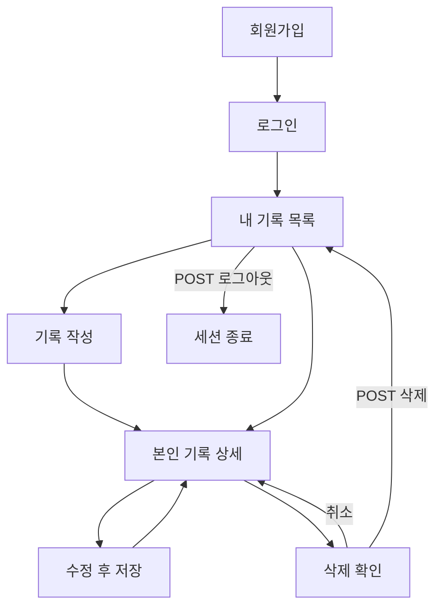
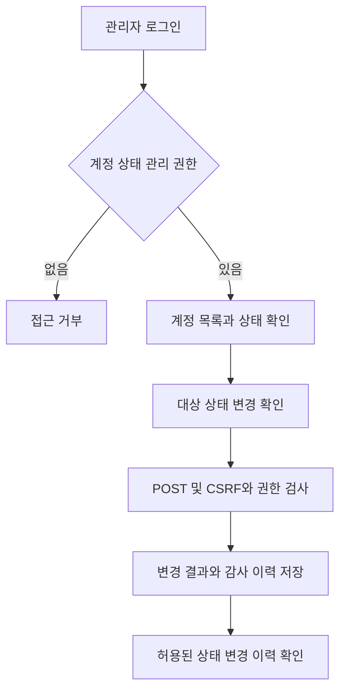
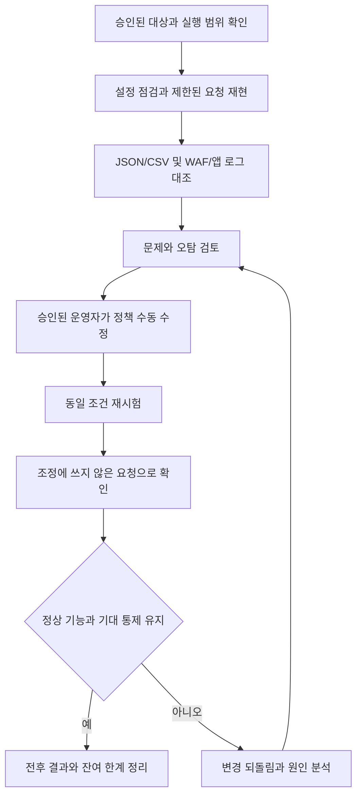
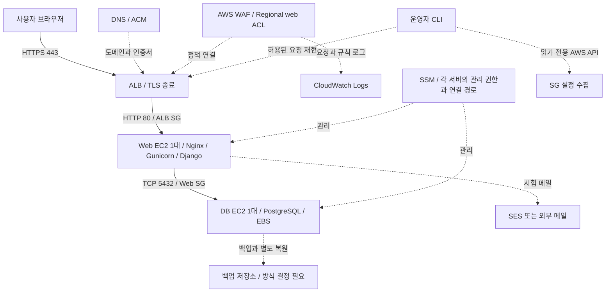
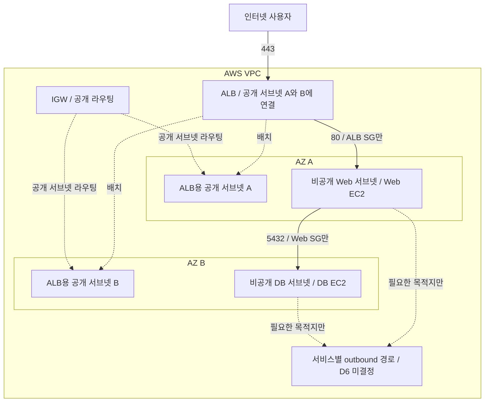
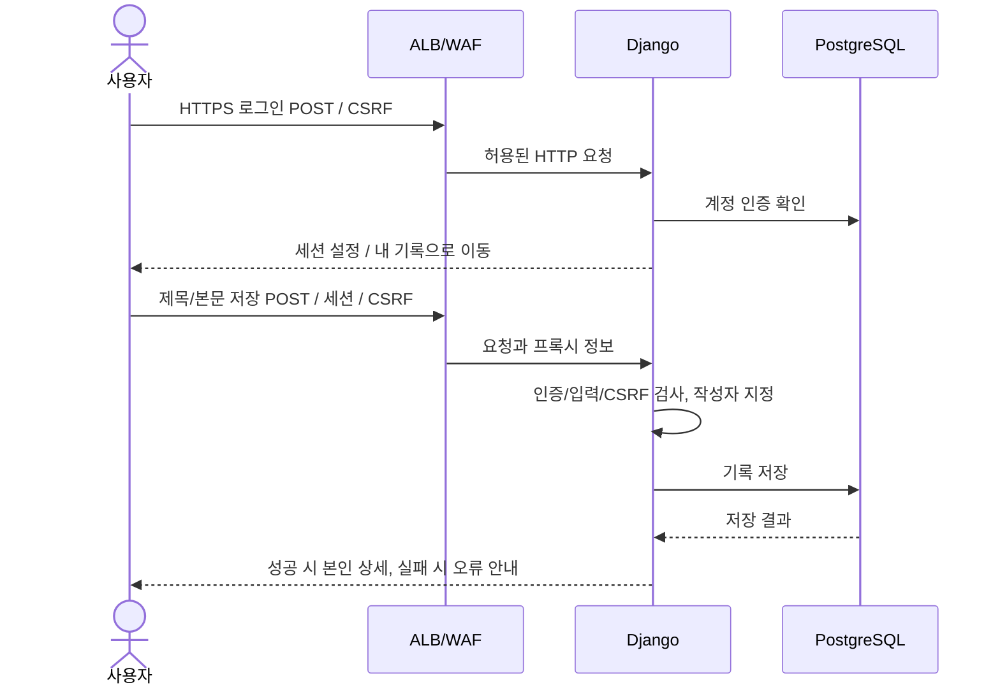
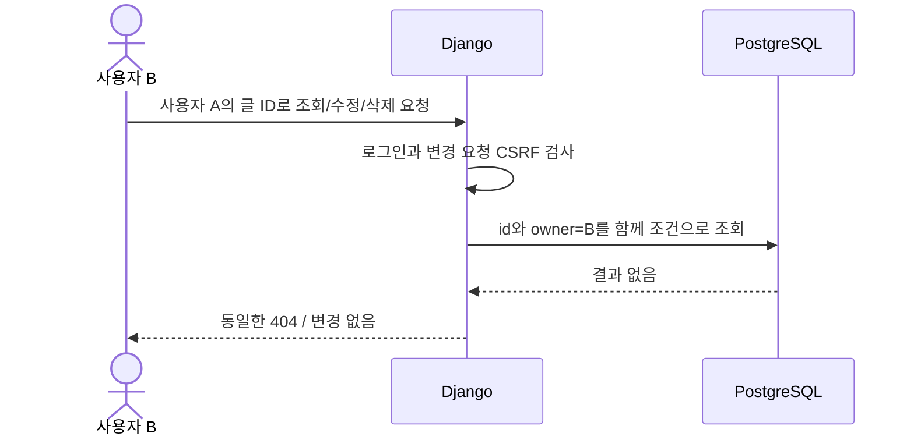

# Haven 기본 프로젝트 계획서

**프로젝트:** Haven | **팀:** ORCHESTRAION | **작성 기준:** 2026-11-05

**상태: 팀 검토용 구현 계획.** 아래 기능과 기술은 구축할 목표와 권고 설계다. 팀 합의나 구현 완료를 의미하지 않는다. 담당자, 날짜, 예산과 환경별 설정은 착수 전에 결정한다.

## 1. 프로젝트 개요

### 1.1 무엇을 만드는가

Haven은 **AWS 기반 개인 기록 서비스와 운영자용 보안 점검 도구를 함께 만드는 클라우드 보안 프로젝트**다. 사용자는 웹 화면에서 자신의 기록을 관리한다. 운영자는 클라우드 설정과 요청 처리 결과를 점검하고, 필요한 정책을 수정한 뒤 같은 조건에서 다시 시험한다.

서비스를 사용할 수 있게 만드는 일과 그 서비스의 보안을 검증하는 일을 하나의 구성으로 연결한다. 게시판은 가상의 보안 시험 페이지가 아니라 가입부터 기록 삭제까지 동작하는 최소 서비스로 구현한다. 점검 도구는 이 서비스에 사용한 설정과 정책을 재현 가능한 방법으로 확인하는 운영자용 CLI로 만든다.

| 결과물 | 사용 주체 | 제공할 기능 | 완료를 확인할 방법 |
|---|---|---|---|
| 개인 기록 웹 서비스 | 일반 회원 | 가입, 로그인, 본인 기록 작성/조회/수정/삭제 | 실제 웹 화면에서 사용 흐름 성공, 비로그인 및 타인 접근 거부 |
| 계정 운영 화면 | 승인된 앱 운영 관리자 | 계정 활성/비활성 관리와 변경 이력 확인 | 허용된 상태 변경만 성공, 기록 본문 열람 및 권한 상승 거부 |
| 설정 점검 CLI | 승인된 AWS 점검 운영자 | SG를 읽어 기대 접근 정책과 비교 | fixture 시험과 실제 설정 수동 대조, 실패와 미확정의 명시 |
| 요청 재현 CLI | 허가된 시험 운영자 | 정해진 정상/시험 요청 실행과 결과 정리 | 요청 ID로 WAF 로그와 앱 동작 대조, 동일 조건의 전후 비교 |
| 검증 자료 | 팀과 검토자 | 구성, 정책, 시험, 개선 이유와 잔여 한계 | 실행 ID와 버전으로 결과를 연결하고 시연 절차로 재현 |

### 1.2 기본 범위와 경계

기본 범위는 Web/DB 구축, IAM, 네트워크 통제, WAF와 정책 검증을 중심으로 도메인/메일, 최소권한 검토, 자체 SG 점검, 요청 재현을 연결하는 것이다. 시험에는 가상 계정과 가상 기록만 사용한다.

공개 글, 회원 간 기록 공유, 파일 업로드, 운영자용 웹 보안 대시보드, 실시간 탐지, 자동 정책 변경, 다중 고객 AWS 계정 연결은 기본 범위에 넣지 않는다. 심화 암호화와 PKI는 [심화 프로젝트 계획서](심화프로젝트_계획.md)로 분리한다. 서비스 명칭만으로 상용 보안 솔루션 수준의 탐지나 보호를 주장하지 않는다.

### 1.3 성공 기준

- 사용자가 화면에서 자신의 기록을 생성하고 다시 조회, 수정, 삭제할 수 있다.
- 요청의 글 ID나 작성자 값을 조작해도 타인의 기록을 읽거나 변경할 수 없다.
- 외부에서 ALB를 통한 정상 접속은 성공하고 Web/DB 직접 접속은 거부된다.
- 운영자는 설정 점검 결과의 근거를 확인하고 수집 실패를 정상으로 오인하지 않는다.
- WAF 정책 변경 전후를 같은 조건으로 비교하고 정상 기능 유지 여부까지 설명할 수 있다.
- 재시작 뒤 데이터가 유지되고 백업을 별도 DB에 복원해 실제 내용을 확인할 수 있다.

## 2. 사용자와 사용 흐름

### 2.1 세 가지 권한 영역

| 구분 | 허용할 작업 | 허용하지 않을 작업 |
|---|---|---|
| 일반 회원 | 본인 기록 CRUD, 본인 세션 종료 | 타인 기록, 계정 관리 화면, AWS 관리 |
| 앱 운영 관리자 | 지정된 계정의 활성/비활성 처리, 상태 변경 이력 확인 | 타인 기록 본문 조회, 비밀번호 변경, staff/superuser/그룹/권한 변경 |
| AWS 운영자/점검자 | 맡은 Role에 따른 구성 관리 또는 읽기 전용 점검 | 점검 Role의 설정 변경, 불필요한 리소스 접근 |
| DB 계정 | runtime은 앱 작업, migration은 스키마 변경 | 앱 runtime의 슈퍼유저 작업과 불필요한 DDL |

앱 운영 관리자는 최고권한 계정으로 운영하지 않는다. 복구용 최고권한은 일상 운영과 분리한다. 이 앱 권한 제한은 OS/DB 최고관리자도 원문을 볼 수 없다는 보장이 아니다.

### 2.2 일반 사용자 흐름



로그인하지 않은 사용자는 보호 화면에 접근하면 로그인 화면으로 이동한다. 타인의 기록 ID와 존재하지 않는 ID는 같은 404로 응답한다. 저장에 실패하면 성공 화면으로 이동하지 않고 입력과 오류를 보여준다. 비밀번호와 같은 민감한 입력은 오류 화면에 다시 표시하지 않는다.

### 2.3 계정 운영 흐름



운영 화면은 `/admin/accounts/`를 중심으로 제한된 전용 화면을 만든다. 기본 UserAdmin의 광범위한 수정 권한을 그대로 노출하지 않는다. 상태 변경 이력은 Django LogEntry를 재사용하되 행위자, 대상, 시각, 변경 전후 상태와 결과를 연결한다. 일반 사용자의 기록 본문은 운영 화면과 변경 이력에 표시하지 않는다.

### 2.4 보안 운영 흐름



점검 프로그램은 결과를 제시하고 설정을 자동 수정하지 않는다. 정책 수정 권한과 점검 권한은 분리한다.

## 3. 화면 구성과 UI 구현

### 3.1 화면별 기능

Django Templates로 서버가 HTML을 생성하고 최소 CSS로 공통 화면을 구성한다. 별도 SPA나 프론트엔드 서버를 두지 않는다.

| 화면 | 경로 | 표시/입력 | 동작과 검증 기준 |
|---|---|---|---|
| 회원가입 | `/accounts/signup/` | 아이디, 비밀번호, 확인 | 입력 검증, 중복 처리, 안전한 해시 저장, 계정 정보 과다 노출 완화 |
| 로그인 | `/accounts/login/` | 아이디, 비밀번호, 일반화된 오류 | 성공 시 내 기록으로 이동, 실패 제한과 회복, 세션 갱신 |
| 내 기록 목록 | `/posts/` | 본인 글 제목, 작성 시각, 페이지 이동 | 본인 데이터만 조회, 빈 목록 안내, 작성 화면 진입 |
| 기록 상세 | `/posts/{id}/` | 제목, 본문, 수정/삭제 진입 | 서버 소유권 검사, 안전한 본문 출력, 타인/없는 글 동일 404 |
| 기록 작성 | `/posts/new/` | 제목, 본문, 필드 오류 | POST+CSRF, 작성자는 로그인 세션에서 결정, 크기 초과 거부 |
| 기록 수정 | `/posts/{id}/edit/` | 기존 제목/본문과 오류 | 본인만 수정, 실패 시 비민감 입력 보존 |
| 삭제 확인 | `/posts/{id}/delete/` | 대상 제목, 삭제 확인, 취소 | GET은 확인만, POST에서 소유권과 CSRF 재검사 후 삭제 |
| 계정 관리/이력 | `/admin/accounts/`와 하위 경로 | 상태 목록, 허용된 변경과 이력 | 승인된 관리자만 사용, 권한 상승과 본문 접근 금지 |

로그아웃은 POST 요청으로 처리한다. `/healthz`는 상태 확인용 최소 응답이며 사용자 화면에 연결하지 않는다. 경로별 메서드와 응답은 [기본 구현 명세](docs/구현명세/기본프로젝트_구현명세.md)에 정의한다.

### 3.2 대표 화면 와이어프레임

다음은 정보 배치를 설명하는 초안이며 실제 구현은 공통 템플릿과 반응형 CSS로 구성한다.

```text
[내 기록 목록]
+--------------------------------------------------+
| Haven    내 기록                 사용자 / 로그아웃 |
+--------------------------------------------------+
| 내 기록                              [새 기록]   |
| 제목                          작성 시각          |
| 네트워크 실습 메모             YYYY-MM-DD HH:MM   |
| 정책 검증 준비                 YYYY-MM-DD HH:MM   |
|                                                  |
| 기록이 없으면: 첫 기록을 작성해 보세요.           |
|                   [이전] 1 / N [다음]            |
+--------------------------------------------------+

[기록 작성/수정]                [기록 상세]
+-------------------------+    +-------------------------+
| 제목 [                 ]|    | 제목                    |
| 본문 [                 ]|    | 작성/수정 시각          |
|      [                 ]|    | 안전하게 출력한 본문    |
| 오류: 해당 입력 아래 표시|    |                         |
| [저장] [취소]           |    | [수정] [삭제 확인] [목록]|
+-------------------------+    +-------------------------+

[계정 관리]
+--------------------------------------------------+
| Haven 계정 관리                     [변경 이력]   |
| 계정           현재 상태             허용 동작    |
| 가상 사용자 A  활성                  [비활성 확인]|
| 가상 사용자 B  비활성                [활성 확인]  |
| 기록 본문/비밀번호/권한 편집 기능은 제공하지 않음  |
+--------------------------------------------------+
```

### 3.3 공통 사용성 및 오류 처리

공통 탐색에는 내 기록, 현재 사용자, POST 로그아웃을 둔다. 관리자 메뉴는 권한에 따라 표시하지만 접근 허용 여부는 서버에서 다시 판단한다. 폼은 label과 입력을 연결하고 키보드만으로 입력, 저장, 취소가 가능하게 한다.

작은 화면에서는 목록을 세로로 읽을 수 있게 하고 버튼과 오류 문구가 잘리지 않도록 한다. 빈 목록, 잘못된 입력, 로그인 만료, 404, 저장 실패에 필요한 안내를 만든다. 오류 페이지에는 stack trace, DB 접속 정보, 세션, 내부 경로를 노출하지 않는다.

## 4. 시스템과 네트워크 구성

### 4.1 전체 시스템 구성도



실선은 서비스 요청, 점선은 관리/정책/보조 연결이다. WAF는 별도 프록시 서버가 아니라 ALB에 연결한 정책이다. ALB→Web은 기본안에서 HTTP이므로 전 구간 암호화로 설명하지 않는다. 내부 TLS와 인증서 검증은 심화에서 별도로 다룬다.

### 4.2 네트워크 배치도



AZ 배치는 권고안이며 CIDR, 실제 AZ, 리전은 착수 시 확정한다. ALB용 서브넷 두 개가 있다고 Web/DB까지 이중화되는 것은 아니다. 각 서버 1대 구성의 장애와 점검 중 중단 가능성을 인정한다.

### 4.3 접근 경계와 거부 시험

| 대상 | 인바운드 허용 기준 | 반드시 확인할 거부 |
|---|---|---|
| ALB SG | 외부 HTTPS 443, 필요 시 HTTP 80은 HTTPS 전환 | 불필요한 리스너와 관리 포트 |
| Web SG | ALB SG에서 TCP 80 | 인터넷 직접 접근, 허용하지 않은 서버 출발지 |
| DB SG | Web SG에서 TCP 5432 | 인터넷 및 비인가 서버의 DB 접속 |
| 관리 | SSM IAM과 outbound 연결 | 일반 계정의 관리 세션, 예외가 없는 22/3389 |

SG만 보고 실제 외부 도달 가능성을 단정하지 않는다. 공인 IP, 라우팅, NACL, listener와 서비스 상태까지 확인한다. NACL을 변경하는 선택 실습은 왕복 통신과 임시 포트를 별도 표로 정의한 뒤 진행한다.

### 4.4 비공개 서버의 출구 결정

| 목적지 | 필요한 작업 | 착수 시 확인할 내용 |
|---|---|---|
| SSM 관련 서비스 | Web/DB 관리 세션 | Agent, 서버별 인스턴스 프로파일, DNS, Endpoint 또는 인터넷 경로 |
| OS/Python 패키지 저장소 | 초기 설치와 보안 업데이트 | 두 서버의 다운로드 목적지, 프록시 또는 NAT 등 실제 경로 |
| 로그/AWS API | 로그 전달과 필요한 API | 서비스별 권한, Endpoint 지원, 비용과 보안 그룹 |
| 메일 서비스 | 앱 시험 메일 발송 | SES API/SMTP 또는 외부 서비스의 실제 목적지와 인증 |

NAT Gateway, NAT 인스턴스, VPC Endpoint를 목적지와 비용 기준으로 비교해 한 운영 구성을 선택한다. Interface Endpoint를 라우팅 next hop으로 그리거나 모든 인터넷 통신의 대체로 취급하지 않는다. 연결이 막히면 출구 설계를 수정하고 비공개 서버를 임시 공개해 진행하지 않는다.

## 5. 애플리케이션과 데이터 설계

Django auth와 세션을 재사용한다. 별도 인증 프레임워크나 중복 사용자/세션 테이블을 만들지 않는다. 사용자 모델의 기본/교체 여부는 첫 migration 전에 확정하며 기본 권고는 기존 User 재사용이다.

| 데이터 | 저장 내용 | 통제 |
|---|---|---|
| 사용자 | 인증에 필요한 최소 계정 정보와 활성 상태 | 프레임워크 비밀번호 해시, 비밀값 미출력 |
| Post | 작성자 참조, 제목, 본문, 생성/수정 시각 | 작성자는 서버 세션에서 지정, owner 조건으로 조회/변경 |
| 계정 관리 이력 | 행위자, 대상, 시각, 상태 변경과 결과 | Django LogEntry 재사용, 관리자 조회 제한, 본문/비밀번호 제외 |
| 앱 감사 로그 | 로그인 성공/실패, 인가 거부, 변경 결과 | UTC와 실행/요청 ID, 토큰/쿠키/원문 본문 미기록 |

기본에는 실제 개인정보를 수집하지 않는다. 메일 과업은 가상 시험 계정과 허가된 수신 대상으로 확인하고 이메일 인증을 가입 필수 기능으로 추가하지 않는다.

### 5.1 로그인부터 저장까지



### 5.2 타인 접근 거부



화면에서 버튼을 숨기는 것만으로 소유권 통제를 끝내지 않는다. HTML/스크립트는 실행하지 않고 안전하게 출력하며 ORM을 사용한다. 글 생성/수정의 전체 직렬화 요청 body는 8,192바이트 이하로 제한하는 권고를 두고 한국어, CSRF overhead, 경계값을 시험한다. 제목/본문 필드와 요청 전체의 제한을 구분한다.

## 6. 기술별 구현 계획

### 6.1 Django와 UI

**선행조건:** 사용자/관리자 권한표, 경로와 입력 규칙 확정. 로컬에서 PostgreSQL 연결 가능.

공통 레이아웃, 가입/로그인, 개인 기록 CRUD, 상태 관리 화면 순서로 만든다. 세션 만료와 Secure/HttpOnly/SameSite, POST+CSRF, owner 조회, ORM과 안전한 출력을 적용한다. 로그인 실패 횟수, 관찰창, 제한과 회복 값은 공개 전에 결정하고 영구 잠금을 피한다.

**검증/산출물:** 화면별 정상/실패 시험, CSRF 강제 검사, 타인 ID/author 조작, 로그인 제한 후 회복, 좁은 화면/키보드 사용 확인. 화면 흐름도, 와이어프레임, 앱 소스와 APP 시험 결과를 남긴다.

### 6.2 Nginx, Gunicorn과 운영 배포

**선행조건:** 로컬 앱과 DB 시험, Web SG와 관리 연결 준비.

고정 의존성과 venv, 비root 실행 계정, Gunicorn loopback, Nginx 요청 전달/정적 파일, systemd 기동을 구성한다. DEBUG, ALLOWED_HOSTS, CSRF origin, 신뢰할 프록시 경계와 비밀값 공급을 확인한다. 지원 버전과 패치 검토 책임은 착수 때 정한다.

**검증/산출물:** Django 배포 설정 점검, HTTPS 세션/CSRF, 서비스/서버 재시작 후 실제 로그인/저장/조회. health 응답만으로 DB 정상 판정을 하지 않는다. 배포 절차, 설정 가림본, DEP 결과를 남긴다. 이전 버전 복귀는 DB migration 호환을 확인한 경우만 수행한다.

### 6.3 PostgreSQL과 백업/복원

**선행조건:** 비공개 DB, Web→DB 연결, EBS와 저장 경로, runtime/migration 계정 기준.

PostgreSQL의 listener, pg_hba, 인증, SG를 일치시키고 앱이 슈퍼유저로 접속하지 않게 한다. 재시작과 데이터 유지 시험 후 가상 데이터 백업을 만들고 별도 DB로 복원한다. 저장 위치, 보존, 복원 권한과 삭제 조건은 운영 결정에 포함한다.

**검증/산출물:** Web CRUD, 무권한 출발지/계정 거부, runtime 관리 작업 거부, 재시작 영속성, 복원 후 기록 대조. 백업 생성만으로 완료하지 않는다. DB 설치/권한/복원 절차와 DB 시험 결과를 남긴다.

### 6.4 IAM과 SSM

**선행조건:** AWS 계정/교육 환경의 인증 제약과 작업별 역할 확정.

IAM 사용자/그룹/정책은 과제 실습으로 구성하고, 일상 운영 인증은 federation/Identity Center 등 임시 Role 기반 경로를 우선 비교한다. 환경 제약으로 개인 IAM을 쓰면 MFA와 예외 근거를 남긴다. 점검, 배포, Web 실행, DB 관리 권한을 분리한다. Web/DB 모두 SSM용 인스턴스 프로파일과 연결을 준비한다.

**검증/산출물:** 필요한 작업 성공과 불필요한 작업 거부, 일반 계정의 관리 세션 거부, SSM 실제 접속. 공유 키/소스 내 키/상시 root 사용을 피한다. 정책 JSON, 역할표, IAM 결과를 남긴다. `Resource:*`만 보고 과권한을 단정하지 않고 Action/Condition/지원 범위와 실제 동작을 검토한다.

### 6.5 DNS, ACM과 시험 메일

**선행조건:** 도메인 운영 주체, DNS 변경 권한, ALB, 메일 발송/수신 방식 확정.

DNS를 ALB에 연결하고 ACM 인증서와 HTTPS listener를 구성한다. HTTP를 열면 HTTPS 전환용으로 제한한다. SES 또는 외부 메일로 시험 메시지를 발송한다. 발송 API 성공과 실제 수신 확인을 구분하고 메일 실패를 서비스 전체 성공으로 기록하지 않는다.

**검증/산출물:** DNS 조회, 인증서 호스트/유효기간, HTTP/HTTPS 정책, 실제 브라우저 쿠키/CSRF, 메일 수신. EXT 결과와 설정 가림본을 남긴다.

### 6.6 WAF와 로그

**선행조건:** 기본 앱 정상 동작, 요청 집합, 로그 전달 권한/보존/마스킹 준비.

ALB Regional web ACL에 필요한 관리 규칙을 후보로 검토하고 Count로 시작한다. 정상 한국어/기호/코드 입력, SQLi/XSS 패턴, 빈도, 본문 크기 경계 요청을 구분한다. 규칙, priority, 예외, 비용/WCU와 변경 이유를 기록한 뒤 필요한 항목만 Block으로 전환한다.

**검증/산출물:** HTTP 상태뿐 아니라 요청 ID, 규칙/액션 로그, 앱 도달과 처리 결과를 대조한다. 정상 기능과 CSRF/소유권 검증은 별도 유지한다. 조정용 집합과 확인용 집합, 오탐 되돌림 조건을 정한다. 정책 가림본, WAF 결과, 전후 비교를 남긴다. 별도 IPS의 과제 요구/인정 조건은 미확인 사항으로 둔다.

## 7. 운영자용 도구

### 7.1 자체 설정 점검 CLI

구현 예정 진입점은 `scripts/network_audit.py`로 정한다. 현재 동작하는 프로그램이라는 뜻은 아니다. 승인된 profile/Role로 명시한 리전/VPC 또는 SG 목록을 읽고, 자산 역할별 기대 규칙과 비교한다. 입력에는 AWS 키를 넣지 않는다.

첫 버전의 대상은 SG다. IPv4/IPv6 공개, 관리/DB 포트, 전체 프로토콜, 범위 포트, ALB/Web SG 참조, 연결된 여러 SG의 허용 합집합을 검사한다. 전체 페이지를 수집하고 역할 미상, 권한 부족, API 실패를 구분한다. IAM 전체 정책 해석과 자동 수정은 넣지 않는다.

| 판정 | 의미 |
|---|---|
| PASS | 수집한 근거가 명시 기준을 만족 |
| FAIL | 명시 기준 위반 |
| UNKNOWN | 자산 역할이나 판단 근거 부족 |
| ERROR | 수집/API/실행 실패 |

JSON 상세와 CSV 요약에 실행 ID, UTC, 버전, 범위, 기대/실제, 판정과 근거를 남긴다. 정상/위반/오류 fixture를 먼저 통과하고 실제 설정을 수동 대조한다. CLI 옵션, 필드, 종료 코드는 기본 구현 명세에 고정한다.

### 7.2 요청 재현 CLI

구현 예정 진입점은 `scripts/request_verify.py`로 정한다. 승인된 대상 URL과 시험 집합에만 요청한다. 로그인 세션은 실행 시 안전하게 획득하고 비밀번호/토큰/쿠키를 출력물에 저장하지 않는다.

비로그인/본인/타인, 정상 한국어/기호 입력, CSRF, SQLi/XSS 패턴, 크기 경계, 별도 승인된 빈도 규칙을 구분한다. 요청 수, 속도, timeout과 전체 실행시간을 제한하고 TLS 검증을 유지한다. 허용하지 않은 외부 호스트로 리다이렉트를 따라가지 않는다.

요청별 예상/실제, HTTP 상태, 앱 결과, WAF 로그 대응을 기록한다. 판정은 정상/WAF/앱/네트워크/실행 오류/미확정으로 분리한다. 응답 403 또는 인증 실패 하나만으로 WAF 차단을 확정하지 않는다. 로그 도착 지연과 미확정은 별도로 남긴다.

### 7.3 기존 점검 도구와 결과 해석

Prowler는 승인된 읽기 범위의 AWS 설정 점검에, ZAP Baseline은 허가된 웹 대상 점검에 사용한다. 도구 버전, 권한, 도달 페이지, 인증 여부와 실행 오류를 남긴다. 경고를 실제 문제/미적용/오탐/추가 확인으로 검토하고 필요한 부분만 수정한다.

Lynis와 pip-audit은 해당 호스트/의존성 검토에 필요한 범위에서 사용한다. IaC나 컨테이너가 없는 단계에 Checkov/Trivy를 추가하지 않는다. ZAP Baseline만으로 전체 앱의 인증/인가 검증을 완료했다고 설명하지 않는다.

## 8. 검증과 개선 절차

### 8.1 시험 층위

| 층위 | 주요 확인 | 증거의 한계 |
|---|---|---|
| 로컬 앱/fixture | 권한, CSRF, 입력, SG 판정과 오류 처리 | 실제 AWS 도달성과 ALB 쿠키 동작 증명 아님 |
| PR CI | 구현된 앱 시험, fixture, Django 점검, 의존성 점검 | 운영 배포/외부 접속 성공 증명 아님 |
| AWS 통합 | IAM, SSM, 네트워크, 실제 앱/DB, HTTPS/메일 | 설정 수집과 실제 기능 결과를 함께 기록 |
| 정책 전후 | WAF/권한 변경 효과, 오탐과 회귀 | 정해진 시험 집합 결과이며 전체 공격 방어율 아님 |
| 복구/운영 | 재시작, 백업 복원, 변경 되돌림 | 파일 생성/health 응답만으로 복구 완료 판정 금지 |

### 8.2 정책 개선의 순서

fixture 시험 → 실제 설정 수동 대조 → 정상/시험 요청 기준선 → Count 로그 대조 → 필요한 정책 변경 → 같은 요청/인증/속도/앱 버전 재시험 → 확인용 집합 → 정상 기능 회귀와 잔여 한계 정리 순으로 진행한다. 오탐이나 기능 실패가 생기면 변경을 되돌리고 원인을 분석한다.

정상 요청 오탐과 시험 요청 차단은 WAF 판정 가능한 요청을 분모로 계산한다. 전체 수, 판정 가능 수, UNKNOWN/ERROR 수와 제외 사유를 함께 남긴다. 분모 0은 N/A로 표시한다. 규칙 변경 외 조건이 달라지면 직접적인 개선율로 비교하지 않는다.

### 8.3 증거와 공개 기준

실행 ID로 환경/코드/도구 버전, 정책, 시험 요청, 로그 대응, 결과를 연결한다. 세션, 쿠키, 비밀번호, 실제 개인정보, 전체 공격 본문은 공개하지 않는다. WAF 필드 마스킹과 sampled requests 노출은 따로 확인한다.

원본과 공개용 가림본을 분리한다. 계정 ID/ARN/호스트 등 식별자는 필요한 범위만 공개한다. 스캐너 경고 수, 실제 확인한 문제 수, 미확정 수를 구분한다.

## 9. 추진 단계와 작업 완료 기준

| 단계 | 입력/의존성 | 수행 작업 | 실패 시 조치 | 완료 기준/산출물 |
|---|---|---|---|---|
| M0 설계 | 과업과 팀 제약 | 화면/권한/구성/출구/비용/운영 인증 결정 | 미결정에 의존한 AWS 생성 보류 | 결정표, 와이어프레임, 네트워크/접근표, 예산/종료 계획 |
| M1 로컬 서비스 | 화면/권한 계약, 로컬 DB | Templates, 인증, 개인 CRUD, 최소 관리자, 초기 CI | 실패 경로와 소유권 원인 수정 | UI 전체 흐름, APP/fixture, Django 점검 결과 |
| M2 AWS 통합 | IAM/네트워크/관리 경로, 앱 | DB, 배포, ALB, HTTPS, 메일, 복원 | 출구/SG/배포 원인 분리, 필요 시 결정 재검토 | IAM/NET/DB/DEP/EXT 결과, 실제 접속/거부/복원 |
| M3 점검 도구 | 기대 접근표, 서비스 기준선 | SG CLI, fixture/실제 대조, 재현 CLI, Count | ERROR/UNKNOWN 분리, 원인 없는 PASS 금지 | AUD와 요청/로그 대응, 최초 점검 결과 |
| M4 정책 개선 | 기준선과 변경 근거 | 최소권한/WAF 수정, 같은 조건 재시험 | 정상 회귀 시 되돌림과 원인 분석 | 전후 비교, 확인용 집합, 정상 기능 유지 |
| M5 제출 준비 | 과업별 결과 | 구성/운영/시연/가림본/비용/종료 정리 | 증거 없는 항목을 미완료로 남김 | 과업 대응표, 시연, 잔여 한계, 보존/종료 절차 |

로컬 앱, IAM 정책 초안, 네트워크 설계와 fixture 준비는 병렬로 진행한다. 실제 AWS 통합은 선행 연결과 권한이 확인된 뒤 수행한다. 담당과 일정은 M0에서 채우고 일별 계획을 임의로 배정하지 않는다.

### 9.1 협업과 최소 PR 검사

작업별 변경 범위와 기대 시험을 PR에 적는다. M1부터 구현된 앱 시험과 SG fixture를 검사하고 Django 설정, pip-audit 등으로 확장한다. Action 버전/권한을 검토하고 외부 PR에 운영 Secret을 제공하지 않는다. 기본 CI와 AWS 자동 배포는 분리한다.

보안 요구는 앱 기능과 연결되는 소수 항목부터 버전과 시험 ID로 매핑한다. 표준 전체 준수를 주장하지 않는다. 변경된 포트/DB/프레임워크가 있으면 SG, 점검 기준, 시험, 문서를 함께 수정한다.

### 9.2 비용과 운영

리전, EC2/EBS, ALB, public IPv4, NAT/Endpoint, WAF, 로그, 메일, 도메인과 백업의 비용 항목을 산정한다. 무료 제공을 전제하지 않고 예산 한도, 알림, 보존 기간과 자원 종료 책임을 정한다.

비밀값은 소스/Git/시험 결과와 분리한다. 업데이트 담당과 패치 검토 주기를 정하고 앱/배포 회귀 시험 후 반영한다. 로그 오류, 디스크 부족, 메일 실패, 비정상 기동은 원인과 영향에 따라 기록하고 조치한다. 종료 전 데이터/증거 보존과 백업 복원 의존성을 확인한 뒤 자원 삭제 절차를 수행한다.

## 10. 기본 필수/선택과 예정 산출물

B/C는 이 계획의 내부 추적 번호다. 공식 과제 원문과 선택 인정 조건을 이번 작업에서 재대조하지 않았으며 별도 IPS 요구 등은 착수 확인 사항이다. 아래는 완료 표시가 아닌 구현/검증 목표다.

| 구분 | 구현 | 검증 | 예정 산출물 |
|---|---|---|---|
| B1 클라우드 서비스 | EC2 Web/DB, UI와 개인 CRUD | APP/DB/DEP, 재시작/복원 | 구축 결과서, 인프라 구성도, 동작 자료 |
| B2 IAM 관리 | 사용자/그룹/정책 실습, 역할/MFA | IAM 허용/거부, 운영 인증 | 정책 JSON, 역할표, 권한 관리 결과서 |
| B3 네트워크 | VPC/서브넷/SG/라우팅/관리 | 정상 경로, 우회/DB/관리 거부 | 네트워크 구성도, 정책/접속 결과 |
| B4 보안 정책 | WAF 연결/로그/기본 정책 | 요청/규칙/액션 대조 | 보안 장비/정책 구성 결과서 |
| C1 외부 서비스 | DNS/HTTPS/메일 | EXT, 브라우저와 실제 수신 | 인증서/접속/메일 결과 |
| C2 최소권한 점검 | 권한 검토/필요 변경 | 정책 전후 허용/거부 | 변경 근거, IAM diff/재시험 |
| C3 자체 점검 | 읽기 전용 SG CLI | AUD fixture/실제 대조/오류 | 소스, JSON/CSV, 시험 결과 |
| C4 정책 개선 | 재현 CLI와 WAF 조정 | 같은 조건 전후/확인용/회귀 | 규칙 변경, 오탐/차단/UNKNOWN 비교 |

시연 순서는 사용자 UI 기능 → 타인 접근 거부 → 설정 점검 결과 → WAF/정책 개선 결과로 정한다. 실시간으로 재현할 부분과 미리 수집한 실행 결과를 보여줄 부분은 구분한다.

## 11. 착수 전에 결정할 사항

| 결정 | 권고/현재 상태 | 확정 전에 확인할 내용 |
|---|---|---|
| 서비스 | 개인 기록, 최소 계정 관리 | 공유/파일 없이 기본 범위 합의 |
| 스택/DB | Django/Nginx/Gunicorn, 별도 EC2 PostgreSQL | 숙련도, 설치 지원, DB 직접 구축 조건, RDS 대안 여부 |
| 계정/리전/주소 | 미정 | 교육 환경 제약, CIDR 중복, AZ/가용 자원 |
| 출구 D6 | 미정 | 목적지별 실제 연결, 비용과 관리 부담 |
| 운영 인증 | 임시 Role 우선 비교 | IAM 실습과 운영 분리, MFA/SSM 제약 |
| 외부 서비스 | DNS/ACM, SES 또는 외부 메일 | 도메인 소유/권한, 발송 조건과 수신 대상 |
| 로그인 방어 | 공개 전에 수치 확정 | 횟수/관찰창/회복/계정 열거/분산 실패 시험 |
| WAF/로그 | Count 우선, CloudWatch Logs | 규칙/WCU/비용, 보존/마스킹/지연, IPS 인정 조건 |
| 운영/제출 | 미정 | 담당/날짜/예산, 백업 보존/종료, 공식 산출물 조건 |

기술을 바꾸면 호출 경로, 포트, 점검 기준과 시험을 함께 갱신한다. 결정 전의 후보를 동시에 구축할 필수 항목으로 적지 않는다.

## 12. 관련 문서

- [기본 구현 명세](docs/구현명세/기본프로젝트_구현명세.md): 화면/권한 계약, CLI 인터페이스, 설정 기준과 상세 시험.
- [심화 프로젝트 계획서](심화프로젝트_계획.md): 기본 서비스에 추가할 암호화/키 관리/PKI와 통합 검증.
- [심화 구현 명세](docs/구현명세/심화프로젝트_구현명세.md): 심화의 데이터/키/인증서/복원 계약.
- [선택 근거 부록](통합프로젝트_선택근거_부록.md): 기존 제안 비교 참고자료. 본 계획서의 현재 구조와 구분해 읽는다.

README와 PPT는 이 계획서 검토 후 순서대로 갱신한다.
