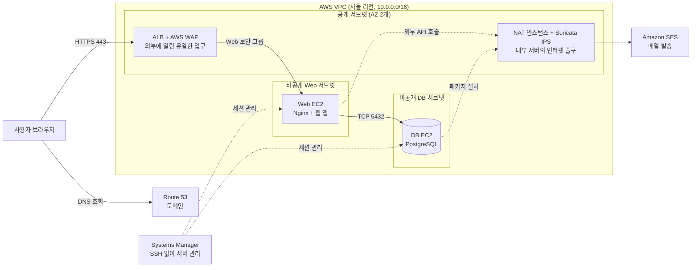
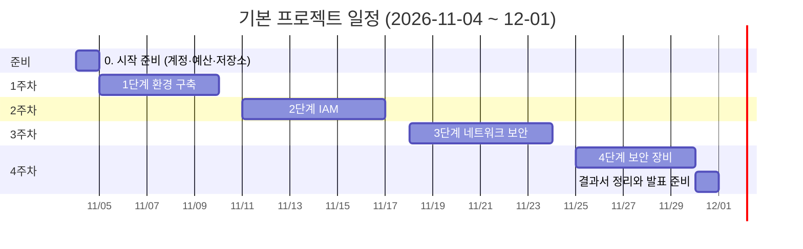

# 기본 프로젝트 계획서: AWS 클라우드 보안 구성 + IAM 접근 통제

---

## 목차

1. [한눈에 보기](#1-한눈에-보기)
2. [확정이 필요한 항목](#2-확정이-필요한-항목)
3. [전체 일정](#3-전체-일정)
4. [0단계: 시작 준비](#4-0단계-시작-준비-114--115)
5. [1단계: 클라우드 환경 구축 및 서비스 확장](#5-1단계-클라우드-환경-구축-및-서비스-확장-1주차)
6. [2단계: IAM 사용자 및 권한 관리](#6-2단계-iam-사용자-및-권한-관리-2주차)
7. [3단계: 네트워크 보안 설정 및 접근 통제](#7-3단계-네트워크-보안-설정-및-접근-통제-3주차)
8. [4단계: 보안 장비 구축 및 정책 고도화](#8-4단계-보안-장비-구축-및-정책-고도화-4주차)
9. [마무리](#9-마무리-1130--121)
10. [팀 작업 규칙](#10-팀-작업-규칙)
11. [용어 정리](#11-용어-정리)

---

## 1. 한눈에 보기

### 우리가 만드는 것

**작은 회원제 게시판 하나를 AWS에 올리고, 그 위에 보안을 단계별로 한 겹씩 쌓습니다.**
서비스 자체보다 "보안을 어떻게 구성하고 검증했는가"가 평가의 핵심입니다. 그래서 웹 서비스는 화면 5개로 작게 유지합니다.

| 화면 | 기능 | 이 화면으로 보여줄 보안 |
| --- | --- | --- |
| 회원가입 | 이메일, 비밀번호, 전화번호 입력 | 비밀번호 해시 저장, 인증 메일 |
| 로그인 | 로그인, 로그아웃 | 세션 관리, 무차별 대입 차단 |
| 내 정보 | 내 정보 조회와 수정 | 다른 사람 정보 접근 차단 |
| 게시판 | 글 목록, 글쓰기 | SQL 인젝션, XSS 방어 |
| 관리자 페이지 | 회원 목록 | 권한 분리, 비인가 접근 차단 |

### 전체 구성



**핵심 원칙 세 가지**

1. **외부에는 ALB 하나만 연다.** Web과 DB 서버에는 공인 IP를 주지 않습니다.
2. **서버 접속에 SSH(22번 포트)를 쓰지 않는다.** 모든 접속은 Systems Manager의 Session Manager로 합니다.
3. **모든 작업은 증거를 남긴다.** 설정 화면, 테스트 결과를 캡처해 `docs/evidence/`에 모읍니다.

### 기술 스택

| 구분 | 사용 기술 | 상태 |
| --- | --- | --- |
| 클라우드 | AWS 서울 리전 (ap-northeast-2) | 확정 |
| 서버 OS | Ubuntu 24.04 LTS | 확정 |
| DB | PostgreSQL 16 | 확정 |
| 웹 서버 | Nginx | 확정 |
| 웹 프레임워크 | Django 또는 FastAPI | **확정 필요** (아래 2장) |
| 인터넷 출구 | NAT 인스턴스 + Suricata IPS (안) | **확정 필요** (아래 2장) |
| 코드와 문서 관리 | GitHub 비공개 저장소 | 확정 |

### 서브넷 계획 (안)

| 서브넷 | CIDR | AZ | 들어가는 것 |
| --- | --- | --- | --- |
| public-a | 10.0.1.0/24 | ap-northeast-2a | ALB, NAT 인스턴스 |
| public-c | 10.0.2.0/24 | ap-northeast-2c | ALB (ALB는 AZ 2개 필요) |
| private-web-a | 10.0.11.0/24 | ap-northeast-2a | Web EC2 |
| private-db-a | 10.0.21.0/24 | ap-northeast-2a | DB EC2 |

Web과 DB의 서브넷을 나누면 3단계에서 계층별 NACL을 따로 걸 수 있습니다.

---

## 2. 확정이 필요한 항목

각자 조사한 내용을 이 문서의 이슈나 PR 댓글로 공유하고, 기한 회의에서 확정합니다. 확정되면 "결정" 칸을 채우고 상태를 바꿉니다.

| 번호 | 항목 | 선택지 | 현재 추천 | 기한 | 결정 |
| --- | --- | --- | --- | --- | --- |
| D1 | 웹 프레임워크 | Django / FastAPI | **Django**: 로그인, 관리자 화면, CSRF 방어, 비밀번호 해시가 기본 내장이라 보안 기능을 직접 만들 일이 적음 | 11/5 | |
| D2 | Web, DB의 인터넷 출구 | NAT 인스턴스 / NAT Gateway / VPC 엔드포인트 | **NAT 인스턴스**: 가장 저렴하고, 4단계 IPS를 같은 서버에 올릴 수 있음. NAT Gateway는 월 약 6만원, SSM용 엔드포인트는 월 3만원 이상 | 11/5 | |
| D3 | ALB → Web 구간 | HTTP 80 / HTTPS 443 | **HTTP 80으로 시작**, 여유가 있으면 4단계에서 HTTPS로 강화 | 11/24 | |
| D4 | WAF 로그 저장 위치 | CloudWatch Logs / S3 | **S3**: 저렴하고 보관이 쉬움 | 11/24 | |
| D5 | 도메인 구매처와 주소 | 가비아 등 | 첫해 저렴한 도메인(.xyz 등) | 11/6 | |
| D6 | 단계별 리드 담당자 | 6명 배정 | 아래 표 참고 | 11/5 | |

**단계별 리드 (D6, 이름 채우기)**

| 영역 | 리드 | 함께하는 사람 |
| --- | --- | --- |
| 일정, 문서, 예산 | | |
| 네트워크(VPC, 보안 그룹, NACL) | | |
| 웹 서비스 개발 | | |
| DB와 데이터 보호 | | |
| IAM과 점검 스크립트 | | |
| 보안 장비(WAF, IPS, 탐지) | | |

리드는 그 영역을 책임지고 진행하는 사람이며, 작업은 모두 함께 합니다.

---

## 3. 전체 일정



| 기간 | 단계 | 이 주의 목표 |
| --- | --- | --- |
| 11/4 ~ 11/5 | 0. 시작 준비 | 계정 보안, 예산 경보, 저장소 |
| 11/5 ~ 11/10 | 1단계 | 인터넷에서 접속되는 게시판 완성 |
| 11/11 ~ 11/17 | 2단계 | 팀원마다 필요한 권한만 갖기 |
| 11/18 ~ 11/24 | 3단계 | 열려야 할 문만 열고 나머지는 닫기 |
| 11/25 ~ 11/30 | 4단계 | 공격을 막고, 탐지하고, 자동으로 대응하기 |
| 11/30 ~ 12/1 | 마무리 | 결과서, 발표, 리소스 정리 |

다음 단계 리드는 앞 단계가 진행되는 동안 미리 설계를 시작합니다. 예를 들어 IAM 리드는 1주차부터 권한 정책 초안을 씁니다.

---

## 4. 0단계: 시작 준비 (11/4 ~ 11/5)

**목표**: 리소스를 만들기 전에 계정을 안전하게 하고, 비용 사고를 막을 장치를 먼저 둡니다.

- [ ] 루트 계정에 MFA를 등록하고, 루트 액세스 키가 있으면 삭제합니다. 루트 계정은 팀장만 보관합니다.
- [ ] 팀원별 개인 IAM 사용자를 만들고 MFA를 등록합니다. (정식 권한 설계는 2단계)
- [ ] AWS Budgets로 월 20만원 예산을 만들고 5만, 10만, 15만원에서 메일 경보가 오게 합니다.
- [ ] 밤 11시에 `AutoStop=true` 태그가 달린 EC2를 자동으로 끄는 스케줄을 겁니다.
- [ ] GitHub 비공개 저장소를 만들고 아래 폴더 구조와 `.gitignore`로 첫 커밋을 합니다.

```text
repo/
├── docs/
│   ├── plan.md                 # 이 문서
│   ├── meetings/               # 회의록 (예: 1104.md)
│   └── evidence/               # 캡처와 로그 (예: 20261106_vpc/)
├── app/                        # 웹 서비스 소스
├── infra/                      # Terraform 또는 설정 파일
└── scripts/                    # 점검 스크립트
```

`.gitignore`에는 최소한 `*.pem`, `*.key`, `.env`, `*.tfstate*`를 넣습니다. 비밀번호, 키, 실제 계정 ID는 절대 커밋하지 않습니다.

**완료 기준**: 예산 경보 3개 설정 화면, 자동 중지 테스트 결과, 저장소 첫 커밋

---

## 5. 1단계: 클라우드 환경 구축 및 서비스 확장 (1주차)

**목표**: 인터넷에서 도메인으로 접속되는 회원제 게시판을 만듭니다.

**과제 원문**
- 필수: AWS EC2를 활용하여 클라우드 서버를 구축하고, Web 및 DB 서비스를 구성하여 클라우드 기반 서비스 운영 환경을 구현한다.
- 도전: 도메인을 연결하고 메일, DNS 등 외부 서비스를 연동하여 클라우드 서비스의 접근 및 운영 환경을 확장한다.

### 필수

- [ ] **VPC 만들기**: 위의 서브넷 계획대로 공개 2개, 비공개 2개 서브넷과 라우팅을 만듭니다.
- [ ] **NAT 인스턴스**: 공개 서브넷에 작은 서버(t4g.nano)를 두고 비공개 서버의 인터넷 출구로 설정합니다. (D2 확정 후)
- [ ] **공통 서버 설정**: 모든 EC2에 메타데이터 v2 필수(IMDSv2), 디스크 암호화, Session Manager용 역할, 태그를 적용합니다.
- [ ] **DB 서버**: 비공개 DB 서브넷에 PostgreSQL을 설치하고, 웹 앱 전용 계정과 회원, 게시글 테이블을 만듭니다.
- [ ] **Web 서버**: 비공개 Web 서브넷에 Nginx와 웹 앱을 올리고 화면 5개를 구현합니다. (D1 확정 후)
- [ ] **ALB 연결**: 공개 서브넷 2개에 ALB를 만들고 Web 서버를 대상으로 등록합니다.
- [ ] **동작 확인과 구성도**: 회원가입 → DB 저장 → 로그인 → 관리자 페이지 차단까지 캡처하고, 인프라 구성도를 그립니다.

### 도전

- [ ] **도메인 연결**: 도메인을 사서 Route 53에 연결하고, ACM 인증서로 HTTPS를 적용합니다. HTTP는 HTTPS로 넘어가게 합니다.
- [ ] **메일 연동**: SES에서 도메인을 인증하고 SPF, DKIM, DMARC 레코드를 등록한 뒤 회원가입 인증 메일을 보냅니다. (EC2는 25번 포트가 막혀 있으므로 SES API를 씁니다.)

### 제출 결과물

| 구분 | 결과물 |
| --- | --- |
| 필수 | 클라우드 환경 구축 결과서, AWS 인프라 구성도, 서비스 동작 확인 자료 |
| 도전 | 클라우드 서비스 확장 결과서, 도메인 및 외부 서비스 연동 테스트 자료 |

### 이 단계에서 확인할 것
- 외부에서 Web, DB 서버에 직접 접속할 수 없는가? (ALB로만 들어와야 함)
- 받은 인증 메일 헤더에 `spf=pass`, `dkim=pass`, `dmarc=pass`가 찍히는가?

---

## 6. 2단계: IAM 사용자 및 권한 관리 (2주차)

**목표**: 팀원마다 자기 일에 필요한 권한만 갖게 합니다.

**과제 원문**
- 필수: AWS IAM 사용자와 그룹을 생성하고, 정책을 적용하여 사용자별 접근 권한 및 클라우드 리소스 관리 환경을 구성한다.
- 도전: 최소 권한 원칙을 적용하여 안전한 클라우드 접근 통제 환경을 구축하고, 과도한 권한 및 불필요한 접근 권한을 점검한다.

### 필수

- [ ] **그룹 4개 만들기**

    | 그룹 | 할 수 있는 일 |
    | --- | --- |
    | 관리자 | 전체 관리 (MFA 로그인 시에만) |
    | Web 운영 | `Role=web` 태그가 붙은 서버만 시작, 중지, 접속 |
    | DB 운영 | `Role=db` 태그가 붙은 서버만 시작, 중지, 접속 |
    | 감사 | 조회와 점검만 (변경 불가) |

- [ ] **팀원 배정**: 각 팀원을 역할에 맞는 그룹에 넣습니다.
- [ ] **공통 규칙 정책**: 모든 그룹에 아래 세 가지를 적용합니다.
    - MFA 없이 로그인하면 MFA 등록 외에는 아무것도 못 함
    - 서울 리전 외에는 리소스를 만들 수 없음
    - 작은 서버(t3.small 이하 등)만 만들 수 있음
- [ ] **서버 역할**: 서버에는 액세스 키를 두지 않고 IAM 역할(Role)로 필요한 권한만 줍니다. 예: Web 서버는 Session Manager와 SES 발송만.
- [ ] **권한 테스트**: 아래 형식의 표로 사용자별 허용과 거부를 테스트하고 캡처합니다.

    | 사용자 | 그룹 | 시도한 작업 | 대상 | 기대 결과 | 실제 결과 |
    | --- | --- | --- | --- | --- | --- |
    | 예: user-web | Web 운영 | 서버 중지 | DB 서버 | 거부 | |

### 도전

- [ ] 일부러 과한 권한을 만듭니다. (예: 개발자에게 전체 관리자 권한, MFA 없는 사용자, 쓰지 않는 액세스 키)
- [ ] IAM 자격 증명 보고서, 마지막 접근 정보, IAM Access Analyzer, Prowler로 문제를 찾아냅니다.
- [ ] 최소 권한으로 고치고, 개선 전후를 비교합니다.

### 제출 결과물

| 구분 | 결과물 |
| --- | --- |
| 필수 | IAM 사용자 및 권한 관리 결과서, IAM 정책 구성 및 적용 자료 |
| 도전 | 클라우드 접근 통제 정책서, IAM 권한 점검 및 개선 결과 보고서 |

### 이 단계에서 확인할 것
- 루트 계정을 일상 작업에 쓰는 사람이 없는가?
- "Web 운영" 사용자로 DB 서버를 끌 수 없는가?

---

## 7. 3단계: 네트워크 보안 설정 및 접근 통제 (3주차)

**목표**: 열려야 할 문만 열고, 나머지는 모두 닫습니다.

**과제 원문**
- 필수: VPC, 서브넷, 보안 그룹 및 네트워크 접근 설정을 구성하고, 클라우드 서비스에 대한 외부 및 내부 접근 통제 환경을 구축한다.
- 도전: 보안 그룹 및 네트워크 설정을 점검하여 불필요하게 허용된 외부 접근과 개방 포트를 자동으로 확인하는 기능을 구현한다.

### 필수

- [ ] **접근 허용표 작성**: 어디에서 어디로, 어떤 포트를 허용하는지 먼저 표로 정합니다.

    | 출발 | 도착 | 포트 | 이유 |
    | --- | --- | --- | --- |
    | 인터넷 | ALB | 443, 80 | 웹 접속 (80은 443으로 전환) |
    | ALB | Web | 80 (또는 443) | 웹 요청 전달 |
    | Web | DB | 5432 | DB 조회 |
    | Web, DB | NAT | 80, 443 | 패키지 설치, 외부 API |
    | 그 외 | 전부 | 전부 | 거부 |

- [ ] **보안 그룹 정리**: IP 대신 "다른 보안 그룹"을 출발지로 지정합니다. (예: DB는 Web 보안 그룹에서 오는 5432만 허용)
- [ ] **NACL 설정**: 서브넷 단위로 한 번 더 막습니다. 보안 그룹(응답 자동 허용)과 NACL(응답도 직접 허용해야 함)의 차이를 테스트로 보여줍니다.
- [ ] **SSH 폐쇄**: 모든 보안 그룹에서 22번을 없애고 Session Manager로만 접속합니다. 세션 기록은 로그로 남깁니다.
- [ ] **VPC Flow Logs**: 네트워크 기록을 S3에 모으고, 차단된(REJECT) 접속 시도를 확인합니다.
- [ ] **비밀번호 보관**: DB 비밀번호를 코드나 설정 파일 대신 Secrets Manager에 저장합니다.
- [ ] **접속 테스트와 구성도**: 우리 리소스만 대상으로 외부와 내부에서 접속을 시도해 결과를 캡처하고, 네트워크 보안 구성도를 그립니다.

### 도전

- [ ] Python(boto3)으로 보안 그룹과 NACL을 읽어 "인터넷 전체(0.0.0.0/0, ::/0)에 열린 포트"와 "위험 포트(22, 3389, 5432 등)"를 찾는 점검 스크립트를 만듭니다.
- [ ] 일부러 위험한 규칙을 열어 스크립트가 찾아내는지 확인하고, 조치 후 다시 점검합니다.

### 제출 결과물

| 구분 | 결과물 |
| --- | --- |
| 필수 | 클라우드 네트워크 보안 구성도, 네트워크 접근 통제 설정 결과서 |
| 도전 | 네트워크 자동 점검 스크립트, 외부 접근 설정 점검 및 검증 결과 보고서 |

### 이 단계에서 확인할 것
- 인터넷에서 22번, 5432번으로 접속이 되지 않는가?
- NAT 서버에서 DB 5432로 접속이 되지 않는가? (Web만 가능해야 함)

---

## 8. 4단계: 보안 장비 구축 및 정책 고도화 (4주차)

**목표**: 공격을 막고(WAF, IPS), 탐지하고(GuardDuty), 자동으로 대응합니다.

**과제 원문**
- 필수: 클라우드 환경에 보안 장비(WAF, IPS 등) 및 서비스를 적용하고, 네트워크와 서버에 대한 보안 정책 및 접근 통제 기능을 구성한다.
- 도전: 클라우드 보안 정책과 장비 설정을 분석하고, 보안 취약 요소에 대한 개선 및 추가 보안 기능을 적용하여 보안 수준을 향상한다.

### 필수

- [ ] **탐지와 감사 켜기**: CloudTrail(누가 무엇을 했는지 기록), GuardDuty(위협 탐지), Security Hub(보안 점수)를 켭니다. 첫날 점수를 캡처해 개선 전 기준으로 삼습니다.
    - GuardDuty와 Security Hub는 30일 무료 평가판이 있으므로 이 주에 켜야 비용이 들지 않습니다.
- [ ] **WAF**: ALB에 AWS WAF를 연결하고 관리형 규칙(SQL 인젝션, XSS, 알려진 악성 IP)과 요청 수 제한 규칙을 넣습니다. 처음에는 "카운트(관찰)" 모드로 확인한 뒤 "차단"으로 바꿉니다.
- [ ] **WAF 차단 테스트**: 우리 도메인만 대상으로 SQL 인젝션, XSS, 과다 요청을 보내 차단되는지 확인합니다.
- [ ] **IPS**: NAT 인스턴스(t4g.small로 확장)에 Suricata를 IPS 모드로 설치해, 비공개 서버에서 나가는 트래픽 중 위험한 것을 차단합니다.
- [ ] **자동 대응**: GuardDuty가 위협을 찾으면 공격 IP를 WAF 차단 목록에 자동 추가하고 메일로 알리게 합니다. (EventBridge + Lambda + SNS)
- [ ] **결과서 작성**: 장비별 구성, 정책, 탐지 및 차단 결과를 정리합니다.

### 도전

- [ ] Prowler, Security Hub, Lynis(서버 내부 점검), ZAP(웹 점검), pip-audit(라이브러리 취약점) 결과를 모아 "위험도, 원인, 조치, 결과" 표로 정리합니다.
- [ ] 찾은 문제를 고치고 같은 점검을 다시 돌려, 개선 전후 점수와 결과를 비교합니다.

### 공격 테스트 원칙
- 우리 팀 도메인과 리소스만 대상으로 합니다.
- 실제 데이터를 지우거나 바꾸는 공격, 서비스를 마비시키는 공격은 하지 않습니다.
- "403 응답이 왔다"만으로 WAF 차단이라 판단하지 않고, WAF 로그에서 어떤 규칙이 막았는지까지 확인합니다.

### 제출 결과물

| 구분 | 결과물 |
| --- | --- |
| 필수 | 클라우드 보안 장비 구축 결과서, 보안 정책 적용 및 구성 자료 |
| 도전 | 클라우드 보안 정책 개선 보고서, 보안 구성 고도화 및 적용 결과서 |

---

## 9. 마무리 (11/30 ~ 12/1)

- [ ] 단계별 결과서를 하나의 최종 보고서로 묶고, 최종 구성도를 그립니다.
- [ ] 발표 자료를 만듭니다.
- [ ] 비용이 큰 리소스(ALB, WAF, NAT)를 정리하고, 서버는 이미지(AMI)와 DB 백업을 남깁니다.
- [ ] 이번 달 실제 AWS 청구 금액을 확인해 보고서에 적습니다.

---

## 10. 팀 작업 규칙

1. **루트 계정은 팀장만** 보관합니다. 모두 개인 IAM 계정과 MFA로 작업합니다.
2. **모든 리소스에 태그 4개**를 붙입니다: `Project=haven`, `Owner=이름`, `Role=web|db|nat|alb`, `AutoStop=true|false`
3. **코드와 설정은 PR로** 올리고, 다른 팀원 1명 이상이 확인한 뒤 합칩니다.
4. **증거는 바로 저장**합니다: `docs/evidence/날짜_작업명/` (예: `20261106_vpc/`)
    - 캡처에서 계정 ID, 공인 IP, 이메일 같은 민감 정보는 가립니다.
5. **회의록은 매일** `docs/meetings/MMDD.md`에 "진행 상황, 결정 사항, 다음 할 일(담당, 기한)" 세 가지로 남깁니다.
6. **비용 확인**: 작업이 끝나면 서버를 끄고, 예산 경보 메일이 오면 바로 팀에 공유합니다.
7. **결정이 바뀌면** 이 문서의 "확정이 필요한 항목" 표를 고치고, 회의록에 이유를 남깁니다.

### 자주 막히는 곳

| 증상 | 원인 | 해결 |
| --- | --- | --- |
| 서버에서 메일이 안 나감 | AWS가 EC2의 25번 포트를 기본 차단 | SES API로 발송 |
| 요금이 갑자기 늘었음 | NAT Gateway, ALB를 켜 둔 채 방치 | 작업 후 정리, 예산 경보 확인 |
| 새 팀원이 아무것도 못 함 | MFA 미등록 | 첫 로그인 후 MFA부터 등록 |
| Session Manager 접속이 안 됨 | 서버 역할 권한 없음 또는 인터넷 출구(NAT) 없음 | 역할에 SSM 권한 확인, NAT 상태 확인 |
| Web에서 DB 접속이 거부됨 | PostgreSQL 접속 허용 설정(`pg_hba.conf`) 누락 | Web 서브넷 허용 줄 추가 후 재시작 |

---

## 11. 용어 정리

| 용어 | 쉬운 설명 |
| --- | --- |
| VPC | AWS 안에 만드는 우리 팀 전용 네트워크 |
| 서브넷 | VPC를 나눈 구역. 공개(인터넷 연결)와 비공개로 나눔 |
| 보안 그룹 | 서버 하나하나에 붙는 방화벽. 응답은 자동 허용 |
| NACL | 서브넷 입구에 있는 방화벽. 응답도 직접 허용해야 함 |
| IAM | 누가 AWS에서 무엇을 할 수 있는지 정하는 권한 관리 |
| MFA | 비밀번호 외에 휴대폰 인증 코드를 한 번 더 확인하는 로그인 |
| ALB | 외부 요청을 받아 Web 서버로 나눠 주는 로드밸런서 |
| WAF | 웹 공격(SQL 인젝션, XSS 등)을 막는 웹 방화벽 |
| IPS | 네트워크 트래픽을 보고 위험한 것을 차단하는 침입 차단 시스템 |
| NAT | 비공개 서버가 밖으로 나갈 때만 쓰는 출구 (밖에서는 들어올 수 없음) |
| Session Manager | SSH 키 없이 AWS 콘솔에서 서버에 접속하는 기능 |
| GuardDuty | AWS 계정과 네트워크의 이상 행동을 찾아 주는 위협 탐지 서비스 |
| CloudTrail | AWS에서 누가 언제 무엇을 했는지 남기는 기록 |
