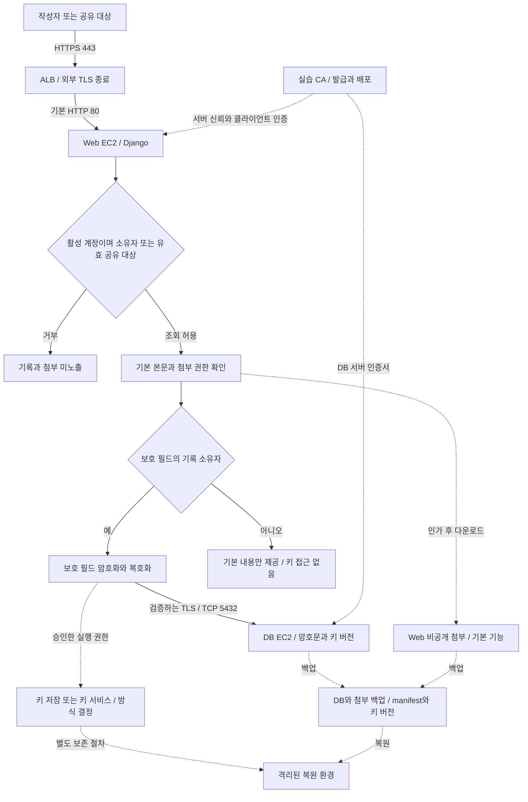
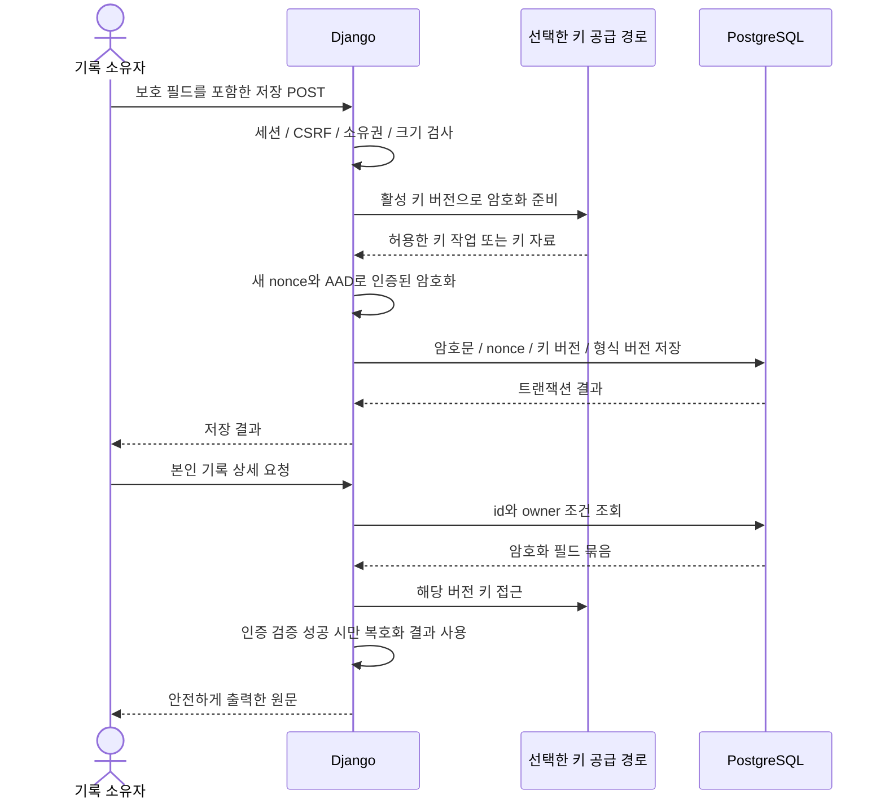
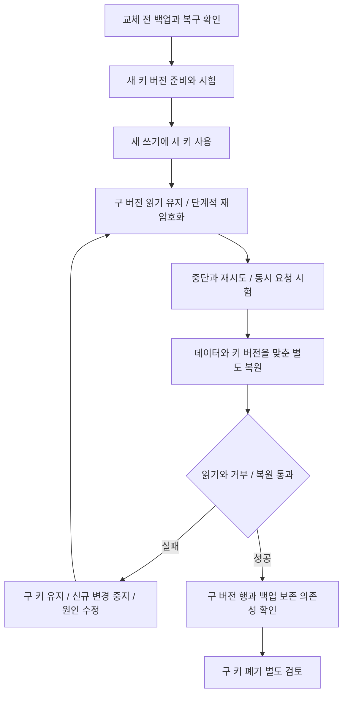

# Haven 심화 프로젝트 계획서

**프로젝트:** Haven | **팀:** ORCHESTRAION | **상태:** 팀 검토용 설계 제안

Haven의 [기본 프로젝트](기본프로젝트_계획.md)는 특정 회원에게 읽기 전용으로 기록을 공유하고 파일을 첨부하는 서비스와 운영자용 보안 점검 도구를 구현한다. 심화에서는 같은 서비스에 소유자 전용 보호 필드 암호화, 키 관리, 실습 CA와 내부 보안 통신을 추가한다. 사용자 화면의 정상 동작뿐 아니라 잘못된 키, 변조된 데이터, 권한 없는 복호화, 잘못된 인증서, 키 교체 중 실패와 백업 복원을 확인한다.

이 문서는 앞으로 수행할 계획이다. 암호화나 인증서 기능이 이미 구현됐다는 뜻이 아니며, 날짜와 담당은 팀에서 정한다. 세부 저장 형식과 시험 계약은 [심화 구현 명세](docs/구현명세/심화프로젝트_구현명세.md)에 둔다.

## 1. 목표와 범위

### 1.1 만들 결과물

| 결과물 | 구현할 내용 | 완료를 판단할 결과 |
|---|---|---|
| 보호 필드 | 기존 기록 화면에 가상 보호 필드 하나를 추가하고 인증된 암호화 적용 | 작성자는 원문을 읽고 DB 조회와 덤프에는 보호 필드 원문이 없음 |
| 키 관리 | 암호화 키를 코드와 DB에서 분리하고 실행 주체의 접근 제한 | 허용한 실행 주체만 키 사용, 무관 주체와 잘못된 키는 실패 |
| 키 교체 | 새 키 쓰기, 구 키 읽기, 단계적 재암호화와 재시도 | 동시 요청과 중간 실패 후에도 데이터가 손상되지 않음 |
| 실습 PKI | OpenSSL 기반 실습 CA로 내부 서버 및 필요한 클라이언트 인증서 발급 | 체인과 호스트를 검증하는 경로에서 정상 연결 및 실패 조건 확인 |
| 내부 TLS와 mTLS | Web에서 DB로 연결할 때 서버 검증, 이어서 클라이언트 인증 검증 | 잘못된 CA, 만료, 다른 호스트, 인증서 없는 클라이언트의 실패 확인 |
| 통합 검증 | 앱 인가, 키 권한, 암호문 저장, 전송 보호와 복원 연결 | 같은 실행의 요청, 권한, 데이터 상태, 실패와 복원 증거 대응 |

보호 데이터는 팀이 만든 가상 문자열만 사용한다. 실제 전화번호, 주소, 비밀번호, 개인 비밀을 수집하지 않는다. 기본 제목, 본문과 첨부 파일 전체를 자동으로 암호화하는 계획은 아니며, 별도 보호 필드의 범위부터 검증한다. 기록을 공유해도 보호 필드는 소유자만 입력하고 조회한다. 로그인 비밀번호는 기존 Django 해시를 유지한다.

회원 간 읽기 전용 공유와 비공개 첨부는 기본 기능을 재사용한다. 심화에서 공동 편집, 공개 공유 링크나 첨부 파일 암호화를 추가하지 않는다. 신규 점검 대시보드, 자동 대응, 패스키, DB RLS, 양자내성 통신, 별도 SOC 구축도 범위에 넣지 않는다. 고급 기능을 추가하기 전에 암호화, 키 교체, 인증서 실패, 복원을 먼저 완료한다.

### 1.2 보호 목표와 제한

| 경계 | 보호할 상황 | 보호하지 못하는 상황 |
|---|---|---|
| 앱 인가 | 비인가 기록 접근 거부, 공유 대상의 읽기/다운로드만 허용, 보호 필드는 소유자 전용 | 정상 실행 주체 자체가 탈취된 상황 전체 |
| 필드 암호화 | 키 없이 DB 데이터나 덤프만 열람하는 주체의 원문 획득 제한 | 앱 실행 환경과 복호화 키를 함께 가진 관리자 |
| 키 권한 | 실행 역할과 무관한 계정의 키 읽기 또는 사용 제한 | 최고관리자 탈취 전반에 대한 완전 방어 |
| TLS | 선택한 내부 연결의 전송 암호화와 서버 신원 검증 | 잘못된 앱 인가나 암호문 저장 설계의 대체 |
| mTLS | 승인한 클라이언트 인증서로 연결 주체 제한 | 회원별 기록 소유권의 대체 |
| 백업 복원 | DB와 첨부 파일 및 manifest, 필요한 키 버전이 일치한 상태의 복구 | 키가 소실된 암호문이나 검증되지 않은 백업의 복구 보장 |

EBS 저장 암호화, 앱 필드 암호화, TLS는 서로 보호하는 위치가 다르다. 하나를 적용했다는 이유로 다른 경계까지 검증 완료로 처리하지 않는다.

## 2. 기본 서비스와 연결하는 구조

기본 Web, DB, 사용자 세션, 공유 권한과 비공개 첨부 저장소를 재사용한다. 새로운 웹 서비스나 별도 회원 체계를 만들지 않는다. 기본 본문과 첨부는 소유자 또는 유효한 공유 대상이 읽을 수 있고, 변경과 업로드는 소유자만 수행한다. 보호 필드 입력과 조회는 소유자에게만 추가하며 공유 대상에게는 키 접근이나 복호화를 시도하지 않는다.

위 그림은 상세 조회의 권한 분기를 중심으로 보여준다. 실선은 처리 경로, 점선은 권한과 관리 관계다. 작성/수정과 첨부 업로드는 기본의 소유자 전용 POST/CSRF 계약을 유지한다. ALB에서 Web으로의 HTTP는 기본 구성을 유지하며 이 단계의 필수 변경으로 삼지 않는다. 따라서 내부 DB 연결을 보호해도 전 구간 암호화라고 부르지 않는다.

ALB에서 Web으로 HTTPS를 추가하는 별도 실험을 선택할 수는 있다. 그 구간의 암호화와 ALB가 대상 인증서를 신뢰 검증하는지는 구분한다. CA 미신뢰, 만료, 호스트 불일치의 실패 증거는 실제 검증을 수행하는 DB 클라이언트 경로에서 확보한다.

## 3. 사용자 화면과 데이터 처리

### 3.1 화면 변경

| 화면 | 추가할 동작 | 확인할 조건 |
|---|---|---|
| 기록 작성과 수정 | 선택 입력인 가상 보호 필드 하나, 입력 한도와 용도 안내 | 빈 값과 입력값 구분, 저장 실패 시 성공 안내 금지 |
| 기록 상세 | 소유자에게만 보호 필드를 복호화해 표시 | 공유 대상에게는 기본 본문과 허용된 첨부만 제공, 키 접근과 보호 필드 원문 노출 없음 |
| 내 기록/공유받은 목록 | 기존 제목과 시각, 공유 구분 유지 | 목록에 보호 필드 원문이나 복호화 상태 상세를 표시하지 않음 |
| 공유와 첨부 화면 | 기본의 읽기 전용 공유/해제, 비공개 업로드/다운로드 유지 | 공유 해제 후 다음 요청부터 기록/다운로드 거부, 공유 대상의 수정/업로드/재공유 거부 |
| 운영 관리자 | 기존 계정 활성과 비활성 관리 유지 | 보호 필드와 타인 본문 열람 권한 추가 금지 |
| 오류 안내 | 서비스 이용에 필요한 일반 오류와 요청 ID | 암호문, 키 식별 상세, 라이브러리 예외와 원문 미노출 |

필드 이름과 입력 한도는 암호화 구현 전에 확정한다. 텍스트 기록 작성/수정 요청에는 기본의 전체 body 8,192바이트 제한과 CSRF 계약을 유지하고, 보호 필드 추가 후 실제 직렬화 바이트 경계를 다시 시험한다. 별도 multipart 첨부 업로드에는 기본 구현 명세의 파일/요청 상한을 적용하며 8,192바이트를 일괄 적용하지 않는다. 업로드 body 전체를 WAF가 검사한다고 가정하지 않는다. 검색, 정렬, 집계에 보호 필드 원문을 사용하지 않는다.

### 3.2 쓰기와 읽기

다음 흐름은 앱이 AEAD 암호화를 수행하는 경우의 설계다. 로컬 제한 파일 또는 Secrets Manager에서 키를 공급하거나, KMS envelope encryption으로 데이터 키를 관리하는 방식을 전제로 한다. KMS 직접 암호화 호출을 선택하면 서비스가 관리하는 암호문과 메타데이터 계약에 맞춰 이 흐름과 구현 명세를 먼저 변경한다.

문자열 인코딩을 암호화로 취급하지 않는다. 검증된 AEAD 라이브러리를 사용하고 nonce 재사용 방지, 기록과 필드에 연결한 AAD, 저장 형식 버전을 설계한다. 변조나 키 접근 실패가 나면 빈 문자열이나 평문 대체 저장으로 처리하지 않는다.

## 4. 키 관리와 교체

### 4.1 키 공급 방식 결정

로컬 제한 파일, Secrets Manager, KMS 직접 호출 또는 envelope encryption을 운영 부담과 시험 가능성으로 비교해 하나를 고른다. 선택 전에는 서로 다른 방식의 명령이나 권한 정책을 혼합하지 않는다.

현재 상세 명세는 앱의 AEAD, nonce와 AAD를 다루는 경로를 설명한다. KMS 직접 호출은 같은 nonce 저장 계약으로 구현하는 대안이 아니다. 직접 호출을 채택하려면 암호문 형식, 서비스 메타데이터, 키 참조와 암호화 컨텍스트, 교체와 복원 시험을 해당 방식에 맞게 다시 정의한 뒤 구현한다.

비교 항목은 키 원문을 읽을 수 있는 주체, 앱이 수행할 키 작업, 서비스 장애 시 동작, 버전 관리, 백업과 복구, 요청 지연, 비용이다. 역할과 키 식별자는 설정으로 분리하고 코드, DB, 공개 결과와 백업에 키 원문을 넣지 않는다. 구체 권한과 Secret 공급 경로는 선택한 방식에 맞춰 고정한다.

### 4.2 교체 절차

1. 교체 전 데이터 백업과 필요한 구 키 버전의 복구 가능성을 확인한다.
2. 새 키 버전을 만들고 제한된 가상 데이터의 암호화와 복호화를 확인한다.
3. 새 쓰기만 새 키로 전환하고 기존 행은 기록된 구 키 버전으로 읽는다.
4. 기존 암호문을 작은 묶음으로 재암호화한다. 성공한 행만 새 버전으로 갱신하고 실패 위치를 기록한다.
5. 교체 중 읽기와 쓰기, 프로세스 중단, 재시도, 동시 수정 충돌을 시험한다.
6. 별도 환경에 DB와 첨부 및 manifest를 복원하고 해당 시점의 키 버전으로 소유자 조회, 공유 대상의 기본 읽기/다운로드, 보호 필드 거부를 재확인한다.
7. 남은 구 버전 행과 백업 보존 의존성을 확인한 뒤 구 키 폐기를 별도로 검토한다.

복원 실패가 남아 있으면 키를 폐기하지 않는다. 구 버전만 지원하는 코드로 되돌리면 새 버전 데이터를 읽지 못할 수 있으므로 코드 롤백과 키 상태 복구를 하나의 절차로 시험한다. 동시 요청과 실패 복구를 시험하기 전에는 무중단 교체라고 표현하지 않는다.

## 5. 실습 CA와 내부 보안 통신

### 5.1 발급과 신뢰 구성

OpenSSL로 실습용 Root CA를 구성한다. Intermediate CA는 발급 역할을 분리할 필요가 있을 때만 추가한다. CA 개인키는 Web과 DB에 배포하지 않고 접근을 제한한 발급 위치에 보관한다. 서버에는 해당 서버 인증서와 개인키, 필요한 체인만 배포한다.

DB 서버 인증서는 Web이 실제로 접속할 내부 DNS 이름과 일치하게 발급한다. Web의 DB 클라이언트에 신뢰할 CA를 지정하고 체인과 호스트명 검증을 켠다. PostgreSQL 연결에서는 `verify-full`에 해당하는 검증을 계획하며 실제 driver와 버전에서 동작을 확인한다. 단순히 TLS 사용 옵션을 켰다는 이유로 서버 신원 검증 완료로 처리하지 않는다.

### 5.2 적용 순서

| 순서 | 작업 | 실패 시 조치와 확인 |
|---|---|---|
| 1 | 별도 시험 연결에서 CA와 DB 서버 인증서 검증 | CA, SAN, 체인과 시각 오류를 분리해 해결 |
| 2 | Web DB 연결에 서버 검증 TLS 적용 | 평문 자동 fallback 금지, 기존 설정 복원 절차 확인 |
| 3 | DB 접속 정책을 TLS 경로와 허용된 Web 주체에 맞춤 | 평문과 잘못된 주체 접속 거부, 정상 CRUD 회귀 |
| 4 | 승인한 Web 클라이언트 인증서로 mTLS 적용 | 인증서 없음, 다른 CA, 만료, 주체 불일치 접속 거부 |
| 5 | 인증서 갱신과 배포, 서비스 재시작 시험 | 잘못된 교체 시 이전 유효 설정으로 복구 |

실습 CA는 공용 브라우저가 기본 신뢰하는 CA가 아니다. 외부 HTTPS의 ACM 인증서와 내부 실습 인증서의 발급 목적과 신뢰 저장소를 구분한다. TLS 버전과 암호군, 인증서 유효기간, 갱신 시점은 선택한 서버와 클라이언트 버전을 확인한 뒤 정한다.

## 6. 구현 단계와 완료 기준

기본 서비스의 로그인, 소유권, 공유/해제, 첨부 업로드/다운로드, 배포와 DB/첨부 복원 시험이 통과하고 기본 제출 자료가 확보된 뒤 착수한다. 실제 일정과 담당은 이 의존성을 기준으로 배정한다.

| 단계 | 입력과 선행조건 | 수행 작업 | 완료 결과와 산출물 |
|---|---|---|---|
| A0 설계 | 기본 계획과 시험 결과 | 보호 필드, 위협 모델, 키 방식, 인증서 경로, 예산 확정 | 결정표, 변경 전 구성, 검증 목록 |
| A1 암호화 | 가상 데이터와 선택 라이브러리 | 필드 형식, AEAD, AAD, 키 권한, 화면 연결 | 정상 복호화와 잘못된 키 및 변조 실패, 코드와 형식 명세 |
| A2 교체와 복원 | A1 및 DB/첨부 백업 | 새 쓰기와 구 읽기, 재암호화, 중단과 재시도, 별도 복원 | 키 버전 전후, 실패 복구, 파일 대조와 권한 회귀 |
| A3 PKI | 내부 DNS와 시험 연결 | 실습 CA, 서버 인증서, 신뢰 저장소, DB 검증 TLS | 발급과 검증 설정, 정상과 인증서 실패 결과 |
| A4 mTLS | 서버 검증 TLS 통과 | 클라이언트 인증서와 DB 접속 정책, 갱신과 복구 | 정상 CRUD와 무인증 및 오인증 접속 거부 |
| A5 통합 | A1~A4 결과 | 사용자와 AWS 및 DB 권한 교차, 공유/첨부와 보호 필드 경계 시험, 로그 가림 | 최종 구성도, 통합 시험, 기본 회귀와 잔여 한계 |

암호화 실패는 저장 성공으로 처리하지 않는다. 인증서 검증 실패는 검증 해제나 평문 fallback으로 우회하지 않는다. 회귀나 복원 실패가 생기면 다음 단계 대신 원인 수정과 재시험을 진행한다.

## 7. 검증과 시연

세부 시험 ID와 예상 결과는 [심화 구현 명세](docs/구현명세/심화프로젝트_구현명세.md)의 시험표를 따른다. 시험마다 실행 ID, 앱과 라이브러리 버전, 설정 버전, 가상 데이터 ID, 기대 결과, 실제 결과와 증거 위치를 기록한다. 키, 비밀번호, 세션, 보호 필드 원문은 공개 자료에 넣지 않는다.

최종 시연은 다음 순서로 진행한다.

1. 작성자가 UI에서 가상 보호 필드를 저장하고 조회한다.
2. 공유 대상은 기본 본문과 첨부를 읽지만 보호 필드는 표시되지 않고 키 접근도 발생하지 않음을 확인한다. 비인가 사용자와 운영 관리자의 보호 필드 요청, 공유 대상의 수정/업로드/재공유는 거부한다.
3. DB와 덤프에는 보호 필드 암호문이 저장되고 잘못된 키와 변조는 실패함을 보인다.
4. 새 키 쓰기와 구 키 읽기, 재암호화 중단과 재시도를 확인한다.
5. 서버 검증 TLS와 mTLS 정상 연결 및 잘못된 인증서 거부를 확인한다.
6. 별도 환경에서 DB와 첨부 및 manifest를 복원하고 소유자/공유 대상/비인가 접근, 공유 해제와 보호 필드의 권한 회귀를 확인한다.

응답시간이나 처리량을 측정할 경우 같은 환경과 부하에서 암호화 전후를 비교하고 키 조회 지연과 오류를 별도로 기록한다. 성능 향상을 결과로 미리 약속하지 않는다.

## 8. 착수 전에 결정할 사항

| 결정 | 확정할 내용 | 확정하지 않으면 진행하지 않을 작업 |
|---|---|---|
| A-D1 보호 범위 | 가상 필드 이름, 빈 값 의미, 입력 한도, 보존 | 모델 migration과 UI 연결 |
| A-D2 암호화 | AEAD 라이브러리와 알고리즘, 형식, nonce와 AAD 계약 | 암호화 코드와 데이터 변환 |
| A-D3 키 공급 | 로컬 또는 AWS 방식 하나, 허용 주체, 장애와 복구, 비용 | 키 생성과 권한 변경 |
| A-D4 교체 | 활성화와 재암호화 단위, 재시도, 코드 롤백, 구 키 보존 | 실제 재암호화와 키 폐기 |
| A-D5 PKI | 내부 호스트, CA 발급 위치, 유효기간, 갱신과 신뢰 배포 | 인증서 발급과 서버 설정 변경 |
| A-D6 DB 연결 | driver 버전, 검증 TLS와 mTLS 인증 매핑, 접속 정책 | DB 인증과 네트워크 변경 |
| A-D7 운영 | 담당, 일정, 복원 환경, 원본 증거 보존과 종료 | 실제 자원 생성과 종료 |

결정에는 선택, 이유, 제약, 확인자, 날짜와 되돌릴 조건을 기록한다. 이 계획은 변경 방법을 정의하며 실제 인프라, DB 변경이나 키 폐기 승인을 대신하지 않는다. 심화 과제의 공식 인정 조건은 별도 확인이 필요하다.
