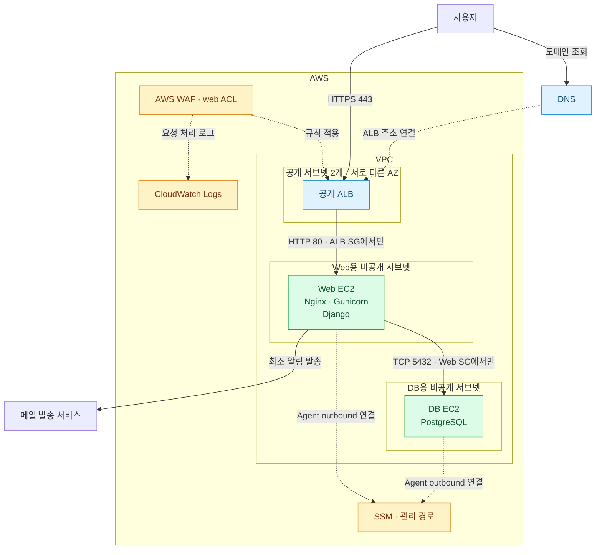
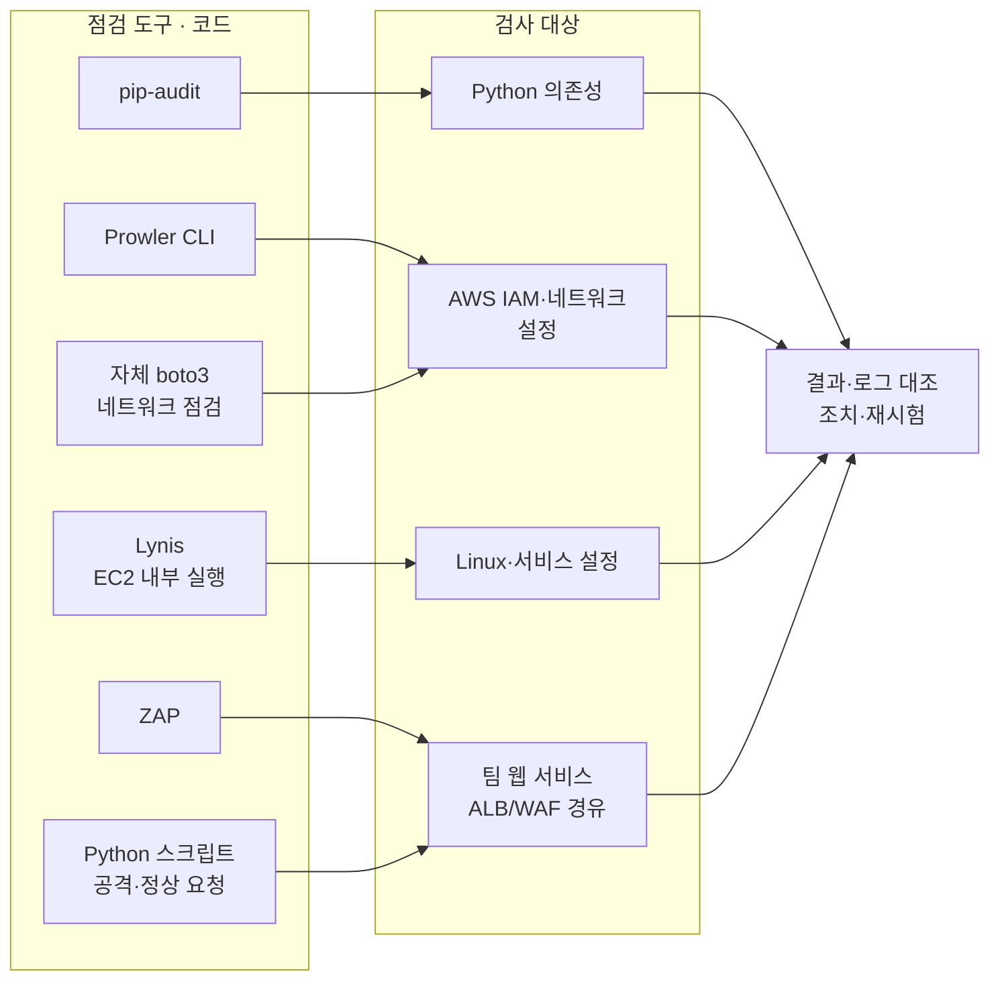
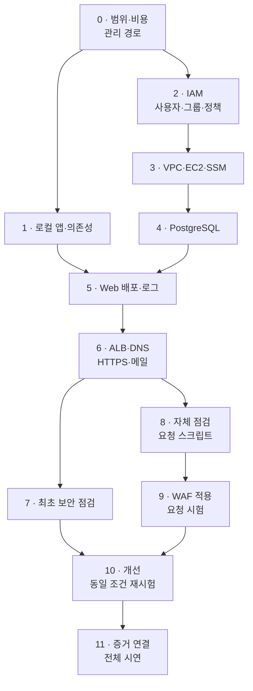
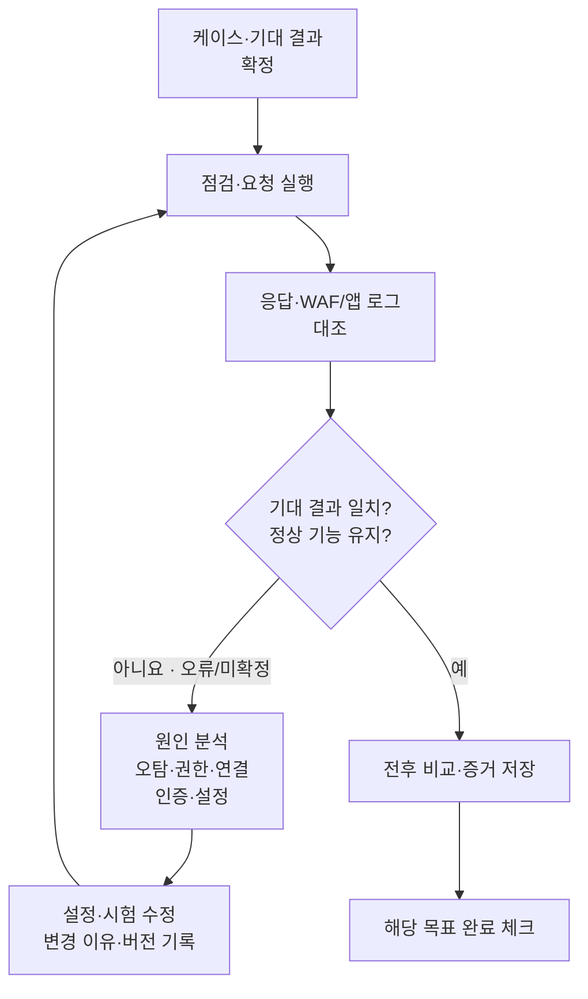

# Haven 기본프로젝트 계획

작성일: 2026-11-04 · 상태: 팀 공유 및 검토용 계획

## 1. 목표와 범위

AWS에 작은 웹 서비스를 구축하고 IAM·네트워크·AWS WAF로 접근을 통제합니다. Prowler CLI와 자체 Python 점검 스크립트로 AWS 설정을 점검하고, ZAP과 재현 요청으로 웹 보안 정책을 검증합니다. 발견 사항을 분석·개선한 뒤 같은 조건으로 다시 시험해 개선 효과를 확인합니다.

프로젝트 가이드 PDF 26~29쪽의 **기본 필수 4개·선택 4개**를 모두 대응하는 계획입니다. 심화 과업은 기본 프로젝트 이후 별도로 계획합니다. 아래 내용은 구현 예정 사항이며 현재 완료 실적은 아닙니다.

## 2. 전체 구성

### 서비스와 접근 경로

실선은 서비스 통신 경로, 점선은 정책 연결·관리·로그 경로입니다. WAF는 ALB에 연결되는 정책이며 별도 중계 서버가 아닙니다. 공개 서브넷 두 개에 걸친 ALB와 Web/DB 각각 한 대를 표현했습니다.

관리 접속은 EC2의 SSM Agent가 시작하는 outbound 연결을 사용합니다. 그림의 점선은 관리 관계이며 외부에서 서버의 관리 포트로 들어가는 연결을 뜻하지 않습니다. NAT/엔드포인트와 패키지 다운로드 경로는 Step 0에서 비용을 검토해 정합니다. Web 비공개 배치의 실제 구성도 이 결정과 함께 확정합니다.

| 구성 요소 | 구현 방법과 용도 |
|---|---|
| 웹 서비스 | Python/Django와 HTML·CSS로 작은 서비스를 구현합니다. 로그인·기록 작성·목록·조회 정도로 범위를 제한합니다. 구체 업무 시나리오는 팀 검토 후 정합니다. |
| 웹 실행 환경 | Nginx가 요청을 받아 Gunicorn/Django로 전달합니다. DB는 별도 EC2의 PostgreSQL로 구성합니다. |
| ALB·네트워크 | 공개 ALB에서 Web으로, Web에서 DB로 필요한 연결만 허용합니다. Web의 앱 포트와 DB 포트로 외부에서 직접 접속하는 경로는 막습니다. |
| IAM | 사용자·그룹을 만들고 JSON 정책을 적용합니다. 애플리케이션 실행 권한과 점검용 권한을 구분해 필요한 작업만 허용합니다. |
| AWS WAF | ALB에 연결해 관리 규칙과 필요한 사용자 규칙을 적용합니다. 로그를 확인하면서 탐지·차단과 정상 요청 영향을 검증합니다. |
| 도메인·메일 | 도메인과 DNS를 연결하고 메일 발송 서비스를 연동해 접속·수신 결과를 남깁니다. 메일 서버를 직접 구축하는 범위는 포함하지 않습니다. |

공개 ALB는 서로 다른 가용 영역의 서브넷을 사용합니다. Web·DB의 서브넷 배치와 비공개 서버의 설치·업데이트·관리 경로는 예산을 검토한 뒤 확정합니다. Web·DB 각 1대 구성으로 시작하며 전체 서비스의 고가용성을 목표로 잡지는 않습니다.

## 3. 오픈소스 활용 방법

### 도입 범위

| 구분 | 도구 | 검사 대상 | 적용 시점 |
|---|---|---|---|
| 기존 구성 | Prowler CLI | 실제 AWS IAM·EC2·네트워크 설정 | 환경 구축 후·개선 후 |
| 기존 구성 | ZAP | 웹 응답·웹 보안 경고 | 서비스 연결 후·개선 후 |
| 추가 권장 | Lynis | Web·DB EC2의 Linux 보안 설정 | 서버 구축 후·개선 후 |
| 추가 권장 | pip-audit | Python 패키지의 알려진 취약점 | 첫 배포 전·의존성 변경 후 |
| 조건부 후보 | Checkov | Terraform·CloudFormation 등 IaC 설정 | IaC를 도입할 때 검토 |
| 조건부 후보 | Trivy | 컨테이너 이미지 등의 취약점 | 컨테이너 배포를 도입할 때 검토 |

이번 구현 경로는 EC2에 venv·systemd로 앱을 배포하는 방식입니다. Checkov·Trivy를 사용하기 위해 IaC·컨테이너를 새로 도입하지는 않습니다. 추가 권장 도구는 기본4의 서버 정책 개선을 보조하며 교안의 별도 필수 과업을 늘리는 의미는 아닙니다.

### 점검 대상과 도구의 관계

각 도구는 서로 다른 대상을 검사합니다. AWS 설정 조회, 서버 내부 점검, 실제 웹 요청 시험을 구분합니다.

### Prowler CLI — AWS 설정 점검

- 프로젝트의 IAM·EC2·네트워크와 관련된 검사를 선정합니다.
- 최초 점검 결과에서 실제 조치가 필요한 항목과 적용 대상이 아닌 항목을 구분합니다.
- 설정을 개선한 뒤 같은 검사 범위로 재점검합니다.
- 처음에는 CLI를 사용하고 Prowler 웹 플랫폼 구축은 포함하지 않습니다.

### 자체 Python/boto3 스크립트 — 네트워크 자동점검

Prowler와 별도로 기본 선택 과업의 자동점검 기능을 직접 구현합니다.

- 인터넷 전체에 허용된 SSH·DB 포트를 확인합니다.
- 모든 포트·전체 프로토콜 허용과 포트 범위에 포함된 위험 포트를 확인합니다.
- IPv4 `0.0.0.0/0`과 IPv6 `::/0`을 함께 확인합니다.
- 결과에 대상 자원·판정·설정 근거·개선 방법을 JSON/CSV로 저장합니다.
- 정상·위험·조회 실패를 구분하고 모의 응답으로 판정 로직을 시험합니다.

보안 그룹의 위험 설정과 실제 외부 도달 가능성은 구분합니다. 실제 연결 여부는 라우팅·공개 IP·보안 그룹 등을 함께 확인하고 연결 시험으로 검증합니다.

### ZAP — 웹 점검과 재시험

- ZAP Baseline으로 웹 응답과 보안 설정을 점검하고 보고서를 남깁니다.
- 발견 사항의 원인을 확인해 필요한 웹·서버 설정을 수정합니다.
- WAF 검증에는 SQLi·XSS 유형 요청과 정상 요청을 정해 반복 사용합니다.
- 필요할 때만 팀 실습 서비스의 정해진 범위에서 ZAP 능동 검사를 수행합니다.

ZAP Baseline은 사이트 탐색과 수동적 분석이며 공격 차단 시험과 다릅니다. 로그인 전후의 검사 범위를 기록하고, WAF 차단 결과와 앱 취약점 수정 결과도 구분합니다.

### 공격·정상 요청 재현 스크립트 — WAF 검증과 정책 고도화

Python으로 정해진 시험 요청을 반복 전송하는 스크립트를 구현합니다. 기본4 필수의 WAF 적용 검증과 기본4 선택의 정책 개선에 사용하며, boto3 설정 자동점검과 별도 코드·결과로 관리합니다.

| 시험 종류 | 수행 내용 | 확인할 결과 |
|---|---|---|
| SQLi 유형 요청 | SQL 공격 패턴을 포함한 요청 전송 | 적용한 WAF 규칙의 탐지·차단 및 로그 |
| XSS 유형 요청 | 스크립트 태그·이벤트 속성 등의 패턴 전송 | 요청 처리와 해당 규칙 로그 |
| 정상 요청 대조 | 한국어·기호·코드 조각 등 정상 입력 전송 | 정상 기능 유지와 오탐 여부 |
| 요청 빈도 제한 | 정한 횟수·속도로 시험 경로에 반복 요청 | 설정한 rate 기반 규칙의 동작 |
| 접근 경로 검증 | ALB 경유 요청과 Web 직접 접근 시도 비교 | 정상 경로 연결과 우회 접근 차단. 기본3 검증에도 연결 |

시험 케이스에는 ID·경로·메서드·입력·인증 상태·기대 결과를 정의합니다. 실행 결과에는 시각·응답 상태·처리 결과를 JSON/CSV로 저장하고 WAF 로그와 대조합니다. 403 응답만으로 WAF 차단을 확정하지 않고 WAF 차단·앱 거부·네트워크 차단·실행 오류를 구분합니다.

검증은 **케이스 작성 → 최초 실행 → 로그 분석 → 정책 수정 → 같은 케이스 재실행** 순서로 진행합니다. 반복 요청의 대상·횟수·속도·시간 상한과 중단 조건을 사전에 정하고 팀 실습 서비스 안에서 수행합니다. 앱에 취약점을 새로 추가하지 않으며, 공격 패턴 차단과 실제 취약점 수정은 별도 결과로 기록합니다.

산출물은 검증 스크립트, 시험 케이스 목록, JSON/CSV 실행 결과, WAF 로그 대조 자료, 정책 개선 전후 보고서입니다.

### Lynis — EC2 내부 보안 설정 점검

Web·DB EC2 안에서 각각 실행해 OS·서비스 설정의 경고와 개선 제안을 확인합니다. SSH·파일 권한·로그·불필요 서비스 등 실제 구성과 관련된 항목을 선정하고, 수동 검토·조치 후 같은 버전·프로필로 재점검합니다.

실행 예시: `sudo lynis audit system --quick`. 결과와 실제 설정 변경을 함께 보관합니다. 점수 상승 자체보다 변경 이유·정상 서비스 유지·재점검 결과를 설명합니다. Lynis는 AWS 권한/네트워크 검사나 WAF를 대체하지 않습니다.

### pip-audit — Python 의존성 점검

팀에서 검토하고 버전을 고정한 requirements를 대상으로 실행합니다. 예시: `pip-audit -r requirements.txt --format=json --output pip-audit.json`.

발견된 패키지·취약점·수정 가능 버전을 검토하고 버전을 갱신한 뒤 앱 기능 시험과 재검사를 수행합니다. 자동 수정 옵션은 초기 흐름에 포함하지 않습니다. 알려진 패키지 취약점 검사이며 소스코드 취약점·악성 패키지·OS 전체를 검사하는 도구는 아닙니다.

## 4. 진행 순서

각 단계는 **설정·구현 → 확인 → 결과 저장** 순서로 진행합니다. 예시 값은 구축 전 중복·예산·실제 환경을 확인하고 확정합니다. 아래 단계 체크는 구현 확인용이며 현재 모두 미완료입니다.

### 단계별 선행 관계

Step 1의 로컬 앱과 Step 2~4의 AWS 환경을 준비한 뒤 Step 5에서 연결합니다. 자체 스크립트와 최초 점검을 준비하고 WAF 시험·개선으로 이어갑니다. 아래 번호는 본문의 Step 번호와 같습니다.

### Step 0. 범위·비용·환경 기준 정하기

1. 서비스 후보는 비공개 기록 게시판으로 잡습니다. 로그인·기록 작성·목록·본인 기록 조회를 최소 기능으로 제안하고 팀에서 확정합니다.
2. AWS 리전 하나와 운영 예산 상한, 사용할 OS·Python·Django·PostgreSQL의 지원 버전을 정합니다. 구체 버전은 설치 시점의 호환성을 확인해 기록합니다.
3. ALB·WAF·EC2 2대·EBS·공인 IPv4·DNS·도메인·메일·로그·NAT/엔드포인트 비용을 합산합니다. 인스턴스 정지만으로 모든 과금이 멈추지는 않으므로 종료할 자원도 목록화합니다.
4. EC2의 관리 경로와 외부 패키지 다운로드 경로를 먼저 정합니다. 권장 후보는 비공개 EC2 + SSM 관리이며, outbound 통신을 위한 NAT 또는 필요한 VPC 엔드포인트/패키지 공급 경로를 예산과 함께 선택합니다.
5. AWS WAF 중심 구성이 기본4 과업에 해당하는지 확인하고 기준 구성도를 작성합니다.

**통과 기준:** 서비스 기능·리전·예산·관리/다운로드 경로가 기록되어 있어야 실제 자원 생성을 시작합니다. **결과물:** 설계 결정표·예상 비용·구성도 초안.

### Step 1. 작은 웹 서비스를 로컬에서 먼저 완성하기

선행조건: Step 0의 최소 기능 결정.

1. Django 프로젝트와 기록 앱을 만들고 개발용 PostgreSQL에 연결합니다.
2. 기록 모델은 `작성자·제목·본문·생성시각` 정도로 시작합니다. 파일 업로드는 초기 범위에서 제외합니다.
3. Django 기본 인증으로 로그인·로그아웃을 구성하고 목록·작성·상세 화면을 만듭니다. 상세·수정·목록 조회에는 작성자 조건을 적용합니다.
4. 정상 계정 2개로 자기 기록 조회 성공과 타인 기록 조회 거부, 비로그인 접근 처리를 시험합니다. 오류 화면에 내부 설정이 노출되지 않는지도 확인합니다.
5. 의존성 버전을 고정하고 pip-audit로 검사합니다. 발견 사항을 검토한 뒤 버전 변경이 필요하면 기능 시험을 다시 합니다.

**통과 기준:** 로컬에서 로그인→작성→저장→재조회가 되고 계정 간 접근이 분리됩니다. **결과물:** 앱 코드·requirements·기능/권한 시험·의존성 점검 결과. 기본1 구현의 준비 단계입니다.

### Step 2. AWS 계정 접근과 IAM 정책 구성하기

선행조건: Step 0의 접근 기준 결정. Step 1과 독립적으로 준비할 수 있습니다.

1. 교안에 맞춰 IAM 사용자·그룹을 생성하고 그룹에 정책을 연결합니다. 루트 계정은 일상 작업에 사용하지 않고 관리 접근에 MFA를 적용합니다.
2. 필요한 AWS 작업을 `조회·서비스 운영·권한 관리` 등으로 분류한 작업/권한표를 만듭니다. 이는 인원 배정이 아니라 정책 설계 기준입니다.
3. EC2가 사용할 SSM 등 실행 권한과 Prowler/자체 점검용 권한을 별도로 구성합니다. 도구 공식 권한 요구를 검토하고 앱 서버에 점검 권한을 합치지 않습니다.
4. JSON 정책의 Action·Resource·Condition을 검토합니다. 리소스 단위 제한을 지원하지 않는 조회 작업의 `Resource: *`까지 일괄 오류로 판단하지 않습니다.
5. 필요한 작업의 성공과 불필요한 수정·삭제 시도의 거부를 비파괴 방식으로 확인합니다. 실패가 IAM 정책 때문인지도 관련 오류/기록으로 확인합니다.

**통과 기준:** 사용자·그룹·정책 연결과 허용/거부 결과가 설명됩니다. **결과물:** IAM 정책·작업/권한표·접근 시험. 기본2 필수에 연결하고 이후 Step 10에서 최소 권한을 재검증합니다.

### Step 3. VPC·서브넷·라우팅·보안 그룹 만들기

선행조건: Step 0 비용/관리 경로와 Step 2 권한 준비.

1. 예시 CIDR은 VPC `10.20.0.0/16`, 공개 서브넷 두 개 `10.20.0.0/24`·`10.20.1.0/24`, Web용 `10.20.10.0/24`, DB용 `10.20.20.0/24`로 잡습니다. 공개 서브넷은 서로 다른 AZ에 둡니다.
2. 공개 서브넷은 Internet Gateway 경로를 구성합니다. Web·DB는 비공개 배치를 우선 검토하고 공인 IP를 부여하지 않습니다. Step 0에서 선택한 관리·다운로드 경로를 구성합니다.
3. 아래 보안 그룹 경로를 만들고, 앱/DB 접근을 IP 전체 공개 대신 보안 그룹 참조로 제한합니다.

| 대상 | 인바운드 허용 | 비고 |
|---|---|---|
| ALB SG | 사용자 HTTPS 443, HTTP 80은 HTTPS 리다이렉트용 | IPv6를 켜면 IPv6 규칙도 함께 검토 |
| Web SG | ALB SG에서 TCP 80 | Nginx 수신. 앱 8000은 서버 내부에서만 사용 |
| DB SG | Web SG에서 TCP 5432 | PostgreSQL 전용 |
| 관리 경로 | SSM 사용 시 SSH 인바운드 없이 구성 | SSM Agent·인스턴스 권한·outbound 연결 필요 |

4. outbound는 앱→DB, HTTPS 외부 API·패키지 저장소, DNS 등 필요한 경로를 식별합니다. SG·라우팅·NACL의 역할을 구분하고 NACL 변경 시 응답용 포트도 검토합니다.
5. SSM 엔드포인트만으로 인터넷 패키지 저장소까지 접근되는 것은 아니므로 OS/Python 설치 경로를 실제 확인합니다.
6. Web·DB EC2를 생성하고 각각 필요한 IAM 인스턴스 프로파일을 연결합니다. SSM Agent 상태를 확인하고 실제 세션 접속·패키지 다운로드를 시험합니다. 이 단계에서 두 서버를 준비한 뒤 DB 설치로 넘어갑니다.

**통과 기준:** 구성도와 실제 서브넷·라우트·SG가 일치하고 관리/다운로드 경로가 동작합니다. **결과물:** 네트워크 구성도·라우팅/SG 표·설정 증거. 기본3 필수의 설정 단계입니다.

### Step 4. DB EC2에 PostgreSQL 구성하기

선행조건: Step 3 네트워크와 관리 접속 동작.

1. Step 3에서 생성한 DB EC2에 지원 버전 PostgreSQL을 설치합니다. 외부 공개 DB 포트를 만들지 않습니다.
2. 프로젝트 DB와 앱 전용 DB 계정을 생성하고 슈퍼유저 계정으로 앱을 운영하지 않습니다. 스키마 변경용 권한이 필요하면 런타임 권한과 구분합니다.
3. PostgreSQL 수신 주소와 `pg_hba.conf`를 Web 경로로 제한하고 SCRAM 등 지원되는 비밀번호 인증을 구성합니다. SG와 DB 자체 접근 규칙을 모두 확인합니다.
4. Web EC2에서 앱 DB 계정으로 접속·쓰기·읽기를 확인합니다. 허용하지 않은 자격증명/출발지의 접근은 거부되는지 구분해 시험합니다.
5. DB 서비스 자동 시작과 로그 위치를 확인합니다. 소규모 시험 데이터를 백업하고 별도 시험 DB에서 복원해 기록합니다. 기본1 동작 안정성을 위한 내부 확인입니다.

**통과 기준:** Web에서 필요한 데이터 작업이 되고 불필요한 DB 접근은 거부됩니다. **결과물:** 설치/접근 설정·계정 권한·연결/백업 복원 시험. 기본1·3에 연결합니다.

### Step 5. Web EC2에 앱 배포하기

선행조건: Step 1 앱·Step 4 DB 연결 준비.

1. Python venv에 고정 의존성을 설치하고 실제 DB 연결 정보를 소스와 분리해 설정합니다. 배포 파일의 소유자·읽기 권한도 제한합니다.
2. 마이그레이션과 정적 파일 수집을 실행합니다. 환경별 설정과 비밀값을 저장소에 넣지 않습니다.
3. Gunicorn은 전용 OS 사용자로 `127.0.0.1:8000`에 실행하고 systemd로 관리합니다. Nginx는 80번에서 요청을 받아 Gunicorn으로 전달합니다. Django 개발 서버는 배포에 사용하지 않습니다.
4. `DEBUG=False`, `ALLOWED_HOSTS`, CSRF 관련 도메인, HTTPS 프록시 인식과 쿠키 설정을 실제 접속 경로에 맞춥니다. 전달 헤더는 신뢰하는 ALB/Nginx 경로에서만 해석하도록 구성합니다.
5. ALB 확인용 `/healthz`는 인증 없이 최소 상태만 반환하도록 Nginx에 구성합니다. ALB health check의 Host 형식을 고려해 이 경로를 처리하며 모든 Host를 앱에서 허용하는 방식으로 해결하지 않습니다. 이 응답만으로 DB 정상까지 증명하지 않습니다.
6. 앱 정상 저장·조회로 DB 연결을 별도 확인하고 운영 설정으로 `python manage.py check --deploy`를 실행합니다. 서비스 재시작 후 자동 실행도 확인합니다.
7. Nginx·Gunicorn/systemd·앱·DB 로그의 시각과 위치를 정하고 보관 기간·민감정보 제외 기준을 기록합니다.

**통과 기준:** 관리 경로에서 Nginx→앱→DB가 연결되고 재시작 후 정상 동작합니다. **결과물:** 배포 설정·배포 점검·정상 기능/재시작 시험. 기본1의 배포 결과입니다.

### Step 6. ALB·도메인·HTTPS·메일 연결하기

선행조건: Step 5 앱 정상 동작.

1. 공개 서브넷 두 개에 ALB를 구성하고 Web EC2를 HTTP 80 대상 그룹에 등록합니다. health check 경로는 `/healthz`로 지정합니다.
2. 대상 상태와 실제 앱 요청을 함께 확인합니다. health check 성공만으로 사용자 기능 완료 처리하지 않습니다.
3. 도메인 DNS를 연결하고 ACM 공개 인증서를 검증·연결합니다. 443 리스너와 80→443 리다이렉트를 구성합니다. 이는 기본 웹 서비스 접속 보호이며 심화의 실습 CA를 대체하는 과업은 아닙니다.
4. 도메인 HTTPS로 로그인·작성·재조회하고 세션/CSRF/쿠키가 배포 경로에서 동작하는지 확인합니다.
5. 메일 발송 서비스에 발신 자격증명을 별도 설정하고 테스트 수신자에게 전송합니다. SES 사용 시 sandbox 상태·리전·발신/수신자 검증 조건을 확인합니다. 본문 원문 대신 최소 알림 내용만 발송합니다.
6. 외부에서 DB로 접근할 경로와 Web 앱 포트의 직접 우회 경로가 없는지 확인합니다. 비공개 IP의 인터넷 시험 실패만 기록하지 말고 공인 IP 부재·SG·라우트와 필요한 VPC 내부 거부 시험을 함께 남깁니다.

**통과 기준:** 도메인 접속·서비스 기능·메일 수신·직접 접근 차단이 확인됩니다. **결과물:** ALB/DNS/접속 설정·메일 수신·접근 시험. 기본1 필수/선택·기본3에 연결합니다.

### Step 7. 최초 점검 결과 확보하기

선행조건: Step 6 서비스 연결. 인터넷 공개 전에 기본 접근 통제를 적용하며 점검을 위해 의도적으로 취약한 공개 환경을 만들지 않습니다.

1. Prowler CLI에서 프로젝트 관련 검사·계정·리전 범위를 정하고 점검 권한으로 실행합니다. 오류·권한 부족·적용 제외를 결과와 구분합니다.
2. Web·DB EC2 각각에서 Lynis를 실행합니다. 실제 서비스와 관련된 경고·제안을 선별합니다.
3. ZAP Baseline으로 공개 화면을 점검합니다. 인증이 필요한 화면은 별도 context/session을 구성한 시험에서 도달 여부를 확인합니다.
4. pip-audit 결과를 배포된 requirements와 대조합니다. 각 도구의 버전·대상·설정·실행 시각을 기록합니다.
5. 발견 항목마다 `근거·우리 환경의 영향·조치/제외 이유·재시험 방법`을 적습니다. 보고서의 경고 수만으로 취약점 수나 침해 가능성을 단정하지 않습니다.

**통과 기준:** 점검 범위와 미검사 영역을 설명할 수 있고 조치할 항목이 선정됩니다. **결과물:** 최초 점검 보고서·발견/조치 목록. 기본2 선택·기본4 정책 개선의 비교 기준입니다.

### Step 8. 자체 점검·요청 검증 스크립트 구현하기

선행조건: Step 3의 접근 기준과 Step 6의 실제 URL/기능.

1. `network_audit.py`로 SG·관련 자원 설정을 읽습니다. 공개 SSH/DB·포트 범위·전체 프로토콜·IPv4/IPv6를 판정하고 JSON/CSV로 저장합니다. 이 이름은 구현 시 사용할 예시입니다.
2. 위험·정상·조회 오류 모의 응답으로 판정을 시험합니다. 실제 설정과 비교하고 Prowler와 결과가 다르면 검사 범위·판정 근거를 분석합니다.
3. `request_verify.py`와 `cases.json`에 SQLi/XSS 유형·정상 입력·빈도 제한·직접 접근 시험을 정의합니다. 케이스별 대상·메서드·인증 상태·기대 결과를 정합니다.
4. 로그인·CSRF가 필요한 요청은 유효한 시험 세션과 토큰을 사용합니다. 인증 실패를 공격 차단 성공으로 잘못 기록하지 않습니다.
5. 대상 allowlist·요청 횟수·속도·timeout·시간 상한·중단 조건을 두고 결과를 저장합니다. redirect로 범위 밖 대상까지 따라가지 않도록 처리합니다.
6. 응답을 `WAF 차단·앱 거부·네트워크 거부·정상 처리·실행 오류·미확정`으로 구분하고 로그를 확인하기 전에는 불명확한 결과를 확정하지 않습니다.

**통과 기준:** 스크립트가 오류를 숨기지 않고 동일 케이스를 반복 실행할 수 있습니다. **결과물:** 두 스크립트·케이스·자체 시험·JSON/CSV. 기본3 선택·기본4 검증에 연결합니다.

### Step 9. AWS WAF 적용하고 정책 시험하기

선행조건: Step 6 ALB, Step 8 검증 케이스.

1. ALB와 같은 리전의 WAF web ACL을 연결합니다. 관리 규칙은 웹 입력 특성에 맞춰 선택하고 규칙명·우선순위·버전을 기록합니다.
2. 시험할 규칙의 개별 action override를 Count로 두고 metrics와 CloudWatch Logs 전달을 설정합니다. 로그 그룹 이름은 `aws-waf-logs-haven`처럼 필수 접두사를 사용하고 보관 기간·전달 권한·실제 로그 도착을 확인합니다. 시험 기간에는 Count/Allow 결과도 보관해 정상 대조와 오탐을 분석합니다.
3. 로그의 비밀값 마스킹을 구성합니다. 로그 redaction은 sampled requests에 적용되지 않으므로 sampling은 초기에는 끄고, 별도 데이터 보호 설정을 확인한 뒤 필요할 때만 켭니다.
4. SQLi/XSS 유형과 정상 케이스를 실행해 응답·규칙 로그·시각·경로를 대조합니다. 정상 입력이 탐지되면 어떤 필드와 규칙 때문인지 분석합니다.
5. 필요한 규칙을 Block으로 바꾸고 같은 케이스를 재실행합니다. 오탐 조정은 필요한 규칙/필드/경로 범위로 제한하며 전체 우회 허용으로 해결하지 않습니다.
6. rate 기반 규칙의 집계 키·평가 창·기준과 관찰 시간을 기록합니다. 정확히 N번째 요청부터 즉시 차단되는 기능으로 가정하지 않고 AWS 평가/반영 지연을 고려해 결과를 해석합니다.
7. ALB에서 WAF의 body 검사 범위가 처음 8KB임을 고려해 앱 입력 제한과 oversize 처리를 함께 정합니다. WAF를 통해 모든 대용량 본문을 검사했다고 주장하지 않습니다.

**통과 기준:** 지정 공격 패턴과 정상 요청의 기대 처리를 로그로 설명하고 직접 우회 경로가 차단됩니다. **결과물:** WAF 설정·케이스 실행·로그 대조·오탐 분석. 기본4 필수에 연결합니다.

### Step 10. 개선 사항 적용하고 같은 조건으로 재시험하기

선행조건: Step 7 발견 목록과 Step 8~9의 결과.

1. IAM 과도 권한·SG 규칙·OS/서버 설정·패키지·웹 설정·WAF 항목 중 근거가 있는 조치만 선택합니다. 변경 전 값과 되돌릴 방법을 남깁니다.
2. 한 번에 원인을 설명할 수 있는 범위로 수정하고 정상 로그인·저장·조회·메일·관리 접속을 확인합니다.
3. Prowler·Lynis·pip-audit·ZAP의 해당 점검과 자체 스크립트를 같은 대상/케이스로 재실행합니다. 버전이 달라졌다면 결과 차이에 영향을 줄 수 있음을 표시합니다.
4. 필요한 AWS 작업은 여전히 허용되고 불필요한 작업은 거부되는지 확인합니다.
5. 각 항목을 `해결·오탐/적용 제외·미해결·미검사`로 구분하고 근거를 기록합니다. 무조건 경고 0개를 목표로 잡지 않습니다.

**통과 기준:** 개선 효과와 정상 기능 유지가 증거로 확인됩니다. **결과물:** 권한/정책 개선 전후 표·재시험 보고서. 기본2 선택·기본4 선택을 완료할 근거입니다.

### Step 11. 산출물 연결하고 전체 시연하기

선행조건: Step 10 재시험 결과.

1. 아래 B1~C4 목표마다 실제 구성·코드·시험·결과서 위치를 연결합니다. 누락된 결과서는 설정 담당 구분 없이 문서 항목으로 확인합니다.
2. 시연은 `도메인 접속→정상 기록 저장/조회→허용·거부→점검 결과→WAF 요청/로그→개선 후 결과` 순서로 구성합니다.
3. 다른 환경에서 스크립트를 재실행할 수 있도록 버전·설정 방법·대상 범위·실행 예시를 기록합니다. 비밀값은 예시 파일과 분리합니다.
4. 실제 증거가 있는 목표만 완료 체크하고 남은 오류·미확정 사항을 정리합니다.
5. 시연 후 로그·시험 데이터·백업의 보관 범위와 과금 자원 종료 절차를 확인합니다.

**통과 기준:** 목표 8개를 각각 증거와 함께 설명할 수 있습니다. **결과물:** 최종 구성도·구축/개선 보고서·시연·목표별 증거표.

### 단계별 진행 체크

- [ ] S0 — 범위·예산·관리/설치 경로 결정
- [ ] S1 — 로컬 앱·권한·의존성 점검
- [ ] S2 — IAM 사용자·그룹·실행/점검 권한
- [ ] S3 — VPC·라우팅·SG·관리 연결
- [ ] S4 — PostgreSQL 설치·접근·백업 복원
- [ ] S5 — venv·systemd·Nginx 배포·로그
- [ ] S6 — ALB·도메인·HTTPS·메일·직접 접근 차단
- [ ] S7 — Prowler·Lynis·ZAP·pip-audit 최초 결과
- [ ] S8 — 자체 설정점검·요청 재현 코드와 케이스
- [ ] S9 — AWS WAF Count/Block·빈도 제한·로그 대조
- [ ] S10 — 개선 후 같은 조건 재시험
- [ ] S11 — 목표별 산출물·전체 시연·종료 절차

## 5. 목표표

| ID | 구분 | 구현 목표 | 완료 조건 | 주요 산출물 |
|---|---|---|---|---|
| B1 | 기본1 필수 | EC2 Web·DB 구성 | 웹 기능으로 데이터를 저장하고 다시 조회합니다. | 클라우드 환경 구축 결과서, AWS 구성도, 동작 자료 |
| C1 | 기본1 선택 | 도메인·외부 서비스 연동 | 도메인 접속과 테스트 메일 수신을 확인합니다. | 서비스 확장 결과서, DNS·메일 연동 테스트 |
| B2 | 기본2 필수 | IAM 사용자·그룹·정책 | 정책 적용과 필요한 작업의 허용·불필요한 작업의 거부를 확인합니다. | IAM 관리 결과서, 정책 구성·적용 자료 |
| C2 | 기본2 선택 | 최소 권한과 과도 권한 개선 | 과도한 권한을 축소하고 필요한 작업은 유지되는지 재시험합니다. | 접근 통제 정책서, 권한 점검·개선 보고서 |
| B3 | 기본3 필수 | 네트워크 접근 통제 | ALB→Web→DB 연결은 성공하고 외부 DB 접근·Web 직접 우회 접근은 실패합니다. | 네트워크 구성도, 접근 통제 설정·검증 결과 |
| C3 | 기본3 선택 | 네트워크 자동점검 | 자체 코드로 정상·위험 설정을 구분하고 조회 실패를 별도 보고합니다. | 자동점검 코드, 시험 결과, 외부 접근 설정 검증 보고서 |
| B4 | 기본4 필수 | AWS WAF·서버 정책 적용 | 서비스 경로에 정책이 적용되고 재현 요청의 응답과 WAF 로그를 대조해 처리 결과를 확인합니다. | 보안 장비 구축 결과서, 정책 구성·적용 자료, 요청 시험 결과·로그 |
| C4 | 기본4 선택 | 보안 정책 고도화 | 발견 사항을 개선하고 같은 스크립트·공격/정상 케이스로 재시험합니다. 오탐·빈도 제한·우회 차단, Lynis 서버 설정·pip-audit 의존성 조치의 해당 결과도 확인합니다. | 검증 스크립트·케이스 목록, JSON/CSV 결과, 로그 대조, 서버/의존성 점검, 정책 개선 전후 보고서 |

## 6. 완료 체크리스트

완료 조건을 충족하고 실제 파일·설정·시험 결과를 확인한 뒤 체크합니다. 각 항목의 증거 칸에는 결과물 위치를 적습니다.

- [ ] **B1 — Web·DB 구축:** 저장·조회 및 구축 산출물 확인. 증거: 미등록
- [ ] **C1 — 도메인·메일 연동:** 도메인 접속·메일 수신 및 확장 산출물 확인. 증거: 미등록
- [ ] **B2 — IAM 사용자·그룹·정책:** 정책 적용과 허용·거부 시험 확인. 증거: 미등록
- [ ] **C2 — 최소 권한 개선:** 권한 개선 전후와 필요한 작업 유지 확인. 증거: 미등록
- [ ] **B3 — 네트워크 접근 통제:** 필요한 연결과 외부 접근·우회 차단 확인. 증거: 미등록
- [ ] **C3 — 자체 자동점검:** 코드·정상/위험/오류 시험·결과 보고서 확인. 증거: 미등록
- [ ] **B4 — AWS WAF·서버 정책:** 실제 적용과 재현 요청의 응답·WAF 로그 대조 확인. 증거: 미등록
- [ ] **C4 — 정책 고도화:** 검증 스크립트·케이스·실행 결과, 정상/공격 대조, 빈도 제한·우회 차단, 정책 개선 후 동일 조건 재시험 확인. 증거: 미등록

## 7. 검증 결과 기록 방식

### 정책 개선과 재검증 흐름

요청 응답만으로 WAF 차단을 판단하지 않고 WAF·앱 로그와 대조합니다. 기대와 다른 결과는 원인을 확인해 정책이나 시험 조건을 고친 뒤 같은 케이스로 다시 확인합니다.

| 시험 ID·실행 시각 | 대상·설정/코드 버전 | 요청·인증·빈도 조건 | 기대 결과 | 실제 응답·판정 | 로그·증거 위치 |
|---|---|---|---|---|---|
| 작성 예정 | 작성 예정 | 작성 예정 | 작성 예정 | 미실행 | 미등록 |

- 정상 요청에는 한국어·기호·코드 조각 등 서비스에서 실제 사용하는 입력을 포함합니다.
- 점검 오류와 미검사 항목을 정상으로 처리하지 않습니다.
- 설정 점검과 실제 접근 시험을 구분하고 개선 전후의 시험 조건을 맞춥니다.
- 관리·DB 포트를 인터넷 전체에 열어 위험 사례를 만들기보다 모의 데이터나 격리 환경으로 시험합니다.
- 결과물에는 비밀번호·키·토큰을 포함하지 않습니다.

## 8. 구축 전 확인할 사항

- 서비스의 구체 업무 시나리오와 최소 기능.
- AWS 리전·예산과 ALB·WAF·EC2·EBS·공인 IPv4·DNS·메일·로그·통신 비용.
- 비공개 서버의 관리·설치·업데이트 경로와 NAT/엔드포인트 필요 여부.
- AWS WAF 중심 구성이 교안의 보안 장비 과업으로 인정되는지 여부.
- 점검 대상·인증 상태·시험 요청·정상 요청의 범위.

## 참고 자료

- [AWS 3계층 웹 구축 예제](https://github.com/aws-samples/aws-three-tier-web-architecture-workshop) — 네트워크·Web·DB 분리 구조 참고.
- [Prowler](https://github.com/prowler-cloud/prowler) — AWS 보안 설정 점검.
- [ZAP Baseline](https://www.zaproxy.org/docs/docker/baseline-scan/) — 웹 설정 점검과 보고서.
- [AWS WAF 시험 가이드](https://docs.aws.amazon.com/waf/latest/developerguide/web-acl-testing-prep.html) — Count 관찰·로그·정책 시험.
- [AWS WAF CloudWatch Logs 설정](https://docs.aws.amazon.com/waf/latest/developerguide/logging-cw-logs.html) — 로그 그룹·권한·전달 확인.
- [AWS WAF 로그 관리](https://docs.aws.amazon.com/waf/latest/developerguide/logging-management.html) — 로그 마스킹과 sampling 구분.
- [Lynis 공식 문서](https://cisofy.com/documentation/lynis/) — Linux 호스트 설정 점검.
- [pip-audit](https://github.com/pypa/pip-audit) — Python 의존성의 알려진 취약점 검사.
- [Django 배포 체크리스트](https://docs.djangoproject.com/en/5.2/howto/deployment/checklist/) — 운영 설정·check --deploy.
- [SSM 연결과 VPC 엔드포인트](https://docs.aws.amazon.com/systems-manager/latest/userguide/setup-create-vpc.html) — EC2 관리 경로.
- [AWS WAF 본문 검사 한계](https://docs.aws.amazon.com/waf/latest/developerguide/waf-oversize-request-components.html) — ALB body 검사 범위.
- [Checkov](https://www.checkov.io/1.Welcome/What%20is%20Checkov.html) — IaC 도입 시 검토할 후보.
- [Trivy](https://github.com/aquasecurity/trivy) — 컨테이너 도입 시 검토할 후보.
