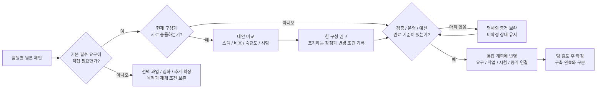

# Haven 통합 프로젝트 선택 근거 부록

작성일: 2026-11-04 | 상태: 팀 검토용 권고안

[상세 통합 실행 계획으로 이동](통합프로젝트_계획.md)

기본 실행 계획과 분리한 부록 A~F다. 기술 선택의 비교/이유/한계/변경 조건을 보존한다. 원문 위치의 행 번호는 검토 기준 commit `295578b`의 원본 기준이다.

## 원본 ID 안내

| ID | 원본 | 검토와 성격 |
|---|---|---|
| S0 | [README](README.md) | 전체 읽음. 기본 필수 4단계와 심화 3단계, 필수 산출물의 공통 기준 |
| S1 | [안민수 기본프로젝트 계획](의견/안민수/기본프로젝트_계획.md) | 전체 읽음. Django/PostgreSQL, 단계별 통과 기준, B/C 체크표, 자체 점검과 재현 |
| S2 | [권혁민 상세 계획서](의견/권혁민/프로젝트_계획서.md) | 전체 읽음. 게시판, 파일/S3, 상세 보안 및 시험, 운영과 후속 암호화 |
| S3 | [권혁민 프로젝트계획](의견/권혁민/프로젝트계획.md) | 전체 읽음. MySQL/RDS 대안, 기본과 심화, 일정과 보안 확장. S2와 별도 제안으로 보존 |
| S4 | [신요찬 plan](의견/신요찬/plan.md) | 전체 읽음. 사전 결정표, 비공개 서버, NAT/Suricata, 예산과 운영 |
| S5 | [신요찬 팀 가이드](의견/신요찬/AWS%20보안%20프로젝트%20팀%20가이드.md) | 전체 읽음. FastAPI, 주차별 구성, 심화 암호/인증, 명령과 코드 예제 |
| S6 | [이민성 계획](의견/이민성/README.md) | 전체 읽음. IAM 정책, MySQL, SG/NACL, 자동 점검 예제, 기본과 심화 |
| S7 | [노푸른 개요](의견/노푸른/README.md) | 전체 읽음. 기본 필수와 결과물의 요약 |
| S8 | [김보람 PDF](의견/김보람/AWS%20클라우드%20보안%20프로젝트.pdf) | 6쪽 텍스트 전체 및 렌더 확인. 1~4쪽 이미지 표 별도 확인. 6쪽은 빈 페이지 |
| S8-동일본 이력 | [김보람 PDF 정본](의견/김보람/AWS%20클라우드%20보안%20프로젝트.pdf) | 기존 루트 업로드86a7e18과 개인폴더 업로드295578b 모두 Git 작성자 김보람. SHA256 동일하여 현재 개인폴더 정본1개로 정리 |
| S9 | [김보람 README](의견/김보람/README.md) | 실질 본문 없음. 제안 내용은 S8로 평가 |

## 부록 A. 팀원 제안을 어떻게 통합했는가

이 부록은 사람의 역량 순위를 매기는 평가가 아니다. 같은 작성자의 문서도 목적과 버전이 달라 별도로 비교했다. 원문 사실은 S번호와 행/쪽으로 표시하고, 채택 이유는 이 보고서의 설계 판단으로 구분한다. 문서 분량과 공통 작성자 수는 우열의 근거가 아니다.

| 팀원/자료 | 이 통합본에서 가져온 강점 | 그대로 합치지 않은 이유 | 보존한 대안/후속 |
|---|---|---|---|
| 안민수 S1 | 단계 의존성, B/C 목표와 증거, 두 자체 스크립트의 역할/안전 범위 | 업무 시나리오/출구가 미확정이고 운영/앱 세부를 더 정해야 함. 이 문서를 공식 팀 계획으로 보지 않음 | 최소 기록 앱, 단계별 통과 기준을 상세 명세로 확장 |
| 권혁민 S2 | 구체 앱 인가/파일 보안, IAM/시험 행렬, 실패/복원, 암호/키 운영 | 파일/S3를 초기 P0로 삼으면 공통 필수보다 기능 범위가 커짐. 다른 버전과 DB/일정 가정도 달라 선택 필요 | 파일/격리/보안 요약, 심화 키교체/성능/PKI. 원문의 전체 HA/전체 SOC 제외도 유지 |
| 권혁민 S3 | 범용 요구/스키마/산출물, 기본과 심화 연결 | S2와 DB/서비스/30일 범위가 달라 두 문서를 하나의 확정 구성으로 합칠 수 없음 | MySQL/RDS, ModSecurity+CRS, 별도 서비스/API 대안 |
| 신요찬 S4 | 사전 결정표, 예산/태그/운영, 비공개 서버, 점검 자동화/로그 | NAT+IPS+자동 차단을 기본 연결과 동시에 요구하면 장애 원인과 운영 부담 증가 | NACL 분석, Flow Logs, 예약 중지, 탐지/대응의 단계화 |
| 신요찬 S5 | FastAPI 시작 예제, 후속 암호/인증의 구체 방향 | 초기 공개 Web/프레임워크가 S4와 다르고 일부 암호/TLS 설명은 검증 조건이 생략됨 | 패스키/RLS/mTLS/키 교체/PQ 실험을 조건부 로드맵으로 보존 |
| 이민성 S6 | IAM/SG/NACL 표와 코드 예제, EventBridge/Lambda/SNS, 단계별 개선 관점 | MySQL/공개Web/SSH 상태를 최종 private PostgreSQL/SSM과 섞으면 모순. 예제 판정과 보안 단정은 수정 필요 | S3 Endpoint/백업 Role, 예약 점검, hardening/유료 탐지 후보 |
| 노푸른 S7 | 기본 4개와 산출물의 간결한 범위 정리 | 배포/앱/검증 구현 세부가 적어 실행 명세의 단독 기준으로는 부족 | 범위 점검용 상위 목차/누락 확인 |
| 김보람 S8/S9 | PHP/RDS/CloudFront의 완결 대안, IAM/MFA/Access Analyzer, 비용/운영기록 | DB 직접 구축/앱 소유권/재현 도구를 강조하는 권고안과 기술 선택이 다름. 기술적 열등함을 뜻하지 않음 | 운영 부담 절감 대안, 선택 도메인/메일, 관리 감사/검증 항목 |

### 제안 채택과 보류의 판단 흐름

사람별 순위를 매기지 않고 제안의 요구 대응, 구성 충돌, 검증/운영 부담을 판단한다. 기본 범위의 예산/완료 기준이 확인되지 않은 제안은 상세 설계와 확인으로 돌린다. 선택 과업/심화/추가 확장은 별도 우선순위로 보존한다.

## 부록 B. 핵심 선택의 이유와 반대 대안

각 항목의 형식은 **선택→비교→이유→감수하는 한계→바꿀 조건**이다. 선택은 아직 팀 합의가 아닌 통합 권고다.

### B-01. 작은 개인 기록 게시판부터 시작하는 이유

**선택:** 회원가입/세션과 본인 글 CRUD로 시작한다(S1 209~215행). **비교:** S2 28~63, 280~314행의 회원제 자료공유/파일/관리자, S4 21~97행의 내정보/인증, S8 1쪽의 등록/조회 서비스. **이유:** 기본 네트워크/IAM/WAF를 검증하면서 타인 객체 인가까지 보여줄 수 있고 파일 저장/검사/실패 정리까지 동시에 만들지 않아도 된다. **한계:** 자료 공유 서비스의 업무적 풍부함과 S3 권한 경험은 줄어든다. **변경 조건:** 팀이 파일 공유를 주 시나리오로 정하고 업로드/객체 권한/격리/복구 시험까지 기간 내 맡을 수 있으면 파일 기능을 앞당긴다.

### B-02. Django와 서버 렌더링을 권고한 이유

**선택:** Django Templates + Nginx/Gunicorn. **비교:** S1 15~63행과 S2 7~24, 194~214행의 Django, S5 138~198행의 FastAPI/Uvicorn/Jinja2, S8 1쪽의 Apache/PHP. **이유:** 이 초안은 API 제품보다 회원/세션/CSRF/ORM/관리자/CRUD가 중심이다. Django의 기존 기능을 사용하면 별도 인증/관리 기능을 조립하는 범위를 줄일 수 있다. 여러 상세안과 이미 정리된 시험을 연결하기도 쉽다. **한계:** FastAPI의 API 중심 구조와 PHP 경험을 활용하는 장점은 선택하지 않는다. Django가 항상 더 안전하거나 개발이 빠르다는 실측 주장은 아니다. **변경 조건:** 팀이 검증된 FastAPI/PHP 구현을 보유하거나 학습/수업 요건이 해당 스택이면 앱 명세/배포/점검을 그 스택으로 일괄 변경한다.

### B-03. PostgreSQL과 DB EC2를 권고한 이유

**선택:** 별도 EC2 PostgreSQL(S1 250~260행, S2 353~463행). **비교:** S3 1~98행의 RDS/EC2 MySQL, S6 155~259행의 MySQL, S8 1~4쪽의 RDS MariaDB. **이유:** listener/DB 계정/호스트 인증/SG/백업/복원을 직접 구성하고 실패 원인을 설명하는 실습 산출물을 만들기 좋다. PostgreSQL은 기존 상세안과 맞아 앱/포트/심화 후보의 일관성을 유지한다. **한계:** 패치/백업/장애 대응을 직접 맡아야 하며 RDS보다 안전/저렴하다는 결론은 내리지 않았다. MySQL로도 기본 과업을 수행할 수 있다. **변경 조건:** 과제에서 DB 직접 운영을 요구하지 않고 팀의 관리 부담이 크면 RDS로 전환한다. MySQL 역량이 더 높으면 엔진을 바꾸고 포트/라이브러리/계정/TLS/복원 시험을 함께 고친다.

### B-04. ALB만 외부 입구로 두는 이유

**선택:** ALB+WAF, 비공개 Web/DB(S1 15~63행, S2 67~159행, S4 21~97행). **비교:** S5의 초기 Web 공개 후 4주차 ALB, S6 199~210/403~417행의 단계적 전환, S8 4~5쪽의 CloudFront+WAF. **이유:** 최종 요청 경로를 한 개로 유지하면 WAF 우회 여부와 SG 관계를 처음부터 같은 조건으로 시험할 수 있다. **한계:** 초기에 ALB/출구 비용과 설정이 필요하다. CloudFront의 배포/캐시/전달 계층 학습은 빠진다. **변경 조건:** 예산/과제/기존 배포 조건에 따라 구축 초기에 공개 Web이 필요하면 임시 상태와 기한을 기록한다. CloudFront를 선택하면 origin 직접 접근 통제와 로그/캐시 영향을 추가 시험한다.

### B-05. SSM을 기본 관리 경로로 삼은 이유

**선택:** SSH 미개방, SSM 관리. **비교:** S1 54~63/221~246행과 S2 67~159행의 SSM, S6/S8의 관리자 IP 제한 SSH. **이유:** 공개 관리 포트와 공유 SSH 키의 운영을 줄이고 IAM 허용/거부와 서버 관리를 연결할 수 있다. **한계:** Agent/IAM/DNS/outbound에 의존해 초기 연결 실패를 분석해야 한다. SSM 사용 자체가 명령 본문 감사 완료를 뜻하지 않는다. **변경 조건:** 필요한 작업/환경이 SSM 경로로 수행되지 않으면 제한 SSH를 만료 조건 있는 예외로 허용하고 별도 감사/회수 절차를 둔다.

### B-06. NAT 방식을 아직 확정하지 않은 이유

**선택:** 기능 정상화와 비용 검토를 별도 문턱으로 둔다. 운영 단순성 우선 비교 후보는 Gateway이고, 비용/학습 목적에 따라 인스턴스 또는 Endpoint 조합으로 바꿀 수 있다. **비교:** S1 54~63/195~203행의 미확정 출구, S4 101~125행의 결정표/NAT 인스턴스, S6 155~189행의 Gateway와 S3 Endpoint. **이유:** 지원 목적지가 다르고 현재 견적/실제 계정 조건을 확인하지 않았으므로 “무료/저렴하다”만으로 배포 방식을 확정할 수 없다. **한계:** D6 확정 전에는 비공개 서버 배포를 시작할 수 없다. **변경 조건:** 필요한 목적지와 견적/복구 부담을 표로 채운 뒤 한 경로를 채택한다. 불확실성을 숨기고 아무 방식이나 생성하는 것보다 이 결정이 먼저다.

### B-07. AWS WAF를 기본, 별도 IPS를 조건부로 둔 이유

**선택:** ALB 연결 WAF의 정상/시험 요청 검증부터 한다. **비교:** S1의 WAF, S2 523~556행의 격리 IDS→inline drop, S4 320~353행의 NAT+Suricata, S6 441~486행의 여러 보안 장비, S8 5쪽의 IPS 요구 시 추가. **이유:** 요청/규칙/로그를 직접 대조할 수 있는 범위부터 완료하고, 라우팅/TLS 가시성까지 다른 문제인 IPS는 별도 시험으로 분리한다. **한계:** WAF만으로 일반 네트워크 공격 탐지/차단이나 공식 IPS 요구를 충족한다고 주장할 수 없다. **변경 조건:** 공식 과제에서 별도 IPS를 요구하면 P0에 포함하고 실제 검사 경로/차단을 증명하는 구성으로 재계획한다.

### B-08. CloudWatch 로그를 먼저 쓰는 이유

**선택:** WAF 시험 중 CloudWatch Logs를 우선 권고, S3는 보관 대안. **비교:** S1 318~326행/S2 523~556행의 관찰, S4 101~125행의 CloudWatch/S3 선택, S8 4쪽 표의 CloudWatch. **이유:** 시험 요청과 가까운 시점에 규칙/액션/로그 도착을 대조하는 작업이 먼저다. **한계:** 최저 비용이나 장기 분석 최적이라는 검증은 없고 로그 보존/전달 비용이 발생한다. **변경 조건:** S3 중심 보존/분석 체계를 실제로 쓸 경우 요청 상관관계와 수집 지연을 포함해 같은 증거 계약을 만족시키면 전환한다.

### B-09. CLI 점검부터 검증한 뒤 예약 자동화를 하는 이유

**선택:** 읽기 전용 SG 점검과 fixture를 먼저 만든다. **비교:** S1 119~129/301~312행과 S2 325~351행의 자체 검사, S6 262~360행의 EventBridge→Lambda→SNS, S4의 SG/NACL 점검. **이유:** 수집/판정 로직이 틀리면 예약과 알림이 그 오류를 반복한다. CLI에서 조건/결과/오류를 재현한 뒤 같은 로직을 실행 환경에 얹으면 중복도 줄어든다. **한계:** 초기에 상시/예약 알림 시연은 없다. **변경 조건:** 판정 시험 통과 후 운영 필요가 있으면 예약과 알림을 추가하고 시간대/구독/권한/실패 알림을 시험한다.

### B-10. 자동 격리/차단을 뒤로 둔 이유

**선택:** 탐지/로그/알림을 먼저, 자동 쓰기는 후속. **비교:** S4 334~335행의 GuardDuty 연동, S2 538~556행의 단계적 알림/차단. **이유:** 이벤트마다 출발지/방향/자산/웹 연관성이 달라 아무 IP나 WAF에 넣으면 정상 접근을 막을 수 있다. **한계:** 자동 대응의 시연 효과는 줄어든다. **변경 조건:** 이벤트 분류, IP 검증, 만료/수동해제, 오탐과 재시도, IPv6/프록시, 실패 처리 시험을 갖추면 제한 시나리오부터 채택한다.

### B-11. 기본과 심화 암호화를 나눈 이유

**선택:** 기본에서도 Secret 분리/저장소 암호화 등 운영 통제를 적용하고, 앱 필드 암호화/키 교체/실습 CA는 P2로 분리한다. **비교:** S0 26~32행, S1 기본 우선, S3의 30일 혼합안, S5 101~115행의 전환/고급 인증, S2 720~744행의 상세 심화. **이유:** 앱/DB/권한/정상 시험 없이 암호화를 먼저 붙이면 실패 원인과 보호 효과를 분리하기 어렵다. **한계:** 기본 완료 시점에는 평문 가상 데이터이고 심화 보호 실적이 없다. **변경 조건:** 공식 제출 범위에 심화가 함께 포함되면 일정에 명시하고 기본 기능과 병렬로 설계하되 보호 완료는 별도 실패 시험으로 판정한다.

### B-12. 파일/S3와 추가 보안 서비스를 선별한 이유

**선택:** 파일은 명확한 업무 시나리오가 있을 때 추가하고, Prowler/ZAP/자체 점검의 목적을 구분한다. **비교:** S2 300~314행의 업로드/검사, S6 519~527행의 Inspector/Security Hub/Flow Logs, S8의 GuardDuty/Access Analyzer. **이유:** 도구 수를 늘려도 분석/개선/재시험이 없으면 증거가 쌓이지 않는다. 파일은 별도 객체 인가와 실패 처리 범위가 크다. **한계:** 관리형 보안 서비스와 저장소 학습 범위가 좁아질 수 있다. **변경 조건:** 기본8 증거를 확보하고 특정 위협/운영 질문이 생기면 그 문제를 해결하는 도구 한 가지를 선택한다.

### B-13. 신규 기능보다 전후 시험과 복원에 시간을 둔 이유

**선택:** 동일 조건 재현, UNKNOWN 분리, 별도 DB 복원, 운영 롤백을 기본 완료 조건으로 둔다. **비교:** S1 291~350행, S2 560~660행, S6의 개선 전후 제안, S7/S8의 결과물. **이유:** 구성 캡처만으로 실제 효과를 설명하기 어렵고, 도구 경고 수를 개선율로 바꾸는 오해를 막아야 한다. **한계:** 기능 수가 적어 보이고 시험/보고에 시간이 든다. **변경 조건:** 간소화할 때도 같은 보호 경계를 증명하는 최소 시험을 유지하며 검증 자체를 생략하지 않는다.

### B-14. 달력 일정과 담당자를 지금 확정하지 않은 이유

**선택:** M0~M5 의존성과 완료 조건을 먼저 제시하고 실제 날짜/이름은 팀 협의로 채운다. **비교:** S2 665~716행의 4주, S3 218~245행의 30일/동결, S4 129~185행, S5의 기본/심화 월별 일정. **이유:** 각 문서의 범위와 시간 가정이 다르고 현재 팀원의 가용 시간을 확인하지 않았다. **한계:** 바로 일정표로 배포하기 전 협의가 필요하다. **변경 조건:** 제출일/인원별 가능 시간/필수 범위를 확인하면 M 단위를 날짜와 주/보조 담당에 연결한다.

### B-15. 본문 10,000자 대신 전송 body8KB 계약을 선택한 이유

**선택:** 기본 글 POST 전체의 실제 직렬화 body를 8,192바이트 이하로 맞추고 기존 10,000자 허용안을 철회한다. **비교:** 이전 통합안은 앱 문자 수와 ALB WAF 검사 크기를 따로 적어 정상 글 차단/미검사 가능성이 남았다. **이유:** 공식 ALB WAF 한도와 SizeRestrictions_BODY를 대조하면 문자 수만으로 정상 처리 범위를 보장할 수 없다. APP-11/WAF-09에서 encoding/CSRF overhead와 경계를 검증한다. **한계:** 긴 글 서비스로는 제한적이고 사용자 안내가 필요하다. **변경 조건:** 큰 본문이 핵심 요구가 되면 경로별 oversize/앱 검증과 검사 경계를 다시 설계한다. WAF 전체 해제로 해결하지 않는다. 이는 특정 팀원 안의 결함이 아니라 통합본의 신규 입력값을 교정한 것이다.

### B-16. 로그인 남용 방어와 실제 CSRF 검증을 기본으로 앞당긴 이유

**선택:** 공개 전에 실패 관찰창/완화/회복/계정 열거 방어를 결정하고 APP-10을 통과한다. **비교:** 이전 통합안은 실패 제한을 후속으로 두고 CSRF 시험의 도구 동작을 명시하지 않았다. **이유:** 프레임워크 로그인과 WAF IP 빈도 규칙만으로 계정별 정책이 완성되지 않는다. Django 기본 Client의 CSRF 비활성화도 막아야 한다. **한계:** 과도한 잠금은 정상 사용자를 방해하므로 회복/분산 출발지/같은 IP의 다중 계정도 시험한다. **변경 조건:** 비공개/초대 실습이라도 인증/인가/CSRF는 유지하고 남용 임계와 범위만 제약에 맞춰 정한다.

### B-17. 최소 CI와 표준 매핑을 IaC보다 먼저 하는 이유

**선택:** APP/AUD/설정/의존성 검사를 M1의 작은 PR CI로 앞당기고, ASVS 5.0.0의 관련 요구만 정확한 ID로 매핑한다. **비교:** 원문 S2/S3/S4/S6의 CI 후보를 이전 통합안은 IaC/배포와 함께 P3로 묶었다. **이유:** 회귀 검사는 AWS 자동 배포 없이 가능하고 여러 사람의 변경이 보호 경계를 깨는지 빨리 알 수 있다. 시험 수보다 요구/증거의 연결을 남긴다. **한계:** 초기 CI 유지와 finding 예외 관리가 필요하고, 선택 매핑은 전체 ASVS 준수가 아니다. **변경 조건:** AWS 배포를 실제 자동화할 때만 OIDC/임시 Role과 repo/branch/environment 제약을 추가한다. 새로운 스캐너/컨테이너를 자동 도입하지 않는다.

### B-18. IAM 운영 인증과 연결 명세를 분리한 이유

**선택:** 과제의 IAM 사용자/그룹 실습은 유지하고 일상 운영은 federation/임시 자격을 우선 비교한다. Interface Endpoint는 DNS/ENI/SG, Gateway Endpoint는 route로 구분하고 DB EC2 실행 프로파일에 SSM/선택 백업/로그를 명시한다. **비교:** S2의 Identity Center 후보는 이전 통합안에서 후속이었고 출구/백업 역할표는 실행 세부가 부족했다. **이유:** AWS 현재 권고와 실제 구성 단위를 반영하면 실습을 없애지 않으면서 장기 키/연결 실패를 줄이는 방향으로 설계할 수 있다. **한계:** 교육 계정의 federation 권한과 비용/Endpoint 지원은 확인해야 한다. **변경 조건:** 계정 제약이 있으면 개인 IAM+MFA 예외를 문서화하고, D6는 실제 목적지/견적을 비교한 뒤 확정한다. 지원 패치/종료일과 업데이트 회귀도 운영 책임에 포함한다.

## 부록 C. 대안을 선택하면 함께 바꿔야 하는 항목

| 변경 | 함께 바꿀 항목 | 그대로 두면 생기는 문제 |
|---|---|---|
| Django→FastAPI/PHP | 인증/세션/CSRF/ORM/관리자, 실행 서버, 의존성/배포 점검, APP 시험 | 프레임워크 기능이 있다고 가정한 보안/배포 누락 |
| PostgreSQL→MySQL/MariaDB | DB 5432→선택 포트, driver/migration/인증/백업/TLS, SG/점검 기준 | 앱/네트워크/점검 결과가 다른 DB를 가정 |
| DB EC2→RDS | 서버 설치/SSM 대신 관리형 DB 네트워크/계정/백업/로그, 과제 산출물 | 직접 서버 운영 시험을 관리형 DB 완료 증거로 혼동 |
| ALB→CloudFront 경유 | WAF 연결 범위, origin 우회/헤더/캐시/TLS/로그/시험 대상 | 캐시 응답을 앱 동작으로 오해하거나 origin 우회 허용 |
| SSM→SSH 예외 | 관리자IP/키/회수/감사/접속 시험 | 22가 임시 개방된 채 최종 구성에 남음 |
| NAT 방식 변경 | route/SG/NACL/Endpoint/DNS/서비스 도달성/복구/비용 | SSM만 되고 패키지/메일이 안 되는 구성 등 |
| 로그 CloudWatch→S3 | 전달/권한/보존/조회/지연/실행ID 대조 | 로그 미도착을 차단 없음으로 잘못 집계 |
| 개인 기록→공유 문서 | 공개 범위/RBAC/IDOR/파일권한/감사/데이터모델 | 본인만 접근하는 시험으로 공유 정책 검증을 대체 |
| 알림→자동 차단 | 쓰기 권한, 이벤트 분류, 만료/해제/오탐/롤백 | 잘못된 탐지로 정상 사용자/서비스를 차단 |

## 부록 D. 원문 예제를 설계로 바꾸면서 수정한 이유

8절의 교정은 팀원의 제안을 배제하기 위한 것이 아니다. 시작 스니펫의 생략 부분을 완료 조건으로 바꾼 것이다.

| 원문 목적 | 통합 시 수정 | 보존한 목적 |
|---|---|---|
| 암호화 전 코드 구조 미리 준비 | plain.encode()를 보안 기능으로 사용하지 않고 가상/비활성 데이터로 제한 | 향후 암호화 함수/스키마 경계 준비 |
| DB mTLS/신원 검증 | 설정 한 줄 대신 인증서/신뢰/호스트/계정 매핑과 실패 시험 추가 | 클라이언트와 서버의 상호 신뢰 |
| 최소권한 업로드 Role | PutObject와 백업 불변성을 구분하고 key/version/복원 통제 추가 | 필요한 백업 쓰기 권한만 제공 |
| 위험 SG 알림 | 프로토콜/범위/IPv6/API 오류/수집 범위를 판정에 반영 | 노출 설정을 반복해서 점검 |
| 공격 차단 시연 | 403 단정 대신 액션/규칙/앱/시각 대조 | 정상과 시험 요청의 정책 효과 확인 |
| 관리 활동 감사 | CloudTrail 이벤트와 SSM 명령/출력 로깅 분리 | 누가 어떤 운영 작업을 했는지 추적 |
| 고급 보안 실험 | IMDSv2/IPS/PQ/RLS의 한계를 적고 실제 검증 추가 | 서비스에 필요한 보호와 학습 확장 |

## 부록 E. 의사결정 보고와 검토 기록 양식

### E.1 팀에서 채울 단일 결정 양식

| 필드 | 기록할 내용 |
|---|---|
| 결정ID/요구 | D번호와 B/C 또는 심화 목표 |
| 원본 근거 | S번호/행/쪽, 서로 다른 가정 |
| 선택/대안 | 실행할 한 구성과 비교 대안 |
| 선택 이유 | 구현/검증/운영/비용/학습 목표 중 실제 근거 |
| 감수한 한계 | 포기한 기능/관리 부담/남은 위험 |
| 확인 필요 | 아직 측정/합의/구축하지 않은 항목 |
| 승인/담당 | 실제 팀 결정 후 이름/날짜 입력 |
| 변경 조건 | 어떤 증거가 나오면 다른 안으로 전환할지 |
| 완료 증거 | 시험 ID, diff/PR, 결과 경로 |

### E.2 이번 보고서의 근거 범위

초기 통합은 저장소 본문과 PDF를 근거로 작성했다. 이후 2026-11-04 사용자 승인으로 AWS/GitHub/Django/OWASP 공식 문서를 대조한 비판 검토를 반영했다. [공식 근거와 반영 내역](통합프로젝트_계획.md#26-비판-검토-반영과-공식-근거)을 참조한다. 외부 첨부 본문은 접근 실패 상태로 유지하며, 벤치마크/현재 가격/팀 숙련도/채용시장을 검증한 결론은 아니다.

선택을 바꾸는 것은 잘못이 아니다. 단, 관련 명세/구성도/포트/정책/시험/증거를 함께 바꾸고 변경 이유를 남긴다. 이 보고서가 다른 원본 문서를 삭제하거나 특정 팀원의 안을 공식 정답으로 만드는 것은 아니다.

## 부록 F. 상세 명세의 완료 체크표

- [ ] M0: 과제/예산/팀 가용시간과 D1~D6를 확정하고 선택 이유를 기록한다.
- [ ] M1: 로컬 앱, 실습 IAM과 운영 임시 자격/MFA, 목적지별 출구/SSM, DB 실행 프로파일, CI-01~03과 초기 ASVS 매핑을 확인한다.
- [ ] M2: DB 권한/복원, 배포/재시작, ALB/HTTPS/메일에 더해 로그인 방어/회복, 실제 CSRF와 body8KB 경계를 시험한다.
- [ ] M3: WAF Count/Block, SG 검사 fixture, 정상/시험 요청 집합을 확보한다.
- [ ] M4: 실제 finding을 분류하고 변경 후 동일 조건으로 재검증한다.
- [ ] M5: 기본8 산출물, 잔여 한계, 개인 기여, 시연과 비용/종료 절차를 완성한다.
- [ ] 후속: 필드 암호화/키 접근/교체/백업 복원과 실패 시험을 첫 심화 권고로 검토한다. 실습 CA/통합 요구도 반영하고 나머지 확장은 별도 선택한다.

위 항목은 실행 계획이며 체크되지 않은 것이 정상이다. 이번 문서 작업의 완료와 프로젝트 구현 완료를 구분한다.
